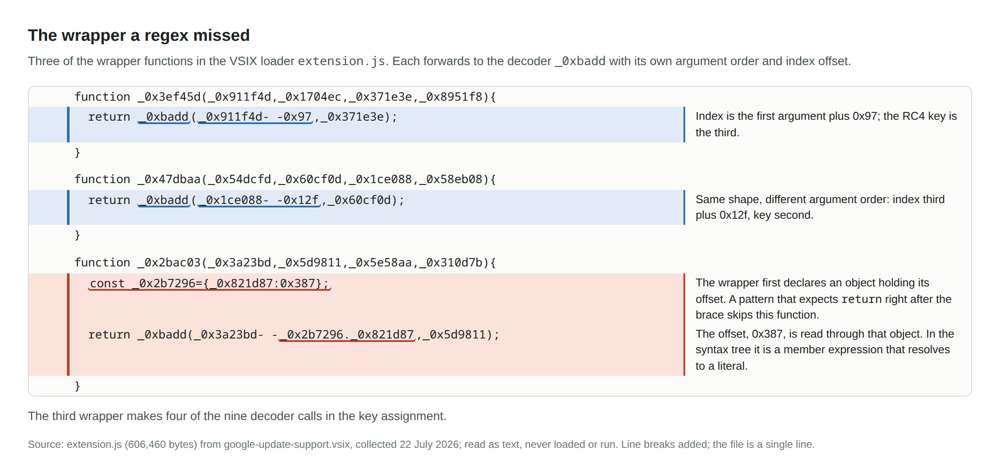
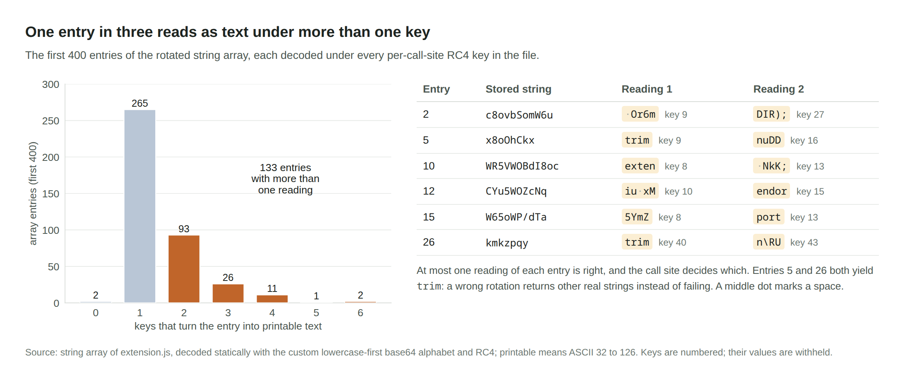
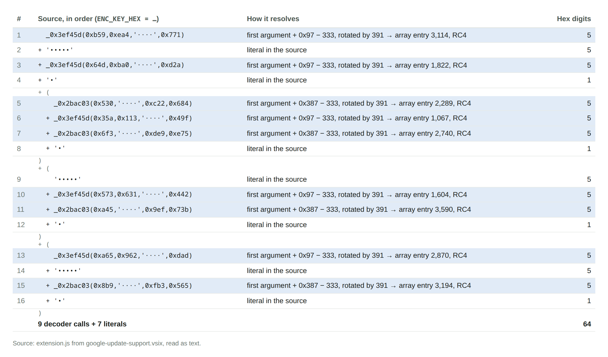
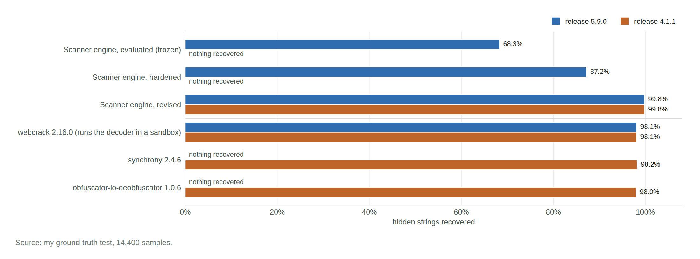

I reconstructed the VSIX loader's AES key from sixteen obfuscated fragments, nine decoder calls and seven literals, without executing the extension. All three encrypted payloads passed GCM authentication under the reconstructed key.

## Key takeaways

- Parsing the loader with Acorn exposed wrapper functions that a regex missed, because one wrapper declared an intermediate value before returning.
- Printable output is a weak test of a string-table rotation: a third of the first 400 array entries produced more than one printable candidate, and a wrong rotation silently returns other real strings.
- GCM authentication is the strong check; `openssl enc` lacks it, so I verified the stored tags with Node's cryptographic library. The same check showed that the ClickFix chain's key opens none of the VSIX payloads.
- In a 14,400-sample ground-truth test, the revised scanner engine recovered 99.8% of hidden strings, and none of 3,265,560 decoded call sites was misplaced.
- Release 0.2.0 on the registries has no fallback parser and never examined 31,292 of 143,153 calibration files, so a completed scan is a pattern check, not a safety verdict.

The recovered components and authentication procedure are recorded in [Exhibit E04](../preprint/evidence/E04.pdf). [Proofpoint's report](https://www.proofpoint.com/us/blog/threat-insight/dont-fear-repo-unkdeaddrop-phishing-campaign-targets-developers-steal) also documents the key and Windows architecture.

## Obfuscation: wrapper calls hide the key's construction

The key assignment combines literals with calls to several wrapper functions. A wrapper may change the index, reorder its arguments or add an offset before invoking the underlying decoder, so each call must be traced through its wrapper. The July analysis identified seven wrappers in the bootstrap and five in `extension.js`. Each needed three fields mapped:

```text
Which argument supplies the string-table index?
Which argument supplies the decoder key?
What offset is applied before the underlying call?
```

Recovering the key required mapping these wrappers and a rotated string table. My first regex missed a wrapper that declared an intermediate value before returning. Five plausible rotations then failed checks across the call sites.



*Figure 1. Three of the wrappers in the VSIX loader. The third declares its offset in an object first, which is the shape my regex missed.*

## Method: parsing the loader without running it

### Acorn reads the wrappers as syntax

A regex that expects every wrapper to return a decoder call immediately can miss a function that first declares an intermediate value. [Acorn](https://github.com/acornjs/acorn) represents both statements in the syntax tree. It does not solve the decoder automatically, but it provides a more reliable structure to inspect than text patterns.

This synthetic example parses a wrapper containing a declaration before its return statement:

```javascript
import { parse } from 'acorn';

const source = `
function wrapper(index, key) {
  const adjusted = index - 17;
  return decode(adjusted, key);
}
`;

const ast = parse(source, {
  ecmaVersion: 2022,
  sourceType: 'script',
  locations: true
});

const fn = ast.body[0];
const returned = fn.body.body.find(
  node => node.type === 'ReturnStatement'
);

console.log(fn.type, returned.argument.type);
// FunctionDeclaration CallExpression
```

`decode` is undefined, but parsing does not require it to exist. Acorn reads the program as a string and returns its syntax tree, and it leaves the declarations and expressions unevaluated.

I reconstructed the wrappers' index and key transformations from their syntax trees, then implemented those transformations separately. The extension was never imported or executed.

### Choosing the string-table rotation

The string array had been rotated, so a valid-looking index could point to the wrong encoded element until the array order was resolved. Searching from one expected `crypt` anchor yielded five plausible rotations. Comparing each rotation against all resolved call sites narrowed the candidates.

The recorded offsets were 391 for the extension and 261 for the bootstrap. The selected candidate produced printable decodes at 15 of 15 tested sites. The runner-up produced 3 of 15. That gap was useful.

Printability remained a heuristic, and a weaker one than it looks. When I later decoded the first 400 entries of the extension's array by brute force, a third of them produced more than one printable candidate. A pass that keeps any printable decoding reports 3,898 of 3,899 entries decoded while choosing wrong values.

For this obfuscator family a wrong rotation does not fail; it silently returns other real strings from the same program.

The scheme explains why. Both obfuscated components use a rotated string array and a decoder that takes an index and a key, a custom base64 alphabet that puts lowercase letters first, then UTF-8 and RC4 with fifty-one distinct four-character keys supplied per call site. The correct key is a property of the call site, not of the array entry. Measured over the first 400 entries, 133 yield more than one printable candidate, so "first printable match wins" picks the wrong one whenever a wrong key happens to produce ASCII first, which for five-character plaintexts is common.



*Figure 2. Of the first 400 array entries, 133 decode to printable text under more than one key. A wrong key returns plausible strings instead of failing.*

Two further traps sat beside it. Decoding with the standard base64 alphabet also produces printable-looking garbage instead of failing. A brute-force consensus over a handful of resolvable sites produced five spurious solutions, each of which decoded one anchor and nothing else. The next checks were whether each string fit its call context and whether the key fragments could be reconstructed in source order. The encrypted payloads would provide a stronger validation.

### Putting the sixteen fragments back in order

The key expression combined nine decoder results with seven literal fragments. Recovering their values was only half the work. The fragments also had to be concatenated in the original order, including values nested inside parenthesized additions.

A small bounded evaluator concatenated string literals and already-decoded values in source order. The recovered key could then be checked against the encrypted payloads.



*Figure 3. The sixteen fragments of the AES key in source order. Literal fragments and per-call keys are withheld; the hex-digit counts add up to 64.*

## Verification: authenticated decryption of all three payloads

The loader specified the encrypted blob layout directly:

```text
bytes  0–11    initialization vector
bytes 12–27    authentication tag
bytes 28–end   ciphertext
```

My initial `openssl enc` attempt failed because that command lacked the required GCM authentication check. I switched to [Node's cryptographic library](https://nodejs.org/api/crypto.html) to verify the stored tag. The failure was in the chosen tool.

With the corrected operation, all three payloads passed authentication:

- `detect_malware.py` (60,054 bytes), the browser-related decryption component;
- `windows-agent-node.js` (56,093 bytes), the Windows Node agent;
- `windows-js-pipeline.js` (32,324 bytes), the collection and elevation coordinator.

All three payloads decrypted to readable, commented source. Authentication tied each plaintext to its encrypted input under the recovered parameters. Execution and collection outcomes require endpoint evidence.

## Results: two delivery routes, two keys, one leaked path

### The ClickFix key does not open the VSIX payloads

The ClickFix chain's stage-three loader also uses AES-256-GCM, with its key embedded in the loader. I tested that key against all three encrypted payloads of the repository route, across four plausible layouts of nonce, ciphertext and tag, and no layout verified for any of them. Because GCM authenticates, that is a clean negative rather than an inconclusive one: a correct key would have verified.

The two delivery routes therefore encrypt their payloads under different keys, and recovering one does not compromise the other. Nothing was lost in understanding, because the equivalent components were recovered in plaintext from the ClickFix chain, and one of them carries the same filename in both.

The same comparison dates builds. The stage-three build served from a later lure host is the same short AES-256-GCM design with the key embedded, and decrypted with the documented layout it diffs cleanly against the July build. A dead-drop host the operator had mistyped three weeks earlier appears only in a code comment, beside resolver logic added so that a stale or mistyped server name cannot override an upload base that already works. The operator patched its code after its own mistake, which dates the build to after the typo. The mistyped name is unregistered, and the code now avoids it.

### What the Python component left in cleartext

The Python component was encrypted but never obfuscated, so once the key was recovered everything in it was readable. Its module docstring ends with four usage examples that were never sanitized. They carry an absolute path from the machine the tool was written on, six times across four command lines:

```text
C:/Users/Administrator/Documents/_Task/PShell/Yuki/dionbenu2yuki/utils/
```

The examples reference the decryptor, a requirements file, a PowerShell staging wrapper whose name I had not seen before, and an output file written back into the same directory. They also use Chrome profile ten rather than the default profile, which fits a test rig or many personas in one browser and is too weak to build on.

Read segment by segment, the path looks like a per-operator working tree under a shared task root: a tasking folder sorted to the top, a PowerShell tooling tree, a directory named after a persona that matches a known dead-drop commit author, and a per-target subproject. A directory name is a different class of evidence from commit metadata, which anyone can forge, because whoever used the machine named it. It is still a persona, not a real name, and it differs from the public handle by one character.

The leak fits a pattern. The operators strip build metadata carefully elsewhere, with trimmed Go build paths, heavy string-array obfuscation on the JavaScript and authenticated encryption on the payloads, so their anti-forensics is mechanical and done at build time, not editorial.

### Antivirus counts need the same care

VirusTotal showed nine detections on `detect_malware.py`. Seven of them are one BitDefender-engine signature, `Generic.PY.PxaStealer.A.8601263C`, resold under OEM licences, so there are three independent detections, not nine. The label names a Chrome-decryption technique that PXA Stealer also uses; it is not an attribution. Counting detections by engine rather than by vendor applies to every ratio quoted about these files.

## Scanner: the checksum loop finds the rotation

### How the engine solves the rotation

The manual analysis selected a rotation by comparing printable output across call sites. The later scanner uses another feature of the same obfuscation: a loop that decodes numeric-looking strings, combines them with `parseInt` and shifts the array until the checksum equals an embedded constant.

The evaluated engine identifies the decoder variant from its syntax, reimplements decoding and evaluates that checksum for candidate rotations. For this extension the variant is RC4 behind a shuffled base64 alphabet, with an index offset of 333:

- For the extension, it reaches rotation 391 and decodes 2,139 of 2,140 call sites.
- For the bootstrap, it reaches rotation 261 and decodes 15 of 17.

These agree with the manually established rotations without executing the extension. The revised engine described below goes further on the same files: 4,048 of 4,048 call sites in the extension and 1,038 of 1,038 in the bootstrap. The decoder also refuses to run unless two independent anchors decode to the expected module names, so a rotation that merely reads as text is not enough.

Recovered strings become available to other rules, including calls whose module names are hidden behind decoders. If the checksum cannot be solved, a printable-consensus heuristic may help. Otherwise the array remains unresolved.

The consensus rule is deliberately strict. A rotation is accepted only if it decodes at least eighty percent of up to sixty-four call sites to printable text and the runner-up decodes at most half as many. A keyless base64 or plain array, printable under every rotation, is therefore reported as unresolved instead of being resolved wrongly.

The rule that an array is never assumed unrotated when recognized rotation code exists cost the most to learn. An earlier implementation missed a parameterless `for(;;)` loop and decoded twenty-two files from commercial bundles under rotation 0, producing text that looked plausible under the wrong rotation. An unrecognized rotator yields wrong strings silently, so partial recovery always has to be read against the number of unresolved call sites.

### Recovery measured against ground truth

I later measured that recovery against ground truth rather than against printability. Fifty benign files, and twenty held-out ones generated afterwards, were obfuscated under a seventy-two-configuration grid across five javascript-obfuscator releases. That gave 14,400 samples in which every hidden string had a known original. Decoded call sites were aligned against the original program in source order, so a wrong rotation would show up as misplaced values.

The revised engine recovered 99.8% of hidden strings on the two main releases and 99.7% on the held-out releases. Of 3,265,560 decoded call sites, none was misplaced.

The design is reusable, and its most valuable part is that it checks its own instrument:

- The fifty inputs were drawn by seeded sample from 1,325 eligible packages of the calibration corpus, one file per package, each with no findings, three to thirty kilobytes long and carrying at least fifteen distinct string literals.
- The grid crossed string encoding, rotation, wrapper style, the calls transform and index shift, with only the string-array transforms enabled, so control-flow flattening and dead code add no strings.
- A produced string counts as wrong only when neither the original nor the obfuscated sample can account for it directly or as a concatenation.
- The misplacement check was validated against itself: twenty-five correctly decoded samples gave zero misplaced sites of 5,402, while shifting every decoded value by one array position misplaced 4,240 of 4,903.
- Because the engine fixes were designed against these samples, the held-out inputs were generated afterwards under three releases never used before. They exposed a gap in the reference sequence, missing class field names, rather than in the scanner.

The three engines show how recall moved while precision held:

| Engine | Recall, release 5.9.0 | Recall, release 4.1.1 | Decoded sites misplaced |
|---|---|---|---|
| Evaluated (frozen) | 68.3% | 0% | 0 of 492,474 |
| Hardened | 87.2% | 0% | 0 of 638,574 |
| Revised | 99.8% | 99.8% | 0 of 3,265,560, held-out releases included |

*Table 1. String recovery by engine against ground truth.*

The pooled median time per obfuscated sample was 32 to 60.5 milliseconds per engine, and 15 to 65 milliseconds per release, against recorded baseline medians of 290 and 1,045 milliseconds.

The same experiment found a version boundary in the published tools:

- The two static deobfuscators, synchrony and obfuscator-io-deobfuscator, decode output up to release 4.1.1 and nothing from 4.2.2 onward.
- webcrack, which runs the decoder in a sandbox instead of matching its shape, recovered about 98% on both.

On the stratified subset, webcrack 2.16.0 recovered 98.1 percent of hidden strings from both 5.9.0 and 4.1.1 output. synchrony 2.4.6 recovered 98.2 percent from 4.1.1 and nothing from 5.9.0, reporting no decoder. obfuscator-io-deobfuscator 1.0.6 recovered 98.0 percent from 4.1.1 and nothing from 5.9.0, leaving the array in place, and timed out on 144 samples, all from one input whose self-recursive function inlining never converges. Its unreleased main branch at commit `42efc01` decodes 3.2.7, 4.1.1 and 5.0.0 output, so the published release is behind its own repository.



*Figure 4. String recovery against ground truth by tool and obfuscator release. The two static deobfuscators recover nothing from 5.9.0, and the revised engine recovers 99.8% from both.*

Each of the three tools produced an unexplained string on exactly one input, by a different mechanism: a constant `JSON.parse` rewritten to an object literal, an obfuscator identifier turned into a property name, and a constant folded to `undefined`. The last one does not change the program's behavior. I reproduced it before reporting it, and the folded value sits in an unreachable branch; the same output appears on the unobfuscated original, so there was nothing to report upstream. Writing the reproduction first, with the unobfuscated original as a control, is what caught that.

A tool that matches a decoder's shape is exact until the shape changes. After that it is silent rather than wrong, which is the safer failure but reads like a negative unless someone checks coverage.

### Bypass test and hardening

A later test replaced `push(shift())` rotation with `splice`. It was one of nineteen single-change variants I wrote against my own rules, of which eighteen evaded or degraded the evaluated engine. The evaluated engine missed the loop and incorrectly accepted rotation zero.

A hardened engine now recognizes more rotation steps and accepts stored order only when the decoded call sites read as text. Hardening raised the fixtures handled from five of twenty-three to twenty-two without adding an error-level finding anywhere. The fixtures were written together with the fixes, so that is regression coverage rather than robustness against an adaptive author. [Part 14](14-scanner-recovery-and-bypasses.md) covers the defect and subsequent tests.

### Implementation and releases

The [scanner paper](../scanner-paper/UNK-Scanner-Paper.pdf) describes the evaluated implementation, including its per-process restrictions and resource limits. The command-line output records which isolation controls were applied (Linux network-namespace isolation depends on host support).

Each file is analyzed in a pool of child processes under the Node.js permission model, with no file writes, child processes, workers or addons, reads limited to the scanner and its parser dependencies, code generation from strings disabled, a 512 MiB heap, an empty environment and a per-file deadline that kills and replaces the process. A hostile rule module that attempted a file write, a process launch and a network connection was refused all three. These controls bound resource use and access when analysis fails; containment of an arbitrary parser or engine exploit remains untested. The isolation costs about six percent of throughput at four workers, and the binding constraint is heap rather than CPU: under the earlier 256 MiB limit, thirteen bundles of five to eight megabytes failed. Installation and current release instructions are maintained in the [companion repository](https://github.com/KrasForge/unk-scanner), with packages on [npm](https://www.npmjs.com/package/unk-scanner) and [PyPI](https://pypi.org/project/unk-scanner/).

The packaged release and the evaluated engines are not the same software. The hardened and revised engines and the TypeScript and JSX fallback exist in the companion repository's source.

## Limitations

- The scanner does not assemble the AES key or decrypt the payloads. Authenticated decryption remains a separate check on the recovered fragments, and partial string recovery must be read alongside the unresolved call sites.
- Only release 0.2.0 is on the registries, and it has no fallback parser, so a file its primary parser rejects gets no findings at all. When I checked every rejection with a second parser, 31,292 of the 143,153 calibration files, overwhelmingly TypeScript, were valid source that release 0.2.0 never examined.
- The scanner reads only JavaScript and TypeScript files, never editor tasks, workspace settings or package scripts, so it saw none of the folder-open launchers described in [Part 2](02-vsix-editor-execution.md).
- It found few error-level alerts and missed most generic package malware in the larger registry evaluation in [Part 13](13-scanner-registry-benchmark.md). Across 19,976 recently changed npm packages the entire error-level output was two false positives. On 2,122 samples from a public malicious-packages dataset the revised engine warned on 128 and none reached error level.

## Conclusion

Static parsing was enough to recover the key, and authenticated decryption was the check that proved it. Printable output and plausible rotations narrowed the search, but only the GCM tags tied each plaintext to its ciphertext.

For analysts, the practical lesson is to validate a deobfuscation against something that fails loudly, such as an authentication tag or a known original, rather than against readability. Recovery accuracy and detection sensitivity are independent properties, and a completed scan is a pattern check, not a safety verdict.

```text
detect_malware.py
4c3fdd86a59d52a0e29f472666cbf9472b6fd83c38ef2a4b547f31c72b8ee87e

windows-agent-node.js
e5b7d6411d0c95da047185d94fca98d454b73df2e7f46f2753e212af2ca45da5

windows-js-pipeline.js
bf820623e8deaa37092650c7fae594e56b8d81c27b541419006cca2d0536353b
```
