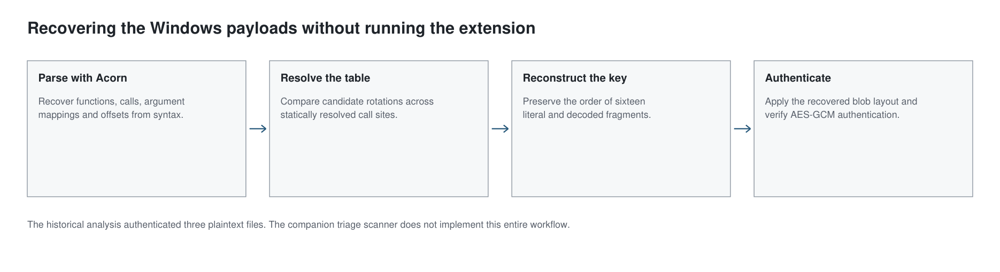

The VSIX loader assembled one AES key from sixteen fragments: nine decoder calls and seven literals. Recovering it required mapping wrapper functions and a rotated string table. A simple regex missed a wrapper that declared an intermediate value before returning, and five plausible rotations failed checks across the call sites.

All three encrypted payloads passed GCM authentication under the reconstructed key. The recovered components and authentication procedure are recorded in [Exhibit E04](../preprint/evidence/E04.pdf). [Proofpoint's report](https://www.proofpoint.com/us/blog/threat-insight/dont-fear-repo-unkdeaddrop-phishing-campaign-targets-developers-steal) also documents the key and Windows architecture.

## Start with the calls around the key expression

The key assignment combines literals with calls to several wrapper functions. A wrapper may change the index, reorder its arguments or add an offset before invoking the underlying decoder, so each call must be traced through its wrapper. The July analysis identified seven wrappers in the bootstrap and five in `extension.js`. Each needed three fields mapped:

```text
Which argument supplies the string-table index?
Which argument supplies the decoder key?
What offset is applied before the underlying call?
```

A regex that expects every wrapper to return a decoder call immediately can miss a function that first declares an intermediate value. [Acorn](https://github.com/acornjs/acorn) represents both statements in the syntax tree. It does not solve the decoder automatically, but it provides a more reliable structure to inspect than text patterns.

### Parsing an obfuscated wrapper

This synthetic example parses a wrapper containing a declaration before its return statement:

```javascript
import { parse } from 'acorn';

const source = `
function wrapper(index, key) {
  const adjusted = index - 17;
  return decode(adjusted, key);
}
`;

const ast = parse(source, {
  ecmaVersion: 2022,
  sourceType: 'script',
  locations: true
});

const fn = ast.body[0];
const returned = fn.body.body.find(
  node => node.type === 'ReturnStatement'
);

console.log(fn.type, returned.argument.type);
// FunctionDeclaration CallExpression
```

`decode` is undefined, but parsing does not require it to exist. Acorn reads the program as a string and returns the structure of declarations and expressions; it does not resolve or run them.

The analysis reconstructed the wrappers' index and key transformations from their syntax trees, then implemented those transformations separately. It did not import or execute the extension.



*Figure 1. Wrapper mapping and string-table recovery supply the key fragments; GCM authentication checks the reconstructed key against the payloads.*

The string array had been rotated, so a valid-looking index could point to the wrong encoded element until the array order was resolved. Searching from one expected `crypt` anchor yielded five plausible rotations. Comparing each rotation against all resolved call sites narrowed the candidates.

The recorded offsets were 391 for the extension and 261 for the bootstrap. The selected candidate produced printable decodes at 15 of 15 tested sites; the runner-up produced 3 of 15. That gap was useful, but printability remained a heuristic. The next checks were whether each string fit its call context and whether the key fragments could be reconstructed in source order. The encrypted payloads would provide a stronger validation.

### Rebuilding the sixteen fragments

The key expression combined nine decoder results with seven literal fragments. Recovering their values was only half the work; the fragments also had to be concatenated in the original order, including values nested inside parenthesized additions.

A small bounded evaluator concatenated string literals and already-decoded values in source order. The recovered key could then be checked against the encrypted payloads.

## From authenticated payloads to triage

The loader specified the encrypted blob layout directly:

```text
bytes  0–11    initialization vector
bytes 12–27    authentication tag
bytes 28–end   ciphertext
```

The initial `openssl enc` attempt failed because that command did not provide the required GCM authentication check. Switching to [Node's cryptographic library](https://nodejs.org/api/crypto.html) allowed the stored tag to be verified. The failed command did not show that the key, rotation or field boundaries were wrong.

With the corrected operation, all three payloads passed authentication: `detect_malware.py` (60,054 bytes), the browser-related decryption component; `windows-agent-node.js` (56,093 bytes), the Windows collection agent; and `windows-js-pipeline.js` (32,324 bytes), the collection and elevation coordinator.

All three payloads decrypted to readable, commented source. Authentication tied each plaintext to its encrypted input under the recovered parameters, but did not establish that a payload ran or collected data. Those remain runtime questions.

### From one recovery to a reusable scanner

The manual analysis selected a rotation by comparing printable output across call sites. The later scanner uses another feature of the same obfuscation: a loop that decodes numeric-looking strings, combines them with `parseInt` and shifts the array until the checksum equals an embedded constant.

The evaluated engine identifies the decoder variant from its syntax, reimplements decoding and evaluates that checksum for candidate rotations. For this extension the variant is RC4 behind a shuffled base64 alphabet, with an index offset of 333. It reaches rotation 391 and decodes 2,139 of 2,140 call sites. For the bootstrap it reaches rotation 261 and decodes 15 of 17. These agree with the manually established rotations without executing the extension.

Recovered strings become available to other rules, including calls whose module names are hidden behind decoders. An unresolved checksum can sometimes be handled by a printable-consensus heuristic; otherwise the recognised array remains unresolved. Neither outcome is a universal safeguard. A later test replaced `push(shift())` rotation with `splice`, and the scanner failed to recognise the loop, incorrectly accepting rotation zero. [Part 14](14-scanner-recovery-and-bypasses.md) examines that defect and the variants that bypassed other rules.

The scanner does not assemble the AES key or decrypt the payloads. Authenticated decryption remains a separate check on the recovered fragments, and partial string recovery must be read alongside the unresolved call sites.

The [scanner paper](../scanner-paper/UNK-Scanner-Paper.pdf) describes the evaluated implementation, including its per-process restrictions, resource limits and AST-only TypeScript/JSX fallback. The command-line output records which isolation controls were applied; Linux network-namespace isolation depends on host support. Installation and current release instructions are maintained in the [companion repository](https://github.com/KrasForge/unk-deaddrop-companion), with packages on [npm](https://www.npmjs.com/package/unk-scanner) and [PyPI](https://pypi.org/project/unk-scanner/).

The larger registry evaluation is in [Part 13](13-scanner-registry-benchmark.md). Its low error-level alert count accompanies poor detection of generic package malware, so a completed scan does not establish that an input is safe.

```text
detect_malware.py
4c3fdd86a59d52a0e29f472666cbf9472b6fd83c38ef2a4b547f31c72b8ee87e

windows-agent-node.js
e5b7d6411d0c95da047185d94fca98d454b73df2e7f46f2753e212af2ca45da5

windows-js-pipeline.js
bf820623e8deaa37092650c7fae594e56b8d81c27b541419006cca2d0536353b
```

[Companion detections and static scanner](https://github.com/KrasForge/unk-deaddrop-companion).
