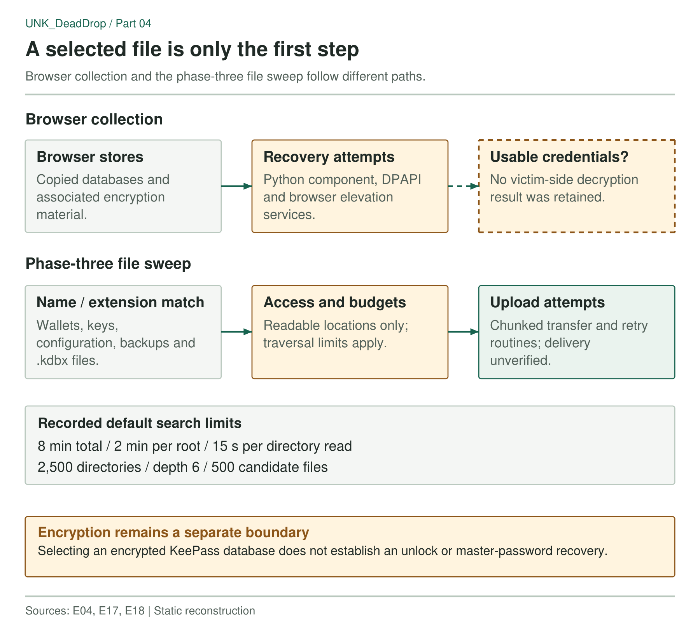

Following the collection code took me beyond browser passwords; its third upload variant searches the home directory for filenames associated with seeds, recovery material, credentials and tokens, while another selector includes encrypted KeePass databases, and the source also sets explicit traversal budgets and skips selected inaccessible directories. These conclusions come from the recovered scripts and the limits recorded in [E05](../preprint/evidence/E05.pdf) and [E17](../preprint/evidence/E17.pdf). Access permissions, traversal limits and file encryption constrain what it can recover.

## Browser databases and saved credentials

The Windows collection path splits across a Node agent, a coordinator and a Python browser-decryption component. Copying a browser database is one step. Recovering its encryption material and extracting usable credentials is another, and MITRE ATT&CK classifies this activity as [Credentials from Web Browsers (T1555.003)](https://attack.mitre.org/techniques/T1555/003/).

The Python source handles DPAPI-related key recovery and browser elevation services associated with App-Bound Encryption, and its comments and staging logic describe caller-path requirements, helping explain why the pipeline attempts elevation and prepares a particular execution environment.

A copied `Login Data` file is not a set of plaintext passwords, and an elevated process does not prove browser decryption succeeded (the investigation found no endpoint telemetry showing what the attempts yielded). Wallet selectors extend the scope beyond browser stores. Part 8 examines corresponding mnemonic and ColdKey fields in the administration frontend.



*Figure 1. Filename selection, file access, decryption and upload form separate stages of collection.*

### Phase 3 searches filenames under the home directory

The large JavaScript collector accepts `main`, `pass` and `phase3` upload variants, and the `phase3` branch walks the home directory, selecting files by name and extension. The recorded filename expression includes:

```text
key / private / wallet / phrase / passphrase
seed / mnemonic / secret / credential
password / backup / recovery / keystore
API key / token
```

The selector also includes configuration and text formats such as JSON, YAML, TOML, INI, property lists and `.env` files. Selection is lexical: a wallet backup or recovery note can match by filename alone, without the code understanding its contents; conversely, useful data under a nonmatching name can be missed.

The search also runs within explicit budgets, which in the inspected source default to:

- 8 minutes for the whole phase;
- 2 minutes for each root directory;
- 15 seconds for any single directory read;
- 2,500 directories visited;
- a walk depth of 6;
- 500 candidate files.

Environment variables can override several budgets. The skip list excludes selected system locations, dependency trees, caches and cloud-storage directories, while on macOS a helper probes selected protected top-level directories and caches the results, and a failure or timeout makes the walker skip the directory:

```text
Is this a protected top-level directory on macOS?
    No  -> continue normal traversal
    Yes -> probe readability
              readable -> continue
              failure or timeout -> skip
```

Access depends on the process's existing permissions and may produce a privacy prompt. The reviewed code uses readability probes. I found no TCC bypass.

### `.kdbx` appears in the generic file selector

Two of the larger JavaScript payloads include `.kdbx` in a generic set of private-key extensions:

```javascript
const KEY_EXTENSIONS = new Set([
  ".key", ".pem", ".asc", ".pfx",
  ".p12", ".ppk", ".gpg", ".kdbx"
]);
```

This selector can collect an encrypted KeePass database without a dedicated KeePass module, and I found no KDBX parser or code to recover the master password, so the collector takes the encrypted file as it is.

## Uploads use 2 MiB chunks and disable certificate checks

For selected files, the transfer code uses a default 2 MiB chunk size and a five-retry setting, while a separate upload-until-success routine repeats attempts with delays capped at 120 seconds, and the inspected HTTPS request path also disables certificate verification. These settings describe intended delivery behavior. Retries do not guarantee transfer if the destination is unreachable.

The Go agent carries the Overlord module path, WebAssembly runtime and transport features alongside SQLite dependencies and wallet/browser markers, and the [framework analysis](12-framework-and-collection-boundary.md) examines these components and the limits of the available upstream comparison. The companion's [wallet-agent YARA rule](https://github.com/KrasForge/unk-deaddrop-companion/blob/main/rules/yara/deaddrop_wallet_agent.yar) combines framework and environment markers with wallet-related strings, while its [stage-three collector rule](https://github.com/KrasForge/unk-deaddrop-companion/blob/main/rules/yara/deaddrop_stage3_collector.yar) targets the recovered source. These rules identify file contents. Execution and completed uploads need host or server records.

## No victim-side upload inventory was recovered

Scoping an incident starts with the component that ran and the phase it reached. File permissions then bound its reach. The recovered source contains neither a victim-side inventory nor completed-upload records.

The [screen-capture components](05-screen-capture-analysis.md) extend potential exposure to information displayed on the desktop.

```text
Upload variants: main, pass, phase3
Configuration: GUS_UPLOAD_CHUNK_SIZE, GUS_KEEP_AGENT_STATE
Large JavaScript payload SHA-256:
694626bed2df1f0d0026a3f7ead7692b44c7e73041cdd799b79a025335533cdc
```

