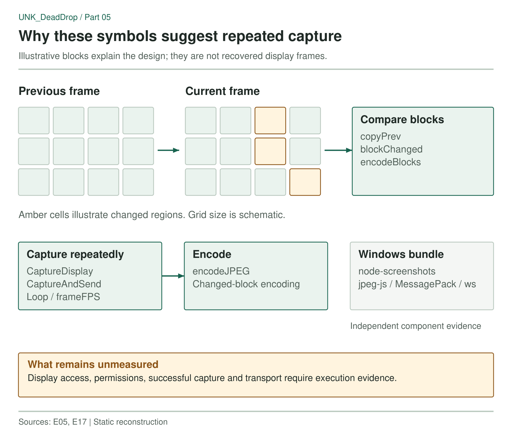

I found that the UNK_DeadDrop agents are built for a continuous video feed of the desktop that sends only what changed between frames, not for occasional screenshots. On Windows the installer refuses to deploy without the capture component, so the screen, not only the disk, has to be part of incident scoping.

## Key takeaways

- The Go implant contains symbols for retaining a previous frame, comparing blocks and encoding JPEG data, which fit a frame-differenced video feed.
- The Windows bundle combines screen acquisition, JPEG encoding, MessagePack serialization and WebSocket transport, and its installer treats the capture files as mandatory.
- The Windows agent persists as the hidden scheduled task `GoogleUpdateSupporterNode` with highest available privileges and 999 restart attempts.
- The held agents contain no keystroke logger; the "keylog" matches in the Go binary are the standard library's TLS key-log facility.
- Responders should ask what was shown on screen during the exposure window, not only which files existed.

## Impact: the screen is the unit of scoping

Frame differencing and frame-rate accounting serve no purpose for occasional screenshots. I therefore read these artifacts as a design for a continuous video feed of the desktop that sends only what changed between frames. I have found this capability in no third-party reporting on this actor.

The practical consequence reverses a common scoping habit. Controls that protect data at rest do nothing against a feed of the desktop. These include an encrypted vault, a hardware wallet that shows its recovery phrase on screen only during setup, and a one-time code that is never saved. In the absence of keystroke logging, the screen covers much of what a keylogger would have captured.

A responder should therefore ask what was shown, typed into a revealed password field or read from a dashboard during the exposure window, not only which files existed. The static artifacts provide no session duration or captured images from which to determine what was actually visible.

## Method: reading symbols and dependencies without a capture session

The Go implant contains symbols for capturing a display, retaining a previous frame, comparing blocks and encoding JPEG data. A separate Windows bundle combines screen acquisition, JPEG encoding, MessagePack serialization and WebSocket transport. I analyzed both statically.

No capture session was recorded. The available evidence comes from the native binaries, the Windows bundle and its installer. Achieved frame rate, bandwidth and desktop access remain unmeasured. The symbol and dependency observations are recorded in [E05](../preprint/evidence/E05.pdf); [E18](../preprint/evidence/E18.pdf) explains why the earlier dependency-only assessment did not rule out capture code.

## Linux Go agent: frame comparison in the symbol table

In the Go binary, I found these capture symbols:

```text
capture.CaptureDisplay    capture.CaptureAndSend
capture.Loop              capture.encodeJPEG
capture.encodeBlocks      capture.blockChanged
capture.copyPrev          capture.frameFPS
```

`CaptureDisplay` and `CaptureAndSend` suggest acquisition and transfer. The more distinctive names are `copyPrev`, `blockChanged` and `encodeBlocks`. They fit a design that retains an earlier frame, compares image regions and encodes changes for transmission. `Loop` and `frameFPS`, together with average-size and average-duration metrics, add evidence of repeated capture and rate accounting.

MITRE ATT&CK groups screen acquisition under [Screen Capture (T1113)](https://attack.mitre.org/techniques/T1113/). Block dimensions and loop frequency remain unmeasured, as does code reachability on a particular host. A Linux process needs access to a usable display session and sufficient permissions before a capture routine can acquire an image.



*Figure 1. Previous-frame storage and block comparison suggest transmission of changed regions between captures.*

### Platform differences across builds

The platform picture needs the dependency list and the symbol table read together, because they measure different things. I found these differences between builds:

- The May Linux build still linked X11 screen capture.
- The July Linux build is stripped of the framework's screen-capture, webcam, audio and WebRTC back-ends, yet still contains the capture package's own symbols and error strings.
- The macOS builds, among them the two macOS builds in the set of six Unix builds fetched from the operator's blob host on 12 November, expose the framework's screenshot command.

The Linux difference points to per-platform tailoring over time. The streaming design is compiled into the July build, but whether that July build could acquire frames is not established. The operator's separate Cortex console returns screenshots of the remote browser. macOS victims are therefore best scoped as watched until shown otherwise.

### TLS key logging, not keystrokes

Three other matches in the Go binary were `writeKeyLog`, `KeyLogWriter` and `crypto/tls.(*Config).writeKeyLog`. Their surrounding names identify the Go standard library's TLS key-log facility, which has nothing to do with keystrokes. A count-only search for "keylog" would report a keylogger that is not there.

Across the held Windows, Linux and macOS builds of the Overlord agents and their Node and Python stages, I found no key-listener package and no keyboard-hook interface at all. This covers Windows hook or key-state calls, X11 record or grab interfaces and macOS event taps.

That negative has a boundary. A separate PowerShell toolkit recovered from a staging repository linked to the same operator personas does run a keylogger through a VBScript runner. It is related to the ECHOES lineage in [Part 9](09-echoes-lineage-image-provenance.md).

## Windows bundle: capture is a mandatory component

The Windows bundle supplies a separate set of components:

- `node-screenshots` and its native module, for screen acquisition;
- `jpeg-js`, for JPEG encoding;
- MessagePack, for serialization;
- `ws`, for WebSocket communication.

The installer checks for the capture files and refuses to deploy without them. It throws an error that the native module is missing from the bundle, so on Windows the capture component is not optional.

The agent then persists as a hidden scheduled task named `GoogleUpdateSupporterNode`, made to resemble a Google update component. The task runs with highest available privileges and 999 restart attempts. The same Windows Node agent also offers live remote desktop with injected mouse and keyboard input, a hidden shell and clipboard access. The feed is meant for an operator who can act on what it shows.

The Windows dependencies and Go symbols come from different artifacts, yet they implement the same frame-differenced design in two languages. Whether the implementations share code remains unresolved. For the Windows branch, investigators would start with the installed bundle, task action and process session to determine whether capture ran.

## Detection: the capture rule requires Overlord and four symbols

The [capture-agent YARA rule](https://github.com/KrasForge/unk-scanner/blob/main/rules/yara/deaddrop_capture_agent.yar) requires an Overlord environment marker and four capture-related symbol strings. It locates files carrying that combination. On its own, a match identifies the framework's capture code rather than this operator, since many unrelated parties run Overlord.

Desktop access and frame delivery require runtime evidence. On a host, the useful follow-up evidence includes:

- the installed component;
- its process and session context;
- display permissions;
- associated network activity.

For the Windows branch, the `GoogleUpdateSupporterNode` task gives an additional place to look for the executable and arguments used. Its hidden setting and extreme restart count are a stronger marker than the name.

```text
Go implant SHA-256:
ef183bbb40f4c7c3f4b52994cdba3295f3eab2604fdad99eefa3b67b8d966e8d
Capture task: GoogleUpdateSupporterNode
```

## Limitations

- No capture session was recorded, so achieved frame rate, bandwidth and desktop access are unmeasured.
- Block dimensions, loop frequency and code reachability on a particular host are unmeasured.
- Whether the July Linux build could acquire frames is not established.
- Whether the Windows and Go implementations share code remains unresolved.
- The static artifacts contain no session duration or captured images.

## Conclusion

The symbols and dependencies describe a frame-differenced desktop feed in two languages, and on Windows the capture component is mandatory. Combined with remote desktop input, a hidden shell and clipboard access, the feed serves an operator who watches and acts.

Defenders should scope an exposure by what appeared on screen, not only by what was stored on disk. Secrets that were only displayed, such as a recovery phrase during wallet setup or a one-time code, belong in the exposure assessment. On Windows, the hidden `GoogleUpdateSupporterNode` task with its 999 restart attempts is a concrete place to start.

The capture-agent YARA rule is part of the public scanner repository. A match identifies Overlord capture code, and runtime evidence is still needed to show that capture ran.
