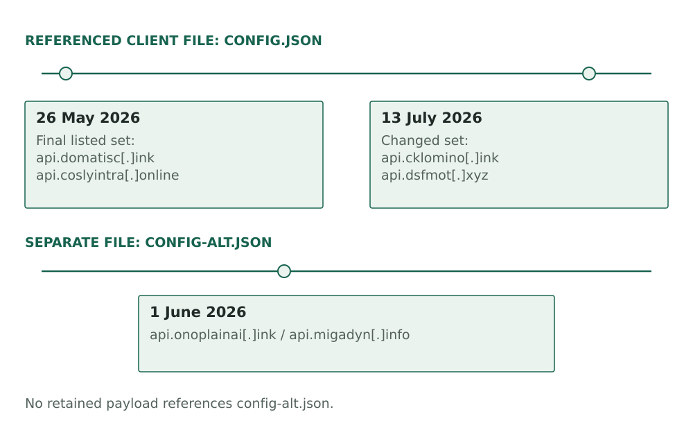

I found that the UNK_DeadDrop payload reads its server list from a GitLab-hosted configuration file, so the operators could move an unchanged payload to new servers with a single commit. When the repository went dark on 22 October 2026, they rebuilt the dead drop under new names within days, and then a second time.

## Key takeaways

- On 13 July 2026, a GitLab commit replaced the server list with `api.cklomino[.]ink` and `api.dsfmot[.]xyz` while the payload hash stayed the same.
- The history I retained in July contains six commits to `config.json` and one to a separate `config-alt.json` that no retained payload references.
- After the original repository became unreadable on 22 October, a replacement repository named the same host about 31 hours later, and a third repository named `api.cerysoi[.]ink` on 3 November.
- Every serving and command address I observed from July to November sits with one provider, Advin Services, across AS22295 and AS206216.
- Blocking a destination does not stop a client that consults the configuration resource, so connection records are needed to identify the destination each client used.

## Mechanism: the payload fetches `config.json` from GitLab

On 13 July 2026, a GitLab commit replaced a list of server names with `api.cklomino[.]ink` and `api.dsfmot[.]xyz`. The retained repository bundle and file history are documented in [E07](../preprint/evidence/E07.pdf). The file held configuration, not a payload.

The client reads its destination from this resource. Changing the server list therefore changes where an unchanged payload can connect, and the payload hash stays the same. That design is also why the file mattered so much in October, when the repository went dark and the operators rebuilt it under new names within days.

The payload references this resource:

```text
gitlab[.]com/drop-indexing/tasks/-/raw/main/config.json
```

The recovered JavaScript has its own hard-coded fallback, `api.domatisc[.]ink`, and a resolver function that requests the raw GitLab `config.json` resource. No retained endpoint log confirms that a victim fetched either file. This code pattern is relevant to MITRE ATT&CK's [dead drop resolver technique (T1102.001)](https://attack.mitre.org/techniques/T1102/001/). A payload with the same hash can receive different destinations depending on when it fetches this resource.

The repository also contains a separate `config-alt.json` file with another pair of destination strings. Neither retained payload references it. Client use of this second file remains unknown.



*Figure 1. The referenced configuration changed in May and July. A separate file was added in June, but no retained payload references it.*

The configuration history records the changing destinations. Certificate and panel observations connect one of those domains to a historical origin address. The [historical indicator reference](historical-indicators.md) lists every recorded resolver value, the separate unreferenced file, related lure hosts and the limits on each IP association.

### The July installer droppers used a separate mechanism

The later July installer family did not use the GitLab file. Its `upd_m`, `upd_w`, `upda_m` and `upda_w` droppers embedded `api.aazdias[.]ink` as the primary store and `api.fallaazdis[.]ink` as the fallback. Those values came from the recovered dropper configuration, not from the GitLab `config.json` history.

## History: five May revisions, then new server pairs in July

The primary file has five recorded revisions on 26 May. They begin with an initial set of `domatisc[.]ink`, `coslyintra[.]online` and `valorecuiting[.]online`. Subsequent edits remove and restore an entry, introduce `api.` prefixes, and finally leave a set of two hosts. The recorded states after that, in order, are:

1. 26 May 2026, final listed revision of `config.json`: `api.domatisc[.]ink` and `api.coslyintra[.]online`.
2. 1 June 2026, separate file `config-alt.json`: `api.onoplainai[.]ink` and `api.migadyn[.]info`. Its use by the recovered client is unestablished.
3. 13 July 2026, about 07:10 UTC, `config.json`: `api.cklomino[.]ink` and `api.dsfmot[.]xyz`.
4. 25 July 2026, 06:02:59 UTC, `config.json`: `api.chestsoi[.]ink` alone.

Commit `c3c71d65` replaces the primary destination set left by the May revisions. The history I retained in July contains six commits to `config.json` and one to `config-alt.json`. The latter is a separately recorded resource, not an evidenced client fallback.

The fourth state came later and from my own monitoring. From 23 July a watch polled the file every two hours. It alerted at 06:30 UTC on 25 July after commit `b1a275dd35` cut the primary list down to the single host `api.chestsoi[.]ink`, which the file then named until October. Two further commits on 10 and 12 October added no host, although I did not keep their contents.

The certificate for `api.domatisc[.]ink` was issued on 26 May, the morning the dead drop first pointed at it. This gives the May sequence an independent clock. The 1 June date of the alternative file rests on commit metadata alone.

### Client behavior decides when a change takes effect

Client refresh behavior determines when a configuration change takes effect. The agent side is built for the contingency: the Windows Node bundle carries its own copy of the dead-drop project and fails over between hosts in round-robin order.

A client that fetches the file again may receive a new address, while one using a cached destination may continue trying the old server. I hold no client execution trace that shows which happened on a real machine. Blocking a destination can interrupt traffic, while a client that consults this configuration resource may receive another address. Connection records are needed to identify the destination each client used.

## Recovery: the October outage and two successor repositories

On 22 October 2026 the original repository became unreadable, and my watch saw it within hours. Nothing I hold records the cause. The operators then rebuilt the dead drop twice:

1. A replacement group, `drop-indexings`, was created on 23 October at 21:29 UTC. By 23:39 its project `tasks` named `api.chestsoi[.]ink`, the same host as before, about 31 hours after the first poll that found the original gone.
2. On 3 November at 03:05 UTC the GitLab account `0xapp123` created a third repository, `up-indexings/tasks`. Its commit `dcb1f391` a minute later wrote a `config.json` naming a new command host, `api.cerysoi[.]ink`, alone. The agent builds fetched on 12 November carry that repository as their only network address.

My watch could only notice a known path stop answering. I learned of the replacement from [SafeDep's antd-img-crop report](https://safedep.io/blog/antd-img-crop-forged-commit-overlord-stealer) and an indicator feed about fifteen days after it appeared. I learned of the third repository from [Stormshield's Trigram report](https://www.stormshield.com/news/cti-trigram-campaign/) about nine days after its creation. [Part 16](16-control-layer-after-october.md) follows the successors, the panels and the hosting after October in detail.

## Infrastructure: a July hostname linked to a reported origin

I compared the resolver hostnames with historical scan records to investigate the services behind them. July scan notes associate `207.241.172[.]222` with C2 and administration services. They record a certificate naming `api.cklomino[.]ink` and a third-party bare-IP scan that returned a Subtensor sign-in panel.

The origin association to `207.241.172[.]222` came from dated certificate and passive-scan observations, not a direct fetch from that address. The raw scan responses and certificate were not retained. The panel HTML and JavaScript available for inspection were retrieved from `api.domatisc[.]ink`, so they cannot independently reproduce the reported response from the bare IP.

### The panel is a lightly modified public Overlord panel

The panel itself is less novel than its title suggests. I later scored a login script captured from the November command host against every public version of the Overlord framework. It shared 81 of its 82 identifiers with the framework's early-March 2026 base, so the operators run a lightly modified public panel rather than their own.

The panel adds an application-level association to the certificate evidence. Further relationships came from certificate facets, passive DNS and reverse-DNS fields. These observations came from research-service records. The origin analysis did not directly scan the server or log in. [E20](../preprint/evidence/E20.pdf) and [E21](../preprint/evidence/E21.pdf) record the source and limits of those historical associations.

### One provider, two autonomous systems

The July observations associated three addresses with distinct roles:

- `207.241.172[.]222` with C2 and administration;
- `170.205.31[.]182` with lure hosting;
- `23.137.105[.]75` with the July campaign's backend.

These roles describe the recorded periods, but the first address proved durable. In November `api.cerysoi[.]ink`, the host the third repository names, was served from `207.241.172[.]222` as well.

All three addresses, and every other serving and command address I observed from July to November, sit with one provider, Advin Services, across its two autonomous systems AS22295 and AS206216. The operators' first Overlord server stood at another provider from 26 May. Advin is ordinary shared hosting, so that concentration organizes a provider request but does not prove control of a range.

### The SSH host-key search found no new address

The saved service enumeration listed SSH, HTTP and HTTPS. Its SSH profile included a host key, banner and handshake information, but these had different value as search pivots. The common OpenSSH banner and handshake fingerprint matched broad populations of hosts. The more selective host key returned only the address already known.

The search found no backup address. Hosts absent from that dataset remain outside its coverage. The reported panel response did not enumerate every tenant at the address, and other services may have shared the address, so an IP block could affect unrelated traffic.

### The 23 July certificates added hostnames

The 23 July certificate enumeration added names that were absent from the inspected payloads:

- a `dashboard` host on the cklomino base;
- `dev` and `hr` mail subdomains on lure domains;
- a `hiring` host alongside a career-themed API.

The [indicator reference](historical-indicators.md) records the names and first-issuance dates. These records identify certificate names, not proof that each host served a malicious application.

The certificates did not provide a cross-domain link. Subject alternative names stayed within individual registered bases, with combinations of the base, wildcards and subdomains such as `api.`, `www.` and `email.`. No retained enumeration entry combined two bases in one certificate. Wildcards also mean that a new subdomain can appear without a new certificate-log entry.

### Certificate timing gave context, not attribution

Timing offered more context. Certificates for four bases were first issued on 13 July, the date of the resolver's change to `api.cklomino[.]ink` and `api.dsfmot[.]xyz`.

On 23 July, `aazdias[.]ink` and `fallaazdis[.]ink` were registered about six minutes apart through the same registrar and privacy service, with the same Cloudflare nameserver pair. Their primary-and-fallback naming repeats the earlier `aavzx[.]ink` and `fallbaav[.]ink` arrangement. The current stores, a new dashboard host and several older lure domains also received certificates that day.

Shared panels and certificate automation can produce this cadence across unrelated customers. I therefore used the timing to check code and configuration relationships, rather than to assign hosts to the cluster. These registration and enumeration observations come from restricted 23 July records and are discussed in the [paper](../preprint/UNK_DeadDrop-Preprint.pdf), but are not independently reproduced in the public evidence exhibits.

### Port-based hunting is a poor discriminator

A sweep of two /23 ranges belonging to the hosting provider covered about a thousand addresses; 291 exposed services. The provider used ordinary shared hosting. About twenty unrelated tenants ran services on port 3000.

The free scan dataset returned no results for port 5173, which is Overlord's default production port for its server, in either range. Port 3000 was common among unrelated tenants, and the dataset did not cover port 5173 at all. The results come from research services and have not been refreshed since 24 July.

## Limitations

- No retained endpoint log or client execution trace shows which file or destination a real client fetched or used.
- Client use of `config-alt.json` remains unknown.
- The contents of the two October commits on 10 and 12 October were not kept, and nothing I hold records the cause of the October outage.
- The raw scan responses and certificate behind the `207.241.172[.]222` association were not retained.
- The registration and enumeration observations of 23 July are not independently reproduced in the public evidence exhibits.

## Conclusion

The GitLab file worked as a dead drop resolver: one commit moved every client that consulted it, without a new payload or a new hash. The revision history, my own polling and outside reports together show the operators changing destinations in May, July and twice after the October outage.

For defenders, blocking a single command host is not enough while the resolver resource stays readable. Connection records show which destination each client actually used, and the resolver path itself is worth monitoring. Shared hosting at Advin Services organizes a provider request, but it does not prove control of a range, and port-based hunting does not separate this cluster from unrelated tenants.

Part 7 follows the target-acquisition tooling behind the two SQLite pools.
