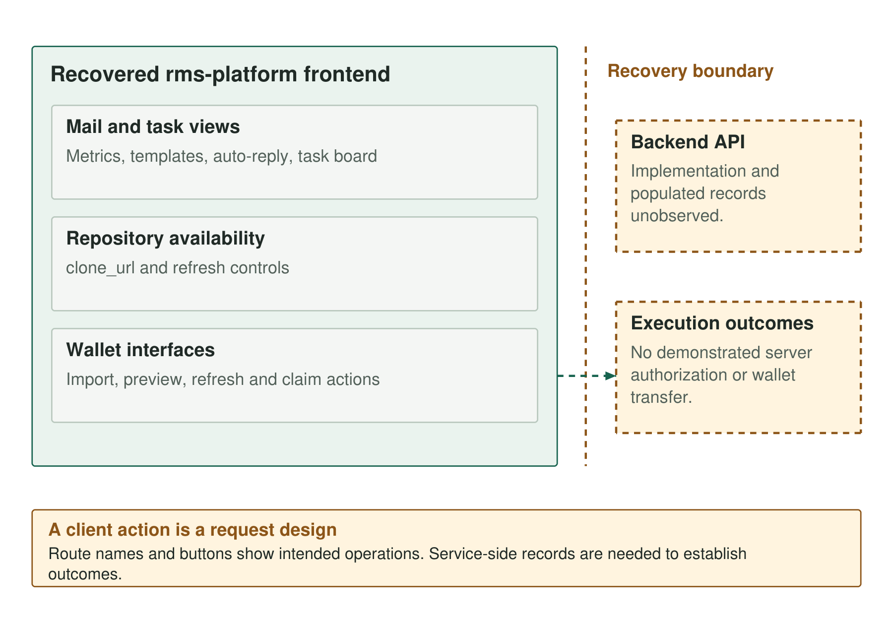

I recovered seventy frontend modules of an operator application called rms-platform from a development deployment at `dashboard.cklomino[.]ink`. The client combines mail views, repository availability checks and wallet-management controls with mnemonic and ColdKey fields, while the recipient addresses of a claim never leave the backend.

## Key takeaways

- The recovered client contains mail metrics, inbox and outbox views, auto-reply controls, repository monitoring and wallet import, refresh, preview, claim and bulk-claim actions.
- Mnemonic and ColdKey fields, a miner-request column and Subtensor theming converge on Bittensor validators and miners, with EVM and Aptos wallets secondary.
- My read of all seventy modules found no cryptocurrency address and no service key, because claim recipients are supplied by the backend at claim time.
- The hard-coded super-administrator address `eros1030109@gmail[.]com` also appears in lure-domain DMARC records and the dead drop's commit history.
- The back-office dashboard moved with the rest of the operators' hosting estate, from Liga Hosting in June 2026 to the October lure fleet.

## Impact: the console that sits behind the lures

A development deployment at `dashboard.cklomino[.]ink` exposed seventy frontend modules for an application called rms-platform. The recovered client combined mail views, repository availability checks and wallet-management controls. Its wallet views include mnemonic and ColdKey fields, plus import, preview and claim actions.

The backend implementation and its stored records were not recovered. By November, however, two outside records had placed the back office it talks to on a timeline and tied it to a persona. The console is therefore no longer an isolated artifact.

## Method: following the Vite server's module imports

I followed imports exposed by the Vite development server and preserved seventy frontend modules. Their embedded source maps included the original TypeScript comments. The acquisition followed only modules loaded by the application and involved no login or call to the authenticated data API.

The recovered application calls itself `rms-platform`. Its client contains:

- mail metrics, inbox and outbox views;
- templates and auto-reply controls;
- a task board;
- database tables;
- wallet-management components.

The source references `/api/github-jobs-check/`, `/api/db/...` and `/api/admin/wallets/{refresh,preview,claim,claim-all}/`. These are strings in the client, not observed requests. The related [historical indicator reference](historical-indicators.md) records the exact route forms. The [evidence index](artifact-reference.md) lists hashes for the recovered modules and related samples, while the retained client excerpts are in [E06](../preprint/evidence/E06.pdf) and [E09](../preprint/evidence/E09.pdf).



*Figure 1. The recovered frontend connects mail views, repository monitoring and wallet-management controls.*

## Delivery monitoring: a view of repository availability

One view tracks repositories by `clone_url`, displays availability labels and offers refresh controls through `/api/github-jobs-check/`. The feature fits the delivery history, since repositories can disappear, move or be replaced. A status view could help monitor locations used to distribute lures or payloads. No backend event history was recovered to show whether a repository suspension triggered an alert or a replacement.

### The back office moved with the hosting estate

Passive resolution history places the back-office dashboard that serves this console, under the name `dashboard.asteara[.]org`, at these locations:

1. at Liga Hosting from 8 June 2026;
2. on an Advin address by 29 June;
3. behind Cloudflare under a second name from 28 July;
4. from 5 October on `170.205.30[.]27`, inside the operators' October lure fleet.

The back office therefore moved with the rest of the estate rather than standing apart from it.

### A database user links the back office to a persona

In November, [Stormshield's Trigram report](https://www.stormshield.com/news/cti-trigram-campaign/) described a Django back office behind the same kit and named the database user `silviattech1129`. The same handle appears in the author address of a commit to the replacement dead-drop repository of October ([Part 16](16-control-layer-after-october.md)). It also binds the "Silvio Silva" persona to a 2025 launchpad presentation.

## Wallet administration: mail, tasks and claim controls

The wallet interface contains import, refresh, preview, claim and bulk-claim actions, and the client references routes including:

```text
/api/admin/wallets/refresh/
/api/admin/wallets/preview/
/api/admin/wallets/claim/
/api/admin/wallets/claim-all/
```

The collection paths and their relationship to the dynamically selected server are listed in the [historical indicator reference](historical-indicators.md). Mnemonic and ColdKey fields, Bittensor-related interface language, and references to EVM and Aptos connect the intended wallet workflow to material targeted by the collectors. The collectors select wallet material that corresponds to these interface fields.

A cold-key field in the wallet import, a miner-request column in the mail table and the Subtensor theming converge on Bittensor validators and miners. EVM and Aptos wallets are secondary.

### Claim recipients never reach the victim's machine

No transaction records accompanied the frontend, and the client could not have yielded them. The recipient addresses of a claim are supplied by the backend from a server-side configuration at claim time and never reach the victim's machine. No sample detonation recovers them. My read of all seventy modules found no cryptocurrency address and no service key. That is the main reason the operation's cash-out remains untraced.

### The mail side turns the list into conversations

The mail side, with its replied status and auto-reply endpoint, is where the untargeted list of [Part 7](07-developer-target-harvesting.md) turns into selected conversations. The sender and harvester tools were recovered separately, and nothing I hold shows this backend reading their pools.

## Authorization: the `SuperAdmin` check lives in the client

The client helper grants super-administrator treatment when either a user flag is set or an email comparison matches. These checks control frontend navigation and protected routes, including the wallet page and its sidebar entry.

The hard-coded address is `eros1030109@gmail[.]com`. The same string appears in three other places:

- the aggregate-report destination in the DMARC records of the lure domains `d2saitrade[.]ink` and `surgecareer[.]ink`;
- the dead drop's commit history;
- [Genians' Operation GitPower report](https://www.genians.co.kr/en/blog/threat_intelligence/kimsuky_ai_llm) of August 2026, a corroboration that [Part 17](17-two-operations-one-ecosystem.md) weighs.

This shows that one actor configured the console, the lure domains and the dead drop, though not who controls the mailbox.

The signup route displays a disabled-signup message. Roles are defined in the interface.

## Limitations

- The backend implementation and its stored records were not recovered, so server-side claim authorization is unknown.
- The API routes are strings in the client, not observed requests.
- No backend event history shows whether a repository suspension triggered an alert or a replacement.
- Account creation and user counts require backend records.

## Conclusion

The recovered client shows one console for the whole operation: reply-driven mail, monitoring of delivery repositories and wallet claims aimed at Bittensor validators and miners. Its hosting history and a shared database handle place it inside the same estate and persona set as the lures and the dead drop.

The claim design keeps recipient addresses on the server, so neither the frontend nor victim-side samples reveal where stolen funds go, and the cash-out remains untraced. For defenders, the shared address `eros1030109@gmail[.]com` is a pivot that connects the console, the lure-domain DMARC records and the dead drop's commit history. The [historical indicator reference](historical-indicators.md) records the exact route forms for hunting.
