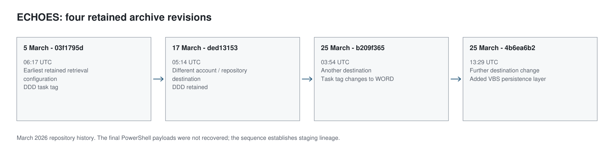

The ECHOES lure paired an animation-project theme with a password-protected archive. Its repository history preserved four versions of the delivery kit. The artwork and staging structure remained recognizable as repository destinations changed. The third revision added a persistence-related script, which the fourth retained.

The archive supports two investigations: a revision-by-revision account of staging changes and a provenance trail in the project's poster image. ECHOES is a separate branch from the ClickFix and VSIX chains. Capabilities recovered from those other samples cannot be assigned to it without the missing payload.

> **Key Takeaways**
>
> - Four archive revisions between 5 and 25 March 2026 keep the artwork and staging structure while changing destinations, and the third adds a VBS persistence layer that the fourth keeps.
> - The final PowerShell payloads were unavailable through the unauthenticated routes examined, so ECHOES is not credited with capabilities recovered from other samples.
> - The poster's C2PA manifest records ChatGPT, GPT-4o and `trainedAlgorithmicMedia`, but no prompt or user identifier.
> - The signing certificate's validity period, 15 April 2025 to 15 April 2026, does not date the image's creation.

## Four versions of the same lure

The repository history records archive changes on 5 March, on 17 March and twice on 25 March 2026, and the retained analysis compares the repeated decoy images, encoding structure, retrieval configuration and task tags across all four. In order, with all times in UTC:

1. `03f1795d`, 5 March, 06:17: the earliest retained retrieval configuration, with a DDD task tag.
2. `ded13153`, 17 March, 05:14: a different account and repository destination.
3. `b209f365`, 25 March, 03:54: another repository destination, with the tag changed to WORD and a VBS persistence layer added.
4. `4b6ea6b2`, 25 March, 13:29: a further destination change and a new access token, with the staging otherwise unchanged.

The repeated staging structure establishes a useful lineage, but describing the later versions as "the same archive with a different C2" misses the persistence component added in the third revision and retained in the fourth. The history also contains embedded access tokens. Their values are unnecessary to establish the sequence, and they were not used to retrieve the final stage.



*Figure 1. Four retained ECHOES archive revisions. Final PowerShell payloads were unavailable; the retained history establishes staging lineage.*


Compare the archive in three layers: presentation (the project theme and decoy imagery), staging (launch and persistence logic), and retrieval configuration (the location of the next resource). A destination can change while the artwork and staging remain largely intact; the same artwork could also be reused with a different delivery mechanism.

That is why complete revisions are more informative than a project name or poster. A shared account or repository is a distribution lead, not a substitute for the missing payload bytes. The history supports reuse and modification within this archive lineage, but does not establish that the final stage was the Go agent, JavaScript collector or Windows pipeline described earlier.

## Where the payload trail stopped

The staging references led to final PowerShell resources unavailable through the unauthenticated routes. No final payload was available for capability analysis.

Account status was less clear than a 404 suggested. One historical check found an unavailable account whose name was also unavailable for registration. That supports a suspension hypothesis, but does not confirm it with the platform. Neighboring numeric identifiers showed no distinctive batch-registration pattern. Consecutive IDs can belong to unrelated signups; proving common registration control would require unavailable platform data. These limits prevent weak account relationships from filling the missing payload gap. They do not diminish the preserved archive history.

## The poster retained a C2PA structure

The poster, identified in the case as `Post.png`, offered a very different kind of lead, because the recorded examination found a [C2PA](https://c2pa.org/specifications/) structure in its PNG `caBX` chunk, and extracting the metadata and parsing its JUMBF, CBOR and certificate structures exposed the following fields:

```text
Claim generator:  ChatGPT
Software agent:   GPT-4o
Source type:      trainedAlgorithmicMedia

Recorded certificate subject fields:
OpenAI / Sora signing-pipeline references
```

The manifest history records creation, conversion and ingredient-opening actions across two manifests. Its embedded thumbnail was described as a lower-resolution version of the poster. These fields provide stronger evidence about the artwork's production pipeline than a visual judgment that it “looks AI-generated.”

The case record reports successful signature validation; no fresh image or certificate-status validation is available here. The provenance assertions concern the image. They do not identify who placed it in the lure or prove that the distributor generated it.

The manifest contains no prompt or user identifier, and its redacted-assertions array is empty. Those fields may never have been included; an empty redaction list is not evidence that information was removed.

Other portraits examined in the case lacked the poster's C2PA structure. Re-encoding could explain that difference, but it does not prove intentional provenance removal; different export paths or source histories could produce the same result. The bounded conclusion is that the retained poster carries assertions associated with an AI image-generation pipeline, but no operator identity.

### The certificate date was not a creation timestamp

The leaf certificate was valid from 15 April 2025 to 15 April 2026, and the examination found no trusted timestamp token. Certificate validity does not establish when an artifact was signed or generated. Repository commits date when the image appears in preserved history, not when it was created.

The PNG examination found no payload appended after the end marker. That is a bounded structural result, not exhaustive proof that the image contains no hidden content.

### What the archive establishes

ECHOES adds a distinct delivery history: four preserved revisions, recurring staging, changing destinations and a later persistence addition. The poster supplies a separate provenance finding. The final payload remains unresolved. Keeping that gap visible prevents the better-understood ClickFix and extension samples from lending their capabilities to ECHOES by association. Any recovered payload should be matched to its revision rather than assumed to represent all four.

The first nine posts connect recruitment lures to collection code, mutable configuration, target-acquisition data and administration interfaces. Some links rest on complete source or exact hashes; others stop at configuration, frontend behavior or historical observations. The technical value is in making each relationship inspectable and showing where the artifacts run out.

The final three posts step back: Part 10 maps the relationships and reassesses novelty, Part 11 examines the companion detections, and Part 12 separates framework features from collection-specific evidence.
