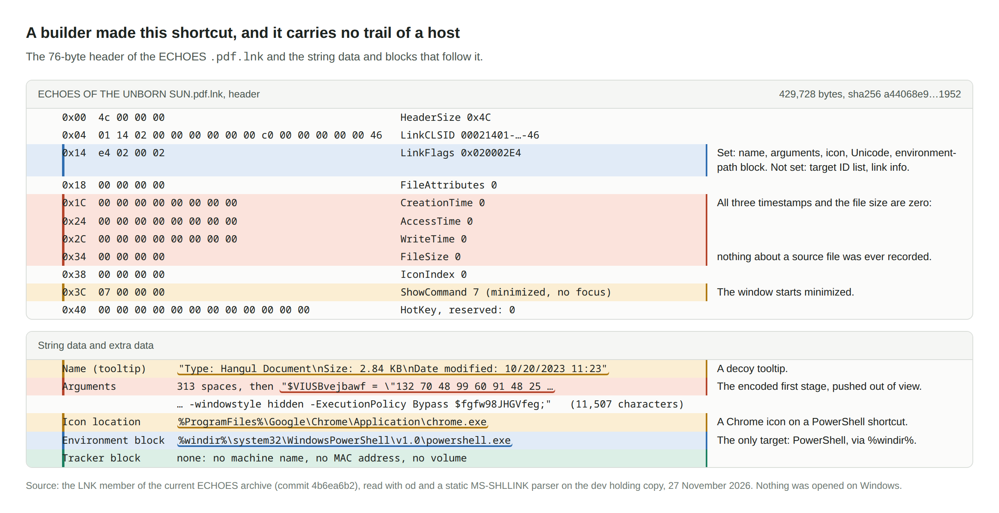
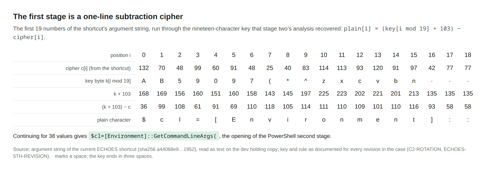
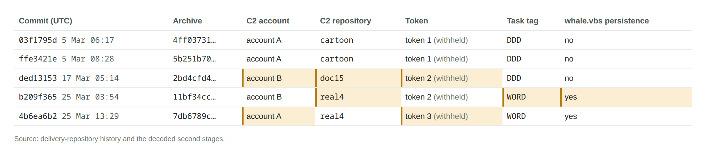
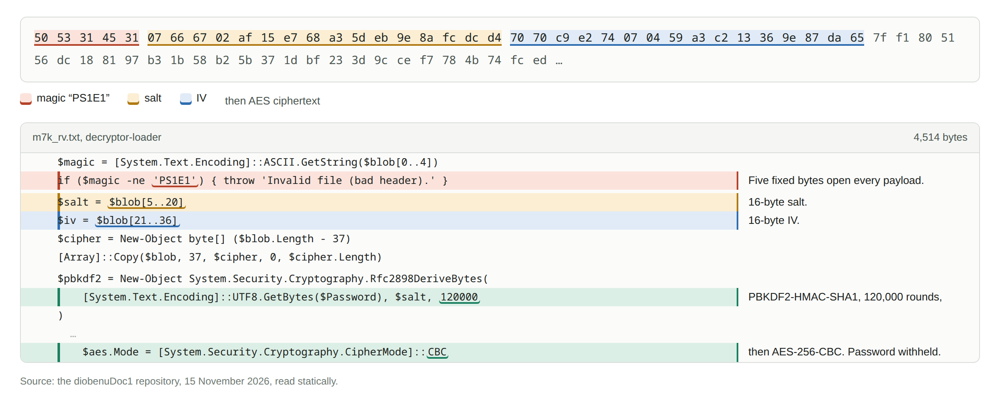

I traced four revisions of the ECHOES lure archive, which reused the same artwork and staging while its repository destinations changed. The final PowerShell payload was never recovered, and the poster's C2PA metadata records an AI image pipeline but no identity.

## Key takeaways

- The ECHOES repository history preserves four distinct archive revisions from 5, 17 and 25 March 2026, five re-commits in all, and the third revision added a VBS persistence layer.
- The final PowerShell resources sit in private repositories reachable only with the embedded token, so no crawler, scanner or token-less sandbox can have captured them.
- A related staging repository holds a four-part PowerShell toolkit that collects wallet files, decrypts browser credentials, logs keystrokes and uploads the results through GitHub's contents API; its fixed, self-identifying container format is a more durable detection handle than blocking `api.github[.]com`.
- The poster's C2PA fields name ChatGPT, GPT-4o and OpenAI / Sora signing references, but they contain no identity for the person who generated or distributed it.
- Every archive commit was authored as `stefan.kano1030109@gmail[.]com`, whose `1030109` suffix is shared with the address that owns the GitLab dead drop and the console's privileged address.

## Delivery: a passworded archive with a shortcut inside

The ECHOES lure paired an animation-project theme with a password-protected archive. Its repository history preserved four versions of the delivery kit. The artwork and staging structure stayed recognizable as repository destinations changed. The third revision added a persistence-related script, which the fourth retained.

The delivery repository was `github[.]com/Lyracartoon/Echoes-of-the-Unborn-Sun`, reported live on 23 July 2026. [Exhibit E11](../preprint/evidence/E11.pdf) records the retained archive revisions. The final PowerShell resource was unavailable, so its final payload cannot be compared with the ClickFix or VSIX payloads.

The retained current RAR has SHA-256 `7db6789c09e29305c728bf3d7b94c5ef1c3e13eef1b321ee52d3ae3997731f56`. Its LNK member has SHA-256 `a44068e9758262a65861b91f2b00d0a3eca019d3b35543dd60c1c7f2e0ba1952`. The [artifact reference](artifact-reference.md) also lists the earlier archive revisions, LNKs and analyst-decoded stage-two hashes.

### The shortcut: builder output with no host trail

The `.pdf.lnk` is not a shortcut somebody made by dragging a file. Its link flags describe a minimal command shortcut that resolves PowerShell through `%windir%` in an environment-variable block. It has:

- no link-target ID list and no link-info structure;
- all three MAC timestamps zeroed and a recorded file size of zero;
- no tracker block, and therefore no NetBIOS machine name or MAC address to recover;
- a decoy tooltip claiming a small Hangul document modified in October 2023, and an icon that spoofs Chrome.

The file is kit output and carries no host attribution, unlike the working-tree path that leaked from a Python payload elsewhere in this toolchain. What it offers a hunter is shape: a double extension with a PowerShell target, the zeroed and trackerless structure, the scheduled-task naming, a fixed set of script drops under `%AppData%`, a byte-loop stage-one cipher keyed with a nineteen-character string, keyboard-mash identifiers, and outbound `raw.githubusercontent[.]com` requests carrying two junk marker headers.



*Figure 1. The ECHOES shortcut, byte by byte. Its timestamps and file size are zero, it has no target ID list, link info or tracker block, and its only target is PowerShell behind a Hangul-document tooltip and a Chrome icon.*

### The entry chain

The archive holds a `.pdf.lnk` shortcut whose arguments carry an encoded first stage. The chain then runs as follows:

1. The first stage decrypts to a PowerShell second stage.
2. The second stage relaunches itself hidden and elevates.
3. It opens a decoy PDF.
4. It installs scheduled-task and script persistence firing at startup and hourly.
5. It pulls two further stages from the same GitHub account using a hard-coded access token.
6. It deletes itself.



*Figure 2. The first stage decoded by hand. Each number is subtracted from a key byte plus 103, and the first 38 values already spell the opening of the second stage.*

No sample I held before ECHOES used a shortcut file, a scheduled task, hidden-window PowerShell with the execution policy bypassed, or GitHub raw content authenticated with a hard-coded personal access token as its C2. ECHOES therefore widens the known toolkit beyond the editor-task and clipboard chains rather than repeating them.

Repository-held retrieval settings change across revisions. ClickFix instead relies on a pasted command, and the VSIX route relies on editor tasks and extension installation. Their shared use of repository staging does not make their downstream capabilities interchangeable.

### One account, two delivery kits

The delivery repositories do have a documented connection. The restricted catalog of 172 public repositories examined on 24 July placed ECHOES and the weaponized `predict-together` copy under the same account. Those two and one further assessment repository were the only three catalogd repositories carrying delivery kits. The catalog is discussed in the [paper](../preprint/UNK_DeadDrop-Preprint.pdf) but is not reproduced in the public evidence exhibits.

That connects account control and delivery staging, not the missing final payload. One delivery account ran two delivery kits, the folder-open repository and ECHOES. ECHOES contributes a distinct entry route.

When I later sorted every repository in that catalog by its role, `Lyracartoon` stood out as a pure delivery account. It carried no credibility dressing at all, and both of its repositories were weaponized, whereas the other operator accounts surround their few working repositories with dozens of portfolio props ([Part 15](15-persona-farm.md)).

### The commit author: the 1030109 suffix

Every archive commit in the delivery repository was authored as `stefan.kano1030109@gmail[.]com`. The same `stefan.kano` name appears as a GitLab namespace in the editor-extension route ([Part 2](02-vsix-editor-execution.md)), and the numeric suffix recurs in two other operator addresses:

| Address | Where it appears |
|---|---|
| `stefan.kano1030109@gmail[.]com` | Author of the ECHOES archive commits |
| `apollo1030109@gmail[.]com` | Owner of the GitLab account that holds the dead drop ([Part 6](06-gitlab-dead-drop-infrastructure.md)) |
| `eros1030109@gmail[.]com` | Privileged console identity, lure-domain DMARC records, dead-drop commit history ([Part 8](08-administration-platform.md)) |

Three distinct addresses on three platform accounts sharing one suffix is the strongest single selector in the persona set, because it ties the throwaway account hosting a live weaponized repository to the operator who maintains the C2 dead drop. The repository's own README gives a fourth address with the stem in truncated form, `davejenkins1030@gmail[.]com`, as the pitch's contact. A git author address is self-asserted, so the suffix proves a configuring habit shared across accounts, not who typed it.

## Lineage: four archive revisions from March

I compared four archive revisions: one from 5 March, one from 17 March and two from 25 March 2026. The comparison followed the decoy images and encoding structure, then checked retrieval settings and task tags. In order, with all times in UTC:

1. `03f1795d`, 5 March, 06:17: the earliest retained retrieval configuration, with a DDD task tag.
2. `ded13153`, 17 March, 05:14: a different account and repository destination.
3. `b209f365`, 25 March, 03:54: another repository destination, with the tag changed to WORD and a VBS persistence layer added.
4. `4b6ea6b2`, 25 March, 13:29: a further destination change and a new access token, with the staging otherwise unchanged.

The third revision changed both retrieval and persistence. The fourth retained that staging while replacing the destination and access token. The embedded tokens were not used to retrieve the final stage, and their values are withheld.

A later review of the delivery repository found a fifth archive commit, made about two hours after the first with the same destination, token and decoys. It is a cosmetic re-compression that leaves the four distinct configurations standing. The accurate count is therefore five re-commits over four distinct C2 configurations: the archive and shortcut bytes differ, but the C2 account and repository, the token, the decoy images, the task tag and the stage-one cipher are all those of the first revision, and like the other early revisions it carries no VBS layer. Across the series the operator rotated through two accounts and three tokens.



*Figure 3. Five commits, four C2 configurations. The 5 March re-commit repeats the first configuration; the third revision brings the WORD tag and the VBS layer, and the fourth switches account and token.*

### One password, five archives

All five archives share one packaging profile. Each holds four members with encrypted headers, and the member times fall between 4 and 25 March 2026. The one documented ECHOES password opens and parses the headers of all five, which establishes password reuse within the series.

I compared the series against every RAR signature in the repository captures I retained, 29,073 stored git blobs across 114 repositories including unreachable objects. That produced eight distinct archives in three groups:

| Group | Archives | Members | Encryption | Password |
|---|---|---|---|---|
| ECHOES | 5 | 4 each | Headers encrypted | The ECHOES password opens all five |
| A historical trading-bot release | 2 | 20 and 22 | File data only | The password printed in that repository's own README |
| An unrelated `env.rar` | 1 | 1 | File data only | Neither password matches |

All members record Windows as the host operating system and all file-encryption records use the same key-derivation work factor, with a distinct salt per archive. Those are packaging observations rather than author identities. Shared metadata does not attribute common authorship, and distinct salts are expected.

### The kit is reused with other lures

The kit was not unique to this lure. [FortiGuard Labs had documented the same LNK and GitHub chain](https://www.fortinet.com/blog/threat-research/dprk-related-campaigns-with-lnk-and-github-c2) on 2 April 2026 with Korean business lures in place of the animation pitch. FortiGuard named one of the C2 accounts in my record among its own, so the operator varies the lure while reusing the toolchain.

The same report also extends the cluster beyond what I hold. It names a primary C2 hub with its exfiltration paths, four sibling C2 accounts that are all now deleted, a second token and a further exfiltration repository. Stored URL-scanner records show that researchers were actively watching the dead C2 in the ten days before my own hunt.

The Hangul decoy metadata and the token-based C2 are consistent with Proofpoint's assessment that the operation is very likely North Korea-aligned and with FortiGuard's DPRK framing. These remain those publishers' assessments rather than mine.

## Payload: the final PowerShell stage was not recovered

The staging references led to final PowerShell resources unavailable through the unauthenticated routes. That absence follows from the design rather than from bad luck: the files sit in private repositories reachable only with the embedded token, so no crawler, scanner or token-less sandbox can have captured them.

My hunt of 23 July covered the account cluster on the forge, stored URL-scanner scans, VirusTotal, MalwareBazaar and the Open Threat Exchange without a hit. FortiGuard did not publish stage-three hashes either. No final payload was available for capability analysis.

The hunt returned the same answer from every source:

| Source | Result |
|---|---|
| The forge | 404 across the whole account cluster |
| Stored URL-scanner scans | 167 scans of those accounts, all 404 apart from one profile page |
| VirusTotal | Neither my hashes nor the five FortiGuard published |
| MalwareBazaar | Hash not found for all of them |
| Open Threat Exchange | No pulse under any of the accounts or the kit |

That absence is itself a finding about the campaign: the samples were never widely shared, which fits a targeted operation. The bytes exist only with the forge, with vendors who ran the kit, or with the operator. The forge retains deleted and private content and the token's access log, which would also show who fetched the files, so a platform request is the lawful route to them.

I did not use the embedded token. Authenticating into the operator's private account would sit next to unauthorized access, would burn the token and tip the operator, and would break the passive method this series describes. Running a sample in a public sandbox has the same problems and would also publish the sample and possibly who was targeted. A credential recovered from a payload is evidence to report, not a key to use.

### The closest counterpart: a four-part PowerShell toolkit

The closest counterpart came from a separate public staging repository linked to the same operator personas. It carries the same retrieval header and, in its first revision, the same account and token as the final ECHOES archive. It holds scripts dated 31 March to 10 April that decrypt with parameters stored beside them.

The repository is `diobenuDoc1` under the `yuki-devtek` account, and it is staging rather than a portfolio prop. It held 44 commits between 31 March and 10 April 2026, two dozen Windows system-reconnaissance reports, a PowerShell decryptor-loader written for in-memory execution, and four encrypted payloads. The loader's default password combines two persona names, `diobenu2silva` and `yuki-devtek`, inside operator tooling, and it decrypted all four payloads with valid padding on the first attempt. That binds the two personas by a working key rather than by naming alone. The value is withheld.

I read the scripts statically and never ran them. They form a four-part toolkit that:

- collects wallet application folders and files named for seeds, private keys and recovery codes;
- decrypts browser credentials, including through the App-Bound encryption bypass and, new to the investigation, Volume Shadow Copy reads of locked browser databases;
- runs a keylogger and clipboard logger through a VBScript runner;
- uploads through GitHub's contents API into a private repository named after each victim's user and machine.

The orchestrator works in logged phases. It collects from AppData, Desktop, Documents and Downloads, and in a separate phase it searches the disk for files matching "private key", "seed phrase" and "wallet backup". It stages everything under a hidden `.user_cached` folder in the user's Documents and uploads it into an `AppLogs` directory in 25 MB parts to stay inside GitHub's limits. The account, repository and token can be overridden at run time from a file on disk, so the destination is not fixed in the script.

The browser half is more capable than the earlier sample of this family. It covers DPAPI, the App-Bound bypass through the browser's own COM elevator and a relaunch under an embedded Python, and Volume Shadow Copy reads of the locked `Login Data` and `Cookies` databases. The installer elevates through UAC and by default decrypts every Chrome and Edge profile on the machine. The largest payload, about 11 MB, is not encrypted at all: it is the official embeddable CPython 3.12.8 package, matching python.org's file, so there is no backdoored interpreter to hunt.

That egress is ordinary TLS to `api.github[.]com`, so blocking it by destination would also block legitimate GitHub use. The toolkit's fixed, self-identifying container format decrypts statically and is a durable detection handle. Each encrypted payload begins with the five-byte magic `PS1E1`, followed by a salt and IV and password-derived AES ciphertext, and the loader states that scheme in its own code. Volume Shadow Copy access by a process that then reads browser databases is the best behavioral detection opportunity in the toolkit.



*Figure 4. Every encrypted payload opens with the five bytes `PS1E1`, then a 16-byte salt and a 16-byte IV. The loader states the same layout in its own code.*

A Python decryptor in the same tooling leaked the operator's working-tree path in an unsanitized docstring. Read segment by segment, it runs through a shared task root, a PowerShell tooling tree and a persona-named directory matching a dead-drop commit author. ECHOES is plausible output of that PowerShell tree. The path itself is withheld.

It also settles a smaller question from [Part 4](04-credential-wallet-collection.md). The Overlord agents and their Node and Python stages log no keys, but the operator's separate PowerShell toolkit does. These scripts show the operator's tooling rather than what the March archives fetched, since those exact bytes were never retained. Nothing in them shows that any victim was affected.

### Account status

Account status was less clear than a 404 suggested. One historical check found an unavailable account whose name was also unavailable for registration. That supports a suspension hypothesis but does not confirm it with the platform.

A November re-read sharpened the picture. `Lyracartoon` now answers 404 for its profile while its repository listing returns an empty set and its organization and follower listings still answer, which is the pattern GitHub shows for a suppressed account rather than a deleted one. The same check reclassified most of the operator accounts I had recorded as deleted. GitHub has not confirmed the reason for any of them.

Neighboring numeric identifiers showed no distinctive batch-registration pattern, and consecutive IDs can belong to unrelated signups. Proving common registration control would require unavailable platform data.

## Provenance: C2PA metadata in the poster

I also examined the retained decoy artwork. The poster, identified in the case as `Post.png`, contained a [C2PA](https://c2pa.org/specifications/) structure in its PNG `caBX` chunk. [Exhibit E14](../preprint/evidence/E14.pdf) records the retained metadata and signature examination. I extracted the metadata and parsed its JUMBF and CBOR structures, including the embedded certificates. The fields read:

```text
Claim generator:  ChatGPT
Software agent:   GPT-4o
Source type:      trainedAlgorithmicMedia

Recorded certificate subject fields:
OpenAI / Sora signing-pipeline references
```

The leaf signing certificate names OpenAI's Sora organizational unit with the common name `Truepic Lens CLI in Sora` and serial `6C29A373FBDCC1D6BB48FC34BA5EFA4004E0C446`. It chains through Truepic's `WebClaimSigningCA` to a Truepic root. The active manifest is `urn:c2pa:92fa8ea8-de24-4770-aa06-c7a895427c59` and its parent is `urn:c2pa:9da8c6fd-ce4c-48d6-bcc6-a181727db5ff`. Only the provider can map those values to the account that generated the image, which is why the manifest is worth reporting even though it names no one. A defender can check every future lure image for the same certificate chain before the operator learns to strip it.

The manifest history records creation, conversion and ingredient-opening actions across two manifests. Its embedded thumbnail was described as a lower-resolution version of the poster. The fields describe an image pipeline. They contain no identity for the person who generated or distributed the poster.

### Signature validation is not independently verified

The original note reports successful signature validation. The retained record lacks independent verifier output and certificate-status or trust-list checks. An embedded ingredient-validation assertion is not independent verification of the later manifest.

### No prompt, no user, no proof of removal

The manifest contains no prompt or user identifier, and its redacted-assertions array is empty. Those fields may never have been included, and an empty redaction list is not evidence that information was removed.

Other portraits lacked the poster's C2PA structure. Re-encoding or a different export path could explain the difference, as could a different source image. Intentional metadata removal remains unverified.

The portraits' PNG chunk profile is the same for each: `IHDR`, `pHYs`, `gAMA`, `cHRM`, `IDAT` and `IEND`, with no `caBX` chunk. That profile is typical of a file re-encoded through an image library, which drops provenance chunks as a side effect. It is consistent with the portraits having passed through a processing step the poster skipped, and it does not show whether anyone meant to remove the metadata.

| Decoy image | SHA-256 | C2PA |
|---|---|---|
| `Post.png` (poster, 3,698,494 bytes) | `d213b4184b93ccf59449237b071ac2e41ff71b83213b2e338917b26696a7b520` | Present, two manifests |
| `Post.png` embedded thumbnail | `fee5e557f82c8a500818b917f4861e781eee664315d27e0d99f1683957f13e57` | Part of the manifest |
| `Lyra.png` (portrait) | `f7d17f0c0f035b67c96b8f37a4e55e27141df0c4d69b534a309191f398a66a47` | Absent |
| `Kael.png` (portrait) | `8a0d38a6089e5c5d276820bb13089986798f5ca3e3136cd028a41e37da1892c0` | Absent |

### C2PA certificate validity ran from April 2025 to April 2026

The leaf certificate was valid from 15 April 2025 to 15 April 2026, and the examination found no trusted timestamp token. Signing and generation times remain unknown. Repository commits date when the image appears in preserved history, not when it was created.

The PNG examination found no bytes after the end marker, though other hiding methods were outside that check.

## Limitations

- The final PowerShell payload was never recovered, so ECHOES capability cannot be compared with the ClickFix or VSIX payloads.
- The PowerShell toolkit is a related counterpart, not the bytes the March archives fetched, and it shows no affected victim.
- The C2PA signature validation lacks independent verifier output and certificate-status or trust-list checks.
- Signing and generation times of the poster remain unknown.
- The `1030109` suffix rests on self-asserted git author and DNS strings, so it shows one configuring habit, not the person behind it.
- GitHub has not confirmed why `Lyracartoon` and its sibling accounts became unavailable.

## Conclusion

ECHOES shows an operator who rotates repository destinations and tokens while keeping one LNK and GitHub toolchain, and who varies the lure around it. The design keeps the final stage behind a token, which explains why no public service holds it.

The archive author's `1030109` suffix ties this delivery branch to the dead-drop owner and the console identity, and the staging toolkit's password ties two more personas together inside working code.

For defenders, the toolkit's self-identifying container format and its shadow-copy reads are better handles than the GitHub egress destination, which legitimate use shares. The shortcut's zeroed, trackerless shape is a better handle than any one archive hash. The poster's C2PA data identifies an image pipeline, not a person, and should be read that way.
