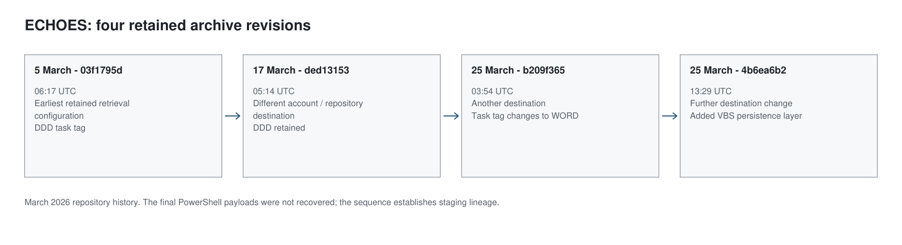

The ECHOES lure paired an animation-project theme with a password-protected archive. Its repository history preserved four versions of the delivery kit, and the artwork and staging structure remained recognizable as repository destinations changed (the third revision added a persistence-related script, which the fourth retained). The delivery repository was `github[.]com/Lyracartoon/Echoes-of-the-Unborn-Sun`, reported live on 23 July 2026, and [Exhibit E11](../preprint/evidence/E11.pdf) records the retained archive revisions, but the final PowerShell resource was unavailable, so its final payload cannot be compared with the ClickFix or VSIX payloads.

The retained current RAR has SHA-256 `7db6789c09e29305c728bf3d7b94c5ef1c3e13eef1b321ee52d3ae3997731f56`; its LNK member has SHA-256 `a44068e9758262a65861b91f2b00d0a3eca019d3b35543dd60c1c7f2e0ba1952`. The [artifact reference](artifact-reference.md) lists the earlier archive revisions, LNKs and analyst-decoded stage-two hashes as well.

The delivery repositories do have a documented connection. The restricted catalogue of 172 public repositories examined on 24 July placed ECHOES and the weaponised `predict-together` copy under the same account, and those two and one further assessment repository were the only three catalogued repositories carrying delivery kits; the catalogue is discussed in the [paper](../preprint/UNK_DeadDrop-Preprint.pdf) but is not reproduced in the public evidence exhibits.

That connects account control and delivery staging, not the missing final payload: one delivery account ran two delivery kits, the folder-open repository and ECHOES. ECHOES contributes a distinct entry route. The archive holds a `.pdf.lnk` shortcut whose arguments carry an encoded first stage, which decrypts to a PowerShell second stage that relaunches itself hidden, elevates, opens a decoy PDF, installs scheduled-task and script persistence firing at startup and hourly, pulls two further stages from the same GitHub account using a hard-coded access token, and deletes itself, while repository-held retrieval settings change across revisions; ClickFix instead relies on a pasted command, and the VSIX route relies on editor tasks and extension installation, yet their shared use of repository staging does not make their downstream capabilities interchangeable.

## Four archive revisions from March

I compared four archive revisions: one from 5 March, one from 17 March and two from 25 March 2026, and the comparison followed the decoy images and encoding structure, then checked retrieval settings and task tags. In order, with all times in UTC:

1. `03f1795d`, 5 March, 06:17: the earliest retained retrieval configuration, with a DDD task tag.
2. `ded13153`, 17 March, 05:14: a different account and repository destination.
3. `b209f365`, 25 March, 03:54: another repository destination, with the tag changed to WORD and a VBS persistence layer added.
4. `4b6ea6b2`, 25 March, 13:29: a further destination change and a new access token, with the staging otherwise unchanged.

The third revision changed both retrieval and persistence; the fourth retained that staging while replacing the destination and access token. The embedded tokens were not used to retrieve the final stage. Their values are withheld. A later review of the delivery repository found a fifth archive commit, made about two hours after the first with the same destination, token and decoys, a cosmetic re-compression that leaves the four distinct configurations standing. The kit was not unique to this lure either: [FortiGuard Labs had documented the same LNK and GitHub chain](https://www.fortinet.com/blog/threat-research/dprk-related-campaigns-with-lnk-and-github-c2) on 2 April 2026 with Korean business lures in place of the animation pitch, and named one of the C2 accounts in my record among its own, so the operator varies the lure while reusing the toolchain. The Hangul decoy metadata and the token-based C2 are consistent with Proofpoint's assessment that the operation is very likely North Korea-aligned and with FortiGuard's DPRK framing, which remain those publishers' assessments rather than mine.



*Figure 1. ECHOES changed retrieval destinations across four revisions and added a VBS persistence layer in the third.*

## The final PowerShell payload was not recovered

The staging references led to final PowerShell resources unavailable through the unauthenticated routes, and that absence follows from the design rather than from bad luck: the files sit in private repositories reachable only with the embedded token, so no crawler, scanner or token-less sandbox can have captured them. My hunt of 23 July covered the account cluster on the forge, stored URL-scanner scans, VirusTotal, MalwareBazaar and the Open Threat Exchange without a hit, and FortiGuard did not publish stage-three hashes either, so no final payload was available for capability analysis.

The closest counterpart came from a separate public staging repository linked to the same operator personas, which carries the same retrieval header and, in its first revision, the same account and token as the final ECHOES archive, and holds scripts dated 31 March to 10 April that decrypt with parameters stored beside them. Read statically and never run, they form a four-part toolkit that collects wallet application folders and files named for seeds, private keys and recovery codes, decrypts browser credentials (including through the App-Bound encryption bypass and, new to the investigation, Volume Shadow Copy reads of locked browser databases), runs a keylogger and clipboard logger through a VBScript runner, and uploads through GitHub's contents API into a private repository named after each victim's user and machine. That egress is ordinary TLS to `api.github[.]com`, so blocking it by destination would also block legitimate GitHub use, whereas the toolkit's fixed, self-identifying container format decrypts statically and is a durable detection handle. It also settles a smaller question from [Part 4](04-credential-wallet-collection.md): the Overlord agents and their Node and Python stages log no keys, but the operator's separate PowerShell toolkit does. These scripts show the operator's tooling rather than what the March archives fetched, since those exact bytes were never retained, and nothing in them shows that any victim was affected.

Account status was less clear than a 404 suggested. One historical check found an unavailable account whose name was also unavailable for registration, which supports a suspension hypothesis but does not confirm it with the platform. Neighboring numeric identifiers showed no distinctive batch-registration pattern, and consecutive IDs can belong to unrelated signups; proving common registration control would require unavailable platform data.

## C2PA metadata in the poster

I also examined the retained decoy artwork. The poster, identified in the case as `Post.png`, contained a [C2PA](https://c2pa.org/specifications/) structure in its PNG `caBX` chunk, and [Exhibit E14](../preprint/evidence/E14.pdf) records the retained metadata and signature examination; I extracted the metadata and parsed its JUMBF and CBOR structures, including the embedded certificates. The fields read:

```text
Claim generator:  ChatGPT
Software agent:   GPT-4o
Source type:      trainedAlgorithmicMedia

Recorded certificate subject fields:
OpenAI / Sora signing-pipeline references
```

The manifest history records creation, conversion and ingredient-opening actions across two manifests, and its embedded thumbnail was described as a lower-resolution version of the poster. The original note reports successful signature validation. But the retained record lacks independent verifier output and certificate-status or trust-list checks, and an embedded ingredient-validation assertion is not independent verification of the later manifest. The fields describe an image pipeline. They contain no identity for the person who generated or distributed the poster.

The manifest contains no prompt or user identifier, and its redacted-assertions array is empty; those fields may never have been included, and an empty redaction list is not evidence that information was removed. Other portraits lacked the poster's C2PA structure. Re-encoding or a different export path could explain the difference, as could a different source image. Intentional metadata removal remains unverified.

### C2PA certificate validity ran from April 2025 to April 2026

The leaf certificate was valid from 15 April 2025 to 15 April 2026, and the examination found no trusted timestamp token. Signing and generation times remain unknown. Repository commits date when the image appears in preserved history, not when it was created.

The PNG examination found no bytes after the end marker, though other hiding methods were outside that check.

