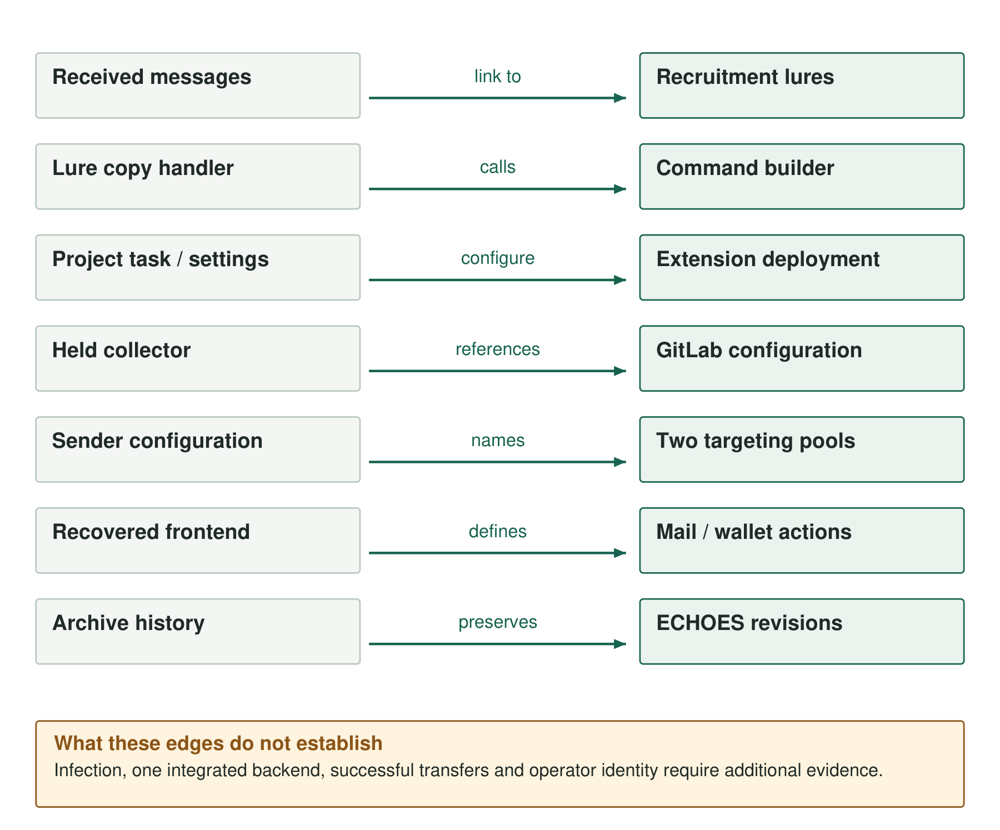

I connected three recruitment messages to delivery code, a mutable GitLab resolver, two targeting databases holding 142,365 distinct address strings and an administration frontend. Some links are direct code references; others rest on dated infrastructure observations, and no endpoint or backend record reconstructs a complete infection and collection sequence.

## Key takeaways

- The copy handler calls a command builder, the editor task invokes an installer, and sender configuration names the two SQLite targeting pools: these are direct code references.
- Every serving and command address I observed from July to November sits with one shared-hosting provider, Advin, so exclusive ownership of any address remains unverified.
- The console's single privileged identity, `eros1030109@gmail[.]com`, recurs in lure-domain DMARC records and in the dead drop's commit history, which ties these pieces to one configuring hand, and its `1030109` suffix recurs in the dead-drop owner's address and the ECHOES archive author's.
- Counted as independent observation paths, the TronzitVeca and ECHOES persona block stands on twelve while the D2S AI Trade and Category Labs lures rest on two and one, and several strong-looking leads fell apart on review, including real crypto companies, an affiliate-marketing spam family and PolinRider, which I keep separate from UNK_DeadDrop.
- Stormshield's Trigram report describes UNK_DeadDrop on my own identifiers, and pivoting its addresses recovered 142 operator-named lure hostnames I had not collected.

## Scope: three messages, two delivery routes

Three recruitment messages started the investigation:

- a Nodit-themed lure received on 22 June 2026;
- a D2S AI Trade lure on 21 July;
- a Category Labs lure on 22 July.

Their links led to clipboard manipulation and editor-extension delivery routes. The collected material also included a mutable GitLab resolver, two targeting databases and administration frontend source.

Some connections are direct code references. The copy handler calls a command builder, the editor task invokes an installer, and sender configuration separately names the database files. Other relationships rely on historical infrastructure observations or compatible functions in separately recovered software. No endpoint or backend record reconstructs a complete infection and collection sequence.

*Figure 1. Code references, configuration values and historical observations connect the recovered components.*

## Delivery: a copy handler, an editor task, and a passworded archive

### The browser route

In the [browser route](01-clickfix-clipboard-manipulation.md), a verification page changes the command placed on the clipboard. Its copy handler passes a nonce, phrase and operating-system value to a builder that adds installation logic while preserving the promised `VERIFY-` output. The first-stage download location comes from the page's origin, allowing the same frontend to work on different lure hosts.

### The repository route

The [repository route](02-vsix-editor-execution.md) uses project task configuration to reach a VSIX installer. The Google Update Support extension reads deployment settings from workspace configuration, so the package and its settings jointly determine the configured destination.

The VSIX also carries native agents and encrypted Windows components. Authenticated decryption exposed a Windows Node/Python pipeline inside the extension. Similar COM elevation-builder code occurs in the ClickFix collector, linking the two implementations.

Their entry conditions differ. One depends on a candidate pasting a command into a terminal. The other depends on editor task permissions and extension installation.

[Proofpoint's earlier report](https://www.proofpoint.com/us/blog/threat-insight/dont-fear-repo-unkdeaddrop-phishing-campaign-targets-developers-steal) documents the extension route and Windows architecture. I recovered the same mechanisms in the package, including the configuration and process-building code.

### The message headers

The message-header review identified Mailgun VERP envelope behavior for the D2S and Category Labs lures, while the Nodit message used its own domain in the envelope. The messages arrived through a forwarding service, so the original sending IP was not preserved. The forwarding service and its relay addresses belong to the recipient's mail path, not the campaign infrastructure. Personal addresses and envelope identifiers are omitted. The message evidence is summarized in [E01](../preprint/evidence/E01.pdf).

The three messages carry these Date headers:

| Lure | Date header (UTC) |
|---|---|
| Nodit | 22 June 2026, 13:33:47 |
| D2S AI Trade | 21 July 2026, 01:08:32 |
| Category Labs | 22 July 2026, 01:08:39 |

The two July messages went out seven seconds apart on consecutive nights, which points to one scheduled job rather than two hand-sent mails.

The mail setup also changed between June and July. The Nodit message was signed with DKIM, but its public key was never published, so the signature failed, no DMARC record existed and SPF alone carried delivery. Its body was a single base64 HTML part with no plain-text alternative, sent during the day. The D2S and Category Labs messages pass SPF, DKIM, DMARC and ARC, use a commercial platform with VERP bounce addressing, publish DMARC on the apex and the sending subdomain, and run a commercial DMARC-monitoring tenant on that subdomain. That reads as a learning curve, a weak signal for the single-actor reading. It also shows that passing authentication is no trust signal: a correctly configured attacker domain passes everything. [Part 1](01-clickfix-clipboard-manipulation.md) explains why I treat the Nodit lure only as a probable earlier iteration.

### Timing: build and campaign run as one workflow

Three independent artifact types place one re-provisioning day, 13 July 2026:

- WHOIS records register `aavzx[.]ink`, `fallbaav[.]ink` and `d2saitrade[.]ink` at 06:38, 07:13 and 19:59 UTC;
- the dead drop's own history commits the rotation to the new C2 at 07:10:58 UTC;
- the Windows agent archive's preserved modification times show its update script and the file holding the dead-drop URL edited that day.

The Go implant's `vcs.time` of 01:14:06 UTC on 21 July then falls five minutes and thirty-four seconds after the D2S message. That field is the commit time of the source revision, not a compile time ([Part 12](12-framework-and-collection-boundary.md)). Either the send was scheduled while the revision was committed, or the proximity is coincidence, and nothing I observed separates the two. On either reading build and campaign operations belong to the same workflow.

## Infrastructure: resolver edits point to two July server generations

### The GitLab resolver

The [GitLab resolver](06-gitlab-dead-drop-infrastructure.md) separates destination settings from deployed payloads. The retained history records changes to `config.json` and a separate `config-alt.json` file, but no retained payload references the latter. On 13 July, the referenced `config.json` set changed to `api.cklomino[.]ink` and `api.dsfmot[.]xyz` ([E07](../preprint/evidence/E07.pdf)).

On 25 July my own watch recorded a further commit that cut the file to `api.chestsoi[.]ink` alone. After the repository went dark on 22 October, the operators rebuilt it within about 31 hours under a new name, and again on 3 November under a third, naming a new host, `api.cerysoi[.]ink` ([Part 16](16-control-layer-after-october.md)). A payload hash alone cannot identify which configuration a client fetched.

### Server observations

A certificate naming `api.cklomino[.]ink` and a Subtensor sign-in panel observed at `207.241.172[.]222` connect that address to the historical service. Passive DNS and related research-service records supplied further pivots. These observations date service associations.

Every serving and command address I observed from July to November sits with one shared-hosting provider, Advin, so exclusive ownership of any address remains unverified. Before July the pattern did not hold: the first Overlord server stood at RouterHosting from 26 May, and the dashboard spent part of June at Liga Hosting ([Part 16](16-control-layer-after-october.md)). Client refresh behavior and connections after the configuration change remain unknown.

### The late-July lures

The late-July lures added another dated origin picture. On 23 and 24 July, `170.205.31[.]182` served the `3dscenebox[.]online` lure and was associated with several reactivated lure domains. Separately, certificate and passive-scan records linked the `api.aazdias[.]ink` and `api.fallaazdis[.]ink` store pair to `207.241.172[.]222`. [E20](../preprint/evidence/E20.pdf) and [E21](../preprint/evidence/E21.pdf) document the limits of those observations; the public bundle lacks the complete provider responses.

### The July campaign host

The `23.137.105[.]75:5173` C2 observation, reported before my July material, belongs to the July campaign host. A 22 July analyst note also records an Express response from `23.137.105[.]75:3000` and a CORS preflight allowing `X-Guard-Platform`, a header present in the recovered installer.

Route existence and data receipt remain unknown. The note records only the 404 and preflight responses, and the probe transcript is not in the public evidence PDFs. These July observations have not been refreshed since 24 July.

### Provisioning bursts: a timing link

Chaining certificate, registration, commit and mail events that fall within ninety minutes of one another produced 82 bursts across my whole record, 23 of them containing UNK_DeadDrop events. Seven of those bursts connect hosts I had not otherwise connected, for example:

- a lure domain registered forty-six minutes before a different brand's recruitment mail went out, two brands in one sitting;
- three parcel-themed lure names certified inside seventeen seconds;
- two naming families certified two minutes apart, and two lure families on two different addresses in one run;
- one 77-minute session on 3 November that stood up the next C2 generation end to end.

A timing link is weaker than shared hosting and stronger than a naming family. I use it to place hosts beside each other, not to prove common control on its own.

### Summary of the pivots

| Starting artifact | Connection | Result |
|---|---|---|
| Received message | Recruitment URL | A delivered lure |
| Lure source | Copy handler calls command builder | Clipboard substitution and first-stage retrieval logic |
| Project configuration | Task and deployment settings | Extension installation path and configured parameters |
| Held collector | GitLab configuration URL | Mutable destination lookup |
| Sender configuration | Paths to two SQLite pools | Stored targeting material available to the sender |
| Administration frontend | Imports and API route references | Repository monitoring and wallet-management controls |
| ECHOES repository history | Four retained archive revisions | Changes to retrieval and persistence |

The [historical indicator reference](historical-indicators.md) collects the exact hostnames, paths and IP observations behind these links, with the evidence type and uncertainty recorded for each. The [artifact reference](artifact-reference.md) gives file hashes for the samples and archive revisions used in the pivots.

## Targeting: separate contact pools and wallet fields

I recovered the targeting tools and wallet interfaces separately from the delivery chain. Their code describes preparation and intended use of collected data. Their integration remains unverified.

### The harvester and its pools

The [harvester](07-developer-target-harvesting.md) searches repositories by star range and extracts author and committer addresses from branch histories. Sender configuration names two SQLite pools containing 142,365 distinct stored address strings associated with 27,698 repository values ([E08](../preprint/evidence/E08.pdf)).

The pools are split by mail domain, not by any interest, and crypto repositories are the smallest category in them. The list is therefore untargeted, and selection happens at the reply, in the console's mail operation. The counts quantify the available targeting material. Missing send logs and endpoint records prevent a count of recipients contacted or systems compromised.

### The administration frontend

The separately recovered [rms-platform frontend](08-administration-platform.md) contains mail views, repository availability monitoring and wallet import, preview and claim controls. Its mnemonic and ColdKey fields correspond to material selected by the collectors. That connection describes compatible data and functions.

The console's single privileged identity, `eros1030109@gmail[.]com`, recurs in the DMARC records of two lure domains and in the dead drop's commit history. That ties these pieces to one configuring hand.

The strength of that link needs stating carefully. Both places are strings typed into systems that verify neither. A DMARC report address on another domain needs external-destination authorization, and the authorization records that would allow reports for the two lure domains do not exist at `gmail[.]com`, so no compliant reporter ever sends there and the channel is inert. A git author address is equally self-asserted. What survives is that one actor configured the two lure domains and the dead drop with the same string, a link between lure and C2 infrastructure that does not depend on shared hosting. Because the habit has no operational feedback, the operators have little reason to notice and change it. What the string cannot show is the person behind the account. No recovered backend establishes that the targeting pools, mail system and wallet workflow were integrated or used successfully, and the claim recipients are chosen on the server side.

### ECHOES

[ECHOES](09-echoes-lineage-image-provenance.md) preserves a different delivery branch. Four archive revisions show repeated artwork and staging, changing retrieval destinations and a VBS persistence addition. Its final PowerShell payload was unavailable through the unauthenticated routes examined, so whether it deployed the Go agent, the JavaScript collector or another payload remains unknown. The closest counterpart is a separate PowerShell toolkit from a related staging repository that exfiltrates into per-victim GitHub repositories.

## Identity: the 1030109 family

The privileged console address is one of several operator addresses sharing the numeric suffix `1030109`:

| Address or account | Role in my record |
|---|---|
| `eros1030109@gmail[.]com` | Privileged console identity, lure-domain DMARC records, dead-drop commits, a planted security contact |
| `apollo1030109@gmail[.]com` | Owner of the GitLab account `0xapp123` that holds the dead drop, confirmed by its avatar hash |
| `stefan.kano1030109@gmail[.]com` | Author of the ECHOES archive commits ([Part 9](09-echoes-lineage-image-provenance.md)) |
| `hera1030109@gmail[.]com` | A dormant Google account with no public footprint, probable operator on the naming pattern alone |
| Telegram `@Tr1030109` | The "Tronzit Veca" persona that persona-account READMEs tell readers to contact |

The GitLab account carries no name or profile, but GitLab derives its avatar identifier from a hash of the account's lowercased e-mail address, and that hash equals the one for `apollo1030109@gmail[.]com`. The same address authored hundreds of commits under the git names `0xapp123` and `0xed123`, and persona READMEs send readers to `@Tr1030109` on Telegram and `0xapp123` on Discord. I assess with high confidence that these identifiers converge on one operator identity, the TronzitVeca persona that [Part 15](15-persona-farm.md) follows through the persona farm.

The addresses split by role. The ones used for the domain registration, the lure DMARC records and the dead-drop commits return no code commits at all, while the cover-repository addresses return thousands. Outward-facing identities do not appear in commit metadata.

[Genians' Operation GitPower report](https://www.genians.co.kr/en/blog/threat_intelligence/kimsuky_ai_llm) of 10 August 2026 lists `eros1030109` and `apollo1030109` among its own identities, reached through a cluster built on different malware. It also lists `170.205.30[.]227` and `170.205.29[.]83` as C2 without naming a hoster; that they sit at Advin is my own attribution. [Part 17](17-two-operations-one-ecosystem.md) weighs what that corroboration does and does not show.

## Robustness: counting independent paths

To test which connections carry weight, I built a graph from the evidential links in my record and counted independent paths through observables only. I excluded shared victims, because a shared victim is not attribution evidence, and treated dual campaign tags as ordinary nodes rather than links.

| Cluster | Independent observation paths |
|---|---|
| TronzitVeca persona block and ECHOES | 12, across 210 source files |
| D2S AI Trade | 2, one domain pair |
| Category Labs | 1, one served bundle |
| PredictTogether | Not separable: fourteen of its fifteen observables are also tagged into core campaigns |
| PolinRider and related resolver blocks | 0 once two non-observational artifacts are removed |

The persona block's minimum cut spans different evidence types: identity reuse through two operator addresses and two platform accounts, hosting through an address and a persona domain, the GitLab dead drop, and code through the console source and the leaked build path. No single record carries it. The D2S and Category Labs links are sound but have no redundancy, so one corrected observation would break each.

A missing edge is not missing evidence. These counts measure what my graph records as observations, so where a case file holds a link the graph lacks, the attribution is not necessarily weaker.

## Review: leads that fell apart

Several connections that looked strong in the middle of the investigation fell apart when they were checked properly. Keeping them would have put somebody else's infrastructure or name into the indicator set.

### Real companies behind the personas

The persona accounts claimed roles at real crypto projects and displayed testimonials attributed to founders and executives. At first, some project domains and authors' social handles were treated as possible operator infrastructure, because they shared registrar, hosting and privacy-registration patterns with known sites.

The projects proved to be established companies with years of public history. The accounts themselves belong to a persona farm built from copied commit histories, which [Part 15](15-persona-farm.md) separates from the real developers whose work was copied. Their testimonials used real people's names and handles, with no sign those people had written them, and the evidence identifies the companies and people as targets of impersonation.

Their domains do not belong on a certificate watch list. Their names are omitted here. The shared hosting fingerprint was common. A budget registrar, popular host and privacy service are not enough to connect a domain to an operation.

### An affiliate-marketing spam family

Most of this domain family was registered in September 2025 and hosted by the same budget provider. It was first treated as an earlier campaign phase, then reclassified the same day as probable operator infrastructure with high confidence. Closer inspection found:

- at least six beauty and cosmetics domains;
- about forty subdomains per domain named for invented Brazilian influencers;
- numbered bulk-mail sender subdomains;
- spam classifications.

The sites formed an affiliate-marketing spam operation, eight months older on the shared address than the operator's lure fleet. They had no recruitment lure, ClickFix page or malware.

The "dedicated host" claim came from one passive-DNS source with limited coverage, and another address used by the family hosted unrelated sites for years. The association was withdrawn before any indicator set or referral was filed.

### Smaller leads

- The 3D-artist lead in [Part 7](07-developer-target-harvesting.md) came from a new cover story. The harvester shows no separate sourcing channel for that audience.
- The operator-associated Solana wallets active into 2026 led through one pass-through account to a program-owned account holding thousands of SOL and handling hundreds of transactions each day. The trace found no victim funds.
- The broader repository sweep returned two signature matches. Reading the files showed both were benign.

### PolinRider

The most tempting connection of all was PolinRider, a workstation-to-repository worm whose recruiters use the same fake-employer pretext and the same folder-open editor task. Its mechanics differ from UNK_DeadDrop:

- it resolves its C2 from blockchain records rather than a GitLab file;
- it delivers through hidden JavaScript loaders rather than ClickFix pages or an extension;
- it hosts its resolver C2 with Evoxt and AS399486 rather than Advin.

When I counted observation paths in my evidence graph, the only two routes from PolinRider records to UNK_DeadDrop records were a generic obfuscator rule and an attribution tag, neither of them an observation. A fork that appears to show the UNK_DeadDrop persona `pridnet` authoring a PolinRider commit is the worm amending commits under whoever wrote them in a victim's working copy.

The two operations share an ecosystem and a few victims, developers who answered both recruiters, and nothing else I can observe. I keep them apart; [Part 17](17-two-operations-one-ecosystem.md) sets out that separation.

## Corroboration: later reporting and an October continuation lead

I checked later reporting against the retained artifacts for further connections.

### Hopkins

Ben Hopkins's [UNK_DeadDrop investigation](https://brhopkins.uk/posts/foxtopia/) first appeared on 23 July, before this case's evidence cutoff, and was updated in August. The update places `api.chestsoi[.]ink` in the GitLab dead-drop sequence, and my own watch confirms it. The commit of 25 July that made it the file's only host is in my monitoring record, so the hostname is a captured indicator rather than a reported lead. Hopkins's path was accurate when he published it.

### SafeDep and Stormshield

Two November reports reached the same machinery from outside.

[SafeDep](https://safedep.io/blog/antd-img-crop-forged-commit-overlord-stealer) described a forged commit in the GitHub repository of the npm package `antd-img-crop` that ran a dropper on `npm run build` and fetched the operation's stage three, leaving the published package unaffected. Its Windows agent entry file matches the one I hold by full SHA-256, although about seventy of its ninety-three indicators were new to me.

The forged commit, dated 31 October 2026, adds a `prebuild` script that fetches a launcher from a lure domain, then the `deepfake_guard` installer, then the Overlord stage three. An earlier attempt from the same maintainer account on 21 August added an install-time dropper to another of the maintainer's repositories from a different lure domain. One of the lure domains involved was already in my passive DNS, on the server of a known lure cluster, without my having singled it out. An indicator can be held and still be unread.

[Stormshield's Trigram report](https://www.stormshield.com/news/cti-trigram-campaign/) described a ClickFix kit it calls DeepfakeGuard behind a GitLab relay and a Django back office. I can say on my own identifiers that Trigram is UNK_DeadDrop:

- the relay is the dead drop I track in its later projects;
- the back office's database user `silviattech1129` shares its handle with a relay commit author;
- the session-replay organization in current builds already sat on July and June lures.

Stormshield's link to Kimsuky is Stormshield's assessment, which it reworded on 17 November, and I have not established it. Pivoting Stormshield's addresses recovered 142 operator-named lure hostnames I had not collected.

### What outside reporting confirms

Read together, the outside reports confirm the core chain, each for part of it:

| Source | What it documents |
|---|---|
| [Proofpoint](https://www.proofpoint.com/us/blog/threat-insight/dont-fear-repo-unkdeaddrop-phishing-campaign-targets-developers-steal) | Repository tasks, the fake Google extension and the Overlord-derived Go agents |
| [Hopkins](https://brhopkins.uk/posts/foxtopia/) | The GitLab dead drop and the in-memory AES-256-GCM stage, from a JavaScript stage rather than the Go binaries |
| [SafeDep](https://safedep.io/blog/antd-img-crop-forged-commit-overlord-stealer) | The ClickFix branch, the stage three behind the dead drop, the Go agent and the October addresses |

None documents the administration panel, and Hopkins and SafeDep build on Proofpoint's cluster definition without adding independent attribution. Everything after July is in my record only: the rebranded panel on three hosts, the Cortex console, the August to October lure families, the targeting databases and the build-host signals.

### Re-deriving third-party indicators

Each third-party list I worked in November contained entries that are not operator infrastructure:

- Hopkins's list includes the Mailgun sending address of a lure message, which is not a C2, and a value that is the stage's decryption key republished as though it were a file hash;
- four undelegated lure domains I found through one of Stormshield's addresses answered with `45.54.28[.]15` on public resolvers too, an address belonging to a DNS-filtering service, so the answer is a filtering or sinkhole response and not the operator;
- one address in Stormshield's set, which also runs game servers, hosted the operator's dashboard only from about 8 to 29 June 2026 before its hoster reassigned it, so it is historical rather than current.

Before I use an imported indicator, I resolve what it actually is, bound every address by date against hosting reassignment, and check a value's type before indexing it as a hash. The lists remain valuable: the same Stormshield pass surfaced the 142 lure hostnames I had not collected.

### The October developer-lure report

An [October developer-lure report](https://dev.to/edison_flores_6d2cd381b13/a-fake-recruiter-sent-me-a-job-offer-that-ended-in-my-terminal-the-trojan-is-still-live-2okf) describes a launcher with four markers also found in this corpus: `deepfake_guard`, a POSIX double-fork, `/var/tmp/.kdm.XXXXXX` and `/guard-launcher-result`. It names `taikotalent[.]xyz`, the paired hosts `api.gaganata[.]ink` and `api.fallgganata[.]ink`, and sample SHA-256 `c7c22e322c17bda8198257342d4034af6250a5c433242461b870879ba9aa285d`.

The shared markers make this a probable continuation lead, and the `deepfake_guard` marker matches the kit name Stormshield later published. The article, gist, repository and follow-up all trace to one reporting chain, and the sample was not independently recovered. The hosts and hash therefore remain leads, not verified indicators.

## Limitations

- No endpoint or backend record reconstructs a complete infection and collection sequence.
- Missing send logs and endpoint records prevent a count of recipients contacted or systems compromised.
- The infrastructure observations are dated associations on a shared-hosting provider, and the July observations have not been refreshed since 24 July.
- The integration of the targeting pools, mail system and wallet workflow remains unverified.
- The `1030109` link rests on self-asserted DNS and git strings, and the D2S and Category Labs clusters each rest on one or two observation paths.

## Conclusion

The investigation connects its components through named relationships of different strength: code references, configuration values, dated infrastructure observations, provisioning timing and a family of operator addresses sharing one suffix. Counting independent paths shows where that structure is redundant and where one observation carries a whole sub-cluster. Each link supports only what its evidence type supports, and the table and indicator reference record that for each pivot.

The leads that fell apart matter as much as the ones that held. Shared budget hosting, real companies behind copied personas and a parallel operation using the same pretext all looked like connections and were not. Defenders should weigh the same evidence types before adding a domain or address to a watch list.
