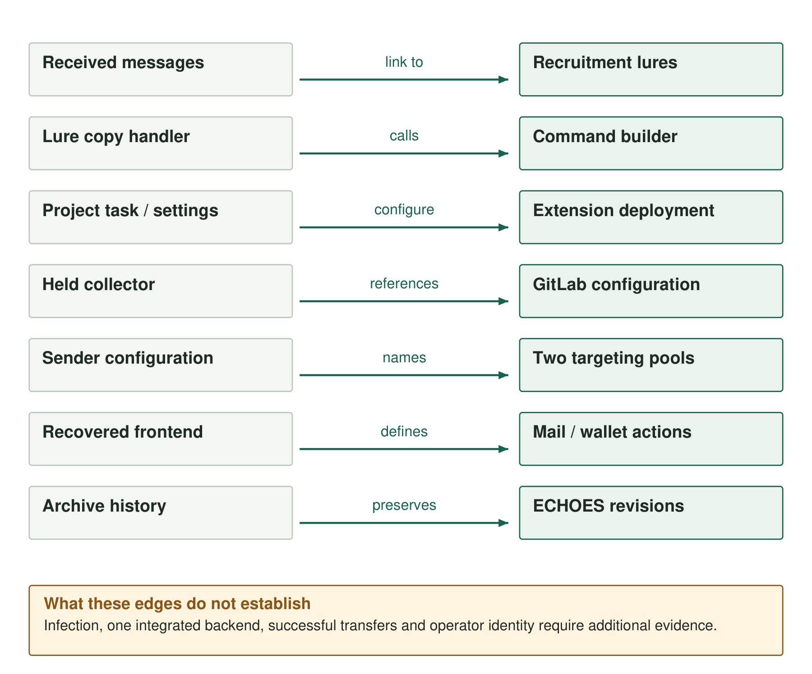

Three recruitment messages started the investigation: a Nodit-themed lure received on 22 June 2026, a D2S AI Trade lure on 21 July and a Category Labs lure on 22 July. Their links led to clipboard manipulation and editor-extension delivery routes. The collected material also included a mutable GitLab resolver, two targeting databases and administration frontend source.

Several connections are explicit in the code: a copy handler calls a command builder, a task invokes an installer, and sender configuration names database files. Other relationships rely on historical infrastructure observations or compatible functions in separately recovered software. No endpoint or backend record reconstructs a complete infection and collection sequence.

## Two delivery routes

In the [browser route](01-clickfix-clipboard-manipulation.md), a verification page changes the command placed on the clipboard. Its copy handler passes a nonce, phrase and operating-system value to a builder that adds installation logic while preserving the promised `VERIFY-` output. The first-stage download location comes from the page's origin, allowing the same frontend to work on different lure hosts.

The [repository route](02-vsix-editor-execution.md) uses project task configuration to reach a VSIX installer. The Google Update Support extension reads deployment settings from workspace configuration, so the package and its settings jointly determine the configured destination. The VSIX also carries native agents and encrypted Windows components.

Authenticated decryption exposed a Windows Node/Python pipeline inside the extension. Similar COM elevation-builder code occurs in the ClickFix collector, linking the two implementations. Their entry conditions differ: one depends on a candidate pasting a command into a terminal, while the other depends on editor task permissions and extension installation.

[Proofpoint's earlier report](https://www.proofpoint.com/us/blog/threat-insight/dont-fear-repo-unkdeaddrop-phishing-campaign-targets-developers-steal) documents the extension route and Windows architecture. The recovered package corroborates those mechanisms and exposes the configuration and process-building code in detail.

The received messages have a separate transport detail: an inbound forwarding service inserted reverse-alias information into the headers. Those addresses belong to the recipient's forwarding path and were excluded from the campaign infrastructure list.

*Figure 1. Code references, configuration values and historical observations connect the recovered components.*

## Configuration and infrastructure

The [GitLab resolver](06-gitlab-dead-drop-infrastructure.md) separates destination settings from deployed payloads. The retained history records changes to `config.json` and a separate `config-alt.json` fallback. On 13 July, the primary set changed to `api.cklomino[.]ink` and `api.dsfmot[.]xyz`. A payload hash alone cannot identify which configuration a client fetched.

A certificate naming `api.cklomino[.]ink` and a Subtensor sign-in panel observed at `207.241.172[.]222` connect that address to the historical service. Passive DNS and related research-service records supplied further pivots. These observations identify dated service associations without establishing exclusive ownership of the address. Client refresh behavior and connections after the configuration change remain unknown.

The main connections are:

| Starting artifact | Connection | Result |
|---|---|---|
| Received message | Recruitment URL | A delivered lure |
| Lure source | Copy handler calls command builder | Clipboard substitution and first-stage retrieval logic |
| Project configuration | Task and deployment settings | Extension installation path and configured parameters |
| Held collector | GitLab configuration URL | Mutable destination lookup |
| Sender configuration | Paths to two SQLite pools | Stored targeting material available to the sender |
| Administration frontend | Imports and API route references | Repository monitoring and wallet-management controls |
| ECHOES repository history | Four retained archive revisions | Changes to retrieval and persistence |

## Targeting data and administration software

The [harvester](07-developer-target-harvesting.md) searches repositories by star range and extracts author and committer addresses from branch histories. Sender configuration names two SQLite pools containing 142,365 distinct stored address strings associated with 27,698 repository values. The counts quantify the available targeting material. Missing send logs and endpoint records prevent a count of recipients contacted or systems compromised.

The separately recovered [rms-platform frontend](08-administration-platform.md) contains mail views, repository availability monitoring and wallet import, preview and claim controls. Its mnemonic and ColdKey fields correspond to material selected by the collectors. That connection describes compatible data and functions; no recovered backend establishes that the targeting pools, mail system and wallet workflow were integrated or used successfully.

[ECHOES](09-echoes-lineage-image-provenance.md) preserves a different delivery branch. Four archive revisions show repeated artwork and staging, changing retrieval destinations and a VBS persistence addition. Its final PowerShell payload was unavailable through the unauthenticated routes examined. The retained stages therefore cannot establish whether it deployed the Go agent, JavaScript collector or another payload.

## Related public reporting

[Ben Hopkins's UNK_DeadDrop investigation](https://brhopkins.uk/posts/foxtopia/) provides additional resolver and infrastructure context. Its initial July publication falls within this investigation's 24 July evidence cutoff, although the article was subsequently updated in August.

An [October developer-lure report](https://dev.to/edison_flores_6d2cd381b13/a-fake-recruiter-sent-me-a-job-offer-that-ended-in-my-terminal-the-trojan-is-still-live-2okf) describes overlapping implementation markers. Its follow-up material comes from the same reporter, and the reported sample was not independently obtained here. It provides a continuation lead for comparison with the retained July artifacts.

[Companion detections and static scanner](https://github.com/KrasForge/unk-deaddrop-companion).
