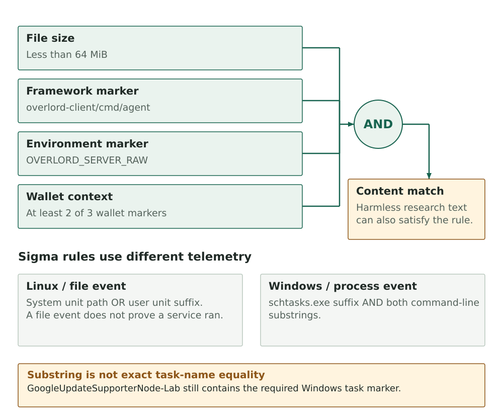

The published companion snapshot contains 33 named YARA rules in 28 files. Every rule matched at least one object in the saved investigation material, and none matched the small local software baseline.

A later, separate local review narrowed seven source rules after selected controls produced collisions. The revisions preserved all earlier artifact matches, but are not part of the published snapshot.

The wallet-agent rule initially matched marker-rich research prose. Requiring ELF magic at byte zero rejects that text fixture. It checks the header, not the executable's behavior.

The [companion repository](https://github.com/KrasForge/unk-deaddrop-companion) contains file-content rules and a parse-only JavaScript scanner. It no longer includes the event rules or workspace-configuration rules: authentic endpoint logs and the original `.vscode` task and settings files were not available for replay. Synthetic event records and invented configuration files would show how a rule behaves, not whether it matches the collected targets.

## The wallet-agent rule matched the held Go binary

The wallet-agent rule now requires ELF magic at byte zero, a file smaller than 64 MiB, an Overlord module path, a server-environment marker and at least two wallet-collection strings. The combination matched the held Go agent. Removing the header or one required marker category gives a negative result in the inert boundary tests.

The earlier rule version matched a harmless fixture with the complete marker set in research prose. Requiring the ELF header at offset zero prevents that ordinary text collision. YARA does not validate the rest of the executable or determine whether the strings are reachable code, so a marker-rich ELF can still match.

A file signature identifies matching content. Execution and data transfer require host evidence; operator attribution requires a separate investigation.

*Figure 1. Every wallet-agent condition is required. The retained rules matched case artifacts, while the local software baseline and marker-rich prose fixture had no hits.*

## The replay covered 192 files and 395 views

The read-only replay covered 192 selected files: the 15 directories marked `DO-NOT-RUN`, compressed lure bundles, web assets, extracted VSIX components and agent archives, source files, and six retained lure messages. The helper read ZIP, VSIX, TAR, gzip and nested ZIP content in memory without writing extracted files.

It evaluated 395 raw or archive-member views totaling about 234 MB. All 33 named rules in 28 files matched at least once. At least one rule matched 90 input files; 102 had no hits. The totals include copied variants and nested archive views, so they are not independent samples or incidents. [Exhibit E15](../preprint/evidence/E15.pdf) records the companion snapshot and validation scope. No file was executed.

Four ECHOES RAR archives require a password, so their members were not inspected. The separate sealed-environment archive was scanned only as raw bytes. Exact hashes identify the four ECHOES containers without making claims about their contents.

A separate exact-hash rule identifies the retained Surge Group message. It does not claim the message shares control with UNK_DeadDrop. Other hash rules identify exact retained packages, launchers and messages; modification or repackaging evades them.

Most unmatched inputs were generic dashboard modules, web assets or research context without a distinctive file-content signature. They were included in the coverage accounting, but weak rules that only identify those records would not be useful detections.

Workspace-file signatures remain absent because neither the original `.vscode/tasks.json` nor `.vscode/settings.json` appears in the saved repository archive or its commit history. Event rules were removed because there are no authentic Windows process, Linux audit or comparable endpoint logs in the retained set. The companion therefore has no Sigma rules. The two SQLite databases containing target addresses were also excluded from scanning.

The companion's [artifact-validation report](https://github.com/KrasForge/unk-deaddrop-companion/blob/main/docs/actual-artifact-validation.md) lists per-rule match counts and corpus limits. Its [detection notes](https://github.com/KrasForge/unk-deaddrop-companion/blob/main/docs/detection-notes.md) explain each condition and its limits.

## No matches in 1,914 local software files

The second scan covered 1,914 files and about 59.2 MB across 2,379 raw and nested object views from the local CPython standard library, installed Python packages, global npm packages and Acorn. No retained rule matched. The 19 Markdown articles and companion notes also produced no hits after source-oriented conditions were narrowed to avoid prose collisions.

The baseline consists of local software. Its small, uncurated sample cannot support estimates of fleet false-positive rate or production precision.

The prose fixture remains important alongside that zero-hit result. It records a false-positive case from the rule's earlier form and confirms the current ELF-header check rejects plain text. Analysts should still review file type, acquisition context and matched bytes before treating a hit as suspicious. For process and persistence behavior, collect authentic endpoint logs first; this repository does not publish event rules without them.

A later local review covered 177 case inputs, 380 views and 344 distinct objects. Seven source rules were narrowed after collisions in selected research, dual-use tooling, ordinary software, installed software and upstream-fork controls. Every previous case-artifact match was preserved, and the seven revised forms had no hits in the external controls scanned. This bounded control set does not estimate a production false-positive rate; the revisions remain separate from the public companion snapshot.

## YARA matches byte patterns; unk-scanner parses JavaScript

The YARA replay measures whether particular bytes match the signatures. `unk-scanner` instead parses JavaScript and follows selected expressions, string decoders and launch structures. A file can match a content signature while the scanner misses its behaviour, or produce a scanner warning because it uses obfuscation that also appears in legitimate software.

The expanded scanner evaluation now has its own [paper](../scanner-paper/UNK-Scanner-Paper.pdf). It covers popular npm packages and editor extensions, recently changed npm packages, and a separate public malware dataset. The final popular-software scan raised no errors in 188,901 files outside the initial calibration corpus, although an earlier run on those files informed one escalation-rule adjustment. In the registry changes corpus, two of 19,976 packages raised errors; full review classified both as false positives.

Sensitivity tells a different story. Only 62 of 2,122 known-malicious samples raised warnings, with none reaching error level. Most lacked the clipboard, Electron or encrypted-loader structures that the higher-severity rules recognise. The retained Windows Node agent also stays below warning level. Its known collection functionality does not become benign because this rule set misses it.

[Part 13](13-scanner-registry-benchmark.md) covers corpus selection, review depth, parser coverage and throughput. [Part 14](14-scanner-recovery-and-bypasses.md) examines nineteen small variants, eighteen of which evaded a rule, lowered severity or defeated string recovery, and a hardened engine that later closed all but one of them without adding error-level findings on the same corpora. These results concern the scanner, not the 33 YARA rules or their earlier control set.

## Rule matches depend on the bytes given to YARA

YARA can inspect only the bytes supplied to it. A rule for decrypted JavaScript needs those plaintext bytes; a rule for a VSIX member needs the member supplied to the engine. Scanning an outer compressed package alone is not equivalent to the archive-member replay above. Consult each rule's target and match conditions before choosing a sample.

A hunting service may use a different rule set for manual file scans. Check where the uploaded rules are deployed.

The repository includes inert [YARA boundary tests](https://github.com/KrasForge/unk-deaddrop-companion/blob/main/tests/test_detections.py), a [prose false-positive test](https://github.com/KrasForge/unk-deaddrop-companion/blob/main/tests/test_blog_boundaries.py), and the [test requirements](https://github.com/KrasForge/unk-deaddrop-companion/blob/main/requirements-dev.txt). Run the checks using the instructions in its README. These tests are repeatable checks of rule behavior, not malware execution or production validation.

