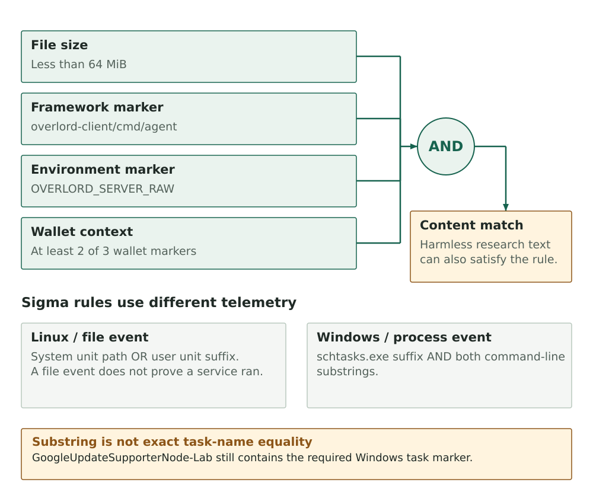

I replayed 33 named YARA rules in 28 files against the saved investigation material, and every rule matched at least one object while none matched the small local software baseline. A wider noise review found seven source rules colliding with public research and my own exhibits, and the static scanner, a separate tool, warns on only 128 of 2,122 known-malicious samples.

## Key takeaways

- All 33 named rules matched at least once across 395 raw or archive-member views from 192 files, and no retained rule matched 1,914 local software files.
- Seven source rules collided with public browser-decryption research, tooling, my published exhibits and rendered articles; I tightened them the same day without losing any earlier artifact match.
- The companion publishes no event, workspace-configuration or Sigma rules, because authentic endpoint logs and the original `.vscode` files were not available for replay.
- The `unk-scanner` engine raised no errors in 188,901 popular-software files, but roughly nineteen in twenty public malware samples get no warning at all.
- The scanner opens only JavaScript and TypeScript extensions, so editor tasks, hooks, package scripts and disguised payloads need a separate method; defenders should treat a rule hit as content for inspection, not a verdict.

## Results: the published rules and the noise review

The published companion snapshot contains 33 named YARA rules in 28 files. Every rule matched at least one object in the saved investigation material, while none matched the small local software baseline.

A wider noise review on the same day found that seven source rules collided with public browser-decryption research and tooling and with my own published exhibits and rendered articles. That is exactly the kind of input a rule author does not think to use as a control. I tightened the seven that day, and the revisions preserved every earlier artifact match. They are still not part of the published snapshot.

The review ran all 33 rules under libyara 4.5.4 against the case material and five control groups:

| Control group | Objects | Rule hits |
|---|---|---|
| Ordinary software, including clipboard libraries, an Electron quick-start and a dashboard template | 461 deduplicated | 0 |
| Installed software | 18,325 | 0 |
| Upstream Overlord fork source | 877 | 0 |
| Public browser-decryption research and tooling, including a research write-up and an expanded HackBrowserData archive whose strings aggregate across members | not counted separately | Collisions |
| My own output: published exhibits E02, E04, E17 and E19, the rendered HTML of Part 1 and the site generator's content cache | not counted separately | Collisions |

The collisions invalidate any blanket claim that the signatures avoid research prose, and they invalidate nothing about the malicious-artifact matches. The fixes required definitions rather than function headings and bound a clipboard call to its telemetry within a bounded expression.

### What the companion leaves out on purpose

The suite contains no host, domain or blocklist rule. Registration, hosting and certificate observations are dated facts, sometimes on shared hosting, and several of mine were later corrected or retracted, so they belong in the [historical indicator reference](historical-indicators.md) with their dates rather than in a signature that would outlive them. The suite also excludes:

- live or historical authentication tokens, private API credentials and endpoint secrets;
- victim-target databases, personal addresses, private messages and operator identity leads;
- bare addresses, parked and expired domains, and shared-host observations;
- generic folder-open, Electron, PowerShell, screen-capture, WebAssembly or framework markers without the conjunctions that make them specific;
- dashboard modules, lure artwork and site shells with no reliable file-content selector, since weak rules for them would identify my evidence set rather than detect malicious behavior.

### What the companion contains

The [companion repository](https://github.com/KrasForge/unk-scanner) contains file-content rules and a parse-only JavaScript scanner. It no longer includes the event rules or workspace-configuration rules, because authentic endpoint logs and the original `.vscode` task and settings files were not available for replay. Synthetic event records and invented configuration files would show how a rule behaves, not whether it matches the collected targets.

## Rule design: the wallet-agent rule matched the held Go binary

The wallet-agent rule initially matched marker-rich research prose, and requiring ELF magic at byte zero rejects that text fixture. It checks the header, not the executable's behavior.

The rule now requires all of the following:

- ELF magic at byte zero;
- a file smaller than 64 MiB;
- an Overlord module path;
- a server-environment marker;
- at least two wallet-collection strings.

The combination matched the held Go agent. Removing the header or one required marker category gives a negative result in the inert boundary tests.

The earlier rule version matched a harmless fixture with the complete marker set in research prose. Requiring the ELF header at offset zero prevents that ordinary text collision. YARA does not validate the rest of the executable or determine whether the strings are reachable code, so a marker-rich ELF can still match.

A file signature identifies matching content. Execution and data transfer require host evidence; operator attribution requires a separate investigation.

*Figure 1. Every wallet-agent condition is required. The retained rules matched case artifacts, while the local software baseline and marker-rich prose fixture had no hits.*

## Markers: six obvious ones that do not work

Six markers that look like natural detections for this operation fail on inspection:

| Marker | Why it fails |
|---|---|
| Dropper file names | Every live host serves the same dropper under every name in the rotation, and the size differences are only embedded hostname length |
| `OVERLORD_*` variables, WebAssembly plugins and remote control | Stock framework features that also fire on legitimate red-team deployments |
| `runOn: folderOpen` alone | Shared with at least one unrelated operation, PolinRider |
| The operators' settings-key namespace | One live sample ships an empty `settings.json` |
| Published Go binary hashes | A Windows chain exists that uses no Go binary at all |
| Sender authentication failure | SPF, DKIM and DMARC all pass for the attacker domains |

What does work is operator-specific: the `GUS_` namespace, the embedded agent token, the kit's repository markers, the C2 endpoint paths, the masquerading extension identity, the hidden scheduled-task name and the home-directory secret-hunting pattern.

### Invariant markers find repositories; rotated markers do not

A code-search sweep separated the two kinds of marker cleanly. The campaign-specific markers, the settings keys, the extension file name and the embedded agent token, each returned only the repository I already knew and a victim's blog post, because the operator rotates them per campaign. The invariant markers, the staging script file names, returned a third weaponized repository on an account I had not seen. That repository's own workspace settings are empty, so a detection keyed on the settings namespace would have missed it.

The negative half needed the same care. I verified thirty-seven candidate repositories from broader queries structurally, by fetching each tree and checking for a folder-open task together with a staging payload, and all thirty-seven were clean. An earlier unauthenticated pass over 160 repositories had hit the API rate limit early and returned "tree unavailable" for about 150 of them, which looks exactly like "clean" in the output. Only an account known to hold two repositories reporting zero gave it away.

## Method: a replay of 192 files and 395 views

The read-only replay on 26 October covered 192 selected files:

- the 15 quarantined sample directories;
- compressed lure bundles;
- web assets;
- extracted VSIX components and agent archives;
- source files;
- six retained lure messages.

The helper read ZIP, VSIX, TAR, gzip and nested ZIP content in memory without writing extracted files. No file was executed.

It evaluated 395 raw or archive-member views totaling about 234 MB, and all 33 named rules in 28 files matched at least once. At least one rule matched 90 input files, and 102 had no hits. The totals include copied variants and nested archive views, so they are not independent samples or incidents. [Exhibit E15](../preprint/evidence/E15.pdf) records the companion snapshot and validation scope.

### What the replay did not inspect

- Four ECHOES RAR archives require a password, so their members were not inspected. Exact hashes identify the four ECHOES containers without making claims about their contents.
- The separate sealed-environment archive was scanned only as raw bytes.
- The two SQLite databases containing target addresses were excluded from scanning.

### Exact-hash rules

A separate exact-hash rule identifies the retained Surge Group message. It does not claim the message shares control with UNK_DeadDrop. Other hash rules identify exact retained packages, launchers and messages. Modification or repackaging evades them.

Most unmatched inputs were generic dashboard modules, web assets or research context without a distinctive file-content signature. They were included in the coverage accounting, but weak rules that only identify those records would not be useful detections.

### Missing workspace and event rules

Workspace-file signatures remain absent because neither the original `.vscode/tasks.json` nor `.vscode/settings.json` appears in the saved repository archive or its commit history. UNK_DeadDrop is therefore the case in which I understood configuration-launched execution but could not turn it into a published signature.

Event rules were removed because there are no authentic Windows process, Linux audit or comparable endpoint logs in the retained set. For the same reason the companion has no Sigma rules, and I have submitted none to the public Sigma repository; that waits until real target logs exist.

The companion's [artifact-validation report](https://github.com/KrasForge/unk-scanner/blob/main/docs/actual-artifact-validation.md) lists per-rule match counts and corpus limits. Its [detection notes](https://github.com/KrasForge/unk-scanner/blob/main/docs/detection-notes.md) explain each condition and its limits.

## Noise: no matches in 1,914 local software files

The second scan covered 1,914 files and about 59.2 MB across 2,379 raw and nested object views. The sources were the local CPython standard library, installed Python packages, global npm packages and Acorn. No retained rule matched.

The 19 Markdown articles and companion notes also produced no hits after source-oriented conditions were narrowed to avoid prose collisions. The baseline consists of local software. Its small, uncurated sample cannot support estimates of fleet false-positive rate or production precision.

The prose fixture remains important alongside that zero-hit result. It records a false-positive case from the rule's earlier form and confirms the current ELF-header check rejects plain text. Analysts should still review file type, acquisition context and matched bytes before treating a hit as suspicious. For process and persistence behavior, collect authentic endpoint logs first; this repository does not publish event rules without them.

### The later local review

The later local review covered 177 case inputs, 380 views and 344 distinct objects. After the seven source rules were narrowed, they had no hits across research, dual-use tooling, ordinary software, installed software and upstream-fork controls. Every previous case-artifact match was preserved, and no control was removed to obtain that result.

This bounded control set does not estimate a production false-positive rate. A rule name remains a label rather than a verdict: because the kit's stages share code, a marker rule describes code lineage, not a file's position in the chain.

## Scanner: YARA matches byte patterns; unk-scanner parses JavaScript

The YARA replay measures whether particular bytes match the signatures. `unk-scanner` instead parses JavaScript and follows selected expressions, string decoders and launch structures. A file can match a content signature while the scanner misses its behavior, or produce a scanner warning because it uses obfuscation that also appears in legitimate software.

### Specificity

The expanded scanner evaluation has its own [paper](../scanner-paper/UNK-Scanner-Paper.pdf), which covers popular npm packages and editor extensions, recently changed npm packages, and a separate public malware dataset.

The final popular-software scan raised no errors in 188,901 files outside the initial calibration corpus, although an earlier run on those files informed one escalation-rule adjustment. In the registry changes corpus, two of 19,976 packages raised errors; full review classified both as false positives.

### Sensitivity

Sensitivity tells a different story. The engine as first calibrated warned on only 62 of 2,122 known-malicious samples. The revised engine, which recognizes a second decoder shape, raised that to 128, still with none at error level, so roughly nineteen in twenty public malware samples get no warning at all.

Most lacked the clipboard, Electron or encrypted-loader structures that the higher-severity rules recognize. The retained Windows Node agent also stays below warning level, yet its known collection functionality does not become benign because this rule set misses it.

### The file-selection blind spot

There is also a blind spot that no rule change closes. The scanner reads only `.js`, `.mjs`, `.cjs`, `.jsx`, `.ts`, `.mts`, `.cts` and `.tsx` files. Editor tasks, coding-agent hooks and rules, package scripts, build files and a payload saved under a font name are never opened. When I checked it against the configuration launchers of 2026, it saw none of them.

In November I built a separate, private method for that surface. It reports a repository only when an automatic trigger and a suspicious target occur together, and it tests whether a font, image or document file actually parses as JavaScript. On 300 real folder-open task files from public repositories it flagged 78 launchers with no false positive. It reached payloads that string recovery and multi-engine scanning had missed, because the disguise defeats file selection before any analysis begins.

[Part 13](13-scanner-registry-benchmark.md) covers corpus selection, review depth, parser coverage and throughput. [Part 14](14-scanner-recovery-and-bypasses.md) examines nineteen small variants, eighteen of which evaded a rule, lowered severity or defeated string recovery, and a hardened engine that later closed all but one of them without adding error-level findings on the same corpora. These results concern the scanner, not the 33 YARA rules or their control set.

## Deployment: rule matches depend on the bytes given to YARA

YARA can inspect only the bytes supplied to it. A rule for decrypted JavaScript needs those plaintext bytes, and a rule for a VSIX member needs the member supplied to the engine. Scanning an outer compressed package alone is not equivalent to the archive-member replay above. Consult each rule's target and match conditions before choosing a sample.

### The public rule-hunting platform

On the public rule-hunting platform the two launcher rules I deployed are active, and its records for the held Windows launcher include both hits. They appear only when the service is queried from an authenticated account in the way it expects; an unauthenticated or mis-scoped query reads as a clean negative. Its manual file scan cannot validate account-deployed rules and runs an older engine than the one I replay with, so deployment is confirmed while engine compatibility is not.

### Public sample collections

Public sample collections hold very little of this material. On 7 November I submitted indicators to ThreatFox and on 8 November a launcher to MalwareBazaar. When I looked up 273 case hashes on 15 November, only fourteen were present in one public repository, ten of them my own submissions, and two in another.

Two YARA hits on a public sample record turned out to be my own rules reflected back. That is why I check every service I both read and write by submitter before counting anything as corroboration.

Public family tags do not isolate this operator either. A tag sweep on 12 November found my own uploads under `UNK_DeadDrop`, and the `DeepfakeGuard`, `Trigram` and `UNK_DeadDrop` tags returned nothing beyond what I had put there. The `overlord` tag also returns unrelated builds sharing the name, and the threat-indicator service's `OverLord` tag holds 346 indicators that are mostly other operators' deployments of the public framework on its default port 5173. A family name shared with a public framework cannot pick out one operator in a public corpus ([Part 12](12-framework-and-collection-boundary.md)).

### Counting what other engines say

Antivirus ratios need the same discipline. VirusTotal showed nine detections on the Chrome App-Bound decryptor from the PredictTogether repository, but seven of the nine are one BitDefender-engine signature resold under OEM licenses, so the nine are three independent detections. Quoting the ratio as nine independent votes would overstate the evidence threefold. The label it carries names a Chrome-decryption technique another stealer family also uses, not an actor.

A crowdsourced wallet-extension rule on VirusTotal matches both this operation's stealer and another campaign's files, which looks like a shared artifact. Counting it settles the question. The rule holds 93 strings, 75 Chromium extension identifiers and 18 Firefox add-on names, and fires on any six. The decrypted stealer contains 20 of the 93 and targets 35 distinct Chromium identifiers, fifteen of them absent from the rule's list. Both operations draw on overlapping parts of a public list, so a YARA match like this is evidence of a shared target list or technique, never of a shared supplier, until the threshold and the matched strings are counted.

### Rule-hunting platform limits

The rule-hunting platform needed a specific route to confirm deployment. An inert manifest fixture that matched the extension-manifest rule locally produced no hit in the platform's manual file scan, which showed that the manual scan is not a validation path for account-deployed rules. The authenticated listing of deployed rules is, and on 10 November it returned all thirty-three expected rules as active. A rule's reference-sample field is metadata: it neither submits that sample nor triggers a retroactive scan of it. The platform documents YARA 4.2.1, while my replays ran under 4.5.4 and 4.5.5.

### Upstream contributions

I offered the content to five public projects, and all five pull requests still await maintainer review:

| Destination | Contribution |
|---|---|
| Yara-Rules | PR #462, two candidate rules and an index include, under GPL-2.0-only |
| Signature-Base | PR #431, the same two rules with per-rule MIT metadata, attribution and references |
| CAPE community repository | PR #604, three raw-file candidates under explicit MIT terms |
| Awesome-YARA | PR #81, an index entry for the companion |
| Velociraptor Artifact Exchange | Draft PR #1340, a file-only manifest artifact that collects no files and inspects no process memory |

A rule suite cannot be contributed unchanged, because each destination imposes its own license on what it accepts. The CAPE PR asks the maintainers to confirm terms, since that repository declares no root license, and I held back seven further candidates that match only after local archive expansion. The three CAPE rules compile under YARA 4.5.5 and matched forty retained case-object views with no hits in the bounded control corpus.

## Limitations

- The local software baseline is small and uncurated, so it cannot estimate fleet false-positive rate or production precision.
- YARA does not determine whether matched strings are reachable code.
- Hash rules are evaded by modification or repackaging.
- Engine compatibility on the public rule-hunting platform is not confirmed.
- No rule has met an independently curated endpoint corpus, so neither a false-positive rate nor recall exists for the suite.

## Conclusion

The 33 rules match the retained artifacts and stay quiet on the local controls, but those controls are bounded, and a hit identifies content rather than execution, data transfer or attribution. The noise review showed that research prose and my own published material are necessary controls for marker-heavy rules. The markers that survive rotation are operator-specific conjunctions, not framework names, file names or settings keys, and detection ratios and shared rule hits mean little until the engines and matched strings are counted.

The scanner raised few errors on ordinary software but warned on few public malware samples, and its file selection misses the configuration launchers that matter most for this kit. Defenders should combine content rules with authentic endpoint logs and check the file type and acquisition context of every hit. I submitted indicators to ThreatFox on 7 November and a launcher to MalwareBazaar on 8 November.

The repository includes inert [YARA boundary tests](https://github.com/KrasForge/unk-scanner/blob/main/tests/test_detections.py), a [prose false-positive test](https://github.com/KrasForge/unk-scanner/blob/main/tests/test_blog_boundaries.py), and the [test requirements](https://github.com/KrasForge/unk-scanner/blob/main/requirements-dev.txt). Run the checks using the instructions in its README. These tests are repeatable checks of rule behavior, not malware execution or production validation.
