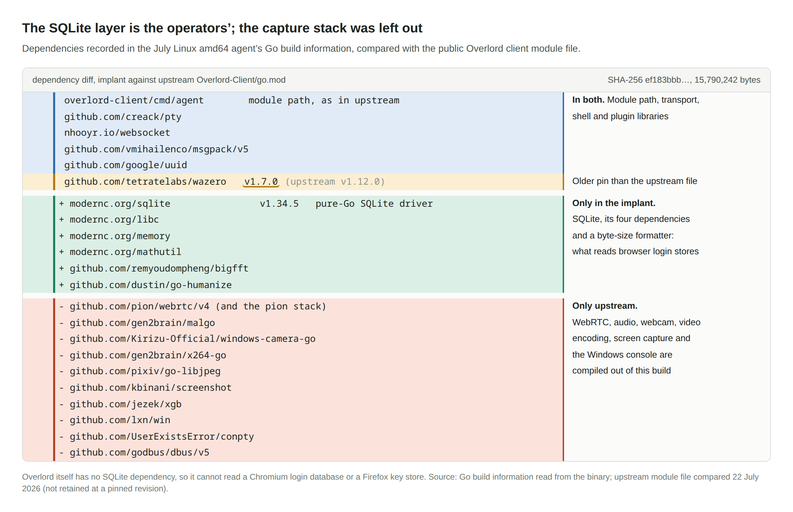
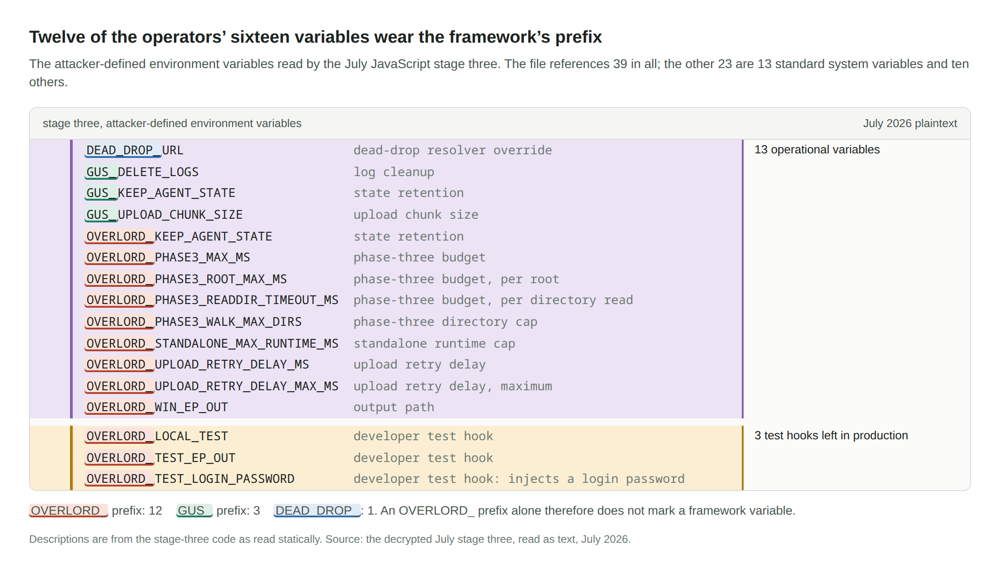

I found that the Linux Go agent is built on the public Overlord framework, and that the credential and wallet layer on top of it belongs to the operators. The framework has no SQLite dependency at all, while the implant adds a pure-Go SQLite driver and two packages, `companywallet` and `browserlogin`, that do not exist in the public code.

## Key takeaways

- The Linux amd64 agent records the module path `overlord-client/cmd/agent`, a `wazero` WebAssembly runtime and `modernc.org/sqlite` in its Go build information.
- A diff against the framework's module file shows a pure-Go SQLite driver with its four dependencies and a byte-size formatter present in the implant and absent upstream.
- Six Unix builds fetched on 12 November carry the operator packages `companywallet` and `browserlogin`, a thirty-five-entry wallet-extension list and a `GUS_` environment namespace.
- The server-side agent token in the current build is byte-identical to the July builds' token, so it survives the rotations that break host-based links.
- For triage, framework markers identify Overlord, while credentials, wallets, seed phrases, the `GUS_` namespace or the delivery chain identify this actor.

## Build: the Go build records an Overlord module path

The Linux Go agent embeds the module path `overlord-client/cmd/agent`, a WebAssembly runtime and SQLite dependencies. Its strings include browser database names, wallet-upload configuration and capture-related symbols. [Exhibit E18](../preprint/evidence/E18.pdf) documents the bounded comparison with selected upstream files, while [Exhibit E05](../preprint/evidence/E05.pdf) records the sample-specific capture findings.

Those components connect a general remote-access framework to the collection functions found in this sample. When I later diffed the agent's recovered dependency set against the framework's own module file, the boundary between the two layers turned out to be sharper than the July comparison could show.

The Linux amd64 artifact is 15,790,242 bytes and has this SHA-256:

```text
ef183bbb40f4c7c3f4b52994cdba3295f3eab2604fdad99eefa3b67b8d966e8d
```

I read these fields from its Go build information:

```text
path                 overlord-client/cmd/agent
module               overlord-client (devel)
wazero               v1.7.0
modernc.org/sqlite    v1.34.5
CGO_ENABLED          0
GOARCH               amd64
GOOS                 linux
vcs.revision         056221e342357056c8539585806f76632660e414
vcs.time             2026-07-21T01:14:06Z
```

The module path connects the binary to the Overlord agent codebase. It is the framework's own module name, declared in its public module file, not a name the operators chose, so it identifies the framework rather than a fork. What shows a private fork is that the embedded build revision is absent from the public history. The `wazero` dependency supplies a WebAssembly runtime, consistent with the framework's plugin support. That runtime is a stock feature with sample plugins shipped publicly, and the implant pins an older version than current upstream, so it carries little attribution value. SQLite provides local database functionality, which becomes relevant alongside the browser-store markers elsewhere in the file.

### The build timestamp bounds the build only from below

The [Go build-setting documentation](https://go.dev/pkg/runtime/debug/?m=old) defines `vcs.revision` as the checkout revision and `vcs.time` as its associated modification time. The timestamp is therefore version-control metadata that bounds the build only from below, and the binary's compilation time remains unverified. The recorded repository lookup did not locate the embedded revision, leaving the corresponding source checkout unresolved.

The field is still useful for timing. Its value of 01:14:06 UTC on 21 July falls five minutes and thirty-four seconds after the Date header of the D2S AI Trade recruitment message, and `vcs.modified` is false. Either the revision was committed while the send was scheduled, or the proximity is coincidence; on either reading build and campaign work ran as one workflow ([Part 10](10-investigation-connections.md)).

The earlier May agents tell the same story from the build side. Their cgo settings point to an Apple Silicon build host, and about seventy seconds pass from source commit to finished extension, as [Part 2](02-vsix-editor-execution.md) sets out.

## Boundary: what upstream has and what the operators added

### The upstream files shared generic framework features

The July comparison inspected selected client module and configuration files. It found the shared module path, plugin support and generic transport configuration. It also recorded a newer wazero version in the examined upstream module file than the sample's v1.7.0. The dependency versions differ. Dating the fork or deployment requires additional records.

SQLite-related dependencies and wallet/browser markers were absent from the selected upstream files. Those files were not retained at a pinned revision, preventing a reproducible source diff at the time.

The later diff against the framework's module file settled the question as far as dependencies can. A pure-Go SQLite driver with its four dependencies and a byte-size formatter are present in the implant and absent upstream. The framework has no SQLite dependency at all, so it cannot read a Chromium login database or a Firefox key store on its own. The operators added that driver while keeping cgo disabled, and by extension the credential and wallet layer built on it is theirs.



*Figure 1. The SQLite driver and its dependencies exist only in the implant. Upstream's WebRTC, audio, webcam and screen-capture libraries are absent from this build.*

### The operator layer in the November builds

Six Unix builds fetched on 12 November share one generation and one Go toolchain. They carry no hard-coded server: the only network address in them is the GitLab dead drop the agent reads, covered in [Part 6](06-gitlab-dead-drop-infrastructure.md). They show the additions as two packages that do not exist in the public code, `companywallet` and `browserlogin`.

Counted as entries of the Go function table, which survives symbol stripping, the two packages hold:

- 242 and 106 functions in the macOS builds;
- 210 or 211 and 71 functions in the Linux builds.

The function-name table, which also lists inlined functions, gives 254 and 120 for macOS and 221 and 82 for Linux. Other counting definitions give other numbers, so I quote the function table.

The six builds cover darwin arm64 and amd64 and linux amd64, arm64, 386 and arm. They share Go 1.27.3 and the same dead drop, and none was known to VirusTotal when I fetched them. The two macOS builds are:

| Build | SHA-256 |
|---|---|
| darwin/arm64 | `187a5535d4c91fd52d5a9a0285efe91fb0e70c007e619d55bb13a530a123a4f5` |
| darwin/amd64 | `3084e392a581009bef973faa15ad4f8cb36a1aa248c447944b38616044aea04d` |

The dotted numbers in their strings are ASN.1 object identifiers, not addresses. The host they were served from returns no listing and has no Windows Go agent, exactly as the kit's own code implies, since the Windows branch uses the Node agent instead.

The `browserlogin` package holds Chromium master-key derivation, Safari keychain export, Firefox NSS decryption and a credential vault. The same layer carries:

- a thirty-five-entry wallet-extension list;
- a bypass of Chrome's App-Bound Encryption;
- an environment namespace prefixed `GUS_`, whereas every upstream variable is prefixed `OVERLORD_`.

Collection targets in these builds are Firefox `key4.db`, the wallets MetaMask, Phantom, Backpack, Solflare, TronLink and Enkrypt, the macOS keychain, Chrome and Edge profiles including Edge Beta, and a keyword file search.

The server-side agent token in the current build is byte-identical to the July builds' token. The dead drop moved, the lure host changed and thirty-six functions were added in between, so the reused credential survives the rotations that break host-based links. The value is not reproduced here. The same token already tied two campaigns six days apart in May to one server instance ([Part 2](02-vsix-editor-execution.md)).

An earlier August macOS build, held among public sources only by VirusTotal and detected roughly ten times in Kaspersky's own telemetry, is a different file from the November builds; [Part 2](02-vsix-editor-execution.md) lists it.

### The agent protocol is the framework's

The agent speaks Overlord's own protocol: a WebSocket at `/api/clients/<id>/stream/ws?role=client` with an `X-Agent-Token` header, and snake_case commands including `file_list`, `file_download`, `file_upload`, `file_zip`, `process_list`, `process_kill`, `screenshot`, `silent_exec`, the `plugin_*` family and `uninstall`. Through the plugin channel the server can stream a native library into a running agent, so a build's recovered capability set is a floor rather than a ceiling. No plugin files sit on the serving host, because plugins travel over the agent connection.

The C2 panel these agents report to is built from an early-March public Overlord base with only cosmetic changes, which [Part 16](16-control-layer-after-october.md) shows by diffing captured assets against the framework's history. The panel's self-signed certificate also comes from the framework's generator, which writes the machine's own interface addresses into it.

## Collection: browser stores, wallet selectors, and capture symbols

### Browser stores

String examinations found `Login Data`, `Local State`, `logins.json` and `key4.db`, along with wallet names and extension identifiers. These are browser-store and collection selectors. Together with SQLite, these selectors identify what the agent is built to read. Successful access and decryption on a victim host remain unmeasured.

### Wallet upload

The wallet-related markers include an endpoint setting, a client header and an upload path. The companion's [wallet-agent YARA rule](https://github.com/KrasForge/unk-scanner/blob/main/rules/yara/deaddrop_wallet_agent.yar) combines these with the Overlord module and server-environment markers. A generic framework match would also identify unrelated Overlord deployments. Requiring wallet context narrows the search to files carrying that additional combination.

### Capture

The binary also contains previous-frame, block-comparison and capture-loop symbols, and here the boundary runs the other way. The frame-differenced capture package is the framework's own design. This July Linux build is a stripped one from which upstream's screen-capture, audio, webcam and WebRTC back-ends are absent.

A May Linux build still carried X11 capture, which points to per-platform tailoring over time. The July build has the capture code but not the platform back-ends, and whether it could acquire frames is not established. [The capture analysis](05-screen-capture-analysis.md) examines those symbols and the separate Windows bundle, where capture is mandatory. Display access, code reachability and successful transmission were not reproduced.

In the other direction, an earlier note of mine listed `/api/company-wallet/` as a framework marker, on the assumption that it came with Overlord. Verification found zero occurrences of "wallet" in the upstream readme, either example environment file or the module file. The endpoint, its client-id header and its environment variable are operator additions that merely follow the upstream naming convention.

### Collection outside the Go agent

The phased JavaScript collection and the Windows Node/Python pipeline occur in separate components of the toolchain. Their functions extend the collection paths beyond the Go executable. On Windows the recovered branch does not use the Go agent at all, and stage three deletes its masquerading executable before installing the Node agent.

The July JavaScript stage three shows the same split between framework and operator in its environment variables. It references thirty-nine in all: thirteen standard system variables, sixteen attacker-defined ones and ten others. Of the sixteen, thirteen are operational, covering the dead-drop resolver override, the phase-three budgets, a standalone runtime cap, upload retry delays and an output path. The other three are developer test hooks left in a production payload, and they are named `OVERLORD_LOCAL_TEST`, `OVERLORD_TEST_EP_OUT` and `OVERLORD_TEST_LOGIN_PASSWORD`, the last of which injects a login password rather than phishing it. Those three are the operators' own variables wearing the framework's prefix.



*Figure 2. Twelve of the operators' sixteen variables carry the `OVERLORD_` prefix. The prefix alone does not mark a framework variable.*

The server URL, agent token and client-id seed are each compared against a build-time placeholder before use, which the builder substitutes at packaging time. The placeholder strings and the test hooks are operator-specific and survive infrastructure rotation, and together with unit tests shipped inside the Windows agent bundle they show a codebase built without release hygiene.

### Stock dependencies are not indicators

Everything third-party the operator serves from its blob host is stock. The `chrome_decrypt_sitepackages_amd64.zip` archive holds an unmodified pycryptodome 3.23.0 wheel for Windows, and the embeddable Python package matches python.org's file as far as I retrieved it. The member files' names and hashes therefore match every legitimate installation and must not become indicators.

The operator did unpack and re-zip the pycryptodome archive, though. All 352 members match the wheel, yet 1.79 of its 1.80 million bytes differ, so the re-zipped archive's own hash, beginning `d7d2854c`, is the operator's. The operator-specific signal lies in that archive hash, in the re-zip stamps and in the surrounding Go and JavaScript builds.

## Triage: separating the framework from the actor

Overlord is a public framework that many unrelated parties run, so a practical triage rule follows:

- anything naming remote control, capture, transport, TLS, mutexes or the module path identifies the framework;
- anything touching credentials, wallets, seed phrases, the `GUS_` namespace or the delivery chain identifies this actor;
- an `OVERLORD_` prefix settles nothing on its own, because the operators named some of their own variables to match.

The same rule applies to public sample collections. The `overlord` tags there are dominated by other operators' deployments of the framework on its default port 5173 and by unrelated builds sharing the name, so they cannot isolate this actor ([Part 11](11-detection-engineering.md)).

For file hunting, the wallet-agent rule and [capture-agent rule](https://github.com/KrasForge/unk-scanner/blob/main/rules/yara/deaddrop_capture_agent.yar) select different marker combinations. Both remain experimental. A hit identifies content for inspection, and can include source or research material containing those strings.

## Limitations

- The binary's compilation time remains unverified, and the embedded revision was not located in the recorded repository lookup.
- The July upstream files were not retained at a pinned revision.
- Successful access and decryption on a victim host remain unmeasured.
- Display access, code reachability and successful transmission of capture were not reproduced.

## Conclusion

The Linux agent is Overlord underneath, but the SQLite driver, the `companywallet` and `browserlogin` packages and the `GUS_` namespace are the operators' additions. That boundary lets an analyst separate unrelated Overlord deployments from this actor's builds.

The reused agent token, the build-time placeholders and the test hooks are links that survive infrastructure rotation, while stock libraries shipped in the kit are not indicators at all. For an unexpected installed agent, preserve its hash, configuration, launch mechanism and outbound destinations alongside the matching offsets.
