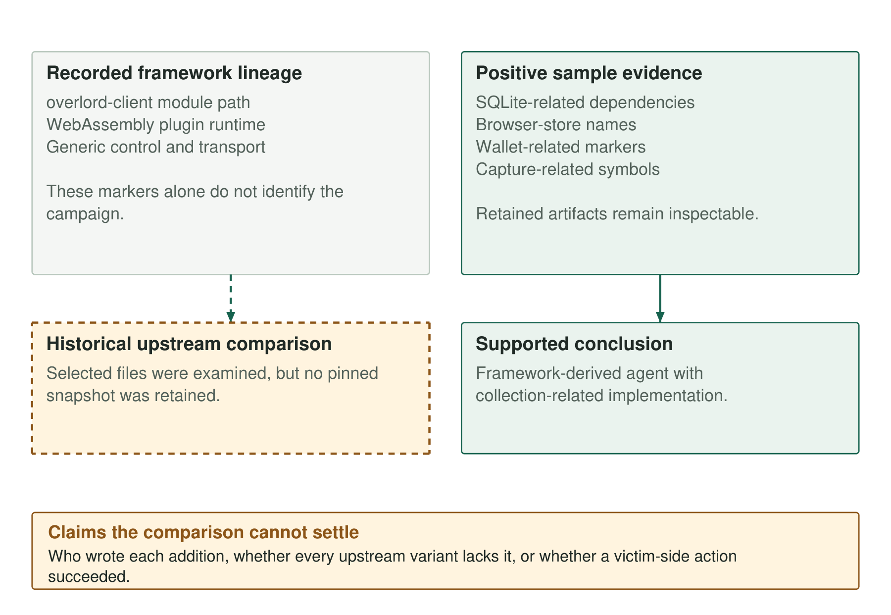

The Linux sample identifies itself as `overlord-client/cmd/agent` and includes a WebAssembly runtime. A historical upstream comparison places the module path and general plugin capability in the framework lineage. A dependency comparison suggested that the Linux build lacked screen capture, but later binary examination found capture-related symbols.

The retained case supports an Overlord-derived agent with additional collection-related components, but no complete, pinned source diff establishes who wrote each addition. Positive evidence in the sample must therefore remain distinct from the limited historical comparison.

> **Key Takeaways**
>
> - The module path, plugin runtime and generic transport features identify framework lineage, not a campaign operator.
> - SQLite dependencies and wallet/browser markers support collection-related implementation in the held sample.
> - The upstream files examined in July were not retained as a pinned snapshot, limiting reproducibility of absence claims.
> - A missing public commit and an absent dependency do not prove a private fork or the absence of a capability.

## Anchor the sample before comparing it

The retained Linux amd64 artifact is 15,790,242 bytes and has this SHA-256:

```text
ef183bbb40f4c7c3f4b52994cdba3295f3eab2604fdad99eefa3b67b8d966e8d
```

The evidence report includes output obtained by reading its Go build information. Selected fields are:

```text
path                 overlord-client/cmd/agent
module               overlord-client (devel)
wazero               v1.7.0
modernc.org/sqlite    v1.34.5
CGO_ENABLED          0
GOARCH               amd64
GOOS                 linux
vcs.revision         056221e342357056c8539585806f76632660e414
vcs.time             2026-07-21T01:14:06Z
```

This is a reformatted selection from the retained extraction, not a new execution result. Reading build information does not run the target binary. The fields identify embedded build metadata and dependencies; they do not independently authenticate a developer or a physical build machine.

The [Go build-setting documentation](https://go.dev/pkg/runtime/debug/?m=old) defines `vcs.revision` as the revision associated with the checkout and `vcs.time` as its associated modification time. That is why the timestamp cannot be promoted into a certified compilation time, even when it falls close to a phishing message.

The July comparison inspected selected Overlord files, including the client module file and configuration examples. It recorded a shared module path, plugin support and generic transport configuration. However, the upstream files used for that comparison were not saved in the workspace, and the evidence does not provide a pinned baseline for their contents.

That limits the strength of a negative comparison. A retained binary can be inspected again. A statement that a string was absent from an upstream file in July cannot be reproduced against an unspecified later version and called the same experiment. Looking at today's repository would establish a new comparison, not repair the missing historical snapshot.

These upstream differences are findings within the examined scope, not an exhaustive diff across every version, fork or plugin. Without the missing baseline, the strongest result is the sample's positive collection evidence, not a claim that nobody else using the framework could possess it.



*Figure 1. Framework lineage and collection evidence. The upstream files were not preserved as a pinned baseline; authorship remains unresolved.*


### Features inherited from the framework

The historical comparison identifies the `overlord-client` module name as upstream. The embedded path is useful for recognizing software ancestry, but it was not a name invented for this deployment. The same distinction applies to the WebAssembly plugin runtime and the general remote-control and transport surface.

The recorded sample uses wazero v1.7.0, while the examined upstream module file was reported to use a newer version. That is a dependency-version difference, not a date for the fork. A maintainer can pin, backport or change dependencies independently of when a deployment began. Without the corresponding source history, the version cannot provide a complete chronology.

This matters for attribution and detection alike. A rule built only around the framework path or plugin runtime can identify unrelated deployments. The framework authors and other users do not become participants in this case because their software shares those properties.

## Collection evidence inside the held artifact

The build metadata includes `modernc.org/sqlite` and related dependencies. Separately, retained string examinations identify browser-store names such as `Login Data`, `Local State`, `logins.json` and `key4.db`, along with wallet-related names and extension identifiers. The combination is more informative than SQLite alone: database support is common in legitimate software, while the surrounding collection markers supply context.

The historical comparison found collection-related dependencies and markers absent from the selected upstream files. That supports a distinction relative to those files. It does not prove that the campaign's operators personally authored every module, that all upstream variants lack collection features, or that a browser database was successfully read from a victim.

Other parts of the case add deployment context: the phased JavaScript collection, GUS-prefixed configuration, the Windows Node/Python pipeline and the delivery artifacts described earlier in the series. These are separate components and should not all be presented as modifications to one Go executable. A toolchain can combine inherited code, additional modules and external orchestration.

### A comparison table with bounded conclusions

| Observation | Evidence basis | Supported conclusion |
|---|---|---|
| `overlord-client` module path | Retained build metadata; recorded upstream comparison | Framework lineage |
| WebAssembly runtime | Retained wazero dependency; historical upstream examples | Plugin support is not unique operator evidence |
| SQLite and browser-store markers | Retained dependency output and string observations | Collection-related implementation context |
| Wallet endpoint and client-header markers | Held artifact and collection analysis | Narrower selectors when combined with framework context |
| GUS configuration and phase-three sweep | Separate recovered collection source | Deployment/collection logic beyond a generic framework label |
| Missing public build revision | Historical lookup result | Unresolved source provenance, not proof of ownership |
| Capture-related symbols | Later binary capability review | Capture implementation markers occur in the held binary; runtime remains unverified |

The table keeps the evidence types separate. A source selector, module dependency and symbol set have different relationships to runtime behavior. Combining them can strengthen an assessment only when their provenance remains visible.

The original comparison inferred that the Linux implant lacked capture because expected dependencies were missing. Later examination found previous-frame, block-comparison and capture-loop symbols in the held binary, so the evidence does not support a categorical capture-free conclusion.

The symbols do not establish a working desktop stream on every Linux host. Reachability, platform implementation, display access and permissions remain separate questions. Part 5 examines the capture evidence in detail. A dependency inventory describes recorded components; it cannot prove an implementation is absent.

The same restraint applies to authorship. Finding an addition relative to selected public files does not identify who wrote it. Reused code, another fork or an unpublished component could explain the difference. The retained artifacts support the behaviour assessment more strongly than they support a personal attribution.

The historical lookup did not find the embedded build revision in the public repository examined. That does not establish a private fork. Unpublished work, removed history or other metadata provenance remain possible explanations that the retained corpus cannot resolve.

Reproducing the comparison requires the exact upstream commit and files, each sample's hash, and the extraction commands and output. Even then, a code difference would not by itself identify an operator.

For detection, combine framework markers with collection context, as the companion's [wallet-agent YARA rule](https://github.com/KrasForge/unk-deaddrop-companion/blob/main/rules/yara/deaddrop_wallet_agent.yar) does, and interpret each match in light of where the file was found. Framework ancestry starts the analysis; surrounding artifacts determine how far the conclusion can go.

[Companion detections and static scanner](https://github.com/KrasForge/unk-deaddrop-companion).
