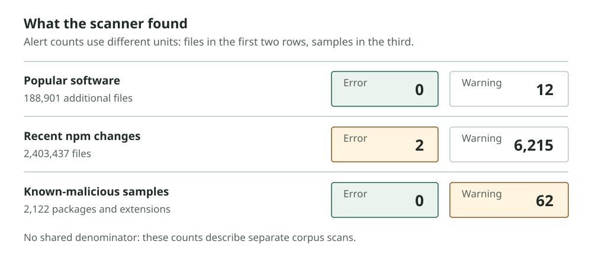

The scanner raised two error-level findings among nearly 2.4 million files from recently changed npm packages. I read both. One came from an AI desktop application's local helper; the other from a setup guide whose `curl` command printed an HTTP status code. Neither was malicious.

The quieter surprise came from a different corpus. Among 2,122 known-malicious packages and extensions, the scanner flagged only 62 samples, all at warning level. It raised no errors. The benchmark had answered two different questions: how often did rules interrupt review with serious false alarms, and how often did they notice malware outside the structures they were built to recognise? The answers were low noise and low coverage.

The results and sampling details are in the [scanner paper](../scanner-paper/UNK-Scanner-Paper.pdf). They come from fixed runs on 29 October, using one engine on an eight-vCPU virtual server. Part 11's [YARA replay](11-detection-engineering.md) covers a different system and different question.

*The error count stays low on popular and recent code, while most known-malicious samples receive no warning. Counts are not directly comparable because the corpus units differ.*

## npm, Open VSX, and public malware corpora

The first check covered 2,500 npm packages ranked by `npm-high-impact` and 500 Open VSX extensions ranked by downloads. That produced 143,153 distinct files. I had already used this material to tune severity, so it was useful for finding noisy rules, but it could not tell me how the same choices would behave on other code.

The expanded run added three collections:

| Collection | Acquired | Files |
| --- | ---: | ---: |
| Top npm packages, Marketplace extensions and the Open VSX calibration set | 4,992 of 5,000 npm packages; 967 of 1,000 extensions | 332,054 |
| Packages selected from the npm registry changes feed | 19,976 of 20,000 package names | 2,403,437 |
| Datadog malicious-package dataset | 122 IDE extensions; seeded sample of 2,000 npm packages | 41,359 |

The first collection included 188,901 files absent from the calibration set. These make a useful comparison, with one qualification: the first scan raised four errors in Microsoft Live Share and GitHub Codespaces bundles. Both contained an editor-as-Node launch near code from a privilege-elevation library. The rule escalated from the hidden PowerShell anywhere in the bundle, although the operations were not part of the same launch path.

I changed escalation to require the hidden execution in the launching function or a local helper it calls. The change cleared those four findings and preserved the severities of the retained UNK_DeadDrop files. I then froze the engine for the reported scans. Because those Tier 1 files informed a rule change, the final result is disjoint from the original calibration corpus but is not an untouched held-out measurement.

## Two benign packages triggered error alerts

The registry changes feed selected packages whose documents changed over a window of about 83,000 sequence positions. Most changes occurred on 29 October. The scan found 6,215 warnings and two errors among the 19,976 packages acquired.

The first error looked persuasive at a glance. A desktop application assembled an encoded PowerShell command, hid its window and set `ELECTRON_RUN_AS_NODE` for a helper. That combination triggered escalation. Reading the code showed the helper contacting `127.0.0.1` with a local password. In this application, the suspicious-looking launch was part of an ordinary local workflow.

The second came from a remote-access product's setup guide. It copied text containing “verify” and a `curl` command. The command printed an HTTP status code. The rule treated the verification wording as lure evidence and missed the difference between displaying a status and fetching a payload.

Warnings took longer to sort out. String-array obfuscation accounted for 6,142 findings across 153 packages. I screened the recovered strings for shells, processes, wallet terms, credential stores and exfiltration services. Seven packages matched those searches; their code fit their apparent roles, including bots, a workspace connector and agent command-line tools. Nine packages still had unresolved arrays, eight from one commercial product.

Clipboard and hidden-script warnings received code review. I also read five Electron findings whose package names did not suggest developer tooling. The remaining 39 were triaged from the recorded launch target and environment. This is enough to describe the review that took place, but not enough to label every flagged package benign. In particular, unresolved arrays leave work for an analyst.

Two error findings in 19,976 packages amounts to about 0.01% of packages needing error review in this scan. That number describes this window and this rule set. It is not a fleet false-positive rate.

## Alerts reached 62 of 2,122 malware samples

The public malware set changed the interpretation of the low alert count. I counted a sample as detected if any file in it raised a warning or error.

Of 122 IDE extensions, four raised warnings. Among 1,884 npm packages classified as malicious at creation, 44 raised warnings. Fourteen of 116 compromised npm libraries raised warnings. No sample reached error level.

The warnings came from obfuscated string arrays and hidden-script launches. Most missed samples did not use the clipboard, Electron or encrypted-loader patterns represented in the rules. Parser failures explained 27 misses, leaving many readable samples outside the scanner's model.

Screening the missed files found common access to environment variables and home-directory files, frequent use of `child_process` and network requests, and references to webhooks. Twenty-one missed IDE extensions contained variation-selector characters used to hide text. These counts describe what appeared in the missed code; each behaviour also occurs in legitimate programs.

The retained campaign files show that the scanner recognises the structures it was built from. That is useful when the code is available and resembles the observed samples. It does not counter the broader malware result, because those retained files informed the rules. Even within the case, the Windows Node agent raised only notes. Its absence of a warning is a miss, not a change in what the agent does.

## Acorn and Babel parsed 330,473 files

The scanner tries Acorn first, then an AST-only Babel fallback for supported TypeScript and JSX syntax. In the popular-software collection it parsed 330,473 of 332,054 files. Of the 1,576 parse failures, most were TypeScript. None parsed under the independent Babel configuration we tested; that does not prove they are invalid in their original build toolchains. Five inputs were not valid UTF-8.

With four workers, the isolated command-line run processed 272 files per second on the calibration collection; the in-process worker-thread run processed 264. That one comparison showed no throughput penalty from isolation, but it was not a repeated performance study. The malware set ran at 325 files per second. The recent-package scan reached 848 with six workers and a different mix of mostly small files.

The scanner is useful for surfacing the behaviours it knows how to follow. Its low error count makes it practical to review; its malware misses mean a clean result cannot clear a package. Part 14 follows the less comfortable question: how little does an author need to change to avoid those findings?

[Companion detections and static scanner](https://github.com/KrasForge/unk-deaddrop-companion).
