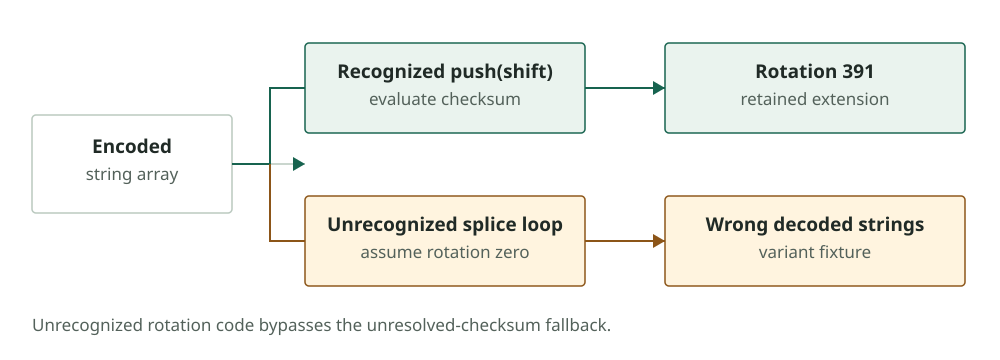

I changed one line in an inert test fixture. The original loop rotated a string array with `push(shift())`; the variant used `splice`. The scanner failed to recognise the new loop, treated the array as already aligned and returned decoded strings from rotation zero.

An unresolved value would have been easier to trust. These strings looked recovered, but were in the wrong order. The design refused to guess only after it recognised a rotation loop. This variant slipped past that first check.

It was one of nineteen single-change variants tested against the evaluated engine. Eighteen evaded their targeted rule, lowered its severity or defeated recovery. These tests used inert copies of demonstration code and a loader fixture; they were not additional malware samples. The full results are in the [scanner paper](../scanner-paper/UNK-Scanner-Paper.pdf).

*The failing variant bypassed checksum evaluation because its array mutation was not recognized. The returned strings were wrong, not unresolved.*

## The loader rotates its string array before decoding

The extension analysed in [Part 3](03-acorn-deobfuscation.md) hides strings behind decoder calls into an encoded array. The program reorders that array before using it. If an analyst decodes the calls against the original order, the output may still look plausible while pointing to a false module name or URL.

In the obfuscator pattern we recovered, a startup loop decodes numeric-looking strings, combines them with `parseInt` and rotates the array until the result matches a constant in the file. The scanner reimplements the decoder and evaluates that checksum across candidate rotations. It never calls the extension's decoder or executes its startup loop.

For the retained extension, this method found rotation 391; for its bootstrap, rotation 261. Both match the manual analysis. The scanner decoded 2,139 of 2,140 call sites in the extension, and 15 of 17 in the bootstrap. The remaining call sites matter: a result labelled “recovered” can still leave a particular URL or module name hidden.

If the loop is recognised but the checksum cannot be solved, the scanner can compare how many call sites produce printable text under each rotation. It accepts a candidate only when it clears a high threshold and the next candidate scores much lower. This fallback helps with a non-foldable checksum target. It cannot help when every rotation of a plain or keyless base64 array produces readable text.

The `splice` fixture revealed a different problem. The scanner never identified its loop as rotation code, so the unresolved-checksum path never ran. It fell through to the no-rotation case. The mistake was in the scanner's view of the code, before checksum evaluation began.

## Clipboard, Electron, loader, and rotation variants

I tested the frozen engine against changes to API shapes and variable bindings, including aliases:

| Change in the fixture | Result |
| --- | --- |
| Route a clipboard builder through a reassignable `var` alias | Missed |
| Encode or assemble the command elsewhere, or fetch it at copy time | Missed |
| Copy through a hidden textarea and `execCommand` | Missed |
| Split or decode the `ELECTRON_RUN_AS_NODE` name at run time | Missed |
| Use another hidden-window structure for the Electron launch | Warning instead of error |
| Move loader steps into a function or change the cipher, binding or module-compilation form | Missed |
| Reach a string decoder through a `var` alias or object property | Warning remained, but affected call sites were not decoded |
| Make the checksum target non-foldable | Recovered by printable-text consensus |
| Rotate the array with `splice` | Incorrectly decoded under rotation zero |

Some misses are deliberate limits. The evaluator leaves reassignable `var` and `let` values unknown because following them safely requires tracking assignments and control flow. A clipboard rule that cannot recover the command may not see the features that raise its severity. Other misses expose unimplemented structures: `execCommand`, a different encrypted-loader API or a split environment-variable name.

The pattern-specific findings are still useful when the observed code is reused. They do not make the behaviour hard to rewrite. The companion scanner's broader benchmark in [Part 13](13-scanner-registry-benchmark.md) puts this in context: low alert volume on ordinary packages coexists with poor coverage of generic malware.

## A `splice` loop returned strings from rotation zero

When a decoder remains unresolved, the gap is visible. When it returns a plausible but incorrect string, an analyst may follow the wrong lead. The `splice` result therefore deserves its own regression test and a fix that covers additional rotation operations.

There is an independent check for the specific extension: the manually reconstructed key authenticated three encrypted payloads. That confirms the recovered key and ciphertext relationship in those files. The scanner does not perform this decryption, and the authentication result cannot be transferred to another sample merely because its string array looks similar.

Potential fixes include recognising additional array mutations and refusing to accept an apparently unrotated result for a keyed decoder without supporting evidence. At this stage of the evaluation, those changes were still untested. Any change needs to be checked against the failing fixture, retained artifacts and benign obfuscated software. I kept the engine fixed for these reported results.

For now, treat recovered strings as leads to inspect against their call sites, and check how many sites remain unresolved. A clean scan means the evaluated rules did not find their patterns. It does not mean that the input is safe.

## Eighteen variants now match their baseline results

After recording those results, I changed the engine to cover the structures the fixtures exposed. The evaluator now follows `var` and `let` bindings when it can show they are never reassigned in the declaring scope. It also handles constant `atob` and `Buffer.from` calls, known-array spreads into functions such as `String.fromCharCode`, and `eval` when the argument is a constant function name. It still leaves other dynamic text unevaluated.

The rules gained corresponding paths. Clipboard analysis now follows values assigned to mutable variables, copy handlers written as object methods, and the hidden-textarea `execCommand('copy')` flow. Electron checks resolve split or decoded environment-variable names and encoded PowerShell. Loader analysis follows recognised ciphers to code-compilation sinks such as `Module._compile`, `vm`, `eval` and `Function`, including bindings inside functions.

For array rotation, the scanner now recognises additional mutations such as `push(splice(...))` and `unshift(pop())`. Other array reordering inside the rotation function sends the sample to consensus analysis instead of silently assuming rotation zero. It also follows decoder calls through aliases and object properties.

The same nineteen fixtures were run again. Eighteen now match their baseline severity and recovery, including the `splice` fixture, whose strings match the checksum-proven rotation. The remaining case fetches the clipboard command at run time. That command text is absent from the file, so static inspection has nothing to recover.

I rescanned the earlier corpora on the same server. The hardened engine produced no new error-level findings and added three warnings: two packages with obfuscator arrays declared using `var`, and a copy button for a `curl` installer.

On the recently changed npm corpus, unresolved arrays dropped from 1,387 to 16. Nine packages whose arrays had been entirely unresolved now exposed licence and service endpoints.

Two newly decoded packages imported `child_process`. Static review found ordinary housekeeping in a developer CLI and licence-configuration handling in an SAP framework plugin. Neither passed downloaded data to a code-execution sink, and neither was classified as malicious. I did not fetch the remote address found in one package.

One escalation needed to be narrowed during this pass. A first version treated any detached, hidden-window editor relaunch as an error. An AI coding extension uses that shape to start its helper server, so it remains a warning. A malicious extension using the same launch would also receive a warning.

Throughput was 281 files per second on the calibration corpus after hardening, compared with 264 in the earlier run. That's one measurement on one host, so it cannot show whether the change affected performance. The three added warnings and zero additional errors describe the reviewed corpora only.

The new fixtures are regression tests in the [companion repository](https://github.com/KrasForge/unk-deaddrop-companion), and the [scanner paper](../scanner-paper/UNK-Scanner-Paper.pdf) reports the frozen and hardened runs separately. These fixtures guided the fixes and now guard against regressions. Coverage of unseen rewrites remains an open test.

## Comparing decoded strings with their originals

The `splice` failure raised a practical question: were the recovered strings correct? I tested the scanner on fifty harmless files, obfuscated under 72 combinations of javascript-obfuscator's string-array options across a current and an older release. Each hidden string had a known original, giving 7,200 samples for comparison with three published deobfuscators.

The scanner returned no misplaced strings, but coverage was weaker. The engines missed the older release's decoder and lost most strings when function wrappers met one option. Fixes for those two cases raised recovery to 99.8% on both releases.

To check those fixes on unseen inputs, I generated a held-out set from twenty new files and five obfuscator releases, three of which the fixes had never seen. Recovery was 99.7% for each release, with no misplaced strings.

The same change also mattered for real malware. On the public dataset from [Part 13](13-scanner-registry-benchmark.md), samples producing a warning doubled from 64 to 128 because many used the older decoder shape. None reached error level. The warning reports recovered obfuscation. Maliciousness requires examining what the decoded code does.

The [scanner paper](../scanner-paper/UNK-Scanner-Paper.pdf) describes the experiment. Scripts and results are in the [companion repository](https://github.com/KrasForge/unk-deaddrop-companion).
