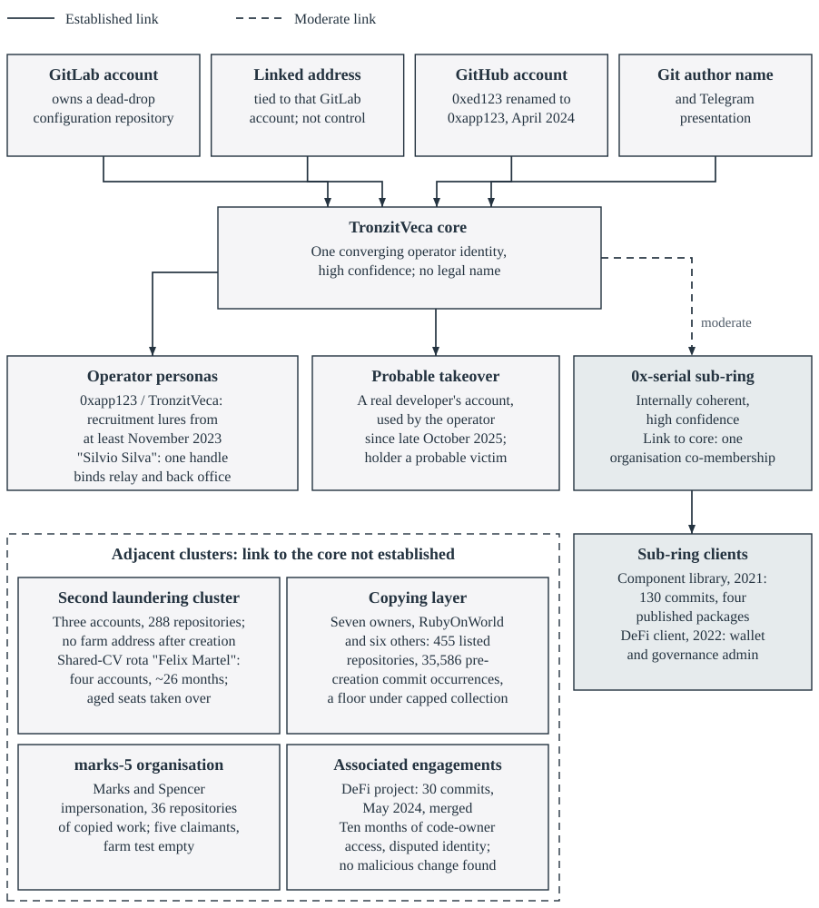

The repositories that gave the TronzitVeca persona its standing were clean. The high-star launchpad projects published under the persona carry tidy, professional code, and at the point where a launchpad would actually move money, the function is stubbed out behind a comment telling anyone interested to get in touch on Telegram. I checked the public copies and found no malware in them, and I did not obtain the privately supplied completion, because getting it would have meant engaging the operator to ask for it. What the repositories do establish is a mechanism: a technically convincing public portfolio that routes the readers most likely to be useful into a private conversation. This part of the series follows how that portfolio was manufactured, how far the identity behind it can be tied to the UNK_DeadDrop operation, and how the forged reputations reached real organizations. A great deal of the work turned out to be about not blaming the wrong people, because the farm's raw material is other developers' genuine history.

## Tying the operator identity together

The central identity rests on several independent observations that converge, rather than on a name found in a file. The case record connects the GitLab account that owns a dead-drop configuration repository to an address linked to the operator's configuration, then joins that identity to GitHub account-number references, a git author name and repeated contact instructions, and the Telegram presentation behind those instructions resolves to TronzitVeca. That chain reaches from a public professional persona into the control infrastructure described in [Part 6](06-gitlab-dead-drop-infrastructure.md), which is what makes it an anchor and not a coincidence. I hold it at high confidence for one converging operator identity, not for a legal name and not for a single person behind every linked service. The GitHub side has its own chronology: platform-generated commit addresses bracket the account's rename from `0xed123` to `0xapp123` in April 2024, and archive visits bracket the period in which its repositories stopped being reachable. The account is platform-suppressed rather than deleted, so its numeric identifier and dated artifacts outlast whichever handle a search happens to return.

The persona works both sides of recruitment. Its social timeline carries developer-recruitment pitches from at least November 2023 that funnel replies into a short "test project", alongside posts in which it seeks to be hired as a developer itself. The passively archived part of that timeline, from May 2024 to December 2025, yields no real name, and its five recruitment and agency posts drew no public replies because respondents were sent to private channels, although an earlier lure in December 2023 did draw 29 public replies. A second thread binds the "Silvio Silva" persona, through one handle, to a relay commit, the administrative back-office configuration and an older launchpad presentation. A configuration-associated handle and a dated commit are more specific than a repeated display name, and they support continuity between the operational artifacts and the persona. They say nothing about the nationality, residence or real employer of whoever used it, and since the case record holds no code-hosting account under that name, I did not try to fill the gap by matching it to unrelated people who happen to share it.

*Figure 1. Identifiers converge on the TronzitVeca core. The 0x-serial sub-ring links to the core at moderate confidence, while the second laundering cluster with its shared-CV rota, the seven-owner copying layer and the marks-5 organization are drawn apart because no link to the core is established.*

## How the farm manufactures credibility

The farm's method becomes visible because a GitHub repository records different things in different fields. The files can be genuine open-source work, the author line can name a persona, and the platform's creation date can show that the displayed history arrived years after the work it describes. The farm re-pushes real projects, rewrites the author lines so that the commits appear under its personas, and lets the original dates stand, so that a profile assembled from such repositories presents years of apparent experience to a prospective employer or to a developer deciding whether to continue a conversation. Around that core sits the surface of a busy career. Follower counts are inflated, pull-request activity runs almost entirely from persona to persona or into operator fronts, and the operator's five fake employer organizations are small, persona-only and in two cases hold no repositories at all. The personas also join real developer communities, which act as a credibility layer rather than as engagements. Because the pipeline manufactures green contribution squares, followers and organization badges, I learned to ignore those surface measures entirely and to rely on detailed project histories and platform relationships instead.

I measured one copying layer to get a sense of scale. A retained enumeration of seven owners in what I call the RubyOnWorld laundering layer lists 455 repositories, and recomputing it gives 35,586 commit occurrences whose author dates predate the repository that contains them, read from non-fork histories with readable commit lists. That number needs its counting rules beside it. An occurrence is a commit inside a containing repository, so one commit object copied into two repositories counts twice, and nothing has been deduplicated into unique contributions, developers or victims. Each read stopped at 600 commits and fifteen repositories hit that cap, while 175 forks were excluded by design, so a complete count would be at least as large. The 455 repositories are not 455 verified forgeries either, because mirrors and forks legitimately preserve earlier dates. The figure measures how common copying is in the examined set, and I have not established that the TronzitVeca core directs this layer.

Copying and rewritten credit are separate observations, and I checked the second directly. A cheap screen flagged 130 farm repositories whose recent history contains a pre-creation commit under a farm-attributed address. Comparing each flagged copy with its upstream source, commit by commit, verified re-attribution in 83 of them, confirmed the upstream without settling authorship in 13, gave a partial result in two and left 32 unresolved. One detail is telling: a web-interface merge is committed by the platform itself, so a merge commit whose committer equals its author has been rewritten after the fact, and in four of the upstream-confirmed copies six commits that named developers had authored upstream now carry a farm address as both author and committer, which is their work signed over in numbers too small to cross my acceptance threshold.

## The direction-and-date test and its blind spot

The copying makes attribution unusually treacherous. If a farm republishes genuine projects with some original authors preserved, a real developer's address inside a farm repository is exactly what one should expect, and treating co-occurrence as membership would reproduce the attacker's own misattributions. I therefore adopted a direction-and-date rule: an address counts towards the farm only if it authors a commit inside another farm account's repository after that repository was created, and attribution additionally needs platform-side corroboration such as an email association, a platform-signed commit or an archived event actor. An address that appears only in history older than its containing repository fails, however often it sits beside operator addresses. Under that rule, six identities that co-occur with operator anchors inside farm repositories turned out to be copy victims, real developers whose own histories the farm republished, and twelve further candidates did not meet the standard. Several of those developers belong to the core team of a decentralized-exchange project the farm mirrored, and a check of one mirror found 94 overlapping commits with 94 identical author addresses and no re-attribution at all.

The same rule bounded an apparent contractor relationship. One account with three merged pull requests at a mobile-advertising company between 2021 and 2023 looked suspicious only because one of its repositories mirrored the same exchange project the farm had copied. It has a self-consistent history from 2017 to 2023 and no commits in any farm-owned repository, and when I read the newest hundred commits of each of the 288 repositories of the second laundering cluster's three accounts, 4,155 commits in all, its address appeared in none of them. Its pull requests are ordinary contract work. The test also has a blind spot in the other direction, which I keep in view rather than paper over. If an original project was already operator-involved and only a later copy survives, the pre-creation history can contain genuine operator work even though the surviving repository did not yet exist, so the chronology alone cannot decide such an identity. For that reason "copied history" and "innocent original author" are not synonyms in my notes. I also do not name the real developers here, because printing their names beside the word persona, even to clear them, would spread the very association the test rejects.

## A CV maintained in shifts

The shared-CV case gives a more concrete picture of coordination than any resemblance between profile photos. One portfolio repository carries a sequence of post-creation edits associated with four numeric accounts, three outside seats followed by the owner account under two successive logins, all presenting the persona "Felix Martel" across roughly twenty-six months. That supports reuse and maintenance of one professional identity across several account-linked author identities, not four people taking shifts, since an account is not a person. Push events sharpen the point: two of the seats never pushed their own attributed commits, one segment having been pushed by another account and the other by the repository owner, so the identity credited with an edit and the account delivering it can differ. A related portfolio carries the same employers with the same dates under a different persona name, "Shi Le E", which makes the employment history a reusable narrative rather than one CV mirrored across sites. The companies named in it are victims of an unsubstantiated employment claim, and nothing shows they hired, paid or knowingly helped any persona. One persona even publishes two CVs that contradict each other on degrees, employers, locations and dates.

This rota belongs to the second laundering cluster, not to the core. Its three accounts commit into one another's repositories after creation, but no farm address does so in any of their 288 repositories within the commits I read, so the test that binds those accounts together also separates them from TronzitVeca. Account age, the other cheap credibility signal, proved just as unreliable. One account has a genuine earlier history under an original holder and a later persona phase, and nothing I hold separates a purchase from a compromise. The two aged seats of the rota have takeover windows that the sparse intervening history barely narrows. A further account carries a long-standing verified address of a private person, with valid platform signatures on web-interface commits, and it is most probably that person's own account, used by the operator since late October 2025, which makes its holder a probable victim. An old creation date says nothing about continuous ownership.

A different device appears in the marks-5 organization, which presents itself as Marks and Spencer, links to the real brand's website and uses repository descriptions that suggest internal work. All 36 of its non-fork public repositories were created within 22.1 minutes on 4 October 2022, and preserved merge messages and tree comparisons point to real upstream projects, including the company's own public GitHub organization, with authorship rewritten to five claimant identities. The repositories now return not-found responses while the organization listing still shows them as public, a pattern of platform suppression rather than deletion, so I read all 36 from archived snapshots. All five claimants are copiers, yet the farm-membership test is empty for every one of them, which places marks-5 in the wider authorship-rewriting ecosystem rather than in the TronzitVeca core. No access to the company's systems is shown, because publicly copied material is enough to create the appearance of employment. A live public fork of one repository carries part of the forged history onward into a stranger's account, and I treat its holder as a potential victim and do not name them.

## From forged reputation to real work

The record shows that a forged identity can still do real work. One take-home repository holds ten commits from a single day, including two merge commits that take pull requests from a second persona of the same pool while the owner commits under the first persona's address, which is direct evidence of shared working capacity behind one applicant. At a live decentralized-finance project, the same address that appears as author in re-signed portfolios has 30 post-creation commits from May 2024 with substantive development messages, merged into the project's genuine repository, while its other commits sit pre-creation in later copies on an account with the farm's characteristic inflated follower count. The strongest case is an infrastructure-development engagement in which an account held write permission and a code-owner role over a client repository for ten months, with branches and self-merged work in the record. My static review of the examined changes found no obfuscated payload, install hook or comparable malicious change, only one workflow modification that raises an ordinary dependency-management concern, so the finding is substantial access under a disputed identity with no malicious modification established.

The 0x-serial sub-ring, linked to the core at moderate confidence through a single shared organization membership, supplies the earliest dated client work. In May and June 2021 one seat made 130 commits across six repositories of a software company's component library, all of them after the repositories were created, and four of the client's published packages carry that code: the source revision in each package's registry metadata sits at or after one of the seat's commits, and one file per package matches the repository byte for byte. That is shipped contribution, not malicious functionality. A second engagement, with a DeFi client from February 2022, ties the seat to frontend work and to a wallet bound by its own name-service registration, which was still an administrator of three of the client's governance spaces when I read them on 15 November 2026. The wallet's gas and tokens came from the client's own team wallet and its final sweep went back to the client's side, so it was working capital rather than theft revenue. A good contribution by the sub-ring does not strengthen its link to TronzitVeca beyond what the identity graph shows.

## What the public IT-worker reporting does and does not add

The behavior fits what others have published about IT-worker fraud. [Mandiant's reporting](https://cloud.google.com/blog/topics/threat-intelligence/mitigating-dprk-it-worker-threat) describes résumés reused across personas and one worker behind several identities, and the [FBI's public service announcement](https://www.ic3.gov/PSA/2023/PSA231018) lists several online profiles for one identity among its warning signs. I compared the case on exact identifiers with tayvano's public [DPRK IT-worker dataset](https://github.com/tayvano/lazarus-bluenoroff-research/tree/main/dprk-it-workers), which corroborated one identity binding in every particular and showed one further seat touching a tracked identity through a single shared address, which is overlap and not a merge of accounts. The DPRK labels belong to those publishers. A behavioral fit is not independent evidence of nationality, and I infer none from persona names, working-hour offsets, profile photos or shared frameworks. What stands is more concrete: particular histories were copied, particular identities were tied to particular accounts, and particular clients accepted work. For employers and maintainers the practical lesson is that portfolio volume and account age were weak evidence here, while an earlier source history, a genuine project-side event or a verified account relationship held up, and that an accepted contribution still deserves review on its actual contents.

The `0xapp123` account reappears in the next part, [Part 16](16-control-layer-after-october.md), as the creator of the third dead-drop repository that took over UNK_DeadDrop's command configuration on 3 November 2026.
