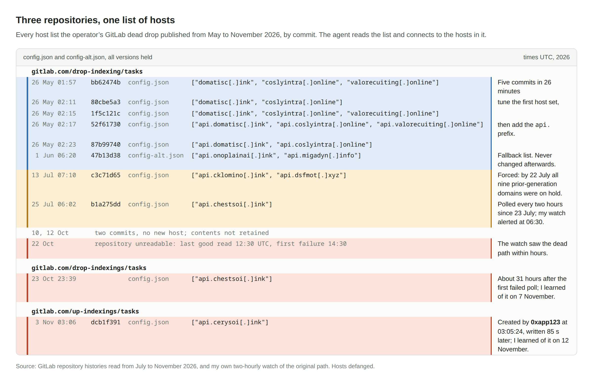
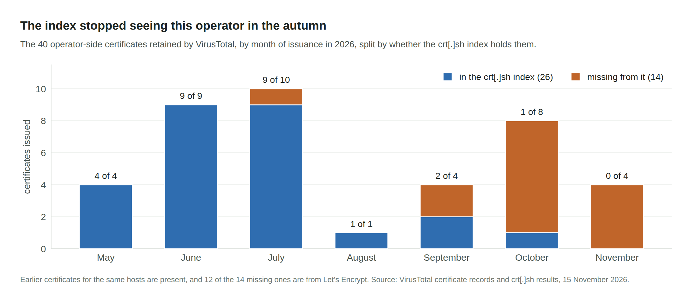
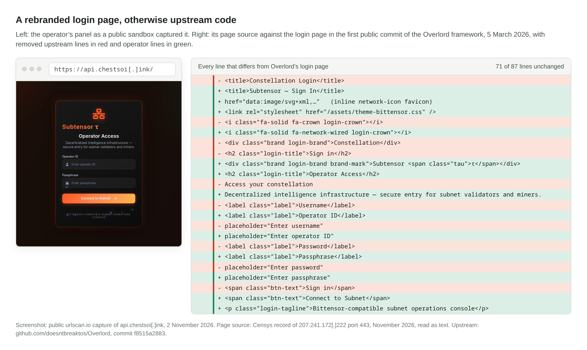
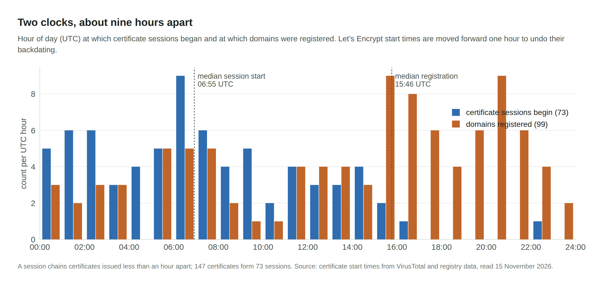

I found that UNK_DeadDrop rebuilt its GitLab dead drop twice after the original repository became unreadable on 22 October 2026, and my watch on the known path found neither successor. The third repository, created by `0xapp123` on 3 November, is the only network address in agent builds fetched on 12 November, and I learned of it from Stormshield about nine days after its creation.

## Key takeaways

- The original repository was replaced by `drop-indexings/tasks` about 31 hours after the outage, and by `up-indexings/tasks` on 3 November; I learned of them on 7 and 12 November from SafeDep, an indicator feed and Stormshield.
- A watch on a fixed set of paths can see a known path stop answering but never a successor created under a new name; watching for change, discovering successors and checking source coverage are three separate tasks.
- Certificate transparency coverage of this operator collapsed in the second half of 2026: 14 of the 40 operator-side certificates retained by VirusTotal are absent from the crt[.]sh index, and none of the 4 issued in November are present; a whole lure generation, 54 domains live on 12 November, went uncollected.
- The operator's panel matches the oldest public Overlord version, commit `f8515a2883` of 5 March 2026, and Cortex is a distinct command-and-control system with 34 command types, half of them for browser control.
- Every serving and command address I observed from July to November 2026 sits with Advin Services LLC, but that concentration proves nothing about common control; a request to the provider has to name the exact service and address with dates.

## Successors: a new repository the watch could not see

At 03:05:24 UTC on 3 November 2026, the GitLab account `0xapp123` created a repository called `up-indexings/tasks`. Eighty-five seconds later, its second commit, `dcb1f391`, wrote a `config.json` naming a single host, `api.cerysoi[.]ink`. The operator's agent builds fetched on 12 November carry that repository as their only network address, so by November it was the dead drop those builds actually read.

I learned of it on 12 November from [Stormshield's report on what it calls the Trigram campaign](https://www.stormshield.com/news/cti-trigram-campaign/), about nine days after it was created. I had been watching the operator's dead drop continuously for almost four months. The control layer I described in [Part 6](06-gitlab-dead-drop-infrastructure.md) lost its original repository in October and was rebuilt twice under new names. The panel, the agent credential and the hosting stayed stable, and the way I found each successor says as much about monitoring as about the operator.

## Timeline: three epochs and a single host

The original repository's primary configuration file has six commits in two epochs that I could reconstruct from its contents. My watch recorded a third.

1. **26 May 2026.** The operator tuned an initial set of three hosts over five commits within about half an hour, dropping and re-adding one before giving all of them an `api.` prefix. A certificate for `api.domatisc[.]ink` issued the same day corroborates that sequence independently of the commit dates, which the operator could have rewritten. A self-signed panel certificate created at 04:00:32 UTC that morning places the panel host's stand-up about two hours after the first commits.
2. **1 June.** The fallback file's single commit rests on commit metadata alone.
3. **13 July.** The primary file rotated to a new pair of hosts. The rotation was forced: a registration-status sweep on 22 July found all nine prior-generation domains, including `domatisc[.]ink` and the rest of the 24 April batch, on registrar hold and no longer resolving. The batch registered on 13 and 14 July, 35 days after Proofpoint's publication of 8 June, was untouched, and the dead drop switched to it the same day.
4. **25 July.** My watch polled the file every two hours from 23 July. Commit `b1a275dd35` at 06:02:59 UTC reduced the list to `api.chestsoi[.]ink` alone, and the watch alerted at 06:30.
5. **10 and 12 October.** Two further commits added no host. I did not retain their contents, so the history is complete for the hosts named but not for every change.

*Figure 1. Every host list the dead drop published, by commit. The two successor repositories carried on with the host the original had last named, then moved to api.cerysoi[.]ink.*

## Recovery: the 22 October outage and the first replacement

On 22 October 2026 the original repository became unreadable, and nothing I hold records why. My watch noticed within hours.

A replacement group, `drop-indexings`, was created at 21:29 UTC on 23 October. Its project `tasks` named `api.chestsoi[.]ink` by 23:39 the same evening, about 31 hours after the first poll at which the original failed. It pointed at the host the original had named alone since 25 July. The last readable poll of the original was at 12:30 UTC on 22 October and the first failed poll at 14:30, so the true gap between the original going and its replacement lies between 31 and 33 hours. The replacement project took about two hours from the creation of its group. A newer stage-three build reads it while keeping the July agent credential.

### Prepared alternatives

Prepared alternatives existed beside it. The fallback hosts `api.onoplainai[.]ink` and `api.migadyn[.]info` had been registered on 24 April in the same batch as `domatisc[.]ink`. At VirusTotal's last fetch on 26 October, they were still serving the operator's "Google Login" panel as a 3,220-byte page identical to the one `api.domatisc[.]ink` served in June.

The Windows Node bundle on the agent side carries its own copy of the dead-drop project and fails over between hosts in round-robin order. The design absorbs the loss of one repository or one host at a cost of hours.

### How I learned of the replacements

I did not find that replacement myself. On 3 November, [SafeDep reported](https://safedep.io/blog/antd-img-crop-forged-commit-overlord-stealer) a forged commit in the GitHub repository of the npm package `antd-img-crop`. It added a `prebuild` hook that runs a stage-two loader on `npm run build`; the published npm package itself was unaffected. That loader fetches the operation's stage three. SafeDep's report came eleven days after the replacement was created. Following it and an indicator feed is how I learned of `drop-indexings/tasks` on 7 November, about fifteen days after its creation.

The same reporting describes an earlier attempt from the same maintainer account on 21 August, an install-time dropper added to a Hugo theme repository from a different lure domain. One of the lure domains involved was already in my passive DNS records, on the server of a known lure cluster, without having been singled out. An indicator can be held and still be unread.

I then added the replacement path to the watch. Five days later, Stormshield's report showed that the dead drop had already moved again. The third repository's commit fell inside a single 77-minute provisioning burst that also certified `api.cerysoi[.]ink` and the next generation's primary and fallback names. One sitting stood up the next command generation end to end.

Stormshield independently dates the repository's creation to 03:05 UTC on 3 November, attributes its `config.json` to `0xapp123` and records the payload querying it the following day. The same report's handle `silviattech1129` binds the commit author of the October replacement to the user of the operators' back-office database. Its attribution of the activity remains Stormshield's assessment.

## Monitoring: what a watch on a known path can and cannot see

The account that created the third repository is the same `0xapp123` identity at the center of the persona farm in [Part 15](15-persona-farm.md). On 13 November, its GitLab profile showed no activity other than this repository and an empty placeholder made a minute earlier. That is the kind of seed a discovery channel can use, and it is exactly what my watch lacked.

The watch polled a fixed set of paths every two hours and could register a change only on a path in that set. I extended the set only after learning of a repository by other means. It therefore saw the old path stop answering within hours, and it could never have seen a successor created under a new name. A faster poll would have reduced my uncertainty about the dead path without finding the live one. After 12 November I extended the watch to every project of the owning account, which closes this particular gap and no other.

Three tasks are separate:

- Watching an established object for change.
- Discovering its successors.
- Checking that each data source still covers known positives.

Treating the first as if it covered the other two makes an operator look inactive at precisely the moment one has lost the means of observing it.

### Certificate transparency coverage collapsed

The same lesson came back from the certificate side. Certificate transparency had been my main discovery source for new command and lure names, and its coverage of this operator collapsed in the second half of 2026. Of the 40 operator-side certificates retained by VirusTotal, 14 are absent from the crt[.]sh index. The absence is a cliff rather than a spread:

| Period | Certificates present in crt[.]sh |
| --- | ---: |
| Through July | 22 of 23 |
| August | 1 of 1 |
| September | 2 of 4 |
| October | 1 of 8 |
| November | none of the 4 issued |

Earlier certificates for the same hosts are present, which points to an indexing failure of that index rather than a blind spot for one authority. Most of the missing certificates are from Let's Encrypt, and the failure concerns crt[.]sh, not the transparency logs themselves. For this operator, a crt[.]sh negative carries no information.

*Figure 2. Operator certificates by month of issuance. From October onward most are missing from the crt[.]sh index, and none of the four November certificates is present.*

A second, separate failure sat beside it. On 12 November I found that crt[.]sh was answering substring queries with an empty list while exact-domain queries still worked. A stem sweep I had scheduled two days earlier had therefore been reporting "0 new" as empty answers rather than checks. Its stems would have matched only two lure families, and none of the names registered after it started, so that failure cost no alerts and is not why the generation below went uncollected. Other substring queries had returned thousands of records two days earlier, so whether the behavior changed or depends on query form or load is not settled. Either way, a certificate sweep needs a positive control with a known answer, because the index distinguishes "nothing matched" from "this query no longer works" nowhere in its response. Reading certificates retained by VirusTotal instead produced 118 distinct operator certificates against the 42 I had held. Pivoting the eight of Stormshield's addresses that were new to me returned 165 hostnames, of which only two were already in my files. A whole lure generation had passed under my instruments while the panel lineage, the dead-drop mechanism and the agent credential stayed the same.

### The uncollected lure generation

Of those 165 hostnames, 142 follow the operator's naming: 125 recruitment-pattern names and seventeen others, including themed subdomain names and two dashboard hosts. Another 21 are probably unrelated tenants of the same servers. At 02:30 UTC on 12 November, 54 lure domains were live, meaning registered, not on hold and resolving to operator servers:

| Address | Live lure domains |
| --- | ---: |
| `65.110.40[.]18` | 12 |
| `193.160.32[.]243` | 11 |
| `208.84.100[.]64` | 11 |
| `170.205.28[.]251` | 10 |
| `193.160.32[.]188` | 9 |
| `170.205.30[.]27` | 1 |

All used Namecheap nameservers, and sixteen had been registered on 9 or 10 November, two to three days before the check, so the fleet was still growing. About forty more were on registrar hold, 27 no longer resolved, and four with no delegation answered with a filtering company's sinkhole address. Registration dates span 28 April to 10 November 2026, with 107 domains registered in October and 24 in November.

I had missed them for several reasons at once. Before 10 November I had no pattern-based certificate discovery. My known-root certificate watch covered only exact known domains. My origin watch covered only known addresses, and this generation sat on six new ones. And crt[.]sh had lost most of this operator's certificates since September. Each instrument was working as designed, and none of them was designed to find a new generation.

## Panel: lineage against the public Overlord history

The operator's panel has appeared as "Google Login" and as "Subtensor - Sign In", and its code shows a single lineage. The login script captured from `api.cerysoi[.]ink` on 5 November shares 81 of its 82 identifiers with the login script in the public [Overlord repository](https://github.com/doesntbreaktos/Overlord). It also shares the file layout, the crown-logo markup and the flow in which a temporary token forces a password change.

### Method: scoring against every public version

I scored each captured file against every version of its counterpart in the framework's history: six versions of the login script, eleven of the login page and forty-nine of the main stylesheet, back to 5 March 2026. In every case the best match was the oldest public version, commit `f8515a2883` of 5 March, with similarity falling at each later version. The best scores were 0.978 for the script, 0.828 for the page and 0.752 for the stylesheet. I use them only to rank versions.

The operators changed the wording, the crown icon, an inline favicon, an added Bittensor theme stylesheet and the timing of the particle animation. They left the authentication design alone, so the framework's ordinary features are not their development.

*Figure 3. The operator's login page against the oldest public Overlord login page. Only the branding, the icon, the favicon and a theme stylesheet differ, and 71 of its 87 lines are unchanged.*

### A second production server

A framework-level fingerprint does not find the operator. Faceting the crown-logo login markup returned twenty-three hosts of the public framework on dynamic-DNS names and hobbyist hosting, none of them the operator's.

The address `142.248.82[.]155`, found through a panel-title search with no domain pointing at it, is a second production Overlord server. Its port 5173 is Overlord's own production default, not a sign of a staging role. Its self-signed certificate, `O=Google, OU=IT, CN=localhost`, is the framework's March template with the organization edited. The framework's certificate generator adds every address of the machine's own interfaces, so its alternative name `45.61.162[.]155` shows that the server was first stood up on that RouterHosting address on 26 May and later moved, certificate and all.

### A persistent agent token

Continuity also runs through configuration. An agent token in the workspace settings of a weaponized repository pushed on 19 May recurs in an independently published victim write-up of a different campaign. The current stage-three build embeds the identical token, even though the dead drop moved, the lure host changed and 36 functions were added in between. The repository was pushed on 19 May and the other campaign's lure mail arrived on 25 May, six days apart. A shared server-side credential means the same Overlord instance behind both campaigns, which is stronger than any naming convention, and it comes from another party's sample rather than from mine.

## Cortex: a separate console

Beside the Overlord panel and the phishing-operations console of [Part 8](08-administration-platform.md) stands a third system. Cortex, captured on port 8080 of `207.241.172[.]222` on 11 November, opens a WebSocket to its own host with a GUI role, uses its own login and contains no plugin references.

I tested it against Overlord's plugin model. In that model, a plugin is an archive with a panel interface and a native library that rides a plugin-event channel on the existing Overlord connection. Cortex does none of that, so it is a distinct command-and-control system rather than a theme or plugin.

### Command set

Its console sends 34 command types, and exactly half concern browser control:

- **Browser control:** launching a browser with a chosen profile, optionally headless, navigating, handling tabs and profiles, clicking, scrolling, typing and reading the selection.
- **Other commands:** a step that opens the macOS Full Disk Access dialog, a file manager, an interactive shell, agent restart and removal, and administration of operator accounts.

The server returns client inventories with hostname, platform, username and version, screenshots of the remote browser, shell output and file-system results.

Its agent was never collected, so the command set documents what the console expects to request. Nothing I hold decides whether the agent arrives through Overlord or a separate loader.

### Why no agent sample exists

The absence of an agent sample is a property of the delivery design. A stager I recovered, 47,841 bytes and unknown to VirusTotal and MalwareBazaar, resolves its server from the dead drop and requests the component with a signature computed with HMAC-SHA256 from an embedded key and the stager's own file hash. It saves whatever comes back under a random name, runs it with Node and then deletes the staging directory and itself. The component is returned only to a correctly signed request and never sits at a fetchable URL. The Windows branch of the lure fleet's ClickFix kit fetches this stager from the dead-drop host, with the Cortex host as its default, while the macOS and Linux branches were unchanged.

I also ran a content rule for the Cortex protocol over MalwareBazaar's daily archives from 24 September to 10 November 2026: 31,379 readable files, no match. That zero covers only files in those archives and does not rule out packed files, disk images or samples absent from MalwareBazaar.

### Build history

The builds show development in place:

1. A predecessor titled "BrowserSync Controller" on port 8080 of `142.248.82[.]155`, fetched on 7 November with a Last-Modified date of 24 September, already speaks the same protocol with 19 of the later 34 command types, all of them in the Cortex set, and logs in with a single token. The fifteen it lacks include the macOS access step and agent removal.
2. The Cortex build of 21 October adds the macOS access step and agent removal, which reads like what the operators found they needed after a month of use.
3. A rebuild of 10 November leaves the protocol unchanged, at 151 message and case types, and only echoes typed commands into the shell view. That was usability work, not new capability.
4. Censys records show new script and stylesheet bundle names at some point between 12 November at 04:16 and 15 November at 13:57 UTC.

These dates order the builds without giving a development schedule, because a server header, an embedded build marker and a scanner's observation time measure different things. GitHub code search on Cortex's strings and protocol names found no related project, and Overlord's source contains none of them, so its origin remains unidentified.

## Provisioning: two clocks nine hours apart

Certificates and registrations record when the operators act, and they record different acts. I chained certificate issuance into sessions, after moving each Let's Encrypt notBefore forward by its one hour of backdating, and compared them with 99 registration timestamps:

| Measure | Host provisioning (certificates) | Domain buying (registrations) |
| --- | --- | --- |
| Events | 147 certificates in 73 sessions | 99 registrations |
| Median time | Session start 06:55 UTC | 15:46 UTC |
| Concentration | 53 of 73 sessions (73%) inside 00:00 to 10:00 UTC | 62% of the lure fleet inside 14:00 to 24:00 UTC |
| Weekdays | 57 of 73 sessions Monday to Thursday, 5 on a Friday | |

The gap between the two medians is about nine hours, so one shift covering both would have to span about nineteen. I therefore read buying domains and provisioning hosts as distinct activities.

*Figure 4. The hours at which certificate sessions began and domains were registered. The two medians are about nine hours apart.*

I tested the obvious alternatives before quoting hours:

- **Automatic renewal.** A renewal timer cannot avoid Fridays, and these certificates largely do: 86% of the 147 fall Monday to Thursday.
- **Batching.** 49 of the 147 certificates sit in six bulk runs, the largest eighteen certificates between 14:59 and 15:18 UTC on 26 October. Counting sessions instead of certificates strengthens the early window rather than diluting it.
- **Registrar artifacts.** 85 of the 99 domains sit at one registrar, and the registrations come in irregular, hand-made rhythms: one-to-four-minute pairs separated by pauses of eighteen to forty-seven minutes.
- **Clock error.** Once adjusted, only one certificate, from Google Trust Services, precedes its domain's registration, by about 44 minutes. A certificate hour is good to within about an hour, far too little to explain nine.

The lag from registration to first certificate also differs by role. Five of the seven `.ink` command domains received a certificate within an hour of registration, in one sitting. `chestsoi[.]ink`, registered on 13 July, received its first certificates about twelve days later, on the morning of 25 July when the dead drop was rotated to it. The earliest certificate I hold for `api.cerysoi[.]ink` came about 83 days after its registration on 11 August, inside the 3 November burst; crt[.]sh holds nothing for the host, so 83 days is an upper bound. Nine of eleven `.xyz` lure names received theirs eleven to fifteen days after registration.

The early provisioning window is compatible with a working day in UTC+8 to UTC+10, and the modification times of archives from a July build host support that reading for the provisioning role. It is not the operation's timezone, because the buying clock sits nine hours away. Whether the two windows are two roles, two shifts or two places is not settled, and I use neither clock to infer nationality.

## Hosting: one provider, and why that is not enough

Every serving and command address of the estate that I observed from July to November 2026 sits with Advin Services LLC, across AS22295 and AS206216, through four months and three generations of infrastructure:

- The command and panel origin `207.241.172[.]222`.
- The second Overlord server.
- The July lure origin `170.205.31[.]182`.
- The October and November lure fleet, on addresses such as `208.84.100[.]64` and `65.110.40[.]18`.
- The launcher host `193.160.32[.]10`.
- The back-office dashboard from 29 June.

Before July the picture differed. The first Overlord server stood at RouterHosting (AS14956) from 26 May, and the dashboard spent about three weeks at Liga Hosting from 8 June before moving to Advin on 29 June.

### Fronting leaked the origins

Fronting did not hide the origins as well as intended. In July, a scan of `207.241.172[.]222` without a server name returned the full panel, because it was the web server's default virtual host. In November, `204.10.194[.]115` presented a certificate for `api.gamsterb[.]ink` and `api.fallgamsterb[.]ink`, names I had seen only behind Cloudflare. Its resolutions up to September belong to unrelated tenants, so the operator's use of it was recent. The unit for response is that service on that address during the observed interval.

### Concentration is not common control

The concentration makes Advin the most consequential single party for response. It proves nothing about common control by itself, because Advin is ordinary shared hosting.

- The web-server build string the operator's hosts carry appears in 6,939 Netlas responses in April 2026 and 2,278,062 by 23 October, the curve of a stock package rolling out.
- Restricted to Advin's two autonomous systems, it leaves 72 responses on 40 addresses, and the operator occupies five of those forty.
- urlscan, which indexes what researchers submit and therefore over-represents this heavily studied fleet, puts the operator on 51 of 55 domains for the same query.
- The same build crossed with the operator's naming grammar at every other provider returned only parking pages, a trades-site network and ordinary businesses.
- Port 3000 runs on about twenty unrelated hosts in the ranges I swept, and a sweep of two /23 ranges found 291 hosts with open ports in which the campaign addresses blended in.

What discriminated was the combination of hoster, build and content. That combination found four new `.space` lure domains and one command origin.

## Conclusion

The operator's control layer absorbed the loss of its original repository within about 31 hours and moved again on 3 November, while the panel lineage, the agent credential and the hosting stayed the same. My watch saw the dead path within hours and missed both successors, because it could only observe paths it already knew. Certificate transparency failed at the same time, so the operator looked quieter exactly when my coverage dropped. The operator's own rhythm stayed legible throughout: hosts provisioned early in the UTC day, domains bought about nine hours later.

Defenders tracking a dead-drop resolver should watch the owning account, not only a path, and should test each data source against known positives. Any request to the provider has to name the exact service and address with dates, because the neighbors are customers too.

The next part, [Part 17](17-two-operations-one-ecosystem.md), separates UNK_DeadDrop from PolinRider and the wider Contagious Interview ecosystem, and sets out who attributes what.
