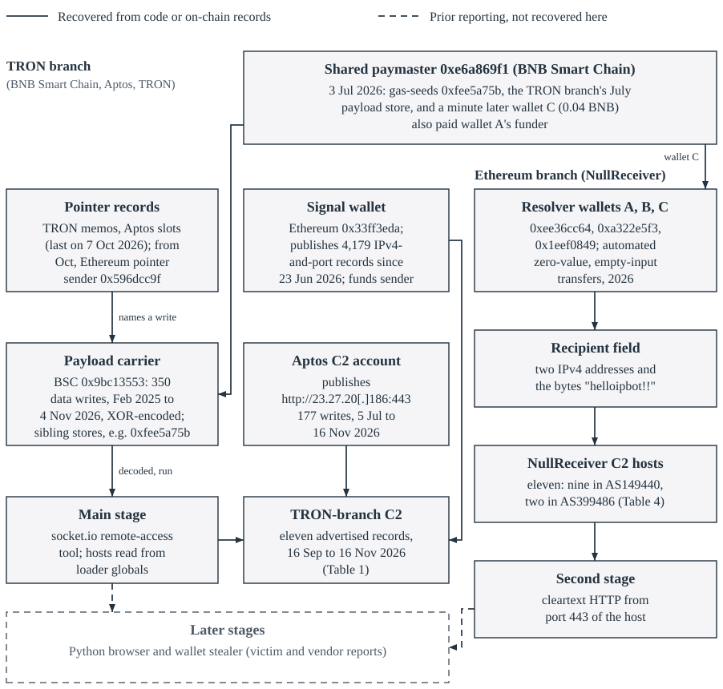

I found that the Hiring777 loader does not contain the address of its next server. It reads that address from the recipient field of the newest transaction sent by one fixed Ethereum wallet, so I could read every address the wallet had ever announced without contacting a single server.

## Key takeaways

- The Ethereum resolver writes each server as twenty bytes in a zero-value transfer: an IPv4 address, the same four bytes again, and `helloipbot!!`.
- The older TRON branch keeps its payloads on one BNB Smart Chain carrier, `0x9bc13553`, whose complete history of 351 transactions I took rather than sampled.
- The memos of the two published TRON wallets name only 28 of the carrier's 350 data writes; three further methods raised coverage to 259 writes, about 74%.
- From October 2026 the carrier's writes are named by block number and transaction index from an Ethereum sender, which defeats memo watching in principle.
- One paymaster on BNB Smart Chain funded both the Hiring777 resolver wallet and a TRON-branch payload store one minute apart, which joins the two branches in one money network.

*Figure 1. The two resolver branches. Solid arrows show behavior recovered from code and on-chain records; the dashed later stages rest on prior reporting.*

## Impact: a channel that cannot be blocked and cannot be erased

This design cuts both ways. For the operator, an unchanged copy of the loader, already sitting in a victim's repository, follows each new server as soon as one more transaction is sent. Blocking yesterday's address therefore protects nobody for long.

For a defender, the operator's server history is written into a public ledger that cannot be edited afterwards, with a block time on every entry. This post explains how the Ethereum branch encodes its servers, and then how PolinRider's older and larger branch on TRON and BNB Smart Chain uses the same idea for its payloads.

## Method: reading the loader without running it

The `init` file hides its strings behind a common JavaScript obfuscator:

- a rotated string array;
- decoder calls in place of every readable literal;
- a further layer that splits strings into fragments, so searching the raw bytes for a URL finds nothing.

I recovered the strings in four steps:

1. I parsed the file into a syntax tree.
2. I reimplemented the decoder.
3. I solved the array rotation without evaluating the input.
4. I reassembled the fragments.

That recovered all 372 strings at all 538 call sites.

## Ethereum branch: a server address in the recipient field

What came out was a small, precise program. It performs these steps:

1. It names a fixed sender wallet.
2. It asks public block explorers and indexers for that wallet's transactions, newest first.
3. It falls back to four public Ethereum RPC endpoints if those fail.
4. It reads the recipient of the newest transaction.

That recipient is not a wallet anyone controls. Its twenty bytes are an IPv4 address, the same four bytes again, and the twelve ASCII bytes `helloipbot!!`. The transfer that carries it has zero value and empty input, so the whole transaction exists only to write those twenty bytes into the chain.

### The second stage

Having decoded the address, the loader fetches its second stage in cleartext HTTP from port 443 of that host, under a path beginning `/0x/`. The port and the protocol are separate facts. A host listed in an indicator feed as "HTTPS on 443" would mislead anyone writing a network rule for this traffic.

I retrieved the second-stage responses on 6 November and kept them as inert files, neither decrypted nor run. What those files do is known only from other researchers' reporting, and they establish nothing about what any particular developer received.

### A correction to one published description

Google's [EtherHiding report](https://cloud.google.com/blog/topics/threat-intelligence/dprk-adopts-etherhiding) describes the cluster it calls UNC5342 as querying chains through centralized API providers rather than RPC endpoints. This loader falls back to public RPC endpoints. That contradicts Google's description only if this branch's operator is UNC5342, which I have not established. The precise statement is that the loader I hold behaves differently from that description.

## TRON branch: payloads on BNB Smart Chain

### The carrier

The Ethereum resolver turned out to be the newer and smaller of two branches. PolinRider's primary resolver is described in OpenSourceMalware's reporting, and I recovered it first-hand from Go modules that [JFrog had listed](https://research.jfrog.com/post/hijacked-npm-vscode-tasks-blockchain/). It works as follows:

1. It reads the newest outbound transaction of a fixed TRON wallet.
2. It takes from its memo a reference to a BNB Smart Chain transaction.
3. It fetches that transaction's input over a public RPC.
4. It decodes the input with a byte-wise XOR key and evaluates the result.

The resolver runs two such chains, each with its own TRON wallet, its own Aptos fallback account and its own key, behind a thirty-second anti-replay guard.

I followed the two TRON wallets that public reporting gives for this branch to the BNB Smart Chain account that holds the payloads, `0x9bc13553`. A carrier's history is finite, so I could take all of it rather than a sample: exactly 351 transactions, one deploying a contract and 350 carrying data, between February 2025 and 4 November 2026, with no unexplained nonce.

### Generations and keys

The memo mechanism is itself a second generation. In June 2025 the operator first carried payloads inside TRON memos and hit the memo size limit. It then moved the payload into BNB Smart Chain calldata while keeping the memo, written backwards, as a pointer to the carrier transaction.

I recovered the XOR keys write by write with a frequency method that scores each key byte against a reference plaintext. Of the 309 writes long enough to score, 307 decrypt to fully printable text. Eight sixteen-character keys cover most of them, and the remaining two yield to the ordinary key once the XOR is taken per character.

Generations change every four to six months under a new key. Two keys ran side by side for sixteen months, which I read as a loader and a main stage shipped together.

The main stage is a socket.io remote-access tool whose code barely moves while its configuration changes:

- Until February 2026, its builds embedded their server addresses.
- From 25 February, they read them from loader globals.
- From May, the loaders route each victim by the campaign tag its lure carried, so one recovered loader understates the infrastructure by about two thirds.

## Coverage: pointers that a watcher can and cannot see

The most useful question this carrier lets me ask is how much of a channel like this a defender can reconstruct from outside. The memos of the two published TRON wallets name only 28 of the carrier's 350 data writes, and they stop in June 2026.

Three further methods raised that coverage to 259 writes, about 74%:

- expanding the funders of known dead drops, which attached memos from ten TRON wallets and slots from seven Aptos accounts;
- querying each payload hash on Aptos as though it were an account;
- reading an Ethereum pointer channel that began in October.

Most of the remaining 91 writes have an explanation. They predate the pointer mechanism, repeat named writes byte for byte, carry one configuration value or read as superseded builds. Seven have neither a pointer nor an explanation, six of them from the two October days on which the Ethereum pointer channel began.

### The October change

That October change defeats memo watching in principle. From then on, the carrier's writes are named by BNB Smart Chain block number and transaction index. They are published as a list by an Ethereum sender, `0x596dcc9f`, whose 1,112 writes between 6 October and 15 November resolve to the carrier's history.

### A mechanical signature across chains

Provisioning also has a mechanical signature across chains. In three separate sessions the order is the same, each step measured in the block time of its own chain:

1. The BNB Smart Chain write comes first.
2. The Aptos pointer follows two to five seconds later.
3. The TRON memo follows six to fourteen seconds later.

Read across its whole life, the branch's control layer is a sequence of addressing schemes laid over one payload pipeline. It runs from the carrier's own contract calls in February 2025, through memos and Aptos slots, to block-and-index lists in October 2026. Each scheme defeats a different kind of watch.

## Server channels: a signal wallet and an Aptos account

From mid-2026 the TRON branch publishes its servers on channels of their own. The Ethereum signal wallet `0x33ff3eda` has made 4,179 address-and-port writes since 23 June 2026. Each recipient holds a primary and a fallback address followed by an eight-byte trailer. The trailer changes with the content and therefore behaves like a checksum rather than a key.

Between 16 September and 16 November the signal wallet advertised eleven distinct records. They range from 586 writes for `111.90.143[.]39`, which held for three weeks, down to three writes in under two hours for `150.40.98[.]42`.

Until 12 October the primary used port 443 and the fallback port 80; afterwards both used port 80. The two shortest stand-ups sit on either side of that change, a pattern I hold at medium confidence without knowing its cause. The current record, since 2 November, is `95.135.181[.]25` on port 80.

An Aptos account repeats a second server string, `http://23.27.20[.]186:443`, in 177 writes since July. The operator therefore keeps two publication channels on two chains at once, advertising adjacent addresses in one /24.

## Links between branches: one paymaster

The evidence that the two branches belong to one operation is mostly financial:

- On 3 July 2026 the account `0xe6a869f1` sent 0.04 BNB to the address of the Ethereum resolver wallet that the Hiring777 loader hard-codes. That was two months before that wallet sent its first resolver transaction.
- One minute earlier, the same account had seeded `0xfee5a75b`, the TRON branch's payload store for July 2026. Its 34 writes decrypt with the two XOR keys recovered from my own NullReceiver sample.
- The same paymaster paid the funder of another resolver wallet, and it pays the same recipients as the wallet that collects the resolvers' fees.

The two branches and their payroll therefore form one money network, and I hold the on-chain facts behind that statement with high confidence.

At host level, a single undetected Python sample, submitted once to a scanning service on 14 November, posts to the newest Ethereum-branch host under the upload path of the TRON branch's main stage. That joins the branches a second time. The link rests on one sample whose body nobody has been able to read.

## Conclusion

A blockchain dead drop protects an operator against takedown. Seizing one server changes nothing while the operator can announce the next one for the price of a transaction.

The same design leaves a complete public record of the operator's instructions and spending, because nothing written to the chain can be removed. Defenders who watch only memos lose sight of the carrier after October 2026. Expanding the funders of known dead drops, querying payload hashes on Aptos and reading the Ethereum pointer channel raised my coverage from 28 to 259 of 350 writes.

[Part 3](20-polinrider-wallets-and-hosts.md) follows that record for the Ethereum branch: three resolver wallets, eleven hosts, and the shared destinations that show the wallets to be one pool.
