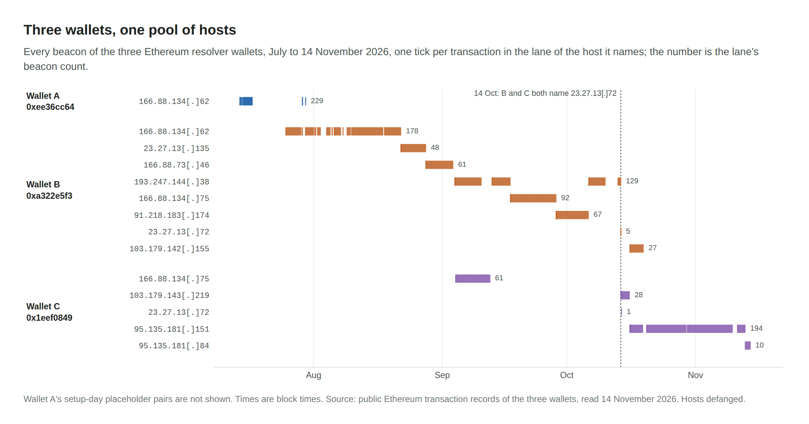
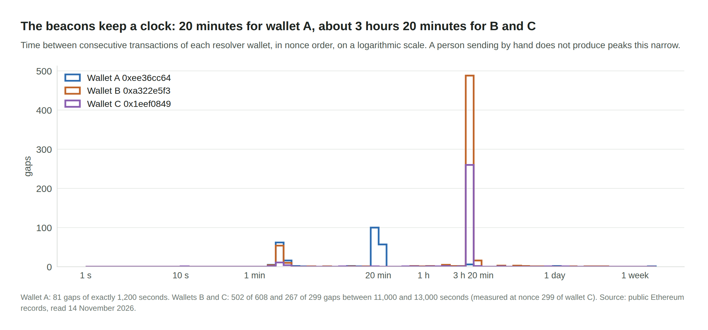
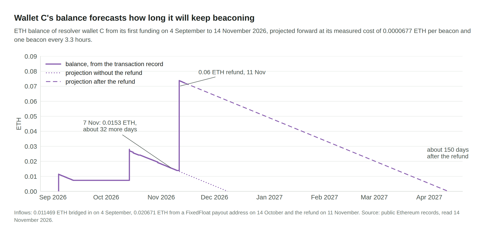

I found that PolinRider's Ethereum resolver runs on three wallets that hand one pool of eleven hosts between them, in a way that only one operator would arrange. One recovered loader gave me the first wallet, and a closed enumeration over the chain gave me the other two and, by 14 November, all eleven hosts.

## Key takeaways

- Because a resolver recipient is a fixed function of the host it names, I could ask the chain which wallets ever beaconed to a known host; the enumeration closed at three wallets.
- The wallets behave as one pool: they share hosts, hand addresses over within days, and from 19 October only wallet C remained active.
- All 1,177 resolver-wallet transactions form unbroken nonce ladders with fixed gas limits and priority fees, so the beacons come from a scheduler, not a person.
- Fingerprint scanning never found a host the on-chain dead drop had not already named, so the chain rather than the internet is the authoritative host list.
- Wallet A and the enumeration that ties all three wallets together appeared in no publication I found.

## Method: a closed enumeration over the chain

The step that made this possible follows directly from the encoding described in [Part 2](19-polinrider-ethereum-address-book.md). The recipient of a resolver transaction is a fixed function of the host it names: the four address bytes twice, followed by `helloipbot!!`. I can therefore compute that recipient for any host and ask the chain which wallets ever sent a transaction to it.

The enumeration ran as a loop:

1. Starting from the known hosts, I listed the senders of every host's recipient.
2. I decoded every outbound transaction of the wallets I found.
3. I added each new host they named.
4. I repeated both steps until neither the wallet set nor the host set grew.

Run over the ten hosts known on 6 November, that closed enumeration stopped at three wallets. Decoding both address fields of every transaction they had sent found no host outside those ten, apart from one wallet's setup-day placeholders.

### The boundary of the closure

The closure has a precise boundary:

- It is complete only for wallets that named at least one host in the final set. A wallet that announced only hosts I have never seen cannot be reached by it.
- The eleventh host, `95.135.181[.]84`, to which the newest wallet moved on 12 November, entered my set from that wallet's own transactions. I did not list the other senders of its recipient.
- None of the nine other wallets that the branch's paymaster seeded alongside wallet C ever sent a beacon. Two went to FixedFloat, five to ChangeNOW, one returned its gas and one is a TRON-branch payload store, so that batch hides no fourth resolver.
- Open-source advisories that use the same staging path and header extend beyond the packages that cite these three wallets, which suggests resolver wallets outside the set. That is an inference from shared tooling rather than an observed wallet. The vendor reports of November that name wallets for those packages name the same ones I hold rather than a fourth.

### Advisories are a noisy transcription channel

The advisories themselves nearly produced false wallets. Forty-nine packages use the toolkit, and the seven resolver addresses I pulled from their advisories turned out to be wallet B and six transcription corruptions of it, most with an inserted digit and every one with zero on-chain activity. The wallet count stands at three. An address that resembles a known one but has never transacted is a corruption signal, so I check new advisory addresses character by character against the known set before treating them as indicators.

*Figure 1. Every beacon of the three resolver wallets, in the lane of the host it names. Wallets B and C share hosts, and on 14 October both named `23.27.13[.]72`.*

## Hosts: the eleven addresses, by wallet

| Host | Network | Beacons by wallet | Window |
|---|---|---|---|
| `166.88.134[.]62` | AS149440 | A 229, B 178 | 14 July to 22 August |
| `23.27.13[.]135` | AS149440 | B 48 | 22 to 27 August |
| `166.88.73[.]46` | AS149440 | B 61 | 28 August to 3 September |
| `166.88.134[.]75` | AS149440 | C 61, B 92 | C 4 to 12 September, B 17 to 28 September |
| `193.247.144[.]38` | AS149440 | B 129 | 4 to 17 September and 6 to 13 October |
| `91.218.183[.]174` | AS149440 | B 67 | 28 September to 6 October |
| `23.27.13[.]72` | AS149440 | B 5, C 1 | 14 October |
| `103.179.143[.]219` | AS149440 | C 28 | 14 to 16 October |
| `103.179.142[.]155` | AS149440 | B 27 | 16 to 19 October |
| `95.135.181[.]151` | AS399486 | C 194 | 16 October to 12 November |
| `95.135.181[.]84` | AS399486 | C 10, to 14 November | From 12 November, 23:44 UTC |

*Table 1. The Ethereum branch's hosts in 2026, from the decode of 14 November. `166.88.134[.]62` is the host OpenSourceMalware published with wallet B.*

Where scanning saw services, the Evoxt hosts are Windows servers exposing remote desktop and Windows Remote Management, and none presents a TLS certificate.

## Wallets: one pool handed over in stages

I label the wallets in order of first activity:

| Wallet | Address | Beacons | Hosts | Active |
|---|---|---|---|---|
| A | `0xee36cc64` | 247, 18 of them placeholder pairs | one | 12 to 31 July |
| B | `0xa322e5f3` | 607 | eight | 25 July to 19 October |
| C | `0x1eef0849`, hard-coded in the Hiring777 loader | 294 | five | from 4 September, still active at my decode of 14 November |

The wallets behave as one pool:

- Wallets A and B both announced `166.88.134[.]62` over the summer.
- Wallet C last used `166.88.134[.]75` on 12 September and wallet B first used it on 17 September. Independent operators would be unlikely to pick the same rented address five days apart.
- On 14 October wallets B and C both announced `23.27.13[.]72` within about five hours of each other. That host received six resolver transactions in its whole history: five from wallet B between 00:06 and 00:14 UTC and one from wallet C at 04:52.
- Wallet B then spent its last three days on `103.179.142[.]155`, and from 19 October wallet C was the only active resolver.

That last hand-over matches one victim's public incident report of 27 October, which states that the current build used wallet C and the previous one wallet B.

### Setup and the longest run

Wallet A's start shows the setup. It began with sixteen self-transfers from 08:58 UTC on 12 July. Its unusable placeholder pairs, one in reserved address space and one pairing a carrier-grade NAT address with a content-delivery address, kept recurring after real use began, so they were not only a pre-deployment test. They start at nonces 21 and 24, run through nonce 36 between 12 and 14 July, and recur on 28 July and on 31 July in wallet A's last transaction, about eighteen transactions in all.

These pairs also show that the twenty bytes can carry two different addresses side by side rather than one address twice. The content-delivery value, `45.12.31[.]11`, belongs to Cloudflare's Spectrum proxy service and its own resolver recipient is empty. Anyone reading the raw dead drop without the rehearsal-day context would report it as operator C2, so it stays out of every indicator list I publish.

Wallet C's history after the hand-over is the longest on a single host: 194 beacons to `95.135.181[.]151` between 16 October and 12 November. The move to `95.135.181[.]84` in the same /24 followed at 23:44 UTC on 12 November.

Those 194 beacons to one fixed recipient contradict a statement in OpenSourceMalware's [NullReceiver write-up](https://opensourcemalware.com/blog/nullreceiver-dprk-c2-technique) that the technique never reuses a destination. The recipient is a fixed function of the host's address, so it repeats for as long as the host does.

## Timing: a scheduler, not a person

Everything about the beacons indicates a machine:

- All 1,177 resolver-wallet transactions form unbroken nonce ladders.
- Apart from five of wallet A's sends and 68 of wallet B's, each wallet uses one fixed gas limit.
- Of the 1,176 transactions in the current fee format, 1,169 pay a priority fee of exactly 1.5, 2.25, 3.0 or 4.5 gwei. The exceptions are setup sends and two retried writes.
- The median gap between consecutive sends is 1,200 seconds for wallet A and about 12,036 seconds, roughly three hours and twenty minutes, for wallets B and C.

| Measure | Wallet A | Wallet B | Wallet C |
|---|---|---|---|
| Nonce ladder | 0 to 267, no gap | 0 to 608, no gap | 0 to 299, no gap |
| Fixed gas limit | 21,000 on 263 of 268 | 42,000 on 541 of 609 | 42,000 on all 300 |
| Dominant priority fee | 1.5 gwei on 252 of 268 | | 3.0 gwei on 289 of 300 |
| Period | 81 gaps of exactly 1,200 s | 502 of 608 gaps between 11,000 and 13,000 s | 267 of 299 gaps between 11,000 and 13,000 s |

*Table 2. Automation measures from the raw fee fields, read when wallet C stood at nonce 299.*

*Figure 2. Time between consecutive transactions of each resolver wallet. The narrow peaks at 20 minutes and at about 3 hours 20 minutes are a scheduler's period.*

The same four measures point the other way on the operation's money wallets, which show 58 distinct gas prices in 70 transactions and 39 in 47, variable gas limits and twelve zero-second gaps. Those read as batches started by hand.

I grouped the 1,148 decoded beacons into 743 sessions, opening a new session after any gap longer than 90 minutes. The sessions spread almost evenly across the twenty-four hours of the UTC day. The densest ten consecutive hours hold 43% of them, against about 42% for a uniform clock.

Rotation, on the other hand, follows no clock. Nine rotation events give intervals from 1.85 to 38.78 days, with a median of 11.27. The intervals are 1.85, 38.78, 6.01, 6.96, 24.40, 15.57, 2.20 and 27.78 days, with a standard deviation of 13.62, so there is no period to predict. I count a rotation as the first beacon naming a host, merging hosts first named within six hours of each other because each beacon carries two addresses. I could not distinguish any reaction to my own disclosures from chance: the forty I sent in November set a baseline lag of about two and a half days, against the two days observed. The monthly baselines were 10.5 days in August, 28.5 in September and 21.5 in October, and every rotation but the last came 11.4 to 36.3 days after the nearest preceding disclosure.

One timing result survives these doubts because block times cannot be spoofed. Nine of the eleven hosts were first named between 00:00 and 07:00 UTC. That tells me when someone chose to rotate, not where that person sits. The money side of the operation, whose hand-started batches concentrate in a similar early-UTC window, is the subject of [Part 7](24-polinrider-money.md).

## Infrastructure: hosts that only the chain can name

The eleven hosts sit on two networks: the first nine in Evoxt's AS149440 and the last two in AS399486. They defeat the usual pivots by construction:

- **No certificates.** The resolver side runs its servers as bare addresses on raw ports. Across all 26 resolver-side hosts I hold, only two certificates exist, both for a domain of the separate npm cluster discussed in [Part 6](23-polinrider-detection.md), so there is no certificate clock to read.
- **No scan pivot.** Fingerprint scanning across the shared hosting networks, with roughly 1,300 hosts answering on port 443 in AS399486 alone, never produced a host that the on-chain dead drop had not already named. The chain rather than the internet is the authoritative host list.
- **Feeds.** Five of the hosts were already in public abuse feeds when I found them, and none is in the public maltrail Lazarus list.

Across the resolvers, carriers and publication channels, 21 of 26 Evoxt-routed hosts sit in London, against London's share of about 13%. That is a provisioning habit that no single address would show. The two newest hosts are off Evoxt, so no newer address has tested it.

These are dated hosting associations. None of them should be carried forward to whoever rents an address next.

### Shared address space is not shared control

The TRON branch's signal wallet currently advertises `95.135.181[.]25`, in the same leased /24 as wallet C's last two hosts. That looks like a link between the branches until the sequence is read:

- In eleven rotations the signal wallet never advertised any other address in that range.
- It stood up `.25` ten days before wallet C moved to `.84`.
- Both addresses sit in one leased registry object with no sub-assignment.
- Their service shapes differ.
- Addresses in that range churn between unrelated customers.

I record that as shared space without evidence of shared control.

## Funding: what a wallet's balance says

Each beacon costs gas, which turns a wallet's balance into a forecast. I divided wallet C's balance on 7 November by its mean fee per beacon and multiplied by its period, which gave about 32 more days of beacons: 0.0153 ETH bought roughly 226 further beacons at about one every 3.3 hours. The operator refunded it with 0.06 ETH on 11 November, about a month early. At the measured rate the runway after the refund is about 150 days.

*Figure 3. Wallet C's balance and its projection at the measured cost per beacon. Without the refund it would have run dry in early December; after it, the runway reaches April 2027.*

Where the gas comes from is more informative than how much it costs:

- Wallets B and C were partly funded from a FixedFloat payout address, a no-registration swap service, so the shared payout reflects a habit rather than common control. It sent 0.017637 ETH to wallet B on 25 July and 0.020671 ETH to wallet C on 14 October, and on each of those dates it made more than 500 payouts to hundreds of recipients. The proof of common control is the shared hosts, not the funding.
- Wallet C's first gas came on BNB Smart Chain from the paymaster `0xe6a869f1`, which also paid 410 USDT to wallet A's funder. [Part 2](19-polinrider-ethereum-address-book.md) shows the same account seeding a TRON-branch payload store one minute earlier.
- The wallet that pays the resolver fees, `0xf97062cb`, is a drain collection address. About twenty-two established personal wallets sent into it what for most of them was their last transaction.
- Wallet B returned its remaining 0.0293 ETH to it on 14 October, the same day both wallets announced `23.27.13[.]72`.

The collection address first moved on 3 September at 02:01 UTC, a day before wallet C's first beacon. Of the roughly thirty addresses that sent it ETH by 3 November, about twenty-two were established personal wallets, first active between 2021 and 2025 and with up to 533 transactions, for which that transfer was their last outgoing transaction; nine were emptied within eleven minutes on 3 September. What came in left at once, tokens through the 1inch router within the hour and about 2.47 ETH into the LI.FI bridge contract in September.

The funding rails are non-custodial throughout. The intermediate funders are fresh, unlabeled accounts and EIP-7702 delegated smart accounts whose counterparties are bridges and decentralized-exchange routers, and wallet C's first Ethereum gas was bridged in through Across. No labeled centralized-exchange deposit address appears anywhere in the funder cluster, so the only provider-held record on this side is FixedFloat's order data, which only law enforcement can request.

That the transfers into the collection address were thefts by this operation is an inference I hold open. Part 7 sets it out with the rest of the money.

## Prior reporting: two of three wallets are public

Two of these three wallets are now public:

- Wallet B appeared in OpenSourceMalware's reporting in August.
- [SafeDep](https://safedep.io/polinrider-ethereum-c2-github-repositories/) published six of its eight hosts on 30 September, JFrog a seventh on 9 November and [StepSecurity](https://www.stepsecurity.io/blog/accurasofthire-fake-interview-developer-machines) all eight on 13 November.
- [Sonatype](https://www.sonatype.com/blog/polinrider-loader-reappears-in-hijacked-npm-packages) named wallet C and one of its hosts on 4 November.
- Victims' own public incident reports named wallet C from 22 October, before any vendor did.

JFrog's and StepSecurity's reports also give wallet B a public face: a fake company, `accurasofthire[.]com`, with hidden GitHub hiring accounts, the recruiter persona `oleksandr3201`, ten look-alike npm packages and a delivery through a camera driver and a browser extension. Sonatype's ten hijacked npm packages read wallet C.

For the eleventh host the outside record is thinner than it looks. The only public label calling `95.135.181[.]84` NullReceiver is a ThreatFox entry I filed myself, which I exclude from every corroboration count, and urlscan holds no scan of it. The only outside evidence touching that host is the single undetected sample described in [Part 2](19-polinrider-ethereum-address-book.md).

Wallet A and the enumeration that ties all three together appeared in no publication I found.

## Conclusion

The three wallets are one pool run by a scheduler and paid for out of a drain collection wallet. Their beacons give a dated list of every host the loaders were told to use, and that list is more complete than anything scanning produced.

For defenders, the practical consequence is to take host lists from the chain and to treat each address as a dated association. Watching the resolver wallets shows each rotation with its block time, and a wallet's balance and refunds forecast how long it will keep beaconing.

The chain told me which servers the loaders were told to use and when; [Part 4](21-polinrider-repository-spread.md) returns to the repositories to show how the same loader reached thousands of projects whose owners never spoke to a recruiter.
