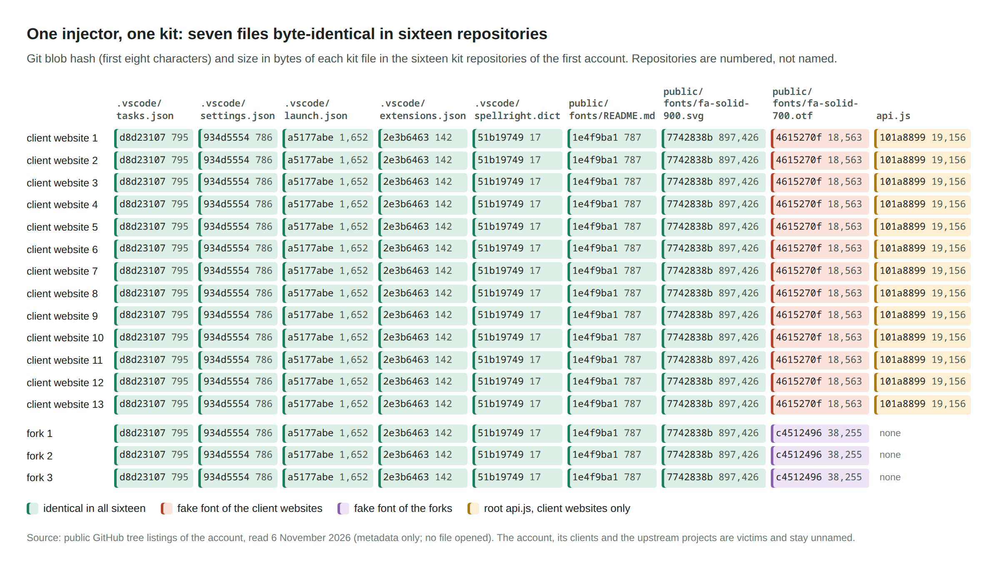
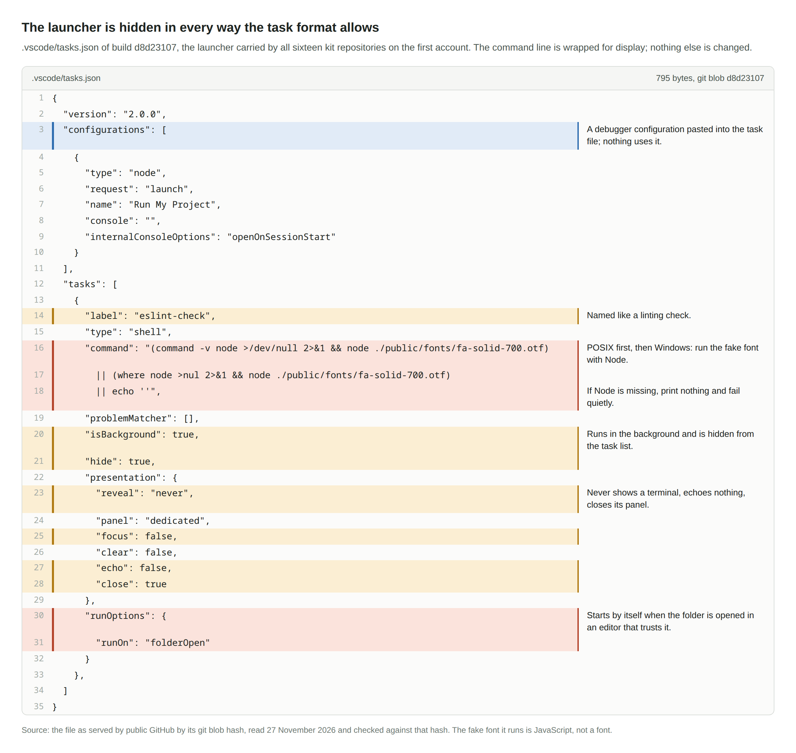
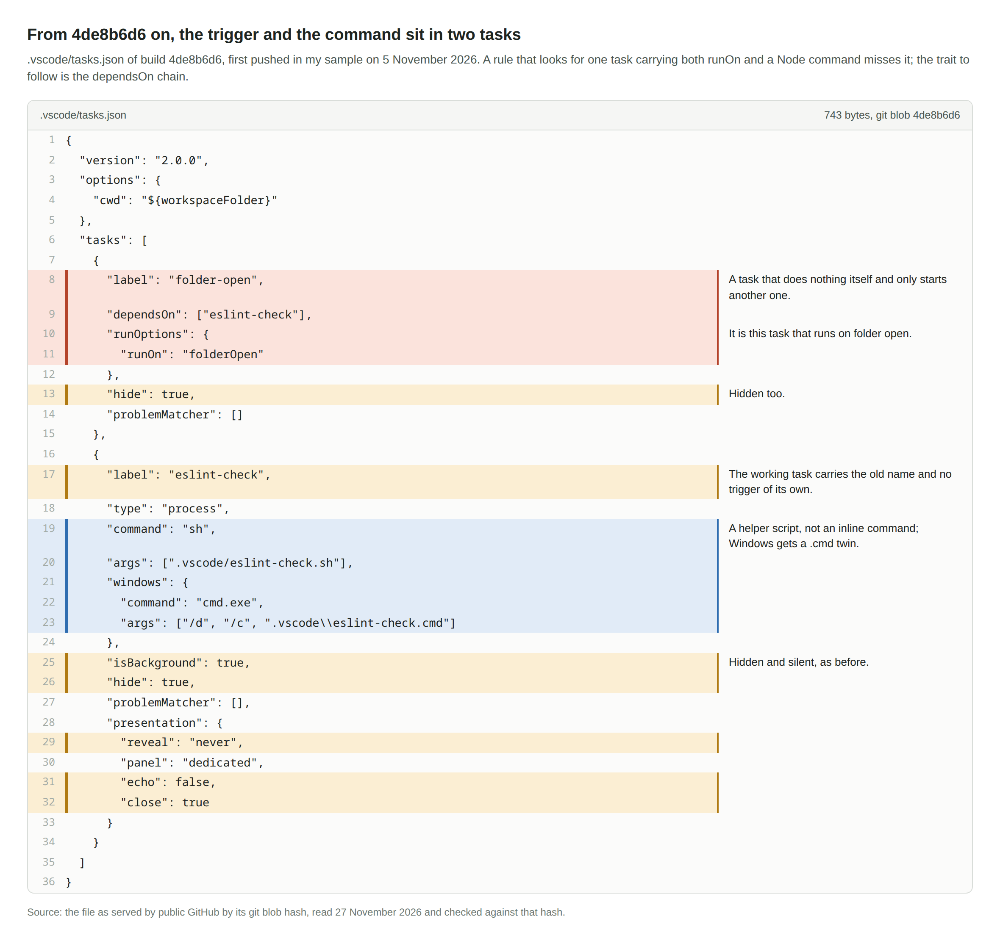

I found loader artifacts in nineteen of the 26 public repositories of the developer who took the Hiring777 take-home assessment. Eighteen of them had nothing to do with any recruiter, so changes written through one developer's access exposed clients and collaborators who never spoke to the recruiter.

## Key takeaways

- Nineteen of 26 repositories on one account carried the PolinRider kit; thirteen of the eighteen non-lure repositories are small business websites built for clients.
- The kit is written by amending existing commits under their real authors' names and force-pushing them, so author dates and author fields mislead.
- The platform's push time is the reliable clock: an author date can read as 2022 to 2024 for an infection in 2026, and an unsigned commit under the owner's own address is not evidence that the owner wrote it.
- A second account carries the kit in about 101 of its 148 repositories, pushed in two waves on 14 August and 29 October 2026.
- Defenders should remove persistence before rotating credentials, disable automatic editor tasks globally and check every repository the account can push to without opening it in the editor.

## Scope: one assessment, nineteen repositories

The take-home assessment was one repository. The rest of the same developer's public account showed loader artifacts in nineteen of its 26 repositories: the Hiring777 copy and eighteen others.

- Thirteen of the eighteen are small business websites the developer had built for clients.
- Five are forks: four of open-source projects and one of an UNK_DeadDrop take-home lure.

Sixteen of the nineteen, the thirteen client websites and three of the forks, carry the same kit. Seven of its files are byte-identical across all sixteen, while its fake-font payload differs between the client websites and the forks. An identical root `api.js` sits only in the client websites. It is probably a further loader, but I have not analyzed it.

*Figure 1. Seven kit files share one blob hash in all sixteen repositories. The fake font differs between the client websites and the forks, and only the client websites carry the root `api.js`.*

The other three infected repositories carry less:

- the take-home copy carries only the `init` files of the assessment's dropper, in its root, backend and frontend folders;
- one fork carries only an `init` file;
- the fork of the UNK_DeadDrop lure carries an `init` file and a different `tasks.json`.

Seven repositories are clean.

| Repository group | Count | What it carries |
|---|---:|---|
| Client websites | 13 | full kit, an 18,563-byte fake `fa-solid-700.otf` and a 19,156-byte root `api.js` |
| Forks with the full kit | 3 | full kit, with a fake font of a different size |
| Fork with `init` only | 1 | dropper `init` file, no kit |
| Fork of the UNK_DeadDrop lure | 1 | `init` file and a different `tasks.json` |
| Take-home copy | 1 | `init` files in three folders, no kit |
| Clean | 7 | nothing |
| **All public repositories** | **26** | |

*Table 1. The first developer's public repositories by what they carry.*

### The root `api.js`: a probable second loader

The 19,156-byte root script arrives in the same kit commit as the fake font in every client website. Public reporting on the related worm names a file of that name as a loader location, with the loader appended after a long run of whitespace. I therefore treat it as a probable second loader beside the fake font, and a cleanup list has to include it, not only the editor configuration and the fonts directory. The word "probable" carries real weight: I have recorded the file by its git blob hash, which finds it in any repository, but I have not analyzed its body.

The 18,563-byte fake font of the client websites is in a similar position. It was a payload variant new to me, and an incidental preview showed a marker of the same family as the publicly reported variant and what looked like the resolver wallet inside an encoded chunk. Until that file is analyzed properly, the wallet reference is unconfirmed.

### One injector, not an infected template

An innocent mechanism had to be excluded first. A developer who copies an already infected local template into each new client site would also produce a byte-identical payload across all thirteen websites. The forks rule that out. The same kit arrives in them inside commits amended under the upstream maintainers' names, and only the implant writes those. One injector placed one kit everywhere, so there is no separate template folder to hunt for, and cleanup means removing the kit from every working copy on the disk.

### One take-home copy among twenty-eight

Before this spread came into view, the question was who else had received the weaponized assessment. I checked 25 accounts: every public repository matching the seven assessment brands, the full file tree of each for an extensionless `init` file, and every `package.json` for a prepended `node init`. Exactly one of the 28 matching repositories carries the dropper. The recruiter's own two public base copies are clean, and so is every other candidate copy pushed between May and October 2026.

One delivered copy was weaponized, not the set. That cuts both ways for notification: the other candidates should not be told their copies carry malware, because they do not, while the one real victim's notification becomes more urgent.

I also checked the infection route. None of the 47 packages of the campaign's malicious npm arm appears in any of the 152 manifests and lockfiles on the developer's account. The loader came with the take-home repository the recruiter sent, not from the registry, so a dependency audit is the wrong place to reconstruct this exposure.

This pattern changed the scope of the investigation. A recruitment lure exposes one developer, but changes written through that developer's access can expose clients and collaborators. I leave the developer, the clients and the upstream projects unnamed here; their repositories are evidence of exposure, not of anything they did.

## Mechanism: commits that keep someone else's name

The way the kit is written into repositories is what makes it hard to see. In every victim I examined, the injecting commits carry real contributors' names, messages and timestamps. The payload is added to an existing commit, which is amended in place with its author, date and message unchanged and then force-pushed.

How the kit reached each repository differs by repository type:

- **Client websites.** The developer's own freelance work carries the loader inside ordinary feature commits under the developer's own identity, as though it had been swept up in the next real commit.
- **Forks.** Each injection is a single fork-only commit on top of an old upstream point, carrying the upstream maintainer's own name and email and an upstream-style message. One of them is a rewritten copy of a real upstream commit with a different hash.
- **A third account.** An aged account from 2021 was force-pushed into a project under the identity of a former contributor who had long stopped committing.

The launcher itself is the same everywhere on the first account and matches a publicly reported variant exactly. It is a task labeled as a linting check, set to run on folder open, hidden in every way the task format allows, and running a command that works on both POSIX and Windows to execute the fake font with Node.

*Figure 2. The d8d23107 launcher from the first account, read from GitHub by its blob hash. Every presentation option that could show the task is turned off.*

The pattern fits an implant on the machine that writes the kit into the working copies it finds, fabricates a commit under the upstream author's identity where it needs one, and is otherwise swept into the owner's next commit, with ordinary pushes then carrying it to the platform. I infer this from the repository artifacts; I did not observe it on a machine.

Victims' own public reports describe two further forms:

- forged merge commits that imitate a legitimate pull request, with the same message, parents and declared date but a different tree;
- merges that reintroduce the payload through several contributors.

In the forks the injection arrives in a single commit under the upstream maintainer's name. I compared each fork with its upstream and found that the commit never reached the upstream project. Reading the author field alone would blame a maintainer who never touched the change. I found nothing to suggest that any upstream project received it.

### Dating: push time, not author date

A compromise cannot be dated by a commit's author date. The kit inherits that date from the commit it amends, and it can read as 2022 to 2024 for an infection in 2026. The platform's push time records when the hosting service received the commits and is the reliable clock. A recent push can carry an apparently ancient malicious change.

The take-home copy shows two reading rules at once:

- The dropper arrives in a single unsigned commit attributed to the developer's own email address and dated 2 June 2026, so the repository's own history presents the victim as the author of the compromise. The date is an unsigned author date and cannot be verified. If it is genuine, the implant sat in the submission for three months before its command-and-control (C2) channel went live on 4 September.
- A push on 1 November 2026 looked like fresh activity. It was a bulk re-push of four repositories at unchanged commit hashes and added nothing.

An unsigned commit under the owner's address is not evidence that the owner wrote it, and a re-push with unchanged hashes is not activity.

For the same reason I quote no date for the compromise of the client websites. Their commit dates point to late September, but those dates come from exactly the metadata this kit forges. My records match the launcher they carry to the October build, whose pushes fall between 10 October and 6 November in my 996-repository sample. Either the September dates are an artifact of forged metadata, or the websites carry an earlier build than that match suggests. Settling it would need the push dates and a per-repository inventory of launcher builds on that account.

### The fork of the UNK_DeadDrop lure

One fork looks at first like an UNK_DeadDrop identity authoring a PolinRider commit. Its folder-open task is the lure's original weaponization inherited from upstream, not part of this kit. The PolinRider commit carries the upstream name only because the worm amends whatever it finds. The repository joins the two operations through the victim's disk and nowhere else, so I keep them apart, as [Part 1](18-polinrider-following-a-developer.md) and [Part 17](17-two-operations-one-ecosystem.md) explain.

## Launchers: where the kit hides and what starts it

The take-home route with its `node init` script is one of several. The kit also hides loaders in two other places:

- a whitespace-padded `api.js` at the repository root;
- far more often, fake Font Awesome files under `public/fonts/`, which an editor task reaches when the folder is opened rather than through a package script.

### Fake fonts and their triggers

The executed files carry names such as `fa-solid-*`, `fa-brand-400.*` and `fa-brands-400.ttf`, or invented extensions such as `.lkf`, `.lfk`, `.llf`, `.fml` and `.orc`. From one build onward the folder-open task calls `.vscode/eslint-check.sh` or `.vscode/eslint-check.cmd`, which then run the fake font with Node. Two further forms exist:

- a nested inline form whose file sits deep in the tree under paths containing spaces, route-group parentheses and ampersands;
- an argument form that passes the path separately to a `node` command.

The trait common to every form is an automatically triggered task, directly or through a `dependsOn` chain, that runs a file under `public/fonts/` with Node. A rule keyed to one font name or to the root path therefore ages out. For the same reason [Part 5](22-polinrider-counting-repositories.md) counts by that trait rather than by a filename.

*Figure 3. From build 4de8b6d6 the trigger and the command sit in two tasks joined by `dependsOn`. The working task calls a helper script, which runs the fake font.*

### Configuration launchers

The configuration route that OpenSourceMalware reported first has not gone away. A public scanning service links seven files to one of the branch's older sink addresses. Three of them are `craco.config.js`, `tailwind.config.js` and `appconfig.js` launchers from October 2025 and February 2026.

A reviewer who checks only dependencies would miss both routes. A reviewer who opens an unfamiliar workspace in an editor that trusts it would run the editor task before reading it, which is the whole point of the design. Jamf's [account of workspace-task abuse](https://www.jamf.com/blog/threat-actors-expand-abuse-of-visual-studio-code/) describes the same mechanism in other campaigns, and [Part 6](23-polinrider-detection.md) turns the shared trait into a review rule.

## Persistence: a machine that stays infected

A second account shows the same mechanism at a larger scale and over a longer time. It carries the kit in about 101 of its 148 repositories, written in two waves of pushes two and a half months apart:

- The 81 repositories pushed on 14 August 2026 carry an older launcher and no fake font.
- The 29 repositories of a bulk re-push on 29 October carry the launcher identical to the one in my analyzed loader, this time together with a fake font.

| Push day | Repositories | Launcher build | Fake font |
|---|---:|---|---|
| 14 August 2026 | 81 | `5e226620` | none |
| 23 August 2026 | 15 | `5e226620` | none |
| 25 August 2026 | 7 | `5e226620` | none |
| 29 October 2026 | 29 | `d8d23107` | yes |

*Table 2. Push days of the second account's infected repositories.*

Those are push-day counts. Together they come to 132 repositories, more than the roughly 101 that carry the kit today, and I have not reconciled the two from the spread data. They do not divide the infected repositories neatly between the waves, but they show a machine that stayed infected across a change in the operator's tooling. Its compromise falls on or before 14 August, with either a reinfection or a tooling update in October.

The two waves also straddle the hand-over between the Ethereum resolver wallets of [Part 3](20-polinrider-wallets-and-hosts.md): the August wave sits in the era of wallet B and the October wave in that of wallet C. Two and a half months apart, however, the waves do not date the hand-over itself. A build made before a hand-over keeps pointing at the retired wallet and is never retrofitted, so a victim's build dates the infection but does not tell which wallet is current.

The 32 accounts that appear in both my inline-launcher and my helper-script searches show the same persistence across the wider population. Their machines wrote the kit into repositories under two different launcher generations.

For cleanup this is direct. A remediation dated to one wave will miss the other, and deleting one visible fake font establishes nothing about the rest of the account.

## Attribution check: victims, not operators

An aged, quiet account that took assignments from more than one fake recruiter resembles the accounts operators sometimes repurpose. I tested rather than assumed that these accounts are victims. Two observations decided it:

- The kit rides inside the developer's own feature commits and inside forks under third parties' names, which gains an operator nothing.
- Six independent incident reports by other developers describe the same pattern on their own machines and read as genuine victim reports.

One nominal client of the first developer turned out to be a real clinic with no website at all, which fits speculative freelance outreach rather than a front. Across the more than 282 accounts I enumerated in the first campaign-wide pass, I found no operator account among the infected ones.

A comparison with Miasma, the other repository worm of 2026, makes the commit method diagnostic. Miasma, as [SafeDep](https://safedep.io/inside-the-miasma-supply-chain-attack-toolkit) describes it, forges new backdated commits and hijacks tags. PolinRider amends existing commits in place, and the two share only the idea of a folder-open launcher. A code search for Miasma's signatures found 186 repositories in 104 accounts, fifty of them in the vendor's published list, which shows that the queries work. Against the 566 PolinRider repositories I held at the time, the only three that intersect are defender repositories quoting both worms, and the vendor's full list of 123 repositories in 56 accounts intersects my account lists not at all. The two worms hit separate populations. Even Miasma's forged commits are not uniform: of its 808 kit commits all but three carry the maintainer's own name, and the rest use a previous author or the CI bot, so a rule that assumes every planted commit carries one identity will miss some.

## Exposure: write access, not audience

These repositories are not lures aimed at the public, and their audience shows it. Across the 177 public repositories of the three victims I studied in detail, the combined audience is two stars, four forks and two watchers. All eighteen infected repositories on the first account have no stars, forks or watchers at all. All four forks across the three accounts predate the injections and are clean, because a fork does not receive later commits from its source.

That negative is only as strong as the instrument. Stars and forks bound the visible audience and say nothing about the actual one: anyone who received the code privately, as a client does, is invisible from public data.

The exposure therefore runs through write access. Several affected accounts belong to organizations, where one member's infected machine can reach every repository the organization owns. The next victim is a client or colleague who opens an infected repository in an editor that trusts it, which leaves no public trace for anyone to count.

I did not have endpoint telemetry from any affected machine. I cannot describe the local process that wrote each file, only the repository changes it left. Those changes are consistent with a resident process writing the kit into every working copy it could reach.

## Conclusion

One take-home assessment led to nineteen infected repositories on one account and about 101 on another. The kit spreads through amended commits under real names, so write access, not audience, defines who is exposed, and push time, not author date, defines when.

Response has an order that follows from this:

1. Remove persistence before rotating credentials, because a resident process collects the new ones.
2. Disable automatic editor tasks globally before any affected repository is opened again.
3. Check every repository the account can push to, forks and organization repositories included, without opening it in the editor, and remove the whole kit, root `api.js` included, from every working copy on the disk.
4. Treat any wallet key or seed phrase that was on the machine as stolen.

Takedown requests need the same care, because most infected repositories belong to victims. The owner should hear about it first, and a report to the platform should describe the repository as victim-owned rather than as attacker infrastructure.

How many such repositories exist is the question of Part 5, and the answer depends more on the shape of the search than I expected.
