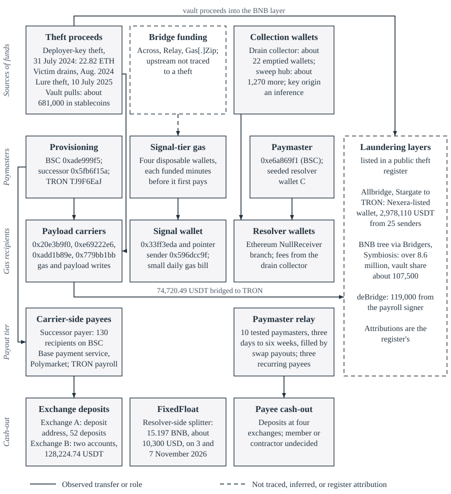

On 31 July 2024, between 15:33 and 15:37 UTC, four wallets belonging to the owner of an established token project's deployer key were emptied in full into `0x20e3b9f0`, the wallet that later served as a BSC payload carrier for PolinRider's May to June 2025 generation, and the deployer wallet's own contribution was 22.82 ETH, its entire balance after seven years and its last transaction ever. The sweep did not look like the owner: it paid a priority fee nearly twenty times the owner's usual setting, sent an exact balance-minus-gas amount to a fresh destination, and swapped and bridged within fifteen minutes, while that evening the project's dormant admin revoked all five of the deployer's roles on its token. Even the carrier's BNB gas came from the victim's own balances, swept in the same four and a half minutes, so the infrastructure that later stored payload stages was paid for, gas and working capital alike, with stolen money. How that key leaked I do not know, and that recruitment malware took it is an inference only.

That carrier is the cleanest example of what this part follows: an operator who puts a command-and-control (C2) channel on a public blockchain has to pay for it one transaction at a time, and every payment stays on the ledger. All of my chain work was read-only, I sent no transaction and contacted no exchange, service, project or victim, and I counted only transfers a wallet signed itself on the genuine token contract, because address poisoning floods token histories with look-alike transfers that would otherwise add millions in flows that never happened. Everything here belongs to PolinRider, which, as [Part 17](17-two-operations-one-ecosystem.md) explains, is a separate operation from UNK_DeadDrop, and the last section shows why the UNK_DeadDrop side of the ledger is almost empty.

## A small daily gas bill

PolinRider's on-chain C2 is cheap to run. Each write by the signal wallet `0x33ff3eda`, whose mechanics [Part 2](19-polinrider-ethereum-address-book.md) and [Part 3](20-polinrider-wallets-and-hosts.md) describe, is a transfer of zero or dust value, typically 150 wei, to an address that is really twenty bytes of data decoding as two IPv4 address and port pairs, and a loader simply reads the newest transaction and takes its C2 from the recipient field. In the sixty days to 16 November 2026 the signal wallet advertised eleven records, and its whole history since June decodes as 4,179. On the Ethereum NullReceiver branch, resolver wallet C paid a mean fee of 0.0000677 ETH per beacon at a mean interval of 3.34 hours, a daily cost of the order of 0.0005 ETH, so its remaining 0.0153 ETH bought about 226 beacons over roughly 32 days. With a bill that small, who pays it is far more informative than how much it is.

The pointer sender `0x596dcc9f`, which writes payload pointers, ties the signal wallet to the carrier side. Its only funding is two payments of 0.01 ETH from the signal wallet, and between 16 September and 16 November 2026 the two channels each had a transaction in the same Ethereum block 315 times, which one process scheduling both explains and shared infrastructure does not.

*Figure 1. Solid elements are signed transfers or roles read on chain. Dashed elements mark bridge funding not traced to a theft and laundering layers whose attributions belong to the public register. UNK_DeadDrop is not part of this graph.*

## Disposable wallets and provisioning bursts

The signal wallet's gas comes from a tier of disposable wallets, each funded over a bridge minutes before it first pays and used only a few times: `0xd31a213e` paid the signal wallet five minutes after being funded and has four rows in its entire life, `0x416d9906` was funded three times through Across, one to three minutes before each payment, and `0x76d6ddcb` paid 36 seconds after Relay funded it. That habit defeats same-chain tracing by design. Four hops above the signal wallet the trail reaches a person-operated DeFi wallet whose large exchange withdrawals each follow a one-dollar test, a human habit rather than a script's, but the dollars diverge into a bridge while only the gas continues to the beacon, so that wallet is a lead and not a payer of the C2.

Carriers and dead-drop accounts are created by a few provisioning wallets whose lives are short lists of sends. The TRON wallet `TJ9F6EaJ` made seven outbound sends in 439 transactions, five of them demonstrably to dead-drop accounts, and on BSC `0xade999f5` made eight non-zero BNB payments, two of which created the carriers `0xe69222e6` in October 2025 and `0xadd1b89e` in January 2026. Replaying the January generation shows the TRON dead-drop account funded at 15:12:57, the BSC funder topped up at 15:18:14 and the carrier funded at 15:22:25, with funders firing four to twelve minutes before a generation's first write, which makes them the branch's earliest observable signal. When `0xade999f5` stopped in May 2026, a successor payer, `0x5fb6f15a`, had appeared two days earlier, and it funded a new carrier, `0x779bb1bb`, which on 4 August wrote a three-stage build with the same shim, main stage and loader triple as its predecessor.

The Ethereum resolver wallets are funded from a paymaster on BSC, `0xe6a869f1`, and from a drain collection wallet. The paymaster seeded resolver wallet C and, a minute earlier, a BSC payload store of the TRON branch whose calldata decrypts with NullReceiver keys, which is a direct financial link between PolinRider's two resolver branches, a relationship that infrastructure alone had left unsettled.

## Where the money comes from

The main carrier's October and November 2026 payload pushes were paid for with 0.008905 BNB from `0x27d5cbba`, a wallet that on 10 July 2025 had received the entire balances of a family of wallets on three chains within one hour and then sat untouched for fifteen months before sending its last dust to the carrier. The public [theft register maintained on GitHub](https://github.com/tayvano/lazarus-bluenoroff-research) records that sweep as a malicious-repository theft of about 44,000 dollars on that date, in which the victim ran code from a repository shared by a contact met online, and its record has the same victims and theft wallets, address for address, as the chain I reconstructed independently, which is what makes a register match worth more than any label service. The carrier chain's August 2024 inflows are drains as well: the sweeper `0x204643da` drained forty victim wallets on five chains in one morning, and its stablecoins match to the cent what it then bridged.

The largest source tied to the carrier chain is a backdoor that is still armed. In January 2024 both factory contracts of the ConcentricFi vault system on Arbitrum were handed to an attacker key that set an implementation on twelve vaults letting the admin pull any approving wallet's balance up to its allowance, and on my own tabulation 95 of 541 such calls moved value from 55 victims, about 681,000 in stablecoins, most of it after the public exploit from approvers who kept funding their wallets. The tie to PolinRider runs through money, because the admin's pulls fed the carrier chain's Arbitrum leg, and no finding attributes the exploit itself to either operation. On 16 November 2026, 91 wallets still held open allowances to those vaults, 41 with balances that could be pulled, so anyone who ever approved them should revoke the allowance now, which is the most urgent practical result in this entire money trail.

The resolver side is paid for in the same way. The wallet that pays PolinRider's resolver fees is a drain collection address into which about twenty-two established personal wallets were emptied, most of them sending it their last outgoing transaction ever, and a linked sweep hub emptied about 1,270 more, so the operator very probably holds keys to around 1,340 wallets, although whether those keys came from PolinRider's own stealer remains an inference.

## Across the bridges and into the laundering layers

The carrier chain's stolen money leaves BNB Smart Chain by bridge, through Allbridge Core and Stargate pools that I identified by contract verification, and all eighteen deposits of the carrier's peel chain went to TRON. On BSC the 2024 carrier's 74,720.49 USDT was consolidated in one wallet together with 448,818.17 USDT of Nexera theft proceeds, a wallet the register lists under that theft, and on TRON four receiving wallets passed leftover gas down a chain before consolidating in another Nexera-listed wallet that took 2,978,110 USDT in genuine legs from 25 senders. I matched every one of the 32 TRON receipts to its source deposit by the Allbridge message nonce and confirmed each against Allbridge's public endpoint,.

The ConcentricFi proceeds enter a BNB laundering layer that the register lists under about a dozen thefts it attributes to DPRK-linked actors, among them Seedify, OpenFabric, Tapioca and PolinRider itself, and ConcentricFi's share of that layer is about 107,500 of more than 8.6 million. These are strong statements about shared laundering infrastructure and weak ones about identity, because a laundering layer serves whoever pays it, and every DPRK label in this part is the register's reading or that of the reports it cites, among them a [Multilateral Sanctions Monitoring Team report](https://www.gov.uk/government/news/joint-statement-of-the-multilateral-sanctions-monitoring-team-msmt-on-the-report-covering-dprk-cyber-and-it-worker-activities) that I have not read myself.

## Payroll, payouts and the services in between

On TRON, PolinRider pays recurring recipients through GasFree accounts, which let a wallet send USDT on a signed permit without holding TRX, so the payout transaction never shows the real signer and I had to read it from the permit's user field. One payroll ran through four such accounts from April to December 2025, all 175 permits of the first carrying one signer, `TL3NqcUx`, each making one-off payments of about 467.84 USDT, and those fixed amounts turn out not to be wages but checkout addresses of a pooled payment processor. The successor payer `0x5fb6f15a` signed 271 transactions paying 133,753.77 USDT on BSC and 32,014.87 USDC on Base, reaching 130 distinct BSC recipients that are mostly deposit addresses at instant-exchange services and exchanges, plus a payment service on Base whose brand nothing I consulted names and a handful of Polymarket accounts bound to operator wallets.

The resolver side runs on a relay of short-lived paymasters, ten of them confirmed by their nonce history, each filled by a payout from a no-registration swap service, used for three days to six weeks to pay the same small set of people in round USDT amounts, and then abandoned. The three recurring payees are person-operated wallets that cash out at deposit addresses on four exchanges, the strongest identification lead on that side, although the chain cannot say whether they are members or contractors. The resolver side's own cash-out runs through a splitter into single-use addresses that each deposit to FixedFloat within a minute, 15.197 BNB or about 10,300 dollars on 3 and 7 November 2026, and since FixedFloat requires no registration, its payouts carry an order record rather than an account.

One large payout pipeline above the resolver paymasters looked at first like the operation's money machine and is in fact the custody of the peer-to-peer marketplace NoOnes, identified at high confidence by whole-address matches with the register's venue tags, by hundreds of payouts on the day of NoOnes' January 2025 hack two hops behind a consolidation address that [Merkle Science published](https://merklescience.com/blog/hack-track-noones-flow-of-funds-analysis), and by its collapse during the wind-down NoOnes announced from 17 August 2026. PolinRider was one of its customers, and within the 113 case wallets I read, its exposure comes down to two NoOnes deposit addresses, one of them certainly a single account.

## Exchange touchpoints and what each can prove

Every route from this money to a person runs through a service's records, and I graded each edge by what it can prove rather than by how suspicious it looks. The strongest is a deposit address at one exchange that took 52 deposits, 15 of them from the provisioning funder and the rest from operator-gassed wallets, and that I identified as a deposit address because its only gas comes from that exchange's own deposit funder and every receipt is swept in full within minutes, although only the exchange can say whether the account is the operator's own or a broker's. Two customer accounts at a second exchange took 128,224.74 USDT of operator-side deposits, and an account at that same exchange topped up a wallet in the middle of the February 2024 Serenity Shield theft, the most direct exchange item on the theft side. A single withdrawal proves one funding act, a swap-service payout proves an order, and a shared service proves nothing.

Added up, the cash-out I can attribute to accounts PolinRider uses comes to a few hundred thousand dollars, the same order as the thefts I can see directly, while the laundering layers the money joins are far larger and pooled with other thefts in ways that cannot be apportioned. None of these touchpoints has been put to the exchange concerned, and account details stay out of anything I publish.

## Why UNK_DeadDrop's cash-out stays untraced

UNK_DeadDrop left almost nothing on chain to follow, and the reason is in its own console. The recovered client modules of the operators' dashboard, described in the [administration platform post](08-administration-platform.md) of the UNK_DeadDrop series, contain a SuperAdmin-gated wallet page coded to import victims' seed phrases and Bittensor cold keys, preview balances and claim them, with `eros1030109@gmail[.]com` named as the only account allowed to run the drain, and the backend supplies the recipient addresses for those claims from a server-side configuration at claim time. The receiving addresses never reach a victim's machine, so no sample recovers them, and the two routes I could run without a victim coming forward, a public Bittensor coldkey drain check and a sweep of scam and blocklist databases on 24 July 2026, both came back negative.

The one exchange lever on that side is a single seed-funding link: the operators' primary Solana wallet received its first funding of about 12 SOL on 17 August 2024 from an exchange hot wallet, which shows that someone with an account there funded the wallet once and says nothing about where the operators bank, and the same exchange also appears on PolinRider's side, which, like a shared swap service, links nothing. The rest is a dormant gambling side business and persona-farm engagement wallets holding working capital a client issued rather than pay. PolinRider bought takedown resistance at the price of a permanent public record of its instructions and its money, while UNK_DeadDrop kept both on a server, and that contrast is where this series closes, after [the detection part that precedes it](23-polinrider-detection.md).
