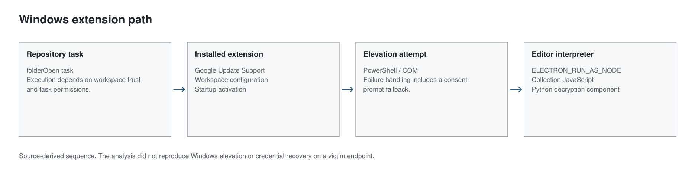

The extension calls itself **Google Update Support** and claims to secure and update the development environment, but inside the 17.6 MB package are native agents for macOS and Linux, encrypted Windows components, and code that selects deployment settings. On Windows, one path uses the editor's Electron executable to interpret attacker-controlled JavaScript. The environment variable `ELECTRON_RUN_AS_NODE=1` enables that mode.

This is the repository-based branch: a project task leads to the extension installer, which supplies the collection pipeline. Part 1's clipboard lure is a separate entry point. Related Windows elevation code appears in both branches, and in November a third party documented the same chain arriving through a forged commit in a real project, which I come back to below.

The July repository review identified five weaponised copies:

- `github[.]com/Lyracartoon/predict-together`
- `github[.]com/pridnet/dscufo-assessment-fe`
- `gitlab[.]com/pulsynk/rekt-db`
- `gitlab[.]com/stefan[.]kano/forge-4626-invariants`
- `gitlab[.]com/predicttogether/forge-4626-invariants`

A sixth copy, `gitlab[.]com/lautaro19/rekt-db`, contained matching payload markers. The evidence supports likely operator control, not confirmed ownership. GitLab reportedly removed `pulsynk-org/rekt-db`; `pulsynk/rekt-db` is a different repository.

The [historical indicator reference](../../indicators/) records the dated observations, and the [artifact reference](../../artifacts/) lists hashes for selected task and settings files. When I rechecked on 4 November 2026 the two GitHub repositories and the four GitLab copies were still public, so I reported them to both platforms, and by the next day `Lyracartoon/predict-together` had gone while the others remained available; treat this as a dated observation rather than a current status.

[Proofpoint's UNK_DeadDrop analysis](https://www.proofpoint.com/us/blog/threat-insight/dont-fear-repo-unkdeaddrop-phishing-campaign-targets-developers-steal) documents the VSIX route and Windows architecture also present in this package, while Jamf Threat Labs has separately documented [threat actors abusing Visual Studio Code](https://www.jamf.com/blog/threat-actors-expand-abuse-of-visual-studio-code/), and the editor's own [task documentation](https://code.visualstudio.com/docs/debugtest/tasks) and Electron's [environment-variable reference](https://www.electronjs.org/docs/latest/api/environment-variables) describe the two legitimate features this chain repurposes.

## A `folderOpen` task points to the installer

The repository task uses `runOn: folderOpen` and points into an ordinary-looking project directory, and in the weaponised copy I hold for the AI-editor lure the same commit that adds the trigger also suppresses workspace trust, so the editor's usual gate is switched off by the project it is meant to guard against. Editor trust and task permissions still gate execution where the user's own settings override that.

After installation, the extension is no longer confined to the project. The installer deletes the task and staging directories, retrying many times, so a victim who later inspects the clone finds a clean project, while the extension it installed declares startup activation and runs whenever the editor finishes starting, in any workspace and indefinitely. Deleting the cloned repository therefore does not remediate the compromise, and the check belongs in the extension directories of the editor and of any fork such as Cursor.



*Figure 1. The repository installs an extension whose Windows branch invokes the editor's Electron runtime in Node mode.*

The extension manifest contains these fields:

```json
{
  "name": "google-update-support",
  "displayName": "Google Update Support",
  "publisher": "google-dev-tools",
  "version": "1.0.0",
  "main": "./extension.js",
  "activationEvents": ["onStartupFinished"]
}
```

The installed identifier is `google-dev-tools.google-update-support`. These names are part of the masquerade; they establish neither Google authorship nor a trusted signature. The VSIX collected on 22 July 2026 is 17,647,582 bytes. [Exhibit E03](../../evidence/E03.pdf) records the package, nested archive and native-agent hashes:

```text
SHA-256
52886aab179f26421678ff23af1b0fabf0a17ffbb534369cdbbac8008cbed8e7
```

The `onStartupFinished` declaration gives the extension an opportunity to activate after the original workspace is gone. Payload startup still depends on the platform-specific code path.

The extension exposes its settings under the `googleUpdateSupport` namespace, and five of the seven keys it contributes are these:

```text
googleUpdateSupport.agentZipRelativePath
googleUpdateSupport.windowsActivationMode
googleUpdateSupport.companyWalletServerUrl
googleUpdateSupport.companyWalletClientId
googleUpdateSupport.companyWalletAgentToken
```

Every key defaults to an empty or neutral value, and the package carries no command-and-control address of its own; none of the resolved call sites in its obfuscated main file yields a host. The lure repository's workspace settings fill in exactly these keys, so each lure supplies its own server and token and the same VSIX can be pointed at different infrastructure without being rebuilt. Preserve the package and project configuration together: a VSIX hash identifies the archive but cannot reveal where a particular installation was configured to send data. The token is also the most durable link I found, because the same server-side agent token appears in the settings of a repository pushed on 19 May and in an agent log line quoted by a developer targeted in a different campaign six days later, which places one server instance behind both, and the token in the newest stage-three build is still byte-identical.

The nested agent archive contains Go binaries for macOS arm64, macOS amd64 and Linux amd64, all timestamped 13 May 2026, and their hashes are exactly the three in Proofpoint's published indicator list, which until then had been known only as files seen communicating with the C2 address, so those published samples came from this extension. The Windows branch does not depend on dropping those binaries: the kit's own code reserves the Go handoff for macOS and Linux, and on Windows the third stage first deletes the Go agent's masquerading executable. The encrypted Windows modules and their recovered hashes are documented in [E04](../../evidence/E04.pdf).

## Three encrypted scripts inside the VSIX

Static deobfuscation recovered three readable components from the package:

- `windows-js-pipeline.js` coordinates collection, elevation, upload and cleanup.
- `windows-agent-node.js` implements the Windows Node agent.
- `detect_malware.py` handles browser-related key and credential decryption.

The Node source describes a Windows route that does not depend on a Go executable. A detector limited to native-agent hashes would miss this path. The Windows Node agent is built for an operator at a keyboard, with a hidden shell, file operations, process control, screenshots, live remote desktop with injected mouse and keyboard input, clipboard access and self-update, while the actual theft is done by the pipeline and the Python component. The Python component contains DPAPI and browser elevation-service logic, including App-Bound Encryption handling, while the coordinator attempts to obtain the privileges and execution context this stage needs, and the [Acorn analysis](../03-acorn-deobfuscation/) describes their recovery through static deobfuscation and authenticated decryption.

The recovered builder constructs an encoded PowerShell command that requests an elevated COM object associated with CMSTPLUA and the ICMLuaUtil interface, a class Windows auto-approves for elevation, which places the technique in the well-documented UAC-bypass family that MITRE tracks as [T1548.002](https://attack.mitre.org/techniques/T1548/002/). The interface identifiers are assembled from numeric fields at run time and dispatch goes through a delegate created at run time, so searching for a literal GUID is less useful than tracing how the script builds and calls them, but the elevation moniker itself is left in the clear in both samples and is the single most reliable string for this technique.

Similar builder code appears in the ClickFix stage-three script, linking the implementations across the two delivery routes. [E19](../../evidence/E19.pdf) records the relevant source spans.

The failure paths show that elevation may not succeed. The VSIX pipeline can fall back to RunAs, which may display a consent prompt rather than lose the phase, while ClickFix retries the silent path up to three times and polls for a sentinel file to check for completion, because the shell-execution call returns no exit status. On a default configuration whose user belongs to the local Administrators group the technique is built so that no dialog appears, but success depends on Windows version, user privileges, policy and process context. These paths were analyzed statically. Their runtime outcomes were not reproduced. The defence is cheap: setting the UAC consent policy to always notify, or keeping everyday users out of the local Administrators group, breaks the silent path entirely.

### The extension launches the editor binary as Node

The source sets `ELECTRON_RUN_AS_NODE` and invokes the editor executable with an agent-script path. `process.execPath` supplies the executable location from inside the extension. The code uses the editor binary as a Node interpreter for collection code supplied by the chain, rather than its normal startup code, and MITRE ATT&CK tracks this behavior as [Electron Applications (T1218.015)](https://attack.mitre.org/techniques/T1218/015/). The rest of the chain does not even need the editor for that: its second stage downloads its own Node.js runtime (version 20.18.1) from the attacker's store and falls back to the official distribution, so a victim needs no Node installation at all, and the editor binary is reserved for the elevated step.

A process name or publisher check is incomplete here. A legitimate signature authenticates the editor executable, not every script passed to it. On an endpoint, investigate the transition: the parent chain runs editor, then PowerShell, then editor again, and the elevated process is the victim's own signed editor running as an interpreter with a collection-script argument, followed by access to browser or wallet data. Application allowlisting that trusts the installed editor does not block it. Decryption remains a separate condition. Elevation alone does not prove that a password was recovered.

## Recruitment email in the clean repository

The weaponised `predict-together` copy has a clean twin with its own recruitment material. An email template stored beside the clean version shows that the operators also addressed designers, project managers, founders and builders, and it invites them to review an open-source market-analysis platform in Cursor. The operator's console later showed how that pitch is used: the mailing list is an untargeted harvest, and the "no coding needed" invitation goes to respondents who say they do not write code.

The template describes four steps, taking "about 30 minutes":

1. Clone the repository.
2. Open it in Cursor and analyze it with AI.
3. Write a few prompts.
4. Send the prompts back.

The message says, "No coding needed," and offers payment, a Cursor Ultra license or a place on the team for useful feedback. Its repository link is a placeholder. The copy sent to any particular recipient remains unknown.

The public repository is a working FastAPI and React application, with seeded demo users and green test and coverage badges, and I reviewed its full tree, including dot-directories, and found no code that would run on its own.

The review found no `.vscode/tasks.json`, `.cursor/` rules, `mcp.json`, `.devcontainer/` hooks or workflows; the Python and npm dependencies came from ordinary package registries and had no install scripts, and the documentation showed standard install, test and run commands.

The repository's `.gitignore` also excludes `.vscode/`. The copy with the folder-open task belongs to a different account. The template presents the clean repository for inspection, while the weaponised copy is a separate artifact, and that split holds across the operator's public estate: of 172 public repositories across five live operator accounts, three were weaponised, three were clean take-home bait, five were lure funnels and seven were seeding forks, and the remaining 153 credibility props showed no indicator in two content sweeps. Removing a public repository therefore removes the lure's credibility, not the payload, which exists only in the copy a recruited developer received.

The email targets people who are not being asked to write code. A developer doing a coding exercise may inspect the project and notice an unusual task or install hook, while someone told that no coding is needed may instead open the repository in an AI editor and let its agent act without reading the project. The retained weaponised copy used a folder-open task.

Other editor-based routes are possible, including devcontainer hooks, workspace rules or instructions, an MCP server supplied by the workspace, and a dependency that runs when the agent is asked to start the project. None of those appeared in the copies reviewed here.

The review covered the public repository and the retained weaponised copy, not a message received by a target; the exact repository and configuration sent to any individual therefore remain unknown. The public reports cited in this series describe developer-directed assessments. They do not describe this non-coder invitation.

Before opening an unsolicited project in an AI editor:

- Use a disposable machine.
- Turn off automatic task execution and agent auto-run.
- Disable workspace-supplied MCP configuration.
- Keep wallet keys, SSH keys, browser profiles and `.env` secrets off it.

## The same chain through a forged commit

In November the route widened beyond repositories the operator owns. [SafeDep reported](https://safedep.io/blog/antd-img-crop-forged-commit-overlord-stealer) on 3 November 2026 that a genuine maintainer's account had been taken over and a forged commit force-pushed onto the GitHub repository of the npm package antd-img-crop, adding a `prebuild` hook so that a dropper ran on `npm run build` for anyone who built the project from that repository, while the package published on npm was not affected. In SafeDep's reported instance of 31 October the script fetched the operator's launcher from a lure domain, then the same installer the ClickFix chain uses, then the Overlord third stage, and the Windows agent entry file SafeDep lists is identical in its full SHA-256 to the `update-agent.js` I hold, so the chain, launcher family and fallback-host naming are this operator's own.

Two details from that case change how responders should look. The forged commit reuses the real release's author, date and message, so it claims a March date, while the repository's activity record shows the force-push on 31 October at 15:12 UTC, and dating the compromise by commit author date would place it seven months early. And passing `--ignore-scripts` to the install command does not stop a `prebuild` script when the project is built later, whereas a persistent `ignore-scripts` setting also suppresses the pre- and post-scripts of commands run by name. Of SafeDep's 93 indicators, 71 were new to me even though the core machinery matched, which is what rotating indicators over constant machinery would produce.

## Inspect the extension path and process arguments

Repository-only review can miss the installed extension. A hunt limited to native binaries can miss the JavaScript Windows branch. Preserve task definitions, editor and agent configuration directories, workspace settings, extension metadata, script arguments, process ancestry and any resulting persistence, including the hidden scheduled task `GoogleUpdateSupporterNode` described in [Part 5](../05-screen-capture-analysis/). The extension identifier and package hash provide exact selectors. The editor-to-interpreter transition gives responders a behavior to investigate when names or builds change.

Several markers that look obvious for this route do not hold up. A folder-open task on its own is shared with PolinRider, a separate operation whose workspace launcher uses the same trigger, so it is a technique rather than an attribution; the `googleUpdateSupport` settings namespace fails because one live sample ships an empty settings file; and the published Go hashes miss the Go-free Windows chain. The markers that work are the operator's own: the masquerading extension identity, the embedded agent token, the kit's repository markers and the C2 endpoint paths. On the prevention side, the editor's `task.allowAutomaticTasks` setting keeps folder-open tasks off by default, and Restricted Mode runs no task until a folder is trusted.

The companion repository has a [YARA rule for the recovered VSIX manifest](https://github.com/KrasForge/unk-scanner/blob/main/rules/yara/deaddrop_vsix_manifest.yar). It must scan extracted archive members.

The companion scanner covers JavaScript. Its `electron-run-as-node` rule reports the recovered pipeline at error level because that file writes a PowerShell script, sets `$env:ELECTRON_RUN_AS_NODE` and launches it with a hidden window. The scanner also reports the extension's obfuscated string array as recovered. It does not read configuration at all, so it saw none of the folder-open launchers in editor tasks or workspace settings, a blind spot it shares with source scanners that select files by extension.

Setting the variable alone is not enough to raise an error. In a benchmark of 3,000 popular packages and extensions, TypeScript's language server, SSH proxy shims and local helper servers launched the editor binary as Node in sixteen places. None hid the launch.

The repository has no process or file-event rules because authentic endpoint logs were not retained for replay, and it has no workspace-configuration signature because the original July task and settings files were not retained, only their hashes. The manifest rule identifies package metadata. Confirming execution and subsequent collection requires endpoint records.
