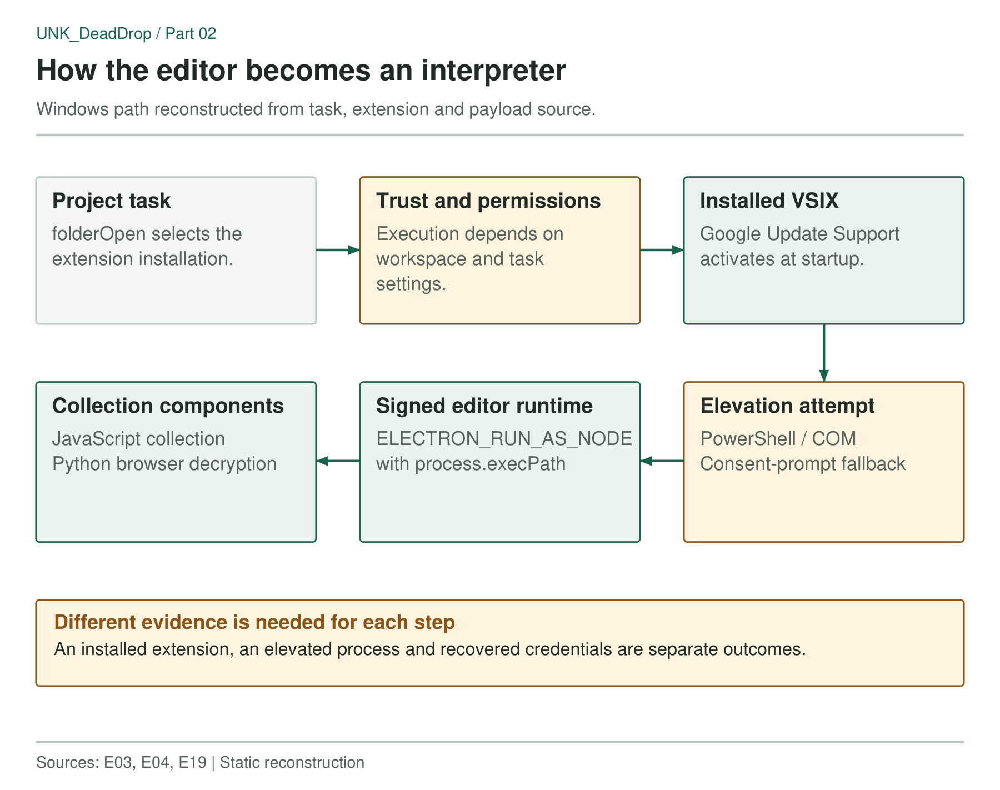

The extension calls itself **Google Update Support** and claims to secure and update the development environment. Inside the 17.6 MB package are native agents for macOS and Linux, encrypted Windows components, and code that selects deployment settings. On Windows, one path uses the editor's Electron executable to interpret attacker-controlled JavaScript. The environment variable `ELECTRON_RUN_AS_NODE=1` enables that mode.

This is the repository-based branch: a project task leads to the extension installer, which supplies the collection pipeline. Part 1's clipboard lure is a separate entry point. Related Windows elevation code appears in both branches.

[Proofpoint's UNK_DeadDrop analysis](https://www.proofpoint.com/us/blog/threat-insight/dont-fear-repo-unkdeaddrop-phishing-campaign-targets-developers-steal) already documents the VSIX route and the Windows architecture, and the package I examined corroborates that reporting while exposing the implementation in enough detail to follow each of the process transitions. Jamf Threat Labs has separately documented [threat actors abusing Visual Studio Code](https://www.jamf.com/blog/threat-actors-expand-abuse-of-visual-studio-code/), and the editor's own [task documentation](https://code.visualstudio.com/docs/debugtest/tasks) and Electron's [environment-variable reference](https://www.electronjs.org/docs/latest/api/environment-variables) describe the two legitimate features this chain repurposes.

> **Key Takeaways**
>
> - The repository's `runOn: folderOpen` task leads to an extension called Google Update Support (`google-dev-tools.google-update-support`), which can stay installed after the clone is deleted.
> - Server and client settings come from workspace configuration, so the same 17,647,582-byte VSIX can be reused with different destinations.
> - The Windows path does not depend on the Go agents: three decrypted components handle collection, elevation, upload and browser-related decryption.
> - With `ELECTRON_RUN_AS_NODE=1`, the editor's own executable is set up to interpret collection code, and its valid signature authenticates the editor, not the script it runs.

## The project is the installer

The repository task uses `runOn: folderOpen` and points into an ordinary-looking project directory. Workspace trust and task permissions still apply, so its presence does not mean every editor runs it automatically.

After installation, the extension is no longer confined to the project. It declares startup activation, while surrounding scripts clean up the task and staging files. Deleting the clone therefore does not establish that the extension or anything it launched has been removed.



*Figure 1. How the editor becomes an interpreter. Workspace trust, permissions and elevation outcomes were not reproduced.*

[Open full-size vector diagram](/UNK_DeadDrop/diagrams/02-vsix.svg). Sources: [E03](../../evidence/E03.pdf), [E04](../../evidence/E04.pdf), [E19](../../evidence/E19.pdf).

### Inside Google Update Support

The manifest I inspected contains the following fields:

```json
{
  "name": "google-update-support",
  "displayName": "Google Update Support",
  "publisher": "google-dev-tools",
  "version": "1.0.0",
  "main": "./extension.js",
  "activationEvents": ["onStartupFinished"]
}
```

The installed identifier is `google-dev-tools.google-update-support`. These names are part of the masquerade; they establish neither Google authorship nor a trusted signature. The VSIX collected on 22 July 2026 is 17,647,582 bytes:

```text
SHA-256
52886aab179f26421678ff23af1b0fabf0a17ffbb534369cdbbac8008cbed8e7
```

The `onStartupFinished` declaration gives the extension an opportunity to activate after the original workspace is gone. It does not prove that every payload runs on every startup or platform.

### The destination comes from configuration

The extension exposes its settings under the `googleUpdateSupport` namespace:

```text
googleUpdateSupport.agentZipRelativePath
googleUpdateSupport.windowsActivationMode
googleUpdateSupport.companyWalletServerUrl
googleUpdateSupport.companyWalletClientId
googleUpdateSupport.companyWalletAgentToken
```

The deployment reads server and client values from configuration, so the same VSIX can be reused with different workspace settings. Preserve the package and project configuration together: a VSIX hash identifies the archive but may not reveal where a particular installation was configured to send data.

The nested agent archive contains Go binaries for macOS arm64, macOS amd64 and Linux amd64. Their hashes match samples identified in the case's comparison with prior reporting. The Windows branch does not depend on dropping those binaries.

## Three encrypted files reveal the Windows path

Static deobfuscation recovered three readable components from the package:

- `windows-js-pipeline.js` coordinates collection, elevation, upload and cleanup.
- `windows-agent-node.js` implements the JavaScript collection agent.
- `detect_malware.py` handles browser-related key and credential decryption.

The Node source describes a Windows route that does not depend on a Go executable. A detector limited to native-agent hashes would miss this path. The Python component contains DPAPI and browser elevation-service logic, including App-Bound Encryption handling. The coordinator attempts to obtain the privileges and execution context this stage needs. Part 3 explains how I decrypted these files without running the loader.

### The COM elevation attempt

The recovered builder constructs a PowerShell script that requests an elevated COM object associated with CMSTPLUA and the ICMLuaUtil interface. The identifiers are assembled from numeric fields, so searching for a literal GUID is less useful than tracing how the script builds and calls them. It then creates a delegate at runtime to dispatch the shell-execution method.

Similar builder code appears in the ClickFix stage-three script, linking the implementations across the two delivery routes. Their failure paths also show that elevation may not succeed: the VSIX pipeline can fall back to RunAs, which may display a consent prompt; ClickFix retries and uses a sentinel to check for completion. I call this an elevation attempt, not a universal silent UAC bypass. The result depends on Windows version, user privileges, policy and process context. No execution test was performed on a victim-equivalent system.

### Why the elevated process can still be the editor

The source sets `ELECTRON_RUN_AS_NODE` and invokes the editor executable with an agent-script path. `process.execPath` supplies the executable location from inside the extension. The code uses the editor binary as a Node interpreter for collection code supplied by the chain, rather than its normal startup code. MITRE ATT&CK tracks this behavior as [Electron Applications (T1218.015)](https://attack.mitre.org/techniques/T1218/015/).

A process name or publisher check is incomplete here. A legitimate signature authenticates the editor executable, not every script passed to it. There is no need to infer that the editor vendor distributed the payload or that the signed executable was modified. On an endpoint, investigate the transition: the editor launching an elevation helper, then an unexpectedly elevated interpreter with a collection-script argument, then access to browser or wallet data. Decryption remains a separate condition; elevation alone does not prove that a password was recovered.

## What to preserve on an endpoint

Repository-only review can miss the installed extension; a hunt limited to native binaries can miss the JavaScript Windows branch. Preserve task definitions, workspace settings, extension metadata, script arguments, process ancestry and any resulting persistence. The extension identifier and package hash provide exact selectors. The editor-to-interpreter transition gives responders a behavior to investigate when names or builds change. Part 3 describes how the encrypted source was recovered.
