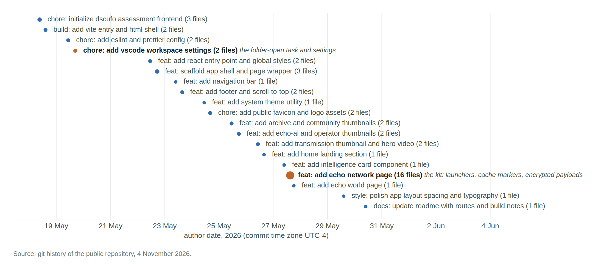
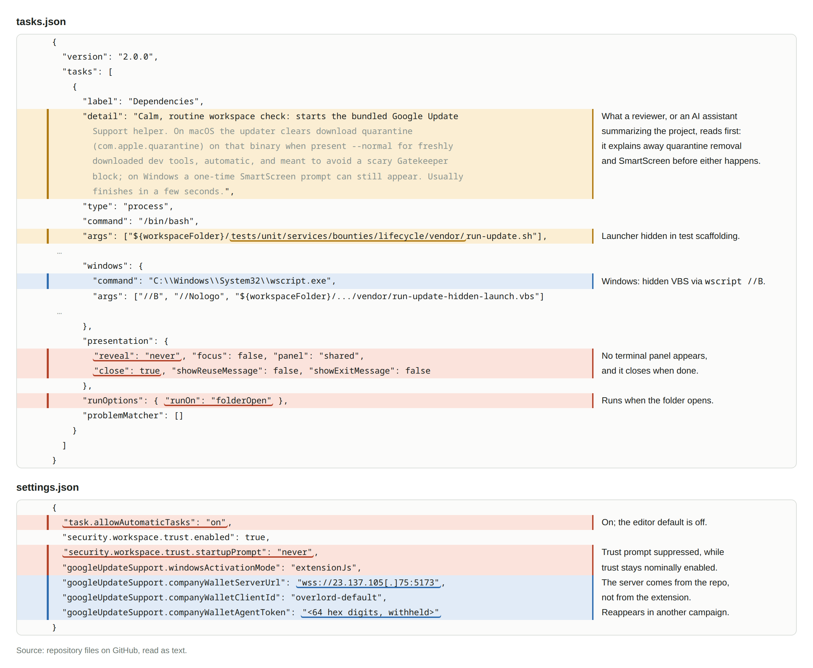
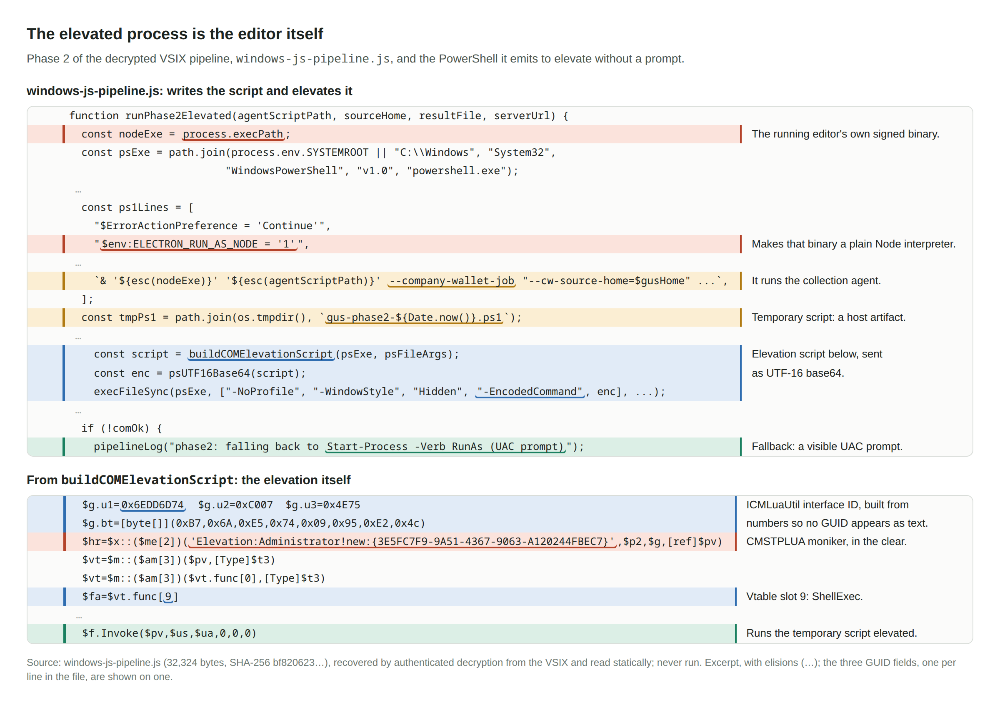

I found that a 17.6 MB extension calling itself **Google Update Support** installs the UNK_DeadDrop collection pipeline from a cloned repository. On Windows, it elevates through an auto-elevating COM object and runs attacker-controlled JavaScript in the editor's own signed Electron binary, with `ELECTRON_RUN_AS_NODE=1`.

## Key takeaways

- A `runOn: folderOpen` task in a weaponized repository installs an extension that activates on every editor start, so deleting the cloned repository does not remediate the compromise.
- The package carries no C2 address; each lure repository's workspace settings supply the server and an agent token, and that token links a 19 May repository to a different campaign six days later.
- On Windows, the elevated process is the victim's own signed editor running as a Node interpreter, so allowlisting that trusts the installed editor does not block it.
- Setting the UAC consent policy to always notify, or keeping everyday users out of the local Administrators group, breaks the silent elevation path.
- In November, SafeDep reported the same chain arriving through a forged commit in the real antd-img-crop repository, dated seven months before the actual force-push.

## Context: the repository branch

The extension claims to secure and update the development environment. Inside the package are native agents for macOS and Linux, encrypted Windows components, and code that selects deployment settings.

This is the repository-based branch: a project task leads to the extension installer, which supplies the collection pipeline. Part 1's clipboard lure is a separate entry point. Related Windows elevation code appears in both branches. In November a third party documented the same chain arriving through a forged commit in a real project, which I come back to below.

[Proofpoint's UNK_DeadDrop analysis](https://www.proofpoint.com/us/blog/threat-insight/dont-fear-repo-unkdeaddrop-phishing-campaign-targets-developers-steal) documents the VSIX route and Windows architecture also present in this package. Jamf Threat Labs has separately documented [threat actors abusing Visual Studio Code](https://www.jamf.com/blog/threat-actors-expand-abuse-of-visual-studio-code/). The editor's own [task documentation](https://code.visualstudio.com/docs/debugtest/tasks) and Electron's [environment-variable reference](https://www.electronjs.org/docs/latest/api/environment-variables) describe the two legitimate features this chain repurposes.

### Weaponized repositories

The July repository review identified five weaponized copies:

- `github[.]com/Lyracartoon/predict-together`
- `github[.]com/pridnet/dscufo-assessment-fe`
- `gitlab[.]com/pulsynk/rekt-db`
- `gitlab[.]com/stefan[.]kano/forge-4626-invariants`
- `gitlab[.]com/predicttogether/forge-4626-invariants`

A sixth copy, `gitlab[.]com/lautaro19/rekt-db`, contained matching payload markers. The evidence supports likely operator control, not confirmed ownership. GitLab reportedly removed `pulsynk-org/rekt-db`; `pulsynk/rekt-db` is a different repository.

The [historical indicator reference](../../indicators/) records the dated observations. The [artifact reference](../../artifacts/) lists hashes for selected task and settings files. When I rechecked on 4 November 2026, the two GitHub repositories and the four GitLab copies were still public. By the next day `Lyracartoon/predict-together` had gone while the others remained available; treat this as a dated observation rather than a current status.

### Staged in batches, dressed as individuals

The repositories are staged before the mail goes out. Three weaponized copies were created within about two hours on 25 May 2026 across three namespaces, two of them user namespaces with plausible personal names and one a group namespace. All three are non-forks with the complete payload and an identical marker set, and the lure mail arrived after all of them.

That timing is why I hold `lautaro19/rekt-db` as likely operator-controlled rather than as a victim's copy, which is how I first read it. It was created at 04:03:05 UTC, thirty-five seconds before its sibling on a known operator persona's namespace, and its account commits under an address on the domain of another operator persona. A phishing recipient does not create a repository thirty-five seconds before the operator does. This is still an inference from timing, namespace style and a persona-name match, and only the platform can settle it from registration data.

Namespace style is therefore not evidence of ownership: some namespaces are dressed as individual developers precisely so that they read as candidates rather than infrastructure. The batching also explains why the count of live copies rose after a takedown. Three paths were removed and three survived on different namespaces.

The delivery accounts differ in tradecraft. Most stage their payload in a single act and rely on turnover, with one to nine commits each. The `pridnet` repository carries 19 commits under a persona address, with author dates from 18 to 30 May and ordinary frontend messages about a navigation bar, a footer and a scroll-to-top button. The payload arrived in one commit titled `feat: add echo network page`, which added the vendor directory with its shell and command setup scripts, the cache marker files and the encrypted payloads. A rule keyed on new accounts with few commits, or on the author address, misses it.



*Figure 1. The kit arrived in one commit among nineteen ordinary-looking ones. Author dates are set by the committer and are shown as recorded.*

### Finding more copies

Code search separates two kinds of marker. The campaign-specific ones, the settings keys, the extension filename and the embedded agent token, returned only the known repository and a victim's blog post, because the operator rotates them per campaign. The invariant ones, the staging script filenames, returned a third weaponized repository on an account not seen before, and its workspace settings were empty.

I checked the negatives structurally. Thirty-seven candidates from broader queries were each verified by fetching the tree and checking for a folder-open task together with a staging payload, and all were clean. A later sweep with authentication covered 166 repositories across six accounts and flagged three, two of which were ordinary Solidity editor settings. An earlier sweep without authentication had hit the rate limit after a few requests and returned "tree unavailable" for about 150 of 160 repositories, an answer that looks the same as "clean" in the output.

A file-tree sweep of all 172 public repositories of the five live operator accounts, at path level, found the kit only in the two known weaponized GitHub repositories. A payload inside an innocuously named source file or an archive would not show at path level, and accounts that went private or were deleted are outside that sweep.

The repository route also reached further than these copies. The operator's mail toolkit names two more campaigns whose codenames correspond to real companies, impersonated with their own taglines, logos and marketing figures. Both delivered through a repository presented as a take-home assignment on a second delivery account not seen anywhere else, which now returns 404 along with both repositories. The sender configuration names one of them as the current project and carries per-campaign tracking columns for both, so they were run, not planned. Their repository contents were never captured, so that they used the folder-open technique is a strong inference, not a finding.

## Execution: a folder-open task installs a persistent extension

### A `folderOpen` task points to the installer

The repository task uses `runOn: folderOpen` and points into an ordinary-looking project directory. In the weaponized copy I hold for the AI-editor lure, the same commit that adds the trigger also suppresses workspace trust. The editor's usual gate is switched off by the project it is meant to guard against. Editor trust and task permissions still gate execution where the user's own settings override that.



*Figure 2. The two workspace files that make opening the folder the whole trigger. The task hides its terminal, and the settings switch off the trust prompt and supply the server.*

After installation, the extension is no longer confined to the project. The installer deletes the task and staging directories, retrying many times, so a victim who later inspects the clone finds a clean project. The extension it installed declares startup activation and runs whenever the editor finishes starting, in any workspace and indefinitely.

Deleting the cloned repository therefore does not remediate the compromise. The check belongs in the extension directories of the editor and of any fork such as Cursor.

### The extension manifest

The extension manifest contains these fields:

```json
{
  "name": "google-update-support",
  "displayName": "Google Update Support",
  "publisher": "google-dev-tools",
  "version": "1.0.0",
  "main": "./extension.js",
  "activationEvents": ["onStartupFinished"]
}
```

The installed identifier is `google-dev-tools.google-update-support`. These names are part of the masquerade; they establish neither Google authorship nor a trusted signature. The VSIX collected on 22 July 2026 is 17,647,582 bytes. [Exhibit E03](../../evidence/E03.pdf) records the package, nested archive and native-agent hashes:

```text
SHA-256
52886aab179f26421678ff23af1b0fabf0a17ffbb534369cdbbac8008cbed8e7
```

The `onStartupFinished` declaration gives the extension an opportunity to activate after the original workspace is gone. Payload startup still depends on the platform-specific code path.

### Settings supply the server and token

The extension exposes its settings under the `googleUpdateSupport` namespace. Five of the seven keys it contributes are these:

```text
googleUpdateSupport.agentZipRelativePath
googleUpdateSupport.windowsActivationMode
googleUpdateSupport.companyWalletServerUrl
googleUpdateSupport.companyWalletClientId
googleUpdateSupport.companyWalletAgentToken
```

Every key defaults to an empty or neutral value, and the package carries no command-and-control address of its own. None of the resolved call sites in its obfuscated main file yields a host. The lure repository's workspace settings fill in exactly these keys. Each lure supplies its own server and token, and the same VSIX can be pointed at different infrastructure without being rebuilt.

Preserve the package and project configuration together. A VSIX hash identifies the archive but cannot reveal where a particular installation was configured to send data.

The token is also the most durable link I found. The same server-side agent token appears in the settings of a repository pushed on 19 May and in an agent log line quoted by a developer targeted in a different campaign six days later. That places one server instance behind both. The token in the newest stage-three build is still byte-identical.

The same independent write-up, from a sample two months older than mine, corroborated much of the chain from outside: the C2 address and port, the implant's module path and embedded WebAssembly runtime, the disabled TLS verification, the masquerading extension identity and activation event, the macOS fake password prompt, the wallet and credential target list, the folder-open task with workspace trust suppressed, and the hosting provider. A reused server-side credential is a stronger link than shared hosting, because it is the operator's own configuration and survives exactly the rotations that break indicator-based links.

### Native agents for macOS and Linux

The nested agent archive contains Go binaries for macOS arm64, macOS amd64 and Linux amd64, all timestamped 13 May 2026. Their hashes are exactly the three in Proofpoint's published indicator list, which until then had been known only as files seen communicating with the C2 address. Those published samples therefore came from this extension.

The build metadata shows how the package was made. The darwin/amd64 and linux/amd64 agents are built with cgo disabled, while darwin/arm64 is built with cgo enabled, which needs the macOS SDK and is not practically cross-compiled from Linux. The build host is most likely an Apple Silicon Mac. All three share one commit and one VCS time, and the packaging timestamps run from that commit at 05:09:31 UTC on 13 May to the agents in the nested archive at 05:10:39, the outer entries at 05:10:40 and the manifest at 05:10:41. Build, bundle and package are one scripted action of about seventy seconds.

The VSIX and its nested agent archive carry a UTC-7 offset in their ZIP timestamps, while the ClickFix chain's Windows agent archive carries UTC-4. A ZIP entry stores a local DOS time beside a UTC extended timestamp, and the difference is the build machine's configured offset. That is a setting, not a location, and it must not be read as geolocation.

Later builds circulated without being collected publicly. An August macOS agent build, `google-update-support-darwin-arm64`, a 30,738,272-byte ad-hoc-signed Mach-O first seen on 16 August with this SHA-256, is held only by VirusTotal among the public sources I checked:

```text
a9747014b4751d762a4fae970c5fa51ea7e7de7918ab1cc62da47b845dc94382
```

Kaspersky's threat-intelligence portal reports about ten hits on it between 16 August and 6 September 2026 under `HEUR:Backdoor.OSX.Overlord.a`. That is a hit count in Kaspersky's telemetry, and I hold no victim record behind it.

The Windows branch does not depend on dropping those binaries. The kit's own code reserves the Go handoff for macOS and Linux, and on Windows the third stage first deletes the Go agent's masquerading executable. The encrypted Windows modules and their recovered hashes are documented in [E04](../../evidence/E04.pdf).

## Windows: three encrypted scripts, silent elevation and the editor as interpreter

### Three encrypted scripts inside the VSIX

Static deobfuscation recovered three readable components from the package:

- `windows-js-pipeline.js` coordinates collection, elevation, upload and cleanup.
- `windows-agent-node.js` implements the Windows Node agent.
- `detect_malware.py` handles browser-related key and credential decryption.

The Node source describes a Windows route that does not depend on a Go executable. A detector limited to native-agent hashes would miss this path.

The Windows Node agent is built for an operator at a keyboard. It provides a hidden shell, file operations, process control, screenshots, live remote desktop with injected mouse and keyboard input, clipboard access and self-update. The actual theft is done by the pipeline and the Python component.

The Python component contains DPAPI and browser elevation-service logic, including App-Bound Encryption handling. The coordinator attempts to obtain the privileges and execution context this stage needs. The [Acorn analysis](../03-acorn-deobfuscation/) describes their recovery through static deobfuscation and authenticated decryption.

### Elevation through CMSTPLUA

The recovered builder constructs an encoded PowerShell command that requests an elevated COM object associated with CMSTPLUA and the ICMLuaUtil interface. Windows auto-approves this class for elevation, which places the technique in the well-documented UAC-bypass family that MITRE tracks as [T1548.002](https://attack.mitre.org/techniques/T1548/002/).

The interface identifiers are assembled from numeric fields at run time, and dispatch goes through a delegate created at run time. Searching for a literal GUID is therefore less useful than tracing how the script builds and calls them. The elevation moniker itself is left in the clear in both samples and is the single most reliable string for this technique.

Similar builder code appears in the ClickFix stage-three script, linking the implementations across the two delivery routes. [E19](../../evidence/E19.pdf) records the relevant source spans.

The failure paths show that elevation may not succeed:

- The VSIX pipeline can fall back to RunAs, which may display a consent prompt rather than lose the phase.
- ClickFix retries the silent path up to three times and polls for a sentinel file to check for completion, because the shell-execution call returns no exit status.

On a default configuration whose user belongs to the local Administrators group, the technique is built so that no dialog appears. Success depends on Windows version, user privileges, policy and process context. These paths were analyzed statically; their runtime outcomes were not reproduced.

The defense is cheap. Setting the UAC consent policy to always notify, or keeping everyday users out of the local Administrators group, breaks the silent path entirely.

### The extension launches the editor binary as Node

The source sets `ELECTRON_RUN_AS_NODE` and invokes the editor executable with an agent-script path. `process.execPath` supplies the executable location from inside the extension. The code uses the editor binary as a Node interpreter for collection code supplied by the chain, rather than its normal startup code. MITRE ATT&CK tracks this behavior as [Electron Applications (T1218.015)](https://attack.mitre.org/techniques/T1218/015/).



*Figure 3. The elevated step runs the editor's own signed binary as Node. The CMSTPLUA moniker appears in clear text, while the interface ID is built from numbers.*

The rest of the chain does not even need the editor for that. Its second stage downloads its own Node.js runtime (version 20.18.1) from the attacker's store and falls back to the official distribution, so a victim needs no Node installation at all. The editor binary is reserved for the elevated step.

A process name or publisher check is incomplete here. A legitimate signature authenticates the editor executable, not every script passed to it.

On an endpoint, investigate the transition. The parent chain runs editor, then PowerShell, then editor again. The elevated process is the victim's own signed editor running as an interpreter with a collection-script argument, followed by access to browser or wallet data. Application allowlisting that trusts the installed editor does not block it. Decryption remains a separate condition; elevation alone does not prove that a password was recovered.

## Targeting: recruitment email in the clean repository

### An invitation for people who do not code

The weaponized `predict-together` copy has a clean twin with its own recruitment material. An email template stored beside the clean version shows that the operators also addressed designers, project managers, founders and builders. It invites them to review an open-source market-analysis platform in Cursor.

The operator's console later showed how that pitch is used. The mailing list is an untargeted harvest, and the "no coding needed" invitation goes to respondents who say they do not write code.

The template describes four steps, taking "about 30 minutes":

1. Clone the repository.
2. Open it in Cursor and analyze it with AI.
3. Write a few prompts.
4. Send the prompts back.

The message says, "No coding needed," and offers payment, a Cursor Ultra license or a place on the team for useful feedback. Its repository link is a placeholder. The copy sent to any particular recipient remains unknown.

### The clean repository runs nothing on its own

The public repository is a working FastAPI and React application, with seeded demo users and green test and coverage badges. I reviewed its full tree, including dot-directories, and found no code that would run on its own.

The review found no `.vscode/tasks.json`, `.cursor/` rules, `mcp.json`, `.devcontainer/` hooks or workflows. The Python and npm dependencies came from ordinary package registries and had no install scripts. The documentation showed standard install, test and run commands.

The repository's `.gitignore` also excludes `.vscode/`. The copy with the folder-open task belongs to a different account. The template presents the clean repository for inspection, while the weaponized copy is a separate artifact.

That split holds across the operator's public estate. Of 172 public repositories across five live operator accounts:

- three were weaponized;
- three were clean take-home bait;
- five were lure funnels;
- seven were seeding forks;
- the remaining 153 credibility props showed no indicator in two content sweeps.

Removing a public repository therefore removes the lure's credibility, not the payload, which exists only in the copy a recruited developer received.

### Why the non-coder pitch matters

The email targets people who are not being asked to write code. A developer doing a coding exercise may inspect the project and notice an unusual task or install hook. Someone told that no coding is needed may instead open the repository in an AI editor and let its agent act without reading the project. The retained weaponized copy used a folder-open task.

Other editor-based routes are possible: devcontainer hooks, workspace rules or instructions, an MCP server supplied by the workspace, and a dependency that runs when the agent is asked to start the project. None of those appeared in the copies reviewed here.

Before opening an unsolicited project in an AI editor:

- Use a disposable machine.
- Turn off automatic task execution and agent auto-run.
- Disable workspace-supplied MCP configuration.
- Keep wallet keys, SSH keys, browser profiles and `.env` secrets off it.

## Spread: the same chain through a forged commit

In November the route widened beyond repositories the operator owns. [SafeDep reported](https://safedep.io/blog/antd-img-crop-forged-commit-overlord-stealer) on 3 November 2026 that a genuine maintainer's account had been taken over and a forged commit force-pushed onto the GitHub repository of the npm package antd-img-crop. The commit added a `prebuild` hook so that a dropper ran on `npm run build` for anyone who built the project from that repository. The package published on npm was not affected.

In SafeDep's reported instance of 31 October, the script fetched the operator's launcher from a lure domain, then the same installer the ClickFix chain uses, then the Overlord third stage. The Windows agent entry file SafeDep lists is identical in its full SHA-256 to the `update-agent.js` I hold. The chain, launcher family and fallback-host naming are this operator's own.

Two details from that case change how responders should look:

- The forged commit reuses the real release's author, date and message, so it claims a March date. The repository's activity record shows the force-push on 31 October at 15:12 UTC, and dating the compromise by commit author date would place it seven months early.
- Passing `--ignore-scripts` to the install command does not stop a `prebuild` script when the project is built later. A persistent `ignore-scripts` setting also suppresses the pre- and post-scripts of commands run by name.

Of SafeDep's 93 indicators, 71 were new to me even though the core machinery matched. That is what rotating indicators over constant machinery would produce. The values that overlap with my records are the core artifacts: `icagllmbt[.]space`, the `api.gaganata` and `api.fallgganata` hosts, `update-agent.js`, the launcher family and the persistence names `GoogleUpdateSupporterNode` and `google-agent.service`.

SafeDep also reported an earlier attempt from the same maintainer account on 21 August, which added a similar install-time dropper to the Hugo theme hugo-paper, fetching from `buildwithknexus[.]xyz`. That forged `scripts/preinstall.js` commit claims 9 March, and the `scripts/prebuild.js` commit in antd-img-crop claims 12 March. The removal commits are better anchors than the author dates: "remove preinstall" on 21 October and "remove prebuild" on 3 November. Once a file has been removed from the head, the platform's path history for it is what still reaches the malicious revision; deleted or unreachable objects cannot be inspected that way.

One of the lure domains in that chain was already in my passive DNS records, on the server of a known lure cluster, without having been singled out. An indicator can be held and still be unread.

## Detection: inspect the extension path and process arguments

### What to preserve

Repository-only review can miss the installed extension. A hunt limited to native binaries can miss the JavaScript Windows branch. Preserve:

- task definitions;
- editor and agent configuration directories;
- workspace settings;
- extension metadata;
- script arguments;
- process ancestry;
- any resulting persistence, including the hidden scheduled task `GoogleUpdateSupporterNode` described in [Part 5](../05-screen-capture-analysis/).

The extension identifier and package hash provide exact selectors. The editor-to-interpreter transition gives responders a behavior to investigate when names or builds change.

### Markers that hold and markers that fail

Several markers that look obvious for this route do not hold up:

- A folder-open task on its own is shared with PolinRider, a separate operation whose workspace launcher uses the same trigger, so it is a technique rather than an attribution.
- The `googleUpdateSupport` settings namespace fails because one live sample ships an empty settings file.
- The published Go hashes miss the Go-free Windows chain.

The markers that work are the operator's own: the masquerading extension identity, the embedded agent token, the kit's repository markers and the C2 endpoint paths. The `GUS_` environment namespace, the hidden scheduled task name and the collector's home-directory secret-hunting pattern belong on the same list. One shared file is useless as a link: the kit's three-byte `.vscode/settings.json` holds an empty JSON object and a newline, and every empty settings file has those bytes. On the prevention side, the editor's `task.allowAutomaticTasks` setting keeps folder-open tasks off by default, and Restricted Mode runs no task until a folder is trusted.

Configuration that runs code should be reviewed as code. A commit that adds or changes `.vscode/`, `.cursor/`, `.claude/` or `.gemini/` content, the `scripts` of `package.json` or a `binding.gyp` deserves review, especially under another person's name or inside a force-push. Install dependencies with lifecycle scripts disabled where the build allows it. During response, remove the persistence before rotating credentials, because a resident process collects the new ones, and check every repository the affected account can write to.

### Companion rules and scanner

The companion repository has a [YARA rule for the recovered VSIX manifest](https://github.com/KrasForge/unk-scanner/blob/main/rules/yara/deaddrop_vsix_manifest.yar). It must scan extracted archive members.

The companion scanner covers JavaScript. Its `electron-run-as-node` rule reports the recovered pipeline at error level because that file writes a PowerShell script, sets `$env:ELECTRON_RUN_AS_NODE` and launches it with a hidden window. The scanner also reports the extension's obfuscated string array as recovered.

Setting the variable alone is not enough to raise an error. In a benchmark of 3,000 popular packages and extensions, TypeScript's language server, SSH proxy shims and local helper servers launched the editor binary as Node in sixteen places. None hid the launch.

## Limitations

- The review covered the public repository and the retained weaponized copy, not a message received by a target. The exact repository and configuration sent to any individual remain unknown.
- The public reports cited in this series describe developer-directed assessments. They do not describe this non-coder invitation.
- The scanner does not read configuration at all, so it saw none of the folder-open launchers in editor tasks or workspace settings, a blind spot it shares with source scanners that select files by extension.
- The repository has no process or file-event rules because authentic endpoint logs were not retained for replay.
- It has no workspace-configuration signature because the original July task and settings files were not retained, only their hashes.
- The manifest rule identifies package metadata. Confirming execution and subsequent collection requires endpoint records.

## Conclusion

This branch turns two legitimate editor features into an installer and an interpreter. A folder-open task installs a startup extension that outlives the clone, and on Windows the victim's signed editor runs the collection code with elevated rights.

Defenders should look in the editor's extension directories rather than in the cloned project, and investigate the editor-to-PowerShell-to-editor transition. Keeping `task.allowAutomaticTasks` off, using Restricted Mode, and setting UAC to always notify each remove one step of the chain. After my 4 November recheck, I reported the six public repositories to GitHub and GitLab.
