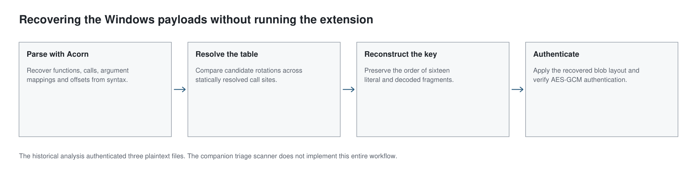

I reconstructed the VSIX loader's AES key from sixteen obfuscated fragments, nine decoder calls and seven literals, without executing the extension. All three encrypted payloads passed GCM authentication under the reconstructed key.

## Key takeaways

- Parsing the loader with Acorn exposed wrapper functions that a regex missed, because one wrapper declared an intermediate value before returning.
- Printable output is a weak test of a string-table rotation: a third of the first 400 array entries produced more than one printable candidate, and a wrong rotation silently returns other real strings.
- GCM authentication is the strong check; `openssl enc` lacks it, so I verified the stored tags with Node's cryptographic library.
- In a 14,400-sample ground-truth test, the revised scanner engine recovered 99.8% of hidden strings, and none of 3,265,560 decoded call sites was misplaced.
- Release 0.2.0 on the registries has no fallback parser and never examined 31,292 of 143,153 calibration files, so a completed scan is a pattern check, not a safety verdict.

The recovered components and authentication procedure are recorded in [Exhibit E04](../../evidence/E04.pdf). [Proofpoint's report](https://www.proofpoint.com/us/blog/threat-insight/dont-fear-repo-unkdeaddrop-phishing-campaign-targets-developers-steal) also documents the key and Windows architecture.

## Obfuscation: wrapper calls hide the key's construction

The key assignment combines literals with calls to several wrapper functions. A wrapper may change the index, reorder its arguments or add an offset before invoking the underlying decoder, so each call must be traced through its wrapper. The July analysis identified seven wrappers in the bootstrap and five in `extension.js`. Each needed three fields mapped:

```text
Which argument supplies the string-table index?
Which argument supplies the decoder key?
What offset is applied before the underlying call?
```

Recovering the key required mapping these wrappers and a rotated string table. My first regex missed a wrapper that declared an intermediate value before returning. Five plausible rotations then failed checks across the call sites.

## Method: parsing the loader without running it

### Acorn reads the wrappers as syntax

A regex that expects every wrapper to return a decoder call immediately can miss a function that first declares an intermediate value. [Acorn](https://github.com/acornjs/acorn) represents both statements in the syntax tree. It does not solve the decoder automatically, but it provides a more reliable structure to inspect than text patterns.

This synthetic example parses a wrapper containing a declaration before its return statement:

```javascript
import { parse } from 'acorn';

const source = `
function wrapper(index, key) {
  const adjusted = index - 17;
  return decode(adjusted, key);
}
`;

const ast = parse(source, {
  ecmaVersion: 2022,
  sourceType: 'script',
  locations: true
});

const fn = ast.body[0];
const returned = fn.body.body.find(
  node => node.type === 'ReturnStatement'
);

console.log(fn.type, returned.argument.type);
// FunctionDeclaration CallExpression
```

`decode` is undefined, but parsing does not require it to exist. Acorn reads the program as a string and returns its syntax tree, and it leaves the declarations and expressions unevaluated.

I reconstructed the wrappers' index and key transformations from their syntax trees, then implemented those transformations separately. The extension was never imported or executed.



*Figure 1. Wrapper mapping and string-table recovery supply the key fragments; GCM authentication checks the reconstructed key against the payloads.*

### Choosing the string-table rotation

The string array had been rotated, so a valid-looking index could point to the wrong encoded element until the array order was resolved. Searching from one expected `crypt` anchor yielded five plausible rotations. Comparing each rotation against all resolved call sites narrowed the candidates.

The recorded offsets were 391 for the extension and 261 for the bootstrap. The selected candidate produced printable decodes at 15 of 15 tested sites. The runner-up produced 3 of 15. That gap was useful.

Printability remained a heuristic, and a weaker one than it looks. When I later decoded the first 400 entries of the extension's array by brute force, a third of them produced more than one printable candidate. A pass that keeps any printable decoding reports 3,898 of 3,899 entries decoded while choosing wrong values.

For this obfuscator family a wrong rotation does not fail; it silently returns other real strings from the same program. The next checks were whether each string fit its call context and whether the key fragments could be reconstructed in source order. The encrypted payloads would provide a stronger validation.

### Putting the sixteen fragments back in order

The key expression combined nine decoder results with seven literal fragments. Recovering their values was only half the work. The fragments also had to be concatenated in the original order, including values nested inside parenthesized additions.

A small bounded evaluator concatenated string literals and already-decoded values in source order. The recovered key could then be checked against the encrypted payloads.

## Verification: authenticated decryption of all three payloads

The loader specified the encrypted blob layout directly:

```text
bytes  0–11    initialization vector
bytes 12–27    authentication tag
bytes 28–end   ciphertext
```

My initial `openssl enc` attempt failed because that command lacked the required GCM authentication check. I switched to [Node's cryptographic library](https://nodejs.org/api/crypto.html) to verify the stored tag. The failure was in the chosen tool.

With the corrected operation, all three payloads passed authentication:

- `detect_malware.py` (60,054 bytes), the browser-related decryption component;
- `windows-agent-node.js` (56,093 bytes), the Windows Node agent;
- `windows-js-pipeline.js` (32,324 bytes), the collection and elevation coordinator.

All three payloads decrypted to readable, commented source. Authentication tied each plaintext to its encrypted input under the recovered parameters. Execution and collection outcomes require endpoint evidence.

## Scanner: the checksum loop finds the rotation

### How the engine solves the rotation

The manual analysis selected a rotation by comparing printable output across call sites. The later scanner uses another feature of the same obfuscation: a loop that decodes numeric-looking strings, combines them with `parseInt` and shifts the array until the checksum equals an embedded constant.

The evaluated engine identifies the decoder variant from its syntax, reimplements decoding and evaluates that checksum for candidate rotations. For this extension the variant is RC4 behind a shuffled base64 alphabet, with an index offset of 333:

- For the extension, it reaches rotation 391 and decodes 2,139 of 2,140 call sites.
- For the bootstrap, it reaches rotation 261 and decodes 15 of 17.

These agree with the manually established rotations without executing the extension. The decoder also refuses to run unless two independent anchors decode to the expected module names, so a rotation that merely reads as text is not enough.

Recovered strings become available to other rules, including calls whose module names are hidden behind decoders. If the checksum cannot be solved, a printable-consensus heuristic may help. Otherwise the array remains unresolved.

### Recovery measured against ground truth

I later measured that recovery against ground truth rather than against printability. Fifty benign files, and twenty held-out ones generated afterwards, were obfuscated under a seventy-two-configuration grid across five javascript-obfuscator releases. That gave 14,400 samples in which every hidden string had a known original. Decoded call sites were aligned against the original program in source order, so a wrong rotation would show up as misplaced values.

The revised engine recovered 99.8% of hidden strings on the two main releases and 99.7% on the held-out releases. Of 3,265,560 decoded call sites, none was misplaced.

The same experiment found a version boundary in the published tools:

- The two static deobfuscators, synchrony and obfuscator-io-deobfuscator, decode output up to release 4.1.1 and nothing from 4.2.2 onward.
- webcrack, which runs the decoder in a sandbox instead of matching its shape, recovered about 98% on both.

A tool that matches a decoder's shape is exact until the shape changes. After that it is silent rather than wrong, which is the safer failure but reads like a negative unless someone checks coverage.

### Bypass test and hardening

A later test replaced `push(shift())` rotation with `splice`. It was one of nineteen single-change variants I wrote against my own rules, of which eighteen evaded or degraded the evaluated engine. The evaluated engine missed the loop and incorrectly accepted rotation zero.

A hardened engine now recognizes more rotation steps and accepts stored order only when the decoded call sites read as text. Hardening raised the fixtures handled from five of twenty-three to twenty-two without adding an error-level finding anywhere. The fixtures were written together with the fixes, so that is regression coverage rather than robustness against an adaptive author. [Part 14](../14-scanner-recovery-and-bypasses/) covers the defect and subsequent tests.

### Implementation and releases

The [scanner paper](../../downloads/UNK-Scanner-Paper.pdf) describes the evaluated implementation, including its per-process restrictions and resource limits. The command-line output records which isolation controls were applied (Linux network-namespace isolation depends on host support). Installation and current release instructions are maintained in the [companion repository](https://github.com/KrasForge/unk-scanner), with packages on [npm](https://www.npmjs.com/package/unk-scanner) and [PyPI](https://pypi.org/project/unk-scanner/).

The packaged release and the evaluated engines are not the same software. The hardened and revised engines and the TypeScript and JSX fallback exist in the companion repository's source.

## Limitations

- The scanner does not assemble the AES key or decrypt the payloads. Authenticated decryption remains a separate check on the recovered fragments, and partial string recovery must be read alongside the unresolved call sites.
- Only release 0.2.0 is on the registries, and it has no fallback parser, so a file its primary parser rejects gets no findings at all. When I checked every rejection with a second parser, 31,292 of the 143,153 calibration files, overwhelmingly TypeScript, were valid source that release 0.2.0 never examined.
- The scanner reads only JavaScript and TypeScript files, never editor tasks, workspace settings or package scripts, so it saw none of the folder-open launchers described in [Part 2](../02-vsix-editor-execution/).
- It found few error-level alerts and missed most generic package malware in the larger registry evaluation in [Part 13](../13-scanner-registry-benchmark/). Across 19,976 recently changed npm packages the entire error-level output was two false positives. On 2,122 samples from a public malicious-packages dataset the revised engine warned on 128 and none reached error level.

## Conclusion

Static parsing was enough to recover the key, and authenticated decryption was the check that proved it. Printable output and plausible rotations narrowed the search, but only the GCM tags tied each plaintext to its ciphertext.

For analysts, the practical lesson is to validate a deobfuscation against something that fails loudly, such as an authentication tag or a known original, rather than against readability. Recovery accuracy and detection sensitivity are independent properties, and a completed scan is a pattern check, not a safety verdict.

```text
detect_malware.py
4c3fdd86a59d52a0e29f472666cbf9472b6fd83c38ef2a4b547f31c72b8ee87e

windows-agent-node.js
e5b7d6411d0c95da047185d94fca98d454b73df2e7f46f2753e212af2ca45da5

windows-js-pipeline.js
bf820623e8deaa37092650c7fae594e56b8d81c27b541419006cca2d0536353b
```
