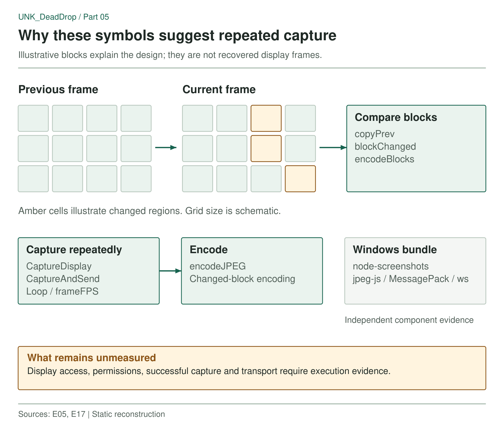

The Go implant contains symbols for capturing a display, retaining a previous frame, comparing blocks and encoding JPEG data, while a separate Windows bundle combines screen acquisition, JPEG encoding, MessagePack serialization and WebSocket transport. Frame differencing and frame-rate accounting serve no purpose for occasional screenshots, so I read these artifacts as a design for a continuous video feed of the desktop that sends only what changed between frames, a capability I have found in no third-party reporting on this actor. No capture session was recorded. The available evidence comes from the native binaries, the Windows bundle and its installer, leaving achieved frame rate, bandwidth and desktop access unmeasured, and the symbol and dependency observations are recorded in [E05](../../evidence/E05.pdf); [E18](../../evidence/E18.pdf) explains why the earlier dependency-only assessment did not rule out capture code.

## Frame comparison in the Linux Go agent

In the Go binary, I found these capture symbols:

```text
capture.CaptureDisplay    capture.CaptureAndSend
capture.Loop              capture.encodeJPEG
capture.encodeBlocks      capture.blockChanged
capture.copyPrev          capture.frameFPS
```

`CaptureDisplay` and `CaptureAndSend` suggest acquisition and transfer, but the more distinctive names are `copyPrev`, `blockChanged` and `encodeBlocks`: they fit a design that retains an earlier frame, compares image regions and encodes changes for transmission, while `Loop` and `frameFPS`, together with average-size and average-duration metrics, add evidence of repeated capture and rate accounting. MITRE ATT&CK groups screen acquisition under [Screen Capture (T1113)](https://attack.mitre.org/techniques/T1113/). Block dimensions and loop frequency remain unmeasured, as does code reachability on a particular host; a Linux process needs access to a usable display session and sufficient permissions before a capture routine can acquire an image.

The platform picture needs the dependency list and the symbol table read together, because they measure different things. The May Linux build still linked X11 screen capture, while the July Linux build is stripped of the framework's screen-capture, webcam, audio and WebRTC back-ends yet still contains the capture package's own symbols and error strings, which points to per-platform tailoring over time: the streaming design is compiled in, but whether that July build could acquire frames is not established. The macOS builds, among them the two macOS builds in the set of six Unix builds fetched from the operator's blob host on 12 November, expose the framework's screenshot command, and the operator's separate Cortex console returns screenshots of the remote browser, so macOS victims are best scoped as watched until shown otherwise.



*Figure 1. Previous-frame storage and block comparison suggest transmission of changed regions between captures.*

### The Go symbols identify TLS key logging

Three other matches in the Go binary were `writeKeyLog`, `KeyLogWriter` and `crypto/tls.(*Config).writeKeyLog`, and their surrounding names identify the Go standard library's TLS key-log facility, which has nothing to do with keystrokes, so a count-only search for "keylog" would report a keylogger that is not there. Across the held Windows, Linux and macOS builds of the Overlord agents and their Node and Python stages I found no key-listener package and no keyboard-hook interface at all, neither Windows hook or key-state calls nor X11 record or grab interfaces nor macOS event taps. That negative has a boundary: a separate PowerShell toolkit recovered from a staging repository linked to the same operator personas, related to the ECHOES lineage in [Part 9](../09-echoes-lineage-image-provenance/), does run a keylogger through a VBScript runner.

## Screen-capture components in the Windows bundle

The Windows bundle supplies a separate set of components:

- `node-screenshots` and its native module, for screen acquisition;
- `jpeg-js`, for JPEG encoding;
- MessagePack, for serialization;
- `ws`, for WebSocket communication.

The installer checks for the capture files and refuses to deploy without them, throwing an error that the native module is missing from the bundle, so on Windows the capture component is not optional. The agent then persists as a hidden scheduled task named `GoogleUpdateSupporterNode`, made to resemble a Google update component, that runs with highest available privileges and 999 restart attempts. The same Windows Node agent also offers live remote desktop with injected mouse and keyboard input, a hidden shell and clipboard access, so the feed is meant for an operator who can act on what it shows. The Windows dependencies and Go symbols come from different artifacts, yet they implement the same frame-differenced design in two languages. Whether the implementations share code remains unresolved. For the Windows branch, investigators would start with the installed bundle, task action and process session to determine whether capture ran.

## The capture rule requires Overlord and four symbols

The [capture-agent YARA rule](https://github.com/KrasForge/unk-scanner/blob/main/rules/yara/deaddrop_capture_agent.yar) requires an Overlord environment marker and four capture-related symbol strings. It locates files carrying that combination, which on its own identifies the framework's capture code rather than this operator, since many unrelated parties run Overlord. Desktop access and frame delivery require runtime evidence. On a host, the useful follow-up evidence includes the installed component, its process and session context, display permissions and associated network activity, while for the Windows branch the `GoogleUpdateSupporterNode` task gives an additional place to look for the executable and arguments used, and its hidden setting and extreme restart count are a stronger marker than the name.

The practical consequence reverses a common scoping habit. Controls that protect data at rest, such as an encrypted vault, a hardware wallet that shows its recovery phrase on screen only during setup, or a one-time code that is never saved, do nothing against a feed of the desktop, and in the absence of keystroke logging the screen covers much of what a keylogger would have captured. A responder should therefore ask what was shown, typed into a revealed password field or read from a dashboard during the exposure window, not only which files existed, although the static artifacts provide no session duration or captured images from which to determine what was actually visible.

```text
Go implant SHA-256:
ef183bbb40f4c7c3f4b52994cdba3295f3eab2604fdad99eefa3b67b8d966e8d
Capture task: GoogleUpdateSupporterNode
```
