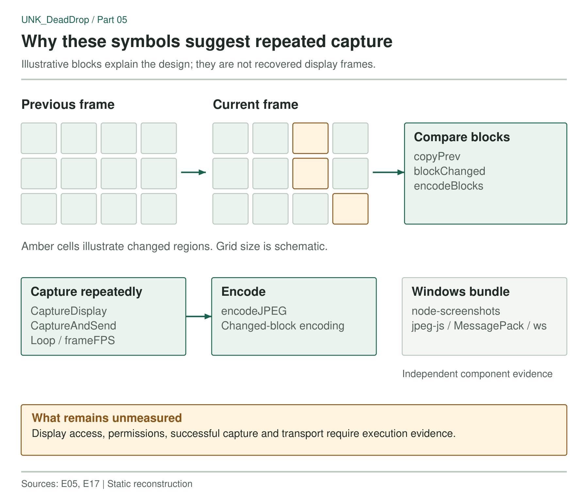

The Go implant contains symbols for capturing a display, retaining a previous frame, comparing blocks and encoding JPEG data. A separate Windows bundle combines screen acquisition, JPEG encoding, MessagePack serialization and WebSocket transport. Together, these artifacts point to a design for repeatedly capturing and transmitting changes on a desktop.

No capture session was recorded. The available evidence comes from the native binary, the Windows bundle and its installer, leaving achieved frame rate, bandwidth and desktop access unmeasured.

## Frame comparison in the Go agent

The Go symbols included the following group:

```text
capture.CaptureDisplay    capture.CaptureAndSend
capture.Loop              capture.encodeJPEG
capture.encodeBlocks      capture.blockChanged
capture.copyPrev          capture.frameFPS
```

`CaptureDisplay` and `CaptureAndSend` suggest acquisition and transfer. The more distinctive names are `copyPrev`, `blockChanged` and `encodeBlocks`: they fit a design that retains an earlier frame, compares image regions and encodes changes for transmission. `Loop` and `frameFPS` add evidence of repeated capture and rate accounting. MITRE ATT&CK groups screen acquisition under [Screen Capture (T1113)](https://attack.mitre.org/techniques/T1113/).

The symbols do not establish exact block dimensions or how often the capture loop runs. They also leave open whether the relevant code is reachable on a particular host. A Linux process needs access to a usable display session and sufficient permissions before a capture routine can acquire an image.



*Figure 1. Previous-frame storage and block comparison suggest transmission of changed regions between captures.*

## The Windows capture bundle

The Windows bundle supplies a separate set of components:

- `node-screenshots` and its native module, for screen acquisition;
- `jpeg-js`, for JPEG encoding;
- MessagePack, for serialization;
- `ws`, for WebSocket communication.

The installer checks for the capture files and raises an error if they are missing. The associated scheduled task is named `GoogleUpdateSupporterNode`. These checks make the capture component an explicit installation requirement.

The Windows dependencies and Go symbols come from different artifacts. They suggest similar capture and transfer functions, but do not establish a shared implementation across operating systems. For the Windows branch, the installed bundle, task action and process session would be the starting points for determining whether capture actually ran.

### The TLS key-log strings

Three other matches in the Go binary were `writeKeyLog`, `KeyLogWriter` and `crypto/tls.(*Config).writeKeyLog`. Their surrounding names identify TLS key logging. None of those matches provides evidence of keyboard interception; no keyboard hook was established by this search.

## Hunting for the capture component

The [capture-agent YARA rule](https://github.com/KrasForge/unk-deaddrop-companion/blob/main/rules/yara/deaddrop_capture_agent.yar) requires an Overlord environment marker and four capture-related symbol strings. It can locate files containing that combination for further inspection. Its match does not establish that a desktop was accessed or that frames reached a server.

On a host, the useful follow-up evidence includes the installed component, its process and session context, display permissions and associated network activity. For the Windows branch, the `GoogleUpdateSupporterNode` task gives an additional place to look for the executable and arguments used.

A functioning capture component could expose information displayed during its operation, including material never saved to a file. The static artifacts provide no session duration or captured images from which to determine what was visible.

```text
Go implant SHA-256:
ef183bbb40f4c7c3f4b52994cdba3295f3eab2604fdad99eefa3b67b8d966e8d
Capture task: GoogleUpdateSupporterNode
```

[Companion detections and static scanner](https://github.com/KrasForge/unk-deaddrop-companion).
