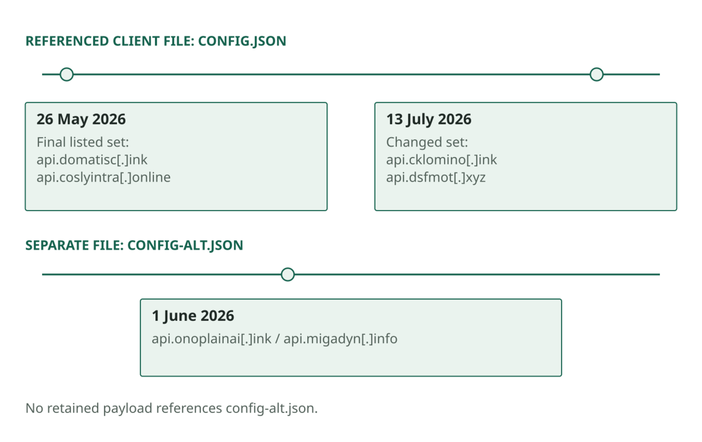

On 13 July 2026, a GitLab commit replaced a list of server names with `api.cklomino[.]ink` and `api.dsfmot[.]xyz`. The file held configuration, not a payload; its significance came from the client code that read it. A client consulting this resource could obtain its destination without carrying a fixed address in the deployed file. The configuration could therefore change without requiring a new payload hash.

Following that dependency led from the collector to the configuration history, then to certificate and panel observations around a historical origin address. It also showed why a list of domains alone gives an incomplete picture of the infrastructure.

> **Key Takeaways**
>
> - The payload reads its destinations from `config.json` in a GitLab repository, which also holds a `config-alt.json` fallback set, so servers can change without a new payload hash.
> - The primary file had five revisions on 26 May and was switched to `api.cklomino[.]ink` and `api.dsfmot[.]xyz` on 13 July 2026.
> - A certificate and a Subtensor sign-in panel historically associated `207.241.172[.]222` with the C2 and administration services.

## The resolver

The payload references this resource:

```text
gitlab[.]com/drop-indexing/tasks/-/raw/main/config.json
```

The history also contains `config-alt.json`, identified as a fallback set. The repository therefore publishes destination values separately from the executable code. MITRE ATT&CK describes the general technique as a [dead drop resolver (T1102.001)](https://attack.mitre.org/techniques/T1102/001/).

Two relationships need preserving: the payload's dependency on the configuration resource, and the value that resource held at the time of a relevant execution. A hash-only inventory captures neither.



*Figure 1. Two configuration files, separate histories. The sequence does not establish fallback selection or client refresh behavior.*


### Reconstructing the changes

The primary file has five recorded revisions on 26 May, beginning with an initial set of `domatisc[.]ink`, `coslyintra[.]online` and `valorecuiting[.]online`, after which subsequent edits remove and restore an entry, introduce `api.` prefixes, and finally leave a set of two hosts. The recorded states after that, in order, are:

1. 26 May 2026, final listed revision of `config.json`: `api.domatisc[.]ink` and `api.coslyintra[.]online`.
2. 1 June 2026, fallback file `config-alt.json`: `api.onoplainai[.]ink` and `api.migadyn[.]info`.
3. 13 July 2026, about 07:10 UTC, `config.json`: `api.cklomino[.]ink` and `api.dsfmot[.]xyz`.

The July change is associated with commit `c3c71d65`; it replaces the primary destination set left by the May revisions. The fallback file has a history of its own, so both files should be preserved rather than inferring the configuration from one URL. There are six listed commits to the primary file and one to the fallback. Repository-wide counts in other notes cover a different scope. In reconstructing this history, the queried file matters as much as the number of results.

The configuration resource lets a destination change independently of the payload. It does not show how each client handles that change. A client may read the new value at startup; one using a cached address may keep trying the old destination. A failed connection could trigger a refresh, use a fallback or simply retry. Those are implementation and runtime questions beyond the fact that the file changed.

Blocking a destination can interrupt traffic, while a client that consults this configuration resource may receive another address. The history does not show whether clients refreshed their configuration. Response should establish which destination an affected client used and whether it connected.

## From the host list to the origin

The July analysis associated `207.241.172[.]222` with C2 and administration services. A certificate observed at that address named `api.cklomino[.]ink`. A third-party scan of the bare IP also returned a Subtensor sign-in panel, providing application content to compare with related panel observations.

The panel adds an application-level association to the certificate evidence. Further relationships came from certificate facets, passive DNS and reverse-DNS fields. These observations came from research-service records; the origin analysis did not directly scan the server or log in.

In the wider July analysis, `207.241.172[.]222` was cast as the C2 and administration origin, `170.205.31[.]182` as lure hosting and `23.137.105[.]75` as earlier C2 infrastructure. These are historical associations, though, and they do not imply that every relationship existed at the same time, that the addresses were controlled exclusively by the same person, or that they still hold those roles today.

### Why the host fingerprint was not an attribution result

The saved service enumeration listed SSH, HTTP and HTTPS. Its SSH profile included a host key, banner and handshake information, but these had different value as search pivots. The common OpenSSH banner and handshake fingerprint matched broad populations of hosts. The more selective host key returned only the address already known. That negative search result does not prove the operation had no backup host.

These observations do not establish that the origin was dedicated or that blocking its IP would have no collateral effect. The panel seen on the bare IP strengthens the service association, but the scan cannot establish every tenant or later ownership change. The certificate's validity dates describe the certificate, not the operation's start or end.

Part 7 follows the target-acquisition tooling behind the two SQLite pools.
