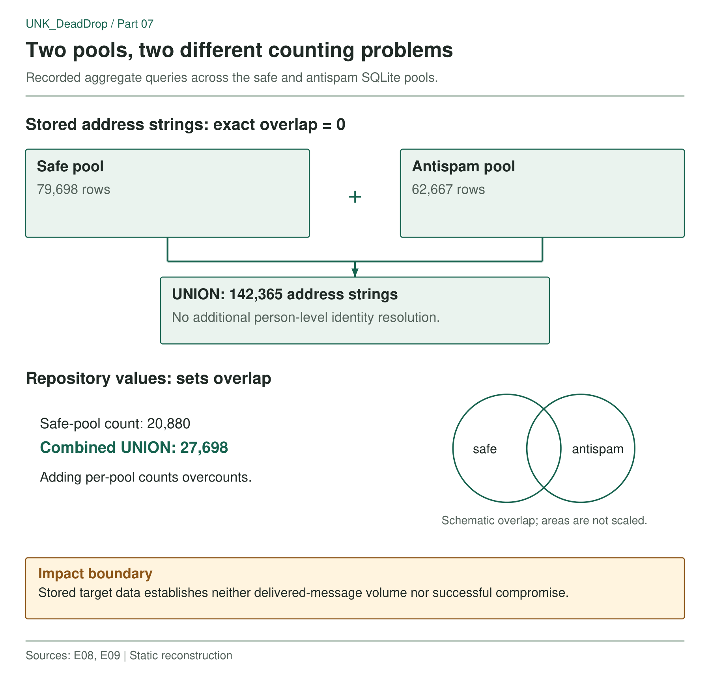

The sender configuration pointed to two SQLite databases. Following those references led to harvesting code and pools containing 79,698 and 62,667 rows. Their combined contents gave the investigation a measurable result: 142,365 distinct stored address strings associated with 27,698 repository values. The interesting part is how those values were collected and counted, and how easily either total could be mistaken for a measure of campaign impact.

> **Key Takeaways**
>
> - Commit metadata supplied contact addresses to a multi-worker harvesting workflow.
> - The two pools contain 142,365 distinct stored address strings, not a count of infections.
> - Repository sets overlap even though the tested address sets are disjoint.
> - Configured endpoints and received headers are stronger provider evidence than variable names.

## Following the database references

The harvester searches repositories by star range, walks their branches and extracts author and committer addresses. It lowercases and trims them before filtering, and visits up to twenty branches per repository in the recorded implementation. Worker configurations partition the search; scheduler and merge code consolidate results into two master pools. MITRE ATT&CK classifies this reconnaissance as [gathering victim email addresses (T1589.002)](https://attack.mitre.org/techniques/T1589/002/). The SQLite relation is simple:

```text
emails
  email: stored address
  repo: associated repository value
```

The sender configuration refers to both pools. Different intervals, cooldowns and warm-up settings control how the tools consume them. The labels `safe` and `antispam` come from the toolkit, not from the investigation.

This connects collection to message preparation, but a stored row does not show that a message was sent to that address. That distinction matters because the databases contain far more rows than the messages received in this case.



*Figure 1. Two pools, two different counting problems. Rows count stored address strings, not people, delivered mail or infections.*


### The repository count needed a union

My first repository total was 20,880, but that described only the safe pool. The second database added repository values that partly overlapped with the first, so counting the full corpus required a union. Read-only aggregate queries recorded on 23 October found:

- 79,698 rows in the safe pool;
- 62,667 rows in the antispam pool;
- an exact address overlap of zero between them;
- 142,365 distinct address strings across both;
- 27,698 distinct repository values across both.

The relevant distinction is easy to see in the SQL:

```sql
-- Address overlap
SELECT count(*)
FROM main.emails AS s
JOIN other.emails AS a ON s.email = a.email;

-- Combined repository values
SELECT count(*) FROM (
  SELECT repo FROM main.emails
  UNION
  SELECT repo FROM other.emails
);
```

In this comparison, the stored address sets are disjoint but the repository sets overlap. Adding the two repository counts would therefore overcount.

The aggregate check applied no additional address canonicalization or person-level identity resolution beyond what the harvester had stored. I call these “address strings” because aliases and people with multiple addresses remain unresolved. The figure counts target data, not infected developers.

The sender code uses `mail.privateemail.com`, although some variables carry a `ZOHO` prefix. Reading the variable names without checking their values would misidentify the provider. A recovered guide supports the Private Email configuration through its DNS examples; later received-message evidence contains Mailgun-related information.

The mail path must therefore be tied to specific configurations and messages, not treated as one fixed provider for the operation. The guide also discusses a shared outbound relay. Its other tenants do not become campaign infrastructure just because they use the same service. Follow concrete values through the code: labels show how a developer named a setting, while endpoints and received headers show the route configured or observed.

## Where the targeting evidence stops

The code and configuration connect harvesting to message preparation. The databases quantify the stored contact material. Neither supplies the missing send logs, delivery outcomes or endpoint evidence needed to count people contacted or compromised. Even the repository total describes stored values rather than a fresh verification of repository existence or ownership.

The earlier total of 20,880 repository values was therefore a scope error, not evidence that the operation suddenly acquired thousands of new targets. Adding the second pool changed the corpus being counted. Recording the input files and the comparison method makes that correction inspectable without publishing individual addresses.

The separate administration frontend is the subject of Part 8. Its mail and wallet views are relevant to the wider investigation, but they are not evidence that every address in these databases entered one integrated backend.
