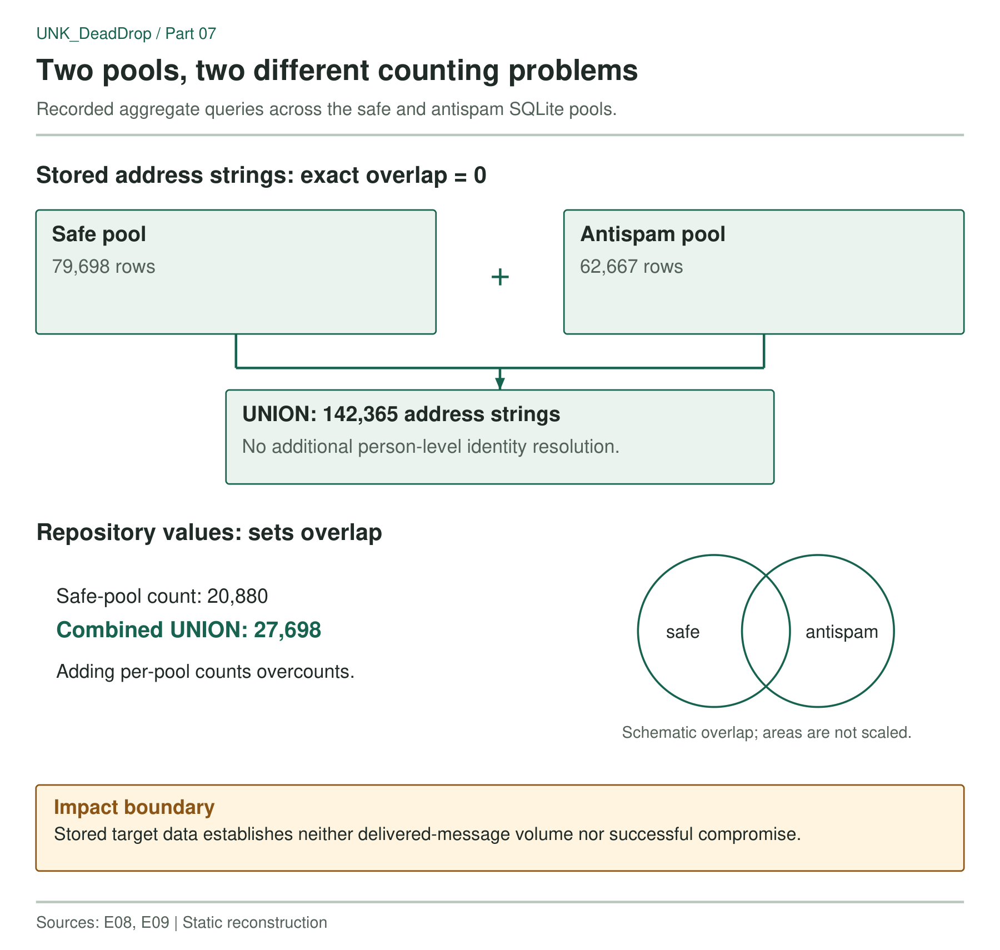

I found that the UNK_DeadDrop sender tooling drew on two SQLite pools holding 142,365 distinct address strings harvested from public commit metadata. The list is untargeted: selection happens later, when a recipient replies and receives a pretext matched to how they describe themselves.

## Key takeaways

- The two pools contain 79,698 and 62,667 rows, with 142,365 distinct address strings associated with 27,698 repository values.
- The harvester searched public repositories by star range only, and three workers added about 130,000 addresses in a single day.
- Crypto or web3 repository names make up only 0.6 percent of the repository values, which rules out a curated list for an operation that steals cryptocurrency.
- The five recruitment accounts active in July held 172 public repositories, of which 153 were credibility props.
- No send logs or endpoint records were recovered, so the number of people contacted or compromised is unknown.

## Impact: an untargeted list of real open-source contributors

The sender configuration pointed to two SQLite databases. I followed those references to the harvesting code and pools containing 79,698 and 62,667 rows. Together they contain 142,365 distinct stored address strings associated with 27,698 repository values. The worker, configuration and read-only count records are summarized in [E08](../../evidence/E08.pdf).

The harvesting code collected those addresses from public commit metadata for use by the sender tooling. The operator had committed the harvester together with its output to a public repository under the GitHub account of TronzitVeca. TronzitVeca is the central persona of the operation's persona farm that [Part 15](../15-persona-farm/) examines, so the tool and the list it produced came from the same place.

### Repository names show no curation

Of the 27,698 repository values, 595 (2.1 percent) have names suggesting 3D or graphics work, such as Blender, Unity, Unreal, WebGL, shaders or rendering. That count comes from repository names alone. I measured other categories the same way:

- design and interface work: 1.5 percent;
- AI and machine learning: 2.9 percent;
- crypto or web3: only 0.6 percent.

For an operation whose income is cryptocurrency theft, crypto being the smallest category rules out a curated list. The pool is an untargeted mailing list of real open-source contributors, and selection has to happen later.

### Selection happens after a reply

The recovered console shows where selection happens. Its mail operation records who replies and keeps the conversation going with an auto-reply endpoint. The respondent then receives a pretext matched to how they describe themselves:

- a validator staking page for someone in crypto;
- a "review our repository in Cursor, no coding needed" pitch for someone who does not code;
- a "Scene Box" pack preview for someone who mentions 3D work.

All three drop the same pair of droppers. The `3dscenebox[.]online` lure in [Part 1](../01-clickfix-clipboard-manipulation/) initially looked like a campaign against 3D artists. Five independent checks found no separate sourcing channel for that group, and the evidence fits a skin on the existing kit sent to the same broad pool.

The chain is confirmed from the recipient's side as well. A later "Surge Group" lure arrived on 23 July at an alias I had given only to GitHub, and the Nodit sender wrote that they had found the recipient's GitHub profile.

## Harvesting: one harvester fed two address pools

The harvester works in these steps:

1. It selects repositories by star range, splitting any search that exceeds the platform's cap of 1,000 results into narrower star or creation-date ranges.
2. For each repository, it walks up to twenty branches.
3. It takes the author and committer addresses from a single listing of up to 100 commits per branch.
4. It lowercases and trims the addresses and discards GitHub's no-reply addresses.

Worker configurations partition the search. The scheduler log records three workers on a Windows host between 18 and 20 April 2026, adding about 130,000 addresses in a single day, which shows how cheaply the whole list could be rebuilt. Merge code then consolidates the results into two master pools that together occupy about 12.4 MB.

MITRE ATT&CK classifies this reconnaissance as [gathering victim email addresses (T1589.002)](https://attack.mitre.org/techniques/T1589/002/). The SQLite relation is simple:

```text
emails
  email: stored address
  repo: associated repository value
```

### The pool split follows mail domains

The split between the pools is not a targeting decision. The merge step sorts each address by its mail domain against a fixed list of 22 domains, mostly consumer mail providers, that the code labels anti-spam. The `antispam` pool holds addresses at those providers, and the `safe` pool holds corporate and other addresses.



*Figure 1. The address sets are disjoint, while repository values overlap between the two pools.*

### Star ranges divided the repository search

The three worker configurations each query a different band of repository star counts: `stars:101..137`, `stars:138..174` and `stars:175..210`. None specifies a language, topic, keyword or organization. The harvester therefore searches public repositories across those bands instead of selecting a particular kind of developer.

## Counting: 142,365 distinct address strings

The two databases share some repository values. A SQL union counts each value once across both pools. Read-only aggregate queries on 23 October found:

- 79,698 rows in the safe pool;
- 62,667 rows in the antispam pool;
- an exact address overlap of zero between them;
- 142,365 distinct address strings across both;
- 27,698 distinct repository values across both.

The queries check address overlap and count the combined repository values:

```sql
-- Address overlap
SELECT count(*)
FROM main.emails AS s
JOIN other.emails AS a ON s.email = a.email;

-- Combined repository values
SELECT count(*) FROM (
  SELECT repo FROM main.emails
  UNION
  SELECT repo FROM other.emails
);
```

In this comparison, the stored address sets are disjoint, as the domain-based split guarantees by construction. The repository sets overlap, so adding the two repository counts would overcount. The queries compare stored strings without additional address canonicalization or identity resolution. Aliases and multiple addresses belonging to one person remain separate entries.

## Sending: a bulk cold-outreach tool, not Gophish

The sender is a custom bulk cold-outreach tool rather than Gophish, despite sharing three route names with it. It consumes both pools with throttling for deliverability:

- a 90-day cooldown;
- send intervals of three to four hours;
- per-sender daily limits;
- a warm-up mode.

It has no landing pages, link rewriting or credential capture. The database references connect harvesting to message preparation, but no send logs were recovered to establish which addresses received messages.

### Mail relays moved from Namecheap to Mailgun

The sender code's variables carry a `ZOHO` prefix, but the code connects to Namecheap Private Email at `mail.privateemail.com`. Earlier toolkit campaigns used it as a real production relay. The July campaigns moved to Mailgun, and the retained headers show its VERP envelope behavior for the D2S and Category Labs messages.

The June Nodit message came from the lure domain's own mail server with a DKIM key that was never published. A month later the July messages passed SPF, DKIM, DMARC and ARC checks. This learning curve says nothing about legitimacy when the attacker owns the domain.

A forwarding service obscured the original sending IP, so its relay address is not attributed to the operators. The [indicator reference](../../indicators/) records the observed sender and tracking-domain details, with the limits of each observation.

## Lure portfolios: three repositories carried delivery kits

I also examined the accounts supplying the recruitment material, separate from the repositories harvested for addresses. Those five accounts active in July held 172 public repositories. I reviewed cached metadata and file trees, then classified repositories by language, project type and apparent role. Twelve repositories had directly evidenced operational roles:

- Three repositories carried delivery kits: two weaponized project copies in [Part 2](../02-vsix-editor-execution/) and the ECHOES branch in [Part 9](../09-echoes-lineage-image-provenance/).
- Three were clean take-home assignments whose weaponized versions were delivered separately.
- Five were lure funnels.
- One held the harvesting and sending toolkit.

Seven others were forks of third-party projects, including two AI coding tools. The catalog labels 152 repositories as credibility props based on their names, file layouts and creation patterns. It separately flags one more prop for an encrypted `.env`, bringing the total to 172.

### Credibility props make up nine in ten repositories

The credibility props include NFT marketplaces, staking programs, dice and coinflip games, trading bots, pump.fun clones and small "GPT" tools. They use the Rust, TypeScript and Python stack expected of a Solana or EVM contractor. Together, the 153 props make up roughly nine in ten repositories, giving each account the appearance of an active engineer's portfolio.

### Creation dates show how the accounts were built

The creation dates show how some of the accounts were built:

- On the flagship account, 67 of 90 repositories appeared within five days in April 2024.
- A second persona account had been dormant since 2017, then received 68 repositories between 27 June and 1 July 2025. Three had exact byte-size matches under new names on the flagship account.
- `pridnet` forked five real trading and LLM projects in March 2026, went quiet for 68 days, then published the weaponized assessment repository.
- `Lyracartoon` held only its two weaponized repositories.

### A byte-level sweep found operator indicators only in known copies

A byte-level sweep using two methods found operator indicators only in the known weaponized copies. The other signature hits were false positives I checked by reading the files. A benign clipboard helper copied the text it displayed, and a marker matched inside the word `bogus` in a fork of Aider. Seven install hooks belonged to ordinary build tooling.

The credibility repositories carried no payload, but their apparent activity could make a recruiter seem trustworthy.

## Inverted recruitment: a public contract repo directed questions to a private contact

Five of the repositories invert the recruitment model, so that the developer is drawn in rather than written to. The most visible is a "pump.fun-compatible" Solana contract with 128 stars and about fifty forks. It implements initialization and liquidity provision, but its fund-moving `remove_liquidity` handler has been reduced to a stub:

```rust
pub fn remove_liquidity(/* ... */) -> Result<()> {
    // If you want to Interact with CPI, then plz contact to me.
    Ok(())
}
```

The repository's pull requests show the pool-removal and migration code being written, then withheld from the public version. This makes the missing code deliberate rather than unfinished. The README, contribution guide, `SECURITY.md` and API documentation direct questions to the same Telegram contact listed in the operators' portfolio material.

An issue from a user who hit the missing module shows the stub at work. Eight inspected forks contain the same 942-byte stub, and none publishes a working version. This suggests the full code was offered privately to people who asked. The public repository has registry-only dependencies, no install hooks, no editor configuration and no hard-coded operator key.

The contents of a private version remain unknown. It might add authority over deployed pools, include a developer-machine payload, or be ordinary paid contract work. The evidence cannot distinguish among these possibilities, and obtaining it would require engaging the operators.

### The launchpad link supports contract work, not ownership

The public repository names a real 2024 launchpad as its homepage, and a second operator repository describes its Solidity contract as written for the same site. The project had its own public team, on-chain program and deployer authorities. None matches a wallet in the operator set. The link supports contract work for the launchpad, not ownership of it. The domain's later re-registration served an unrelated site.

## Limitations

No message logs or endpoint records were recovered.

- Sender configuration connects the databases to message preparation, but counting people contacted or compromised would require send logs and endpoint records.
- The repository total counts stored values. I did not reverify each repository's existence or ownership.
- The category percentages come from repository names alone.
- The queries compare stored strings, so aliases and multiple addresses of one person remain separate entries.

## Conclusion

The harvester collected addresses for messages; the public contract projects drew developers toward private conversations. Both feed the same recruitment operation from opposite directions. The address list itself is broad and cheap to rebuild, and the targeting happens in the conversation that follows a reply.

For defenders, an unsolicited recruitment message to an address published only in commit metadata fits this pattern. The pretext shifts to match what the recipient says about themselves, so a 3D, crypto or no-code pitch is the same kit. A repository that withholds key code and directs questions to a private contact deserves the same caution.

The [administration frontend](../08-administration-platform/) contains the reply-driven mail operation and the wallet views that sit downstream of this list, but nothing I hold shows its backend reading these particular SQLite pools.
