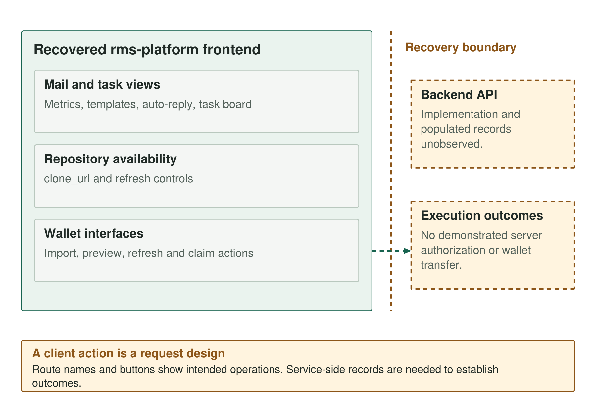

A development deployment at `dashboard.cklomino[.]ink` exposed seventy frontend modules for an application called rms-platform. The recovered client combined mail views, repository availability checks and wallet-management controls. Its wallet views include mnemonic and ColdKey fields, plus import, preview and claim actions. The backend implementation and its stored records were not recovered.

## Seventy modules from a development deployment

The administration recovery followed imports exposed by a Vite development server. It preserved seventy frontend modules, whose embedded source maps included the original TypeScript comments. The recovered application calls itself `rms-platform`; its client contains mail metrics, inbox and outbox views, templates, auto-reply controls, a task board, database tables and wallet-management components.

The acquisition followed only modules loaded by the application. It involved no login or call to the authenticated data API. The source references `/api/github-jobs-check/`, `/api/db/...` and `/api/admin/wallets/{refresh,preview,claim,claim-all}/`; these are strings in the client, not observed requests. The related [historical indicator reference](../indicators/) records the exact route forms and the [evidence index](../artifacts/) lists hashes for the recovered modules and related samples. The retained client excerpts are in [E06](/UNK_DeadDrop/evidence/E06.pdf) and [E09](/UNK_DeadDrop/evidence/E09.pdf).



*Figure 1. The recovered frontend connects mail views, repository monitoring and wallet-management controls.*

One view tracks repositories by `clone_url`, displays availability labels and offers refresh controls through `/api/github-jobs-check/`. The feature fits the delivery history: repositories can disappear, move or be replaced, and a status view could help monitor locations used to distribute lures or payloads.

No backend event history was recovered to show whether a repository suspension triggered an alert or a replacement.

### Wallet management beside mail operations

The wallet interface contains import, refresh, preview, claim and bulk-claim actions, and the client references routes including:

```text
/api/admin/wallets/refresh/
/api/admin/wallets/preview/
/api/admin/wallets/claim/
/api/admin/wallets/claim-all/
```

The collection paths and their relationship to the dynamically selected server are listed in the [historical indicator reference](../indicators/).

Mnemonic and ColdKey fields, Bittensor-related interface language, and references to EVM and Aptos connect the intended wallet workflow to material targeted by the collectors. The collectors select wallet material that corresponds to these interface fields.

No transaction records accompanied the frontend. The sender and harvester tools were recovered separately, and their integration with this application remains unverified.

### The SuperAdmin check

The client helper grants super-administrator treatment when either a user flag is set or an email comparison matches. These checks control frontend navigation and protected routes; without the backend authorization logic, they do not establish which accounts could execute a server-side claim.

The signup route displays a disabled-signup message, so the client does not establish an active account-creation workflow. The interface supports roles but does not reveal how many people used them.

[Companion detections and static scanner](https://github.com/KrasForge/unk-deaddrop-companion).
