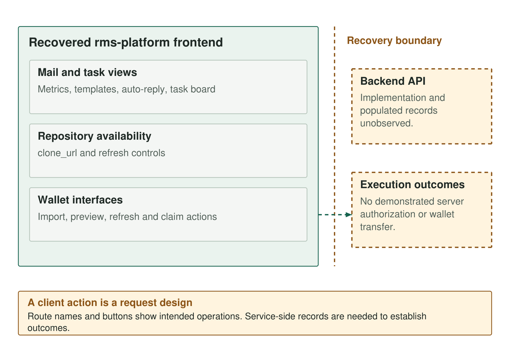

A development deployment at `dashboard.cklomino[.]ink` exposed seventy frontend modules for an application called rms-platform; the recovered client combined mail views, repository availability checks and wallet-management controls, and its wallet views include mnemonic and ColdKey fields, plus import, preview and claim actions. The backend implementation and its stored records were not recovered, but by November two outside records had placed the back office it talks to on a timeline and tied it to a persona, so the console is no longer an isolated artifact.

## The Vite server exposed seventy frontend modules

I followed imports exposed by the Vite development server and preserved seventy frontend modules (their embedded source maps included the original TypeScript comments). The recovered application calls itself `rms-platform`. Its client contains mail metrics, inbox and outbox views, templates, auto-reply controls, a task board, database tables and wallet-management components. The acquisition followed only modules loaded by the application and involved no login or call to the authenticated data API. The source references `/api/github-jobs-check/`, `/api/db/...` and `/api/admin/wallets/{refresh,preview,claim,claim-all}/`. These are strings in the client, not observed requests. The related [historical indicator reference](../../indicators/) records the exact route forms and the [evidence index](../../artifacts/) lists hashes for the recovered modules and related samples, while the retained client excerpts are in [E06](../../evidence/E06.pdf) and [E09](../../evidence/E09.pdf).



*Figure 1. The recovered frontend connects mail views, repository monitoring and wallet-management controls.*

One view tracks repositories by `clone_url`, displays availability labels and offers refresh controls through `/api/github-jobs-check/`. The feature fits the delivery history: repositories can disappear, move or be replaced, and a status view could help monitor locations used to distribute lures or payloads, though no backend event history was recovered to show whether a repository suspension triggered an alert or a replacement. Passive resolution history for the back-office dashboard that serves this console, under the name `dashboard.asteara[.]org`, places it at Liga Hosting from 8 June 2026 and on an Advin address by 29 June, behind Cloudflare under a second name from 28 July, and from 5 October on `170.205.30[.]27` inside the operators' October lure fleet, so the back office moved with the rest of the estate rather than standing apart from it. When [Stormshield's Trigram report](https://www.stormshield.com/news/cti-trigram-campaign/) described a Django back office behind the same kit in November, it named the database user `silviattech1129`, and the same handle appears in the author address of a commit to the replacement dead-drop repository of October ([Part 16](../16-control-layer-after-october/)) and binds the "Silvio Silva" persona to a 2025 launchpad presentation.

### Mail, tasks, and wallet controls

The wallet interface contains import, refresh, preview, claim and bulk-claim actions, and the client references routes including:

```text
/api/admin/wallets/refresh/
/api/admin/wallets/preview/
/api/admin/wallets/claim/
/api/admin/wallets/claim-all/
```

The collection paths and their relationship to the dynamically selected server are listed in the [historical indicator reference](../../indicators/). Mnemonic and ColdKey fields, Bittensor-related interface language, and references to EVM and Aptos connect the intended wallet workflow to material targeted by the collectors, and the collectors select wallet material that corresponds to these interface fields. A cold-key field in the wallet import, a miner-request column in the mail table and the Subtensor theming converge on Bittensor validators and miners, with EVM and Aptos wallets secondary. No transaction records accompanied the frontend, and the client could not have yielded them: the recipient addresses of a claim are supplied by the backend from a server-side configuration at claim time and never reach the victim's machine, so no sample detonation recovers them, and my read of all seventy modules found no cryptocurrency address and no service key. That is the main reason the operation's cash-out remains untraced. The mail side, with its replied status and auto-reply endpoint, is where the untargeted list of [Part 7](../07-developer-target-harvesting/) turns into selected conversations, although the sender and harvester tools were recovered separately and nothing I hold shows this backend reading their pools.

### The `SuperAdmin` check lives in the client

The client helper grants super-administrator treatment when either a user flag is set or an email comparison matches, and these checks control frontend navigation and protected routes, including the wallet page and its sidebar entry. The hard-coded address is `eros1030109@gmail[.]com`, and the same string is the aggregate-report destination in the DMARC records of the lure domains `d2saitrade[.]ink` and `surgecareer[.]ink` and appears in the dead drop's commit history, which shows that one actor configured all of them, though not who controls the mailbox; [Genians' Operation GitPower report](https://www.genians.co.kr/en/blog/threat_intelligence/kimsuky_ai_llm) of August 2026 lists it too, a corroboration that [Part 17](../17-two-operations-one-ecosystem/) weighs. The missing backend code leaves server-side claim authorization unknown. The signup route displays a disabled-signup message. Roles are defined in the interface. Account creation and user counts require backend records.

