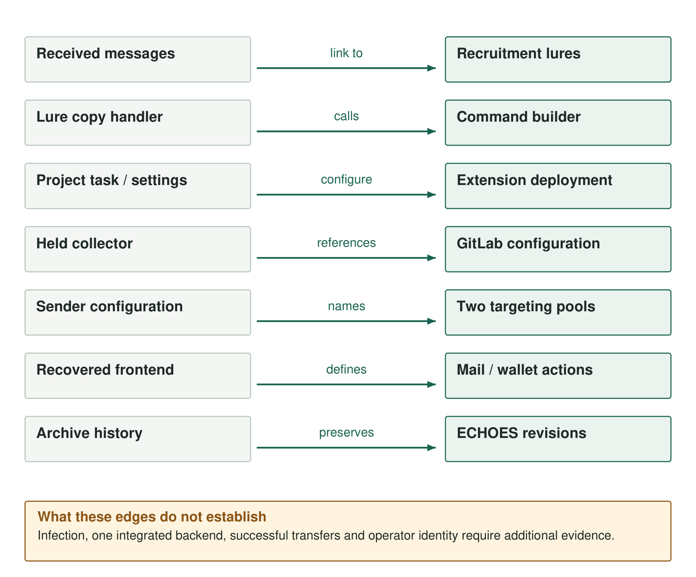

Three recruitment messages started the investigation: a Nodit-themed lure received on 22 June 2026, a D2S AI Trade lure on 21 July and a Category Labs lure on 22 July, and their links led to clipboard manipulation and editor-extension delivery routes, while the collected material also included a mutable GitLab resolver, two targeting databases and administration frontend source.

Some connections are direct code references. The copy handler calls a command builder, the editor task invokes an installer, and sender configuration separately names the database files, while other relationships rely on historical infrastructure observations or compatible functions in separately recovered software, yet no endpoint or backend record reconstructs a complete infection and collection sequence.

## A copy handler, an editor task, and a passworded archive

In the [browser route](../01-clickfix-clipboard-manipulation/), a verification page changes the command placed on the clipboard, and its copy handler passes a nonce, phrase and operating-system value to a builder that adds installation logic while preserving the promised `VERIFY-` output. The first-stage download location comes from the page's origin, allowing the same frontend to work on different lure hosts.

The [repository route](../02-vsix-editor-execution/) uses project task configuration to reach a VSIX installer, and the Google Update Support extension reads deployment settings from workspace configuration, so the package and its settings jointly determine the configured destination. The VSIX also carries native agents and encrypted Windows components, and authenticated decryption exposed a Windows Node/Python pipeline inside the extension; similar COM elevation-builder code occurs in the ClickFix collector, linking the two implementations. Their entry conditions differ: one depends on a candidate pasting a command into a terminal, while the other depends on editor task permissions and extension installation.

[Proofpoint's earlier report](https://www.proofpoint.com/us/blog/threat-insight/dont-fear-repo-unkdeaddrop-phishing-campaign-targets-developers-steal) documents the extension route and Windows architecture. I recovered the same mechanisms in the package, including the configuration and process-building code.

The message-header review also identified Mailgun VERP envelope behavior for the D2S and Category Labs lures, while the Nodit message used its own domain in the envelope. The messages arrived through a forwarding service, so the original sending IP was not preserved, and the forwarding service and its relay addresses belong to the recipient's mail path, not the campaign infrastructure. Personal addresses and envelope identifiers are omitted. The message evidence is summarized in [E01](../../evidence/E01.pdf).

*Figure 1. Code references, configuration values and historical observations connect the recovered components.*

## Resolver edits point to two July server generations

The [GitLab resolver](../06-gitlab-dead-drop-infrastructure/) separates destination settings from deployed payloads, and the retained history records changes to `config.json` and a separate `config-alt.json` file, but no retained payload references the latter; on 13 July, the referenced `config.json` set changed to `api.cklomino[.]ink` and `api.dsfmot[.]xyz` ([E07](../../evidence/E07.pdf)). On 25 July my own watch recorded a further commit that cut the file to `api.chestsoi[.]ink` alone, and after the repository went dark on 22 October the operators rebuilt it within about 31 hours under a new name and again on 3 November under a third, naming a new host, `api.cerysoi[.]ink` ([Part 16](../16-control-layer-after-october/)). A payload hash alone cannot identify which configuration a client fetched.

A certificate naming `api.cklomino[.]ink` and a Subtensor sign-in panel observed at `207.241.172[.]222` connect that address to the historical service, and passive DNS and related research-service records supplied further pivots. These observations date service associations, and every serving and command address I observed from July to November sits with one shared-hosting provider, Advin, so exclusive ownership of any address remains unverified. Client refresh behavior and connections after the configuration change remain unknown.

The late-July lures added another dated origin picture. On 23 and 24 July, `170.205.31[.]182` served the `3dscenebox[.]online` lure and was associated with several reactivated lure domains; separately, certificate and passive-scan records linked the `api.aazdias[.]ink` and `api.fallaazdis[.]ink` store pair to `207.241.172[.]222`, and [E20](../../evidence/E20.pdf) and [E21](../../evidence/E21.pdf) document the limits of those observations; the public bundle lacks the complete provider responses.

The `23.137.105[.]75:5173` C2 observation, reported before my July material, belongs to the July campaign host, and a 22 July analyst note also records an Express response from `23.137.105[.]75:3000` and a CORS preflight allowing `X-Guard-Platform`, a header present in the recovered installer. Route existence and data receipt remain unknown: the note records only the 404 and preflight responses, and the probe transcript is not in the public evidence PDFs, while these July observations have not been refreshed since 24 July.

| Starting artifact | Connection | Result |
|---|---|---|
| Received message | Recruitment URL | A delivered lure |
| Lure source | Copy handler calls command builder | Clipboard substitution and first-stage retrieval logic |
| Project configuration | Task and deployment settings | Extension installation path and configured parameters |
| Held collector | GitLab configuration URL | Mutable destination lookup |
| Sender configuration | Paths to two SQLite pools | Stored targeting material available to the sender |
| Administration frontend | Imports and API route references | Repository monitoring and wallet-management controls |
| ECHOES repository history | Four retained archive revisions | Changes to retrieval and persistence |

The [historical indicator reference](../../indicators/) collects the exact hostnames, paths and IP observations behind these links, with the evidence type and uncertainty recorded for each, and the [artifact reference](../../artifacts/) gives file hashes for the samples and archive revisions used in the pivots.

## Separate contact pools and wallet fields

I recovered the targeting tools and wallet interfaces separately from the delivery chain, and their code describes preparation and intended use of collected data. Their integration remains unverified. The [harvester](../07-developer-target-harvesting/) searches repositories by star range and extracts author and committer addresses from branch histories, and sender configuration names two SQLite pools containing 142,365 distinct stored address strings associated with 27,698 repository values ([E08](../../evidence/E08.pdf)). The pools are split by mail domain, not by any interest, and crypto repositories are the smallest category in them, so the list is untargeted and selection happens at the reply, in the console's mail operation. The counts quantify the available targeting material. Missing send logs and endpoint records prevent a count of recipients contacted or systems compromised.

The separately recovered [rms-platform frontend](../08-administration-platform/) contains mail views, repository availability monitoring and wallet import, preview and claim controls, and its mnemonic and ColdKey fields correspond to material selected by the collectors. That connection describes compatible data and functions. The console's single privileged identity, `eros1030109@gmail[.]com`, recurs in the DMARC records of two lure domains and in the dead drop's commit history, which ties these pieces to one configuring hand, but no recovered backend establishes that the targeting pools, mail system and wallet workflow were integrated or used successfully, and the claim recipients are chosen on the server side.

[ECHOES](../09-echoes-lineage-image-provenance/) preserves a different delivery branch. Four archive revisions show repeated artwork and staging, changing retrieval destinations and a VBS persistence addition, but its final PowerShell payload was unavailable through the unauthenticated routes examined, so whether it deployed the Go agent, the JavaScript collector or another payload remains unknown; the closest counterpart is a separate PowerShell toolkit from a related staging repository that exfiltrates into per-victim GitHub repositories.

## Three leads that fell apart on review

Several connections that looked strong in the middle of the investigation fell apart when they were checked properly; keeping them would have put somebody else's infrastructure or name into the indicator set.

The persona accounts claimed roles at real crypto projects and displayed testimonials attributed to founders and executives, and at first some project domains and authors' social handles were treated as possible operator infrastructure because they shared registrar, hosting and privacy-registration patterns with known sites.

The projects proved to be established companies with years of public history, and the accounts themselves belong to a persona farm built from copied commit histories, which [Part 15](../15-persona-farm/) separates from the real developers whose work was copied; their testimonials used real people's names and handles, with no sign those people had written them, and the evidence identifies the companies and people as targets of impersonation. Their domains do not belong on a certificate watch list. Their names are omitted here. The shared hosting fingerprint was common. A budget registrar, popular host and privacy service are not enough to connect a domain to an operation.

Most of this domain family was registered in September 2025 and hosted by the same budget provider, and it was first treated as an earlier campaign phase, then reclassified the same day as probable operator infrastructure with high confidence. Closer inspection found at least six beauty and cosmetics domains, about forty subdomains per domain named for invented Brazilian influencers, numbered bulk-mail sender subdomains and spam classifications. The sites formed an affiliate-marketing spam operation, eight months older on the shared address than the operator's lure fleet. They had no recruitment lure, ClickFix page or malware.

The "dedicated host" claim came from one passive-DNS source with limited coverage, and another address used by the family hosted unrelated sites for years; the association was withdrawn before any indicator set or referral was filed.

The 3D-artist lead in [Part 7](../07-developer-target-harvesting/) came from a new cover story. The harvester shows no separate sourcing channel for that audience. The operator-associated Solana wallets active into 2026 led through one pass-through account to a program-owned account holding thousands of SOL and handling hundreds of transactions each day. The trace found no victim funds.

The broader repository sweep returned two signature matches. Reading the files showed both were benign.

The most tempting connection of all was PolinRider, a workstation-to-repository worm whose recruiters use the same fake-employer pretext and the same folder-open editor task. It resolves its C2 from blockchain records rather than a GitLab file, delivers through hidden JavaScript loaders rather than ClickFix pages or an extension, and hosts its resolver C2 with Evoxt and AS399486 rather than Advin, and when I counted observation paths in my evidence graph, the only two routes from PolinRider records to UNK_DeadDrop records were a generic obfuscator rule and an attribution tag, neither of them an observation. A fork that appears to show the UNK_DeadDrop persona `pridnet` authoring a PolinRider commit is the worm amending commits under whoever wrote them in a victim's working copy. The two operations share an ecosystem and a few victims, developers who answered both recruiters, and nothing else I can observe, so I keep them apart; [Part 17](../17-two-operations-one-ecosystem/) sets out that separation.

## Later reporting and an October continuation lead

I checked later reporting against the retained artifacts for further connections; Ben Hopkins's [UNK_DeadDrop investigation](https://brhopkins.uk/posts/foxtopia/) first appeared on 23 July, before this case's evidence cutoff, and was updated in August. The update places `api.chestsoi[.]ink` in the GitLab dead-drop sequence, and my own watch confirms it: the commit of 25 July that made it the file's only host is in my monitoring record, so the hostname is a captured indicator rather than a reported lead, and Hopkins's path was accurate when he published it.

Two November reports reached the same machinery from outside. [SafeDep](https://safedep.io/blog/antd-img-crop-forged-commit-overlord-stealer) described a forged commit in the GitHub repository of the npm package `antd-img-crop` that ran a dropper on `npm run build` and fetched the operation's stage three, leaving the published package unaffected, and its Windows agent entry file matches the one I hold by full SHA-256, although about seventy of its ninety-three indicators were new to me. [Stormshield's Trigram report](https://www.stormshield.com/news/cti-trigram-campaign/) described a ClickFix kit it calls DeepfakeGuard behind a GitLab relay and a Django back office, and I can say on my own identifiers that Trigram is UNK_DeadDrop: the relay is the dead drop I track in its later projects, the back office's database user `silviattech1129` shares its handle with a relay commit author, and the session-replay organization in current builds already sat on July and June lures. Stormshield's link to Kimsuky is Stormshield's assessment, which it reworded on 17 November, and I have not established it; pivoting Stormshield's addresses recovered 142 operator-named lure hostnames I had not collected.

An [October developer-lure report](https://dev.to/edison_flores_6d2cd381b13/a-fake-recruiter-sent-me-a-job-offer-that-ended-in-my-terminal-the-trojan-is-still-live-2okf) describes a launcher with four markers also found in this corpus: `deepfake_guard`, a POSIX double-fork, `/var/tmp/.kdm.XXXXXX` and `/guard-launcher-result`, and it names `taikotalent[.]xyz`, the paired hosts `api.gaganata[.]ink` and `api.fallgganata[.]ink`, and sample SHA-256 `c7c22e322c17bda8198257342d4034af6250a5c433242461b870879ba9aa285d`.

The shared markers make this a probable continuation lead, and the `deepfake_guard` marker matches the kit name Stormshield later published. But the article, gist, repository and follow-up all trace to one reporting chain, and the sample was not independently recovered; the hosts and hash therefore remain leads, not verified indicators.

