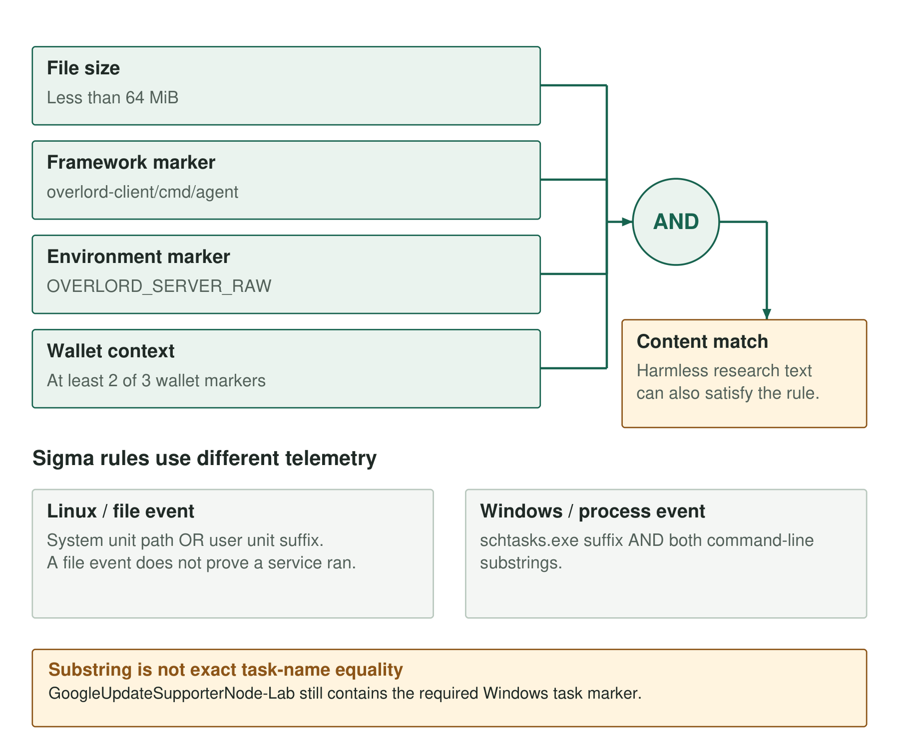

A harmless paragraph containing four marker strings satisfies the wallet-agent YARA rule. A scheduled task named `GoogleUpdateSupporterNode-Lab` satisfies the Windows task selector. Both results follow from the rules' matching conditions and affect how an analyst should triage a hit.

The [public companion](https://github.com/KrasForge/unk-deaddrop-companion) publishes four experimental YARA rules and six Sigma rules. Alongside the wallet-agent, Linux service and Windows task selectors, it covers [editor-spawned Node](https://github.com/KrasForge/unk-deaddrop-companion/blob/main/rules/sigma/windows_editor_node_collection.yml), [PowerShell Electron Node mode](https://github.com/KrasForge/unk-deaddrop-companion/blob/main/rules/sigma/windows_powershell_electron_node_mode.yml), [temporary elevation artifacts](https://github.com/KrasForge/unk-deaddrop-companion/blob/main/rules/sigma/windows_elevation_temp_artifacts.yml), [VS Code extension artifacts](https://github.com/KrasForge/unk-deaddrop-companion/blob/main/rules/sigma/windows_vscode_extension_artifact.yml), [capture-agent markers](https://github.com/KrasForge/unk-deaddrop-companion/blob/main/rules/yara/deaddrop_capture_agent.yar), [VSIX manifest indicators](https://github.com/KrasForge/unk-deaddrop-companion/blob/main/rules/yara/deaddrop_vsix_manifest.yar), and [the stage-three collector source](https://github.com/KrasForge/unk-deaddrop-companion/blob/main/rules/yara/deaddrop_stage3_collector.yar).

## Match the rule to its telemetry

The wallet-agent, Linux service and Windows task rules operate on different inputs. YARA scans file content. The Linux Sigma rule expects file-event telemetry with a target path. The Windows Sigma rule expects process-creation telemetry with an image path and command line. A detection can only evaluate the fields it receives, so a missing command line or an uncollected user-service directory creates a gap before the rule logic is considered.

The checks described here cover syntax and selected input combinations. No evaluation against a representative fleet has measured these rules' precision or recall.



*Figure 1. The wallet-agent rule requires both framework and environment markers plus at least two wallet markers.*

### The wallet-agent conjunction

The YARA rule requires a file smaller than 64 MiB, a framework module marker, an environment marker and at least two of three wallet markers. Its strings and condition are:

```text
strings:
    $framework = "overlord-client/cmd/agent" ascii wide
    $env = "OVERLORD_SERVER_RAW" ascii wide
    $wallet1 = "OVERLORD_COMPANY_WALLET_EP" ascii wide
    $wallet2 = "X-Company-Wallet-Client-Id" ascii wide
    $wallet3 = "/api/company-wallet/upload" ascii wide
condition:
    filesize < 64MB and $framework and $env and 2 of ($wallet*)
```

The excerpt omits the rule declaration and metadata. Requiring wallet markers narrows the match beyond generic Overlord framework strings. The `ascii wide` modifiers accommodate ordinary byte strings and their zero-interleaved wide form; they do not decrypt a packed or encrypted payload. The [YARA rule documentation](https://yara.readthedocs.io/en/stable/writingrules.html) describes those modifiers and condition syntax.

The tests compile the rule and supply inert buffers. They check positive ASCII and wide cases, then remove enough context to produce framework-only, wallet-only and partial-marker negatives. A historical static spot check also matched the held Go implant. Neither exercise measures how many unrelated files in a developer fleet would match.

One fixture contains research prose followed by the required framework, environment and two wallet strings. It has no executable instructions. It still matches, because the rule asks whether those bytes occur, not whether the containing file is an executable or whether its contents are reachable code.

The paired negative replaces the required environment marker with a different label. That buffer no longer matches. Renaming one required marker therefore evades the rule, while documenting the full marker set can trigger it.

A match in a malware-analysis archive should therefore be interpreted differently from a match on an unexpected installed agent. The current rule has no executable-format check.

### Service paths and scheduled-task commands

The Linux rule selects either the exact system unit path `/etc/systemd/system/google-agent.service` or a target ending in `/.config/systemd/user/google-agent.service`. The logical condition is an OR between those two selections.

The existing fixtures cover both paths, a similarly named nonmatching unit and a missing field. A boundary fixture also shows that this evaluator folds case: an uppercase unit name in the field is accepted. That is a property of the matching implementation, not a claim that Linux filesystem paths are interchangeable across case.

A service file event does not establish that the service was enabled, started or successfully ran the collector. Investigators still need the unit contents and supporting process or service activity. A renamed unit escapes this exact selector, while a security exercise using the recorded name can produce a legitimate match.

The Windows selector is:

```yaml
selection:
  Image|endswith: '\schtasks.exe'
  CommandLine|contains|all:
    - '/create'
    - 'GoogleUpdateSupporterNode'
condition: selection
```

Both command-line substrings must occur, and the image must have the required suffix. The [Sigma modifier documentation](https://sigmahq.io/docs/basics/modifiers.html) explains how `all` combines the listed values and how `contains` and `endswith` constrain the match.

The rule does not parse `/TN` and compare its argument for equality. A fixture uses `GoogleUpdateSupporterNode-Lab`, which still contains the required marker and therefore matches in the local evaluator. Negative fixtures cover a query command, a different executable and a missing command line.

A hit requires examination of the complete command and task definition. Registration through another API, a renamed task or missing command-line telemetry can bypass the selector.

## What was tested locally

The downloadable blog bundle contains seven detection tests, including boundary fixtures. The expanded public companion now has 14 inert detection tests and eight AST scanner tests. These checks exercise rule and parser behavior; no service was installed, task registered or malware launched.

| Check | What it establishes | What it does not establish |
|---|---|---|
| YARA compilation and buffers | Syntax and selected marker combinations | Malware precision or recall |
| Harmless-text match | Content can match outside executable code | Frequency of that false positive in a fleet |
| Sigma parsing | Rules accepted by the installed parser | Backend query correctness |
| Field fixtures | Behaviour of the local modifier subset | Real event collection or end-to-end alerts |
| AST tests | Supported parser-tool behaviour | Automatic recovery of the encrypted loader |

The local Sigma evaluator is deliberately small; it is not a SIEM backend. Case handling, field mapping and event normalization still need validation in the intended platform.

The [public companion repository](https://github.com/KrasForge/unk-deaddrop-companion) contains the expanded rules, tests and AST scanner. The downloadable blog bundle preserves the [original detection tests](../../companion/tests/test_detections.py), [boundary tests](../../companion/tests/test_blog_boundaries.py), [pinned Python requirements](../../companion/requirements-dev.txt), [YARA rule](../../companion/rules/yara/deaddrop_wallet_agent.yar), [Linux rule](../../companion/rules/sigma/linux_google_agent_persistence.yml) and [Windows rule](../../companion/rules/sigma/windows_capture_task.yml). Run those original tests from the extracted bundle root:

```sh
python -m venv .venv
.venv/bin/pip install -r public-repository/requirements-dev.txt
.venv/bin/python -m unittest discover -s public-repository/tests -v
```

Those commands run the seven detection tests in the blog bundle. The expanded companion's AST tests require its full project checkout. Code and rules retain the companion's [MIT license](../../companion/LICENSE); that grant does not cover the research prose or underlying evidence.

### Triaging matches

For a YARA hit, retain the file identity, acquisition context and matching offsets. For a Linux unit, inspect the unit definition and associated process activity. For a Windows task, recover the full command line, task action and relevant ancestry. Those follow-ups help separate a research artifact or simulation from an unexpected deployment.

The rules still need conversion and replay against representative telemetry from the intended environment, including clean developer workloads.

[Companion detections and static scanner](https://github.com/KrasForge/unk-deaddrop-companion).
