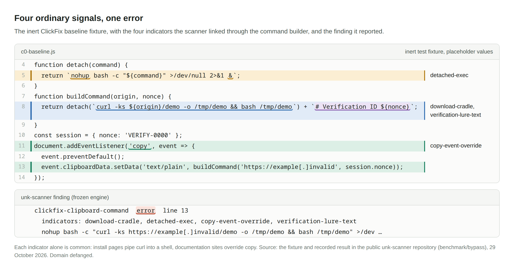
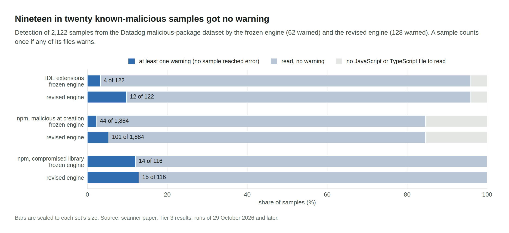
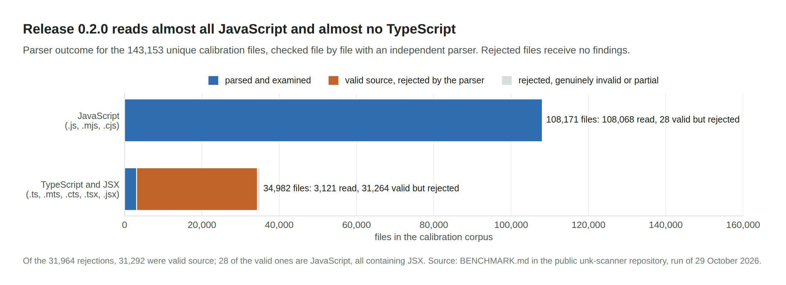

The scanner raised two error-level findings among nearly 2.4 million files from recently changed npm packages, and neither was malicious. Among 2,122 known-malicious packages and extensions, it flagged only 62 samples, all at warning level.

## Key takeaways

- Two error findings in 19,976 recently changed npm packages amount to about 0.01% of packages needing error review in this scan; both were benign.
- The frozen engine raised warnings on 62 of 2,122 known-malicious samples and no errors; a later revision raised warnings on 128, still with none at error level, and no engine change added an error-level finding in any collection.
- About nineteen in twenty known-malicious samples still received no warning, so a clean result cannot clear a package.
- Release 0.2.0 on npm and PyPI rejected 31,964 of 143,153 calibration files, and 31,292 of those were valid source, overwhelmingly TypeScript.
- The scanner reads only JavaScript and TypeScript files, so code started from an editor task, an agent hook, a package script or a font-named file is outside its view.

## Results: few false alarms, few detections

I read both error findings. One came from an AI desktop application's local helper. The other came from a setup guide whose `curl` command printed an HTTP status code.

The quieter result came from a different corpus. Serious false alarms were rare, and so were detections outside the structures the rules were built to recognize. Even after a later engine revision doubled the malware warnings to 128, about nineteen in twenty known-malicious samples still received none.

The results and sampling details are in the [scanner paper](../../downloads/UNK-Scanner-Paper.pdf). They come from fixed runs on 29 October, using one engine on an eight-vCPU virtual server. Part 11's [YARA replay](../11-detection-engineering/) covers a different system and a different question.

## Corpora: npm, Open VSX and public malware

The first check covered 2,500 npm packages ranked by `npm-high-impact` and 500 Open VSX extensions ranked by downloads. That produced 143,153 distinct files. I had already used this material to tune severity. It was useful for finding noisy rules, but it could not show how the same choices would behave on other code.

The expanded run added three collections:

| Collection | Acquired | Files |
| --- | ---: | ---: |
| Top npm packages, Marketplace extensions and the Open VSX calibration set | 4,992 of 5,000 npm packages; 967 of 1,000 extensions | 332,054 |
| Packages selected from the npm registry changes feed | 19,976 of 20,000 package names | 2,403,437 |
| Datadog malicious-package dataset | 122 IDE extensions; seeded sample of 2,000 npm packages | 41,359 |

The three collections hold 2,776,850 file entries, which is the figure in the title. Of these, 56,361 files occur in more than one collection, so the distinct files number about 2.72 million.

The overlap is uneven, and it matters for anyone who reuses the totals:

| Files by number of collections | Distinct files |
| --- | ---: |
| In one collection only | 2,660,312 |
| In two collections | 52,545 |
| In all three collections | 3,816 |
| Total distinct | 2,716,673 |

The 3,816 files present in all three are counted three times in the plain sum, so the repeat entries number 60,177, not 56,361. Most of the shared files are bundled libraries that ship inside many packages. Popular and recent packages share 47,874 files, popular packages and the malware set share 11,443, and recent packages and the malware set share 4,676.

### Calibration: what the severity choices were tuned on

The calibration collection is worth stating with its conditions, because it set the severities used everywhere else. I ran release 0.2.0 on 29 October over the top 2,500 npm packages from `npm-high-impact` 1.13.0 and the top 500 Open VSX extensions by download count. Their 197,978 file occurrences reduce to 143,153 unique files, after 113 members larger than eight mebibytes were excluded at acquisition.

No error-level finding occurred anywhere in that collection. I reviewed all 107 warnings against the cited source:

- **Obfuscated string arrays (90).** All were confirmed obfuscator structures in five commercial extensions. The scanner is right to report them, and they say nothing about intent.
- **Electron launches (16).** These were legitimate: copies of a TypeScript typings installer, SSH and command-line shims, a local helper server and a browser install for a test framework. None hides execution, so none escalates.
- **Copy-install button (1).** A setup wizard's copy-install-command button is a warning by design.

Below warning level the volume is large and deliberately contextual: 1,272 clipboard-write notes across 521 files and 183 notes for assigning `ELECTRON_RUN_AS_NODE`. These files shaped the severities, so the result is a calibration, not a false-positive rate. Files inside one package are correlated, and popularity is not proof that code is benign.

### Severity by combination

The principle that keeps the alert volume low is that no single common technique is an error by itself. Each rule has a default severity and explicit escalation conditions:

- Launching a process with `ELECTRON_RUN_AS_NODE` set is a warning, and merely assigning the variable is a note, because language clients do exactly this. Either escalates when the launching function, or a local helper it calls, also hides execution with a hidden-window PowerShell call or runs a script from a temporary or `.vscode` directory.
- A recovered string array is a warning, and its detail records whether recovery succeeded, because commercial extensions obfuscate too.
- An encrypted loader is an error, but only when embedded base64, AES-GCM authentication and decoded text passed to `Module._compile` are linked through constant bindings.
- A plain `curl` piped into a shell behind a copy button is a warning, because installation pages do that. A hidden or encoded window, `mshta`, base64 decoding, detaching, a write inside a copy handler or verification-lure wording makes it an error.

*Figure 1. Four individually common signals, linked through one command builder, produce the only error in this fixture.*

The two error findings in the recent-package collection below are what this design costs when an ordinary program happens to combine two of those signals.

### Method: one rule change, then a frozen engine

The first collection included 188,901 files absent from the calibration set. These make a useful comparison, with one qualification. The first scan raised four errors in Microsoft Live Share and GitHub Codespaces bundles. Both contained an editor-as-Node launch near code from a privilege-elevation library. The rule escalated from the hidden PowerShell anywhere in the bundle, although the operations were not part of the same launch path.

I changed escalation to require the hidden execution in the launching function or a local helper it calls. The change cleared those four findings and preserved the severities of the retained UNK_DeadDrop files. I then froze the engine for the reported scans. Because those Tier 1 files informed a rule change, the final result is disjoint from the original calibration corpus but is not an untouched held-out measurement.

## Recent packages: two benign error alerts

The registry changes feed selected packages whose documents changed over a window of about 83,000 sequence positions. Most changes occurred on 29 October. The scan found 6,215 warnings and two errors among the 19,976 packages acquired.

### Error findings

- **Desktop application.** It assembled an encoded PowerShell command, hid its window and set `ELECTRON_RUN_AS_NODE` for a helper. That combination triggered escalation. Reading the code showed the helper contacting `127.0.0.1` with a local password; in this application, the launch was part of an ordinary local workflow.
- **Remote-access setup guide.** It copied text containing “verify” and a `curl` command that printed an HTTP status code. The rule treated the verification wording as lure evidence and missed the difference between displaying a status and fetching a payload.

### Warning findings

Warnings took longer to sort out. String-array obfuscation accounted for 6,142 findings across 153 packages. I screened the recovered strings for shells, processes, wallet terms, credential stores and exfiltration services.

- Seven packages matched those searches. Their code fit their apparent roles, including bots, a workspace connector and agent command-line tools.
- Nine packages still had unresolved arrays, eight from one commercial product. These still need analysis.
- Clipboard and hidden-script warnings received code review.
- I read five Electron findings whose package names did not suggest developer tooling. I triaged the remaining 39 from the recorded launch target and environment. The 39 triaged Electron findings received no full code review.

Review depth therefore varied by finding type. Two error findings in 19,976 packages amounts to about 0.01% of packages needing error review in this scan. That number describes this window and this rule set. It is not a fleet false-positive rate.

## Malware: alerts reached 62 of 2,122 samples

The public malware set changed the interpretation of the low alert count. I counted a sample as detected if any file in it raised a warning or error.

- Of 122 IDE extensions, four raised warnings.
- Of 1,884 npm packages classified as malicious at creation, 44 raised warnings.
- Of 116 compromised npm libraries, fourteen raised warnings.
- No sample reached error level.

### Why samples were missed

The warnings came from obfuscated string arrays and hidden-script launches. Most missed samples did not use the clipboard, Electron or encrypted-loader patterns represented in the rules. Parser failures explained 27 misses, which leaves many readable samples outside the scanner's model.

Screening the missed files found common access to environment variables and home-directory files, frequent use of `child_process` and network requests, and references to webhooks. Twenty-one missed IDE extensions contained variation-selector characters used to hide text. These counts describe what appeared in the missed code; each behavior also occurs in legitimate programs.

The retained campaign files show that the scanner recognizes the structures it was built from. That is useful when the code is available and resembles the observed samples. It does not counter the broader malware result, because those retained files informed the rules. Even within the case, the Windows Node agent raised only notes. Its absence of a warning is a miss, not a change in what the agent does.

### The revised engine

The 62 belong to the frozen engine. A controlled recovery experiment, described in [Part 14](../14-scanner-recovery-and-bypasses/), exposed an older decoder shape that the engine did not recognize. Because many obfuscated samples used that older shape, the revised engine raised warnings on 128 of the 2,122 samples, still with none at error level. A warning for recovered obfuscation says only that the file was obfuscated. The denominator includes 295 samples that contain no file the scanner reads at all, and these count as undetected.

*Figure 2. Even the revised engine warned on only 128 of 2,122 known-malicious samples, and none reached error level. Another 295 samples held no file the scanner reads.*

### Rescans: more warnings, no new errors

Each engine change was rescanned against every collection and diffed file by file against the previous results, not compared as summary counts:

| Collection | Hardened engine | Revised engine |
| --- | --- | --- |
| Calibration (143,153 files) | 2 files in one package newly warned; all 96 arrays solved by checksum | 15 more files warned, all in two commercial extensions and fully decoded |
| Popular software (332,054 files) | Same package the only change | 19 more files warned |
| Recent npm (2,403,437 files) | 3 files in two packages newly warned | 917 more files warned across five packages, all fully decoded |
| Malware (41,359 files) | Detected samples 62 to 64 | Detected samples 64 to 128 |

I screened the newly decoded strings in the registry collections and found nothing malicious. Neither change added an error-level finding in any collection, about 2.9 million file results in all. Recovery and warning counts rose by large factors while the error count stayed at zero, which is what a change that preserves precision looks like.

## Parsing: Acorn and Babel read 330,473 files

I measured parser failures separately to distinguish unreadable inputs from code the rules missed. The evaluated engine tries Acorn first, then an AST-only Babel fallback for supported TypeScript and JSX syntax. That fallback exists only in the [companion repository](https://github.com/KrasForge/unk-scanner); the release on npm and PyPI is still 0.2.0, which has none.

- Release 0.2.0 rejected 31,964 of the 143,153 calibration files. When I checked every rejection with an independent parser, 31,292 were valid source, overwhelmingly TypeScript. For that release, more than a fifth of the calibration corpus is unexamined rather than examined and found clean.
- By extension, the 31,964 rejections are 28,864 `.ts`, 2,039 `.mts`, 751 `.cts`, 206 `.tsx`, one `.jsx` and 103 JavaScript files.
- For JavaScript alone, its coverage is almost complete: only 28 valid files, all containing JSX, were rejected. Of 108,171 JavaScript files that is a valid-file rejection rate of 0.026%; the other 75 rejected JavaScript files are genuinely invalid or partial.
- Published packages normally also ship compiled JavaScript, which 0.2.0 does analyze, so the gap for users of the release is real but partial.
- In the popular-software collection, the evaluated engine parsed 330,473 of 332,054 files. Of the 1,576 parse failures, most were TypeScript, and none parsed under the independent Babel configuration I tested. Compatibility with their original build toolchains remains untested.
- Five inputs were not valid UTF-8.

*Figure 3. Release 0.2.0 read all but 103 of 108,171 JavaScript files but rejected 31,861 of 34,982 TypeScript and JSX files, almost all of them valid source.*

The reusable discipline is to check a parser's rejections with a second parser before calling them invalid input. Otherwise a report can show a clean scan over files that were never read.

## Performance: memory, not time, was the constraint

- With four workers, the isolated command-line run processed 272 files per second on the calibration collection, and the in-process worker-thread run processed 264.
- On a sixteen-thread workstation, the same calibration ran at 412 files per second isolated against 439 in process. That is a cost of about 6%, with run-to-run variation of about 10% either way. Both are single runs, so they fit a small isolation cost within noise and nothing more precise.
- The malware set ran at 325 files per second.
- The recent-package scan reached 848 with six in-process worker threads and a different mix of mostly small files. That mode skips process isolation, so the figure is not comparable with the isolated 272.
- With a 256 MiB heap, thirteen bundles of five to eight megabytes failed. With the 512 MiB default, every file completed.
- Computing source positions on demand instead of keeping the parser's location objects cut peak memory on a 7.9-megabyte bundle from 462 to 399 megabytes.
- Release 0.2.0 took about 17% longer than 0.1.1 on a 3,000-file sample, 18.3 seconds against 15.6, because it adds deobfuscation, scope analysis and more rules.

Any comparison of these figures with others has to carry the mode and the hardware, since the isolated and in-process paths differ.

### Isolation: what the profile contains

The isolated path analyzes each file in a pool of child processes. Each runs under the Node.js permission model with no file writes, child processes, workers or addons. Reads are limited to the scanner, its parser dependencies and named rule files, code generation from strings is disabled, the environment is empty and a per-file deadline kills and replaces the process. On Linux, where unprivileged user namespaces are available, the process also runs in an empty network namespace with caps on CPU time, file size and open files.

The applied controls are recorded in each report. A hostile rule module that attempted a file write, a process launch and a network connection was refused all three. These controls bound resource use and access when analysis fails; containment of an arbitrary parser or engine exploit remains untested.

## Conclusion

The scanner is useful for surfacing the behaviors it knows how to follow, and its low error count makes it practical to review. Its malware misses mean a clean result cannot clear a package.

It reads only JavaScript and TypeScript files. Code started from an editor task, an agent hook, a package script or a file named like a font is outside its view by design. Defenders should treat it as one input to review, not as a gate that clears code.

That scope is narrower than it sounds. The scanner opens only `.js`, `.mjs`, `.cjs`, `.jsx`, `.ts`, `.mts`, `.cts` and `.tsx` files, and no rule parses package manifests, editor tasks or agent hook configurations. JSON, rules files, build files, font files, Makefiles and Dockerfiles are never opened. The developer-targeting worms of 2026 put their trigger in exactly such files, so a JavaScript-only scanner sees at most their second stage, and for a loader stored under a font name not even that. The repository now states this scope publicly, because a reader could otherwise assume coverage that does not exist.

Part 14 follows the less comfortable question: how little does an author need to change to avoid those findings?
