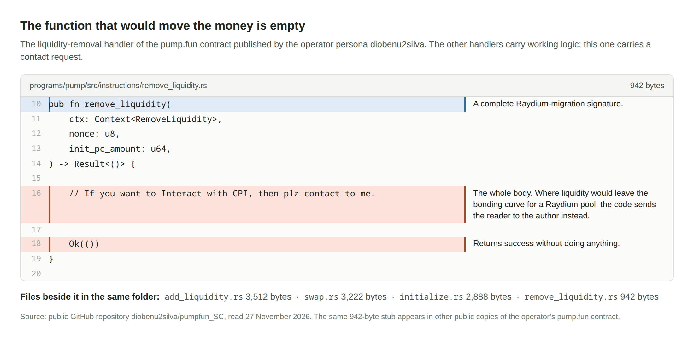
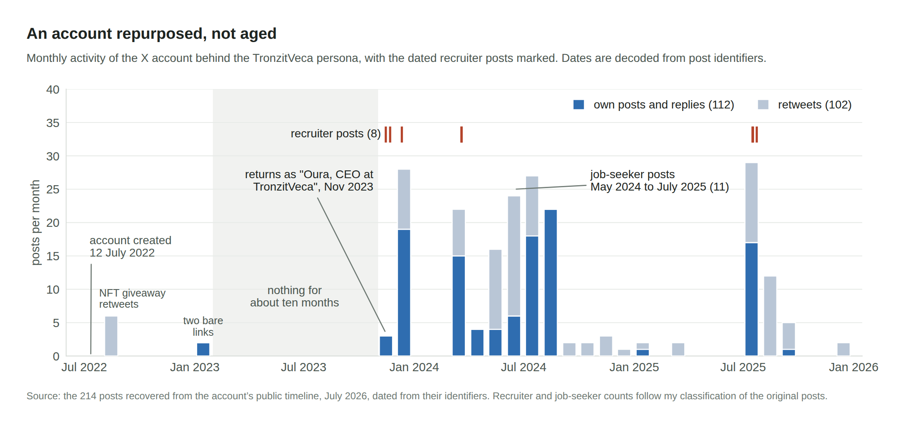
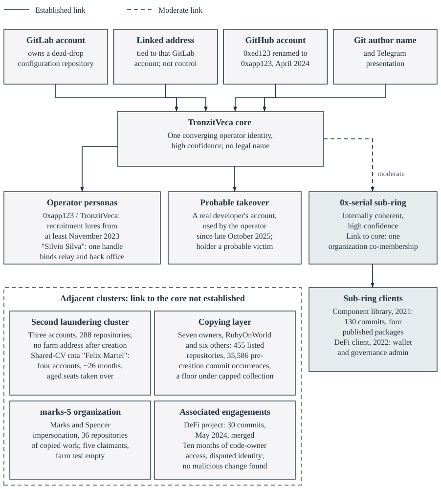
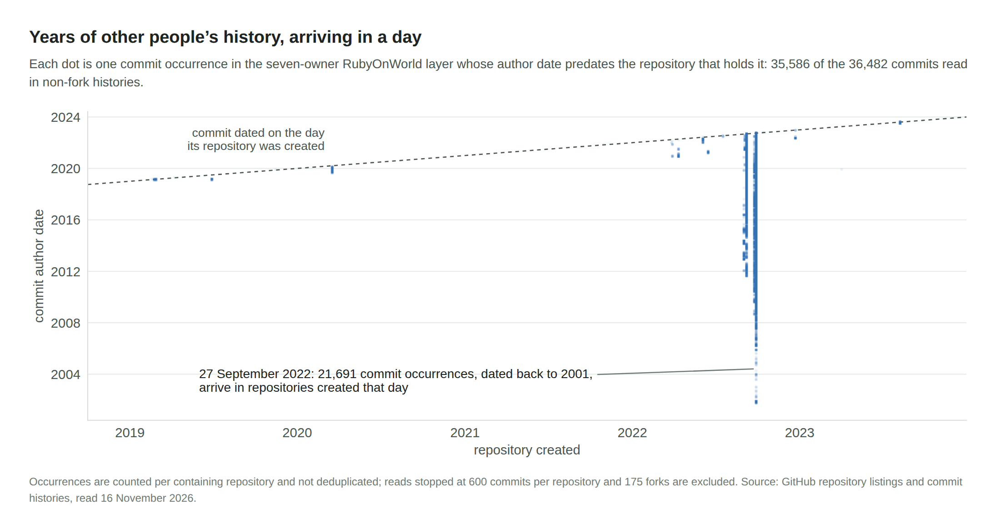

I found that the TronzitVeca persona farm built developer reputations from other people's commits: in 110 of 130 flagged farm repositories, a commit-by-commit comparison with the upstream source verified rewritten authorship, 2,907 re-attributed commits in all. A converging chain of identifiers ties the persona to UNK_DeadDrop's dead-drop infrastructure, and forged identities from the wider farm reached real client work, including write access and a code-owner role over a client repository for ten months.

## Key takeaways

- The high-star launchpad projects published under TronzitVeca are clean; the money-moving function is stubbed out behind a comment asking readers to make contact, and the repository's documents route them to Telegram.
- One operator identity converges at high confidence from a GitLab dead-drop owner through GitHub, git author and Telegram identifiers to TronzitVeca; this is not a legal name or a single person.
- A retained enumeration of seven owners in the RubyOnWorld layer gives 35,586 commit occurrences that predate their containing repository; I have not established that the TronzitVeca core directs this layer.
- A direction-and-date test separated six copy victims from the farm, and twelve further candidates did not meet the standard.
- For employers and maintainers, portfolio volume and account age were weak evidence; an earlier source history, a genuine project-side event or a verified account relationship held up.

## Lure: a clean portfolio that routes readers to Telegram

The repositories that gave the TronzitVeca persona its standing were clean. The high-star launchpad projects published under the persona carry tidy, professional code. At the point where a launchpad would actually move money, the function is stubbed out behind a comment asking anyone interested to make contact. The README, contributing guide and security policy all name the operator's Telegram account.

*Figure 1. The liquidity-removal handler of the persona's pump.fun contract. Its body is one comment asking the reader to make contact, followed by a return of success.*

I checked the public copies and found no malware in them. I did not obtain the privately supplied completion, because getting it would have meant engaging the operator to ask for it. What the repositories do establish is a mechanism: a technically convincing public portfolio that routes the readers most likely to be useful into a private conversation.

This post covers how that portfolio was manufactured, how far the identity behind it can be tied to the UNK_DeadDrop operation, and how the forged reputations reached real organizations. Much of the work was about not blaming the wrong people, because the farm's raw material is other developers' genuine history.

## Identity: tying the operator together

The central identity rests on several independent observations that converge, rather than on a name found in a file. The case record links these steps:

1. The GitLab account that owns a dead-drop configuration repository connects to an address linked to the operator's configuration.
2. That identity joins to GitHub account-number references, a git author name and repeated contact instructions.
3. The Telegram presentation behind those instructions resolves to TronzitVeca.

In more detail, the pieces are these:

- The GitLab account `0xapp123`, user id 33228929, owns the dead-drop repository that the operation's stager reads. Its Gravatar hash equals the SHA-256 of `apollo1030109@gmail[.]com`.
- That address authored 497 commits across nine crypto repositories under the git author names `0xapp123` and `0xed123`.
- The READMEs of three farm accounts tell readers to ask `@Tr1030109` on Telegram and `0xapp123` on Discord, and the Telegram preview for `@Tr1030109` reads "Tronzit Veca, Entrepreneur and Founding member".
- README asset URLs embed `/assets/36965207/`, the numeric id of the GitHub account `0xapp123`, which a platform-generated commit address on an early test-task commit confirms independently.

Beside `apollo1030109` sits a family of addresses on the same numeric pattern. `eros1030109@gmail[.]com` is the hardcoded super-administrator in the operators' own administration platform described in [Part 8](../08-administration-platform/), and `hera1030109@gmail[.]com` is a dormant reserve with no public footprint. Beyond the campaign itself these addresses have almost no public presence.

That chain reaches from a public professional persona into the control infrastructure described in [Part 6](../06-gitlab-dead-drop-infrastructure/), which makes it an anchor and not a coincidence. Counting independent observation paths through the evidence gives twelve for this persona block, spanning identity reuse, hosting, the dead drop and code, so no single record carries it. I hold it at high confidence for one converging operator identity, not for a legal name and not for a single person behind every linked service.

### The GitHub chronology

The GitHub side has its own chronology. Platform-generated commit addresses bracket the account's rename from `0xed123` to `0xapp123` in April 2024, between 5 and 9 April. Archive visits bracket the period in which its repositories stopped being reachable, between 28 April and 5 October 2026. The account is platform-suppressed rather than deleted: its profile returns not-found while repository listings still answer and its addresses still resolve to it. Its numeric identifier and dated artifacts therefore outlast whichever handle a search happens to return.

A software archive holds 78 of the account's repositories. A merge made in GitHub's web interface is committed by GitHub, so a merge commit whose committer is its author has been rebuilt. In 29 of the 78, every merge commit is committed by its author, `0xed123` at the operator's address, while the merge messages still name the pull-request branches of accounts that no longer exist. Eight are unrewritten, with merges committed by GitHub, and in every one of those the author is not the operator's address but other identities the account later dropped. The account's flagship work was re-signed onto itself. The check proves the history was rebuilt, not why, so I hold the reading that this was deliberate at moderate confidence.

### Recruitment on both sides

The persona works both sides of recruitment. Its social timeline carries developer-recruitment pitches from at least November 2023 that funnel replies into a short "test project". It also carries posts in which it seeks to be hired as a developer itself.

Decoding the real dates of every post splits the originals cleanly:

- **Recruiter mode, eight posts.** From "This is Oura, CEO at TronzitVeca, a technical agency" in November 2023, through a March 2024 lure that spelled out the hiring process as "Test project in 2 days" followed by calls, to a July 2025 search for business-development managers in the US and UK for "my tech agency". That last facet could recruit unwitting fronts.
- **Job-seeker mode, eleven posts.** From May 2024 to July 2025, with job-hunt hashtags, portfolio links, cold pitches to founders and an application to a company's careers page.

The account itself was repurposed, not aged. Its identifier dates its creation to 12 July 2022. It posted a handful of NFT-giveaway retweets in August 2022 and two bare links in January 2023, then nothing for about ten months, and came back in November 2023 under a new handle as the TronzitVeca recruiter. A dormancy gap landing exactly on the persona switch fits an account acquired or handed over for the new identity; I hold that at moderate confidence, because replies were not enumerated.

*Figure 2. The account's activity by month. A ten-month silence ends in November 2023 with the TronzitVeca recruiter posts.*

The passively archived part of that timeline, from May 2024 to December 2025, yields no real name. Its five recruitment and agency posts drew no public replies, because respondents were sent to private channels. An earlier lure in December 2023 did draw 29 public replies.

### The "Silvio Silva" thread

A second thread binds the "Silvio Silva" persona, through one handle, to a relay commit, the administrative back-office configuration and an older launchpad presentation. A configuration-associated handle and a dated commit are more specific than a repeated display name. They support continuity between the operational artifacts and the persona.

They say nothing about the nationality, residence or real employer of whoever used it. The case record holds no code-hosting account under that name, so I did not try to fill the gap by matching it to unrelated people who happen to share it.

*Figure 3. Identifiers converge on the TronzitVeca core. The 0x-serial sub-ring links to the core at moderate confidence, while the second laundering cluster with its shared-CV rota, the seven-owner copying layer and the marks-5 organization are drawn apart because no link to the core is established.*

## Portfolio: nine tenths stage dressing

The five live operator accounts held 172 public repositories when I characterized them by language, project type and role:

| Role | Repositories |
| --- | ---: |
| Credibility props | 153 |
| Seeding forks | 7 |
| Lure funnels | 5 |
| Clean take-home bait | 3 |
| Weaponized repositories | 3 |
| Tooling | 1 |

The props cluster on the target audience's interests: NFT projects, gambling games, trading and arbitrage bots, staking and marketplaces, AI tools, pump.fun clones and launchpads, in Solana Anchor with Rust and TypeScript and Node and React frontends. That is exactly what a Solana contractor would show. The accounts divide by role. `0xapp123` holds all of them at once, `diobenu2silva` is the long-lived persona shell, `Lyracartoon` is a pure delivery account whose two repositories are both weaponized, `pridnet` seeds and then deploys, and `Tronzit-Veca` carries the lure funnels.

The role labels are evidence-based for the twelve special repositories and inferred for the props from name, layout and bulk creation. Two independent content sweeps found no indicator in any prop. They are still not harmless, because a third party can clone a plausible launchpad on the strength of the account's apparent history.

### Tooling without a deployed instance

The persona's public specialism is token launchpads and gambling contracts, including a pump.fun fork with bonding curve and liquidity migration maintained into February 2026. That fits a custodial deposit-gambling backend with operator-controlled withdrawals among the persona's for-hire output. I looked for a deployed instance and found none:

- The fork's declared program id is the repository's own example value and is not on mainnet.
- A launchpad on the persona domain `hold.diobenu2silva[.]com`, captured once in July 2025, runs only on a Solana test network. Its program was deployed on 31 May 2025 and last upgraded on 21 July 2025, and its two operational wallets hold test-network funds and share no funder.
- A launchpad I had first taken for the operator's own was a real, independently marketed 2024 product whose contracts the operator was contracted to build. Its on-chain authorities match no operator wallet, so I do not treat it or its team as operator infrastructure.

The toolkit is evidence of competence, not of a laundering act.

## Mechanism: how the farm manufactures credibility

The farm's method becomes visible because a GitHub repository records different things in different fields. The files can be genuine open-source work. The author line can name a persona. The platform's creation date can show that the displayed history arrived years after the work it describes.

The farm re-pushes real projects, rewrites the author lines so that the commits appear under its personas, and lets the original dates stand. A profile assembled from such repositories presents years of apparent experience to a prospective employer, or to a developer deciding whether to continue a conversation.

Around that core sits the surface of a busy career:

- Follower counts are inflated.
- Pull-request activity runs almost entirely from persona to persona or into operator fronts.
- The operator's five fake employer organizations are small, persona-only and in two cases hold no repositories at all.
- The personas join real developer communities, which act as a credibility layer rather than as engagements.

The numbers behind that surface are consistent:

- **Seats, not people.** The core is roughly 30 operator-run accounts and about 55 throwaway addresses, grouped into seats that each run several masks. Four rounds of author-graph search stopped producing new confirmed identities, so the remaining task is maintenance rather than discovery.
- **Followers.** Six persona accounts carry between 697 and 1,428 followers, two of them following 1,747 and 2,266 accounts in return.
- **Pull requests.** Across 37 accounts the farm holds 1,472 pull requests. Once the real developers wrongly swept in are removed, only 21 leave the farm and only nine were merged; roughly 1,450 run from persona to persona.
- **Bulk arrival.** Repositories arrive dozens at a time over a few consecutive days, years after the host account was created.

The engagements that matter are therefore invisible in the pull-request graph. They appear as organization membership, which the project has to grant. On that evidence I hold at moderate to high confidence that five projects engaged a farm persona, mostly through one serialized sub-ring, and at high confidence that three others refused the persona's pull requests and engaged no one.

The farm also launders credibility at ecosystem scale. A persona opened a pull request titled "Add my 30 crypto repos contributions" against a widely cited open dataset of crypto-ecosystem developer activity, and it was merged, injecting about thirty fabricated repositories into the dataset. The same dataset still listed four repositories of the deleted 0x-serial sub-ring that the software archive's search had missed, which made it a recovery source as well as a target.

Because the pipeline manufactures green contribution squares, followers and organization badges, I ignored those surface measures entirely. I relied on detailed project histories and platform relationships instead.

### Scale: one copying layer

I measured one copying layer to get a sense of scale. A retained enumeration of seven owners in what I call the RubyOnWorld laundering layer lists 455 repositories. Recomputing it gives 35,586 commit occurrences whose author dates predate the repository that contains them, read from non-fork histories with readable commit lists.

That number needs its counting rules beside it:

- An occurrence is a commit inside a containing repository, so one commit object copied into two repositories counts twice.
- Nothing has been deduplicated into unique contributions, developers or victims.
- Each read stopped at 600 commits, and fifteen repositories hit that cap. 175 forks were excluded by design, so a complete count would be at least as large.
- The 455 repositories are not 455 verified forgeries, because mirrors and forks legitimately preserve earlier dates.

Most of it sits under the RubyOnWorld owner itself: 292 repositories, in which 34,825 of the 35,038 commits read predate their repository and 237 of 238 non-fork repositories are affected. The other six owners hold the remainder.

*Figure 4. Commits in the copying layer, by author date and by the creation date of the repository holding them. On 27 September 2022 alone, 21,691 occurrences dated back to 2001 arrived in repositories created that day.*

The figure measures how common copying is in the examined set. I have not established that the TronzitVeca core directs this layer.

A second mill of 82 non-fork repositories runs in parallel under one address, with 98.4% of the 20,743 commits read in its account predating their repositories. An eleven-minute sequence on 26 September 2022 ties it to the RubyOnWorld owner and a front organization: the RubyOnWorld owner forked three repositories, a second account forked the same three minutes later, and the mill created non-fork copies of the same three with every author rewritten. The farm test is empty in both directions for that address, so it is coordination and co-membership, not farm identity.

### Scale: the persona portfolios

The personas' own holdings are larger again. Enumerating 2,071 persona-owned repositories found 620 copies drawn from 470 distinct upstream identities, 51 of them organizations, from exchanges and developer platforms to well-known open-source foundations. The selection is indiscriminate: the farm copies whatever makes a crypto or full-stack portfolio look plausible, so the list is neither a target list nor a notification list. The single largest re-attribution I measured is the complete default branch of a major open-source blockchain client, 16,080 commits back to December 2013, rewritten to one persona address and paired one-to-one with the upstream commits on tree, message and author date.

### Rewritten credit

Copying and rewritten credit are separate observations, and I checked the second directly. A cheap screen flagged 130 farm repositories whose recent history contains a pre-creation commit under a farm-attributed address. Comparing each flagged copy with its upstream source, commit by commit, gave these results:

- Re-attribution verified in 83.
- Upstream confirmed without settling authorship in 13.
- A partial result in two.
- Unresolved in 32.

One detail is telling. A web-interface merge is committed by the platform itself, so a merge commit whose committer equals its author has been rewritten after the fact. In four of the upstream-confirmed copies, six commits that named developers had authored upstream now carry a farm address as both author and committer. That is their work signed over, in numbers too small to cross my acceptance threshold.

Later rounds settled the 32 unresolved copies. The final count is 110 of 130 verified commit by commit, carrying 2,907 re-attributed commits from more than 85 real author identities, with none left unresolved. Of the rest, three re-attribute only bot commits, one was never a farm copy, and one is a persona's own unrewritten work on a hiring assignment. A shared root carrying only a handful of unrewritten commits is a take-home test, not a copy, and I do not score it as re-attribution.

### Two rewriting techniques

The comparison also exposed two techniques rather than one:

- **Address only.** Most accounts keep the real author dates and rewrite only the address. That is what makes the forgery detectable by date.
- **Address and date.** Part of one account's portfolio backdates as well. In one example, eleven commits whose messages appear verbatim upstream in late 2021 all carry a single fabricated timestamp in October 2017, before the upstream project existed.

The second technique defeats any match keyed on date, so I re-matched on messages alone and then on tree hashes, which survive the rewriting of author, address and date. A commit's tree hash locates a laundered repository's original in one query. A forgery can also be proved without the original at all: one archived copy carries committer timestamps forty seconds before the repository existed, a time the repository cannot have had.

## Method: the direction-and-date test

The copying makes attribution unusually treacherous. If a farm republishes genuine projects with some original authors preserved, a real developer's address inside a farm repository is exactly what one should expect. Treating co-occurrence as membership would reproduce the attacker's own misattributions.

I therefore adopted a direction-and-date rule:

- An address counts towards the farm only if it authors a commit inside another farm account's repository after that repository was created.
- Attribution additionally needs platform-side corroboration, such as an email association, a platform-signed commit or an archived event actor.
- An address that appears only in history older than its containing repository fails, however often it sits beside operator addresses.

Under that rule, six identities that co-occur with operator anchors inside farm repositories turned out to be copy victims: real developers whose own histories the farm republished. Twelve further candidates did not meet the standard. Several of those developers belong to the core team of a decentralized-exchange project the farm mirrored. A check of one mirror found 94 overlapping commits with 94 identical author addresses and no re-attribution at all.

### An apparent contractor relationship

The same rule bounded an apparent contractor relationship. One account had three merged pull requests at a mobile-advertising company between 2021 and 2023. It looked suspicious only because one of its repositories mirrored the same exchange project the farm had copied.

It has a self-consistent history from 2017 to 2023 and no commits in any farm-owned repository. I read the newest hundred commits of each of the 288 repositories of the second laundering cluster's three accounts, 4,155 commits in all, and its address appeared in none of them. Its pull requests are ordinary contract work.

### The blind spot

The test has a blind spot in the other direction. If an original project was already operator-involved and only a later copy survives, the pre-creation history can contain genuine operator work even though the surviving repository did not yet exist. The chronology alone cannot decide such an identity. For that reason, "copied history" and "innocent original author" are not synonyms in my notes.

I do not name the real developers here. Printing their names beside the word persona, even to clear them, would spread the very association the test rejects.

## Coordination: a CV maintained in shifts

The shared-CV case gives a more concrete picture of coordination than any resemblance between profile photos. One portfolio repository carries a sequence of post-creation edits associated with four numeric accounts: three outside seats, followed by the owner account under two successive logins. All present the persona "Felix Martel" across roughly twenty-six months.

That supports reuse and maintenance of one professional identity across several account-linked author identities. It does not show four people taking shifts, since an account is not a person. Push events sharpen the point. Two of the seats never pushed their own attributed commits: one segment was pushed by another account and the other by the repository owner. The identity credited with an edit and the account delivering it can differ.

A related portfolio carries the same employers with the same dates under a different persona name, "Shi Le E". This makes the employment history a reusable narrative rather than one CV mirrored across sites. The companies named in it are victims of an unsubstantiated employment claim, and nothing shows they hired, paid or knowingly helped any persona. One persona even publishes two CVs that contradict each other on degrees, employers, locations and dates.

### Separate from the core

This rota belongs to the second laundering cluster, not to the core. Its three accounts commit into one another's repositories after creation. No farm address does so in any of their 288 repositories within the commits I read. The test that binds those accounts together also separates them from TronzitVeca.

### Account age is unreliable

Account age, the other cheap credibility signal, proved just as unreliable:

- One account has a genuine earlier history under an original holder and a later persona phase. Nothing I hold separates a purchase from a compromise.
- The two aged seats of the rota have takeover windows that the sparse intervening history barely narrows.
- A further account carries a long-standing verified address of a private person, with valid platform signatures on web-interface commits. It is most probably that person's own account, used by the operator since late October 2025, which makes its holder a probable victim.

An old creation date says nothing about continuous ownership.

## Impersonation: the marks-5 organization

A different device appears in the marks-5 organization. It presents itself as Marks and Spencer, links to the real brand's website and uses repository descriptions that suggest internal work.

- All 36 of its non-fork public repositories were created within 22.1 minutes on 4 October 2022.
- Preserved merge messages and tree comparisons point to real upstream projects, including the company's own public GitHub organization, with authorship rewritten to five claimant identities.
- The repositories now return not-found responses while the organization listing still shows them as public. That is a pattern of platform suppression rather than deletion, so I read all 36 from archived snapshots.

The organization was created on 28 July 2022, ten days after one of its claimant accounts. Tree-hash comparison proves copying for four of the five claimants, and of 6,956 revisions read only one postdates its repository. Two of the 36 repositories kept their real authors, and the six histories I read last added no sixth identity, so the five claimants are the complete set.

All five claimants are copiers, yet the farm-membership test is empty for every one of them. That places marks-5 in the wider authorship-rewriting ecosystem rather than in the TronzitVeca core. No access to the company's systems is shown, because publicly copied material is enough to create the appearance of employment. A live public fork of one repository carries part of the forged history onward into a stranger's account. I treat its holder as a potential victim and do not name them.

The organization's identities were still active in 2026. In September 2026, one of them created a repository with a single squashed commit for a real employer's take-home assignment, a retrieval-augmented assistant built to a brief that another, unrelated candidate also completed the same day. Read statically, the code contacts no endpoint but the model provider and contains no execution, encoding or secret. That the submission was fraudulent rests on the identity being a marks-5 claimant, and the employer is a potential victim of fraudulent hiring, so I do not name it.

## Impact: forged reputations doing real work

The record shows that a forged identity can still do real work.

- **Take-home repository.** It holds ten commits from a single day, including two merge commits that take pull requests from a second persona of the same pool while the owner commits under the first persona's address. That is direct evidence of shared working capacity behind one applicant.
- **Decentralized-finance project.** The same address that appears as author in re-signed portfolios has 30 post-creation commits from May 2024 with substantive development messages, merged into the project's genuine repository. Its other commits sit pre-creation in later copies on an account with the farm's characteristic inflated follower count.
- **Infrastructure-development engagement.** This is the strongest case. An account held write permission and a code-owner role over a client repository for ten months, with branches and self-merged work in the record.

My static review of the examined changes in the infrastructure engagement found no obfuscated payload, install hook or comparable malicious change. One workflow modification raises an ordinary dependency-management concern. The finding is substantial access under a disputed identity, with no malicious modification established.

### The 0x-serial sub-ring

The 0x-serial sub-ring links to the core at moderate confidence through a single shared organization membership. It supplies the earliest dated client work.

In May and June 2021, one seat made 130 commits across six repositories of a software company's component library, all after the repositories were created. Four of the client's published packages carry that code. The source revision in each package's registry metadata sits at or after one of the seat's commits, and one file per package matches the repository byte for byte. That is shipped contribution, not malicious functionality.

A second engagement, with a DeFi client from February 2022, ties the seat to frontend work and to a wallet bound by its own name-service registration. That wallet was still an administrator of three of the client's governance spaces when I read them on 15 November 2026. The wallet's gas and tokens came from the client's own team wallet, and its final sweep went back to the client's side, so it was working capital rather than theft revenue. A good contribution by the sub-ring does not strengthen its link to TronzitVeca beyond what the identity graph shows.

## Context: public IT-worker reporting

The behavior fits what others have published about IT-worker fraud:

- [Mandiant's reporting](https://cloud.google.com/blog/topics/threat-intelligence/mitigating-dprk-it-worker-threat) describes résumés reused across personas and one worker behind several identities.
- The [FBI's public service announcement](https://www.ic3.gov/PSA/2023/PSA231018) lists several online profiles for one identity among its warning signs.
- I compared the case on exact identifiers with tayvano's public [DPRK IT-worker dataset](https://github.com/tayvano/lazarus-bluenoroff-research/tree/main/dprk-it-workers). It corroborated one identity binding in every particular. It showed one further seat touching a tracked identity through a single shared address, which is overlap and not a merge of accounts.

The DPRK labels belong to those publishers. A behavioral fit is not independent evidence of nationality, and I infer none from persona names, working-hour offsets, profile photos or shared frameworks.

## Limitations

- I did not obtain the privately supplied launchpad completion, so its contents are unknown.
- The operator identity is held for one converging identity, not for a legal name or a single person behind every linked service.
- The 35,586 occurrences are not deduplicated, are capped at 600 commits per read and exclude 175 forks.
- The direction-and-date test cannot decide identities whose original project was already operator-involved.
- No link from the TronzitVeca core to the second laundering cluster, the seven-owner copying layer or marks-5 is established.

## Conclusion

What stands is concrete. Particular histories were copied, particular identities were tied to particular accounts, and particular clients accepted work. The farm's raw material is other developers' genuine history, so attribution has to follow direction and date, not co-occurrence.

For employers and maintainers, the practical lesson is that portfolio volume and account age were weak evidence here. An earlier source history, a genuine project-side event or a verified account relationship held up. An accepted contribution still deserves review on its actual contents.

The `0xapp123` account reappears in the next part, [Part 16](../16-control-layer-after-october/), as the creator of the third dead-drop repository that took over UNK_DeadDrop's command configuration on 3 November 2026.
