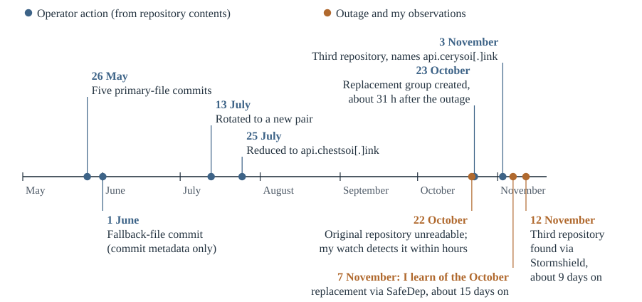

At 03:05:24 UTC on 3 November 2026, the GitLab account `0xapp123` created a repository called `up-indexings/tasks`, and eighty-five seconds later its second commit, `dcb1f391`, wrote a `config.json` naming a single host, `api.cerysoi[.]ink`. The operator's agent builds fetched on 12 November carry that repository as their only network address, so by November it was the dead drop those builds actually read. I learned of it on 12 November from [Stormshield's report on what it calls the Trigram campaign](https://www.stormshield.com/news/cti-trigram-campaign/), about nine days after it was created, although I had been watching the operator's dead drop continuously for almost four months. That gap is the thread of this post. The control layer I described in [Part 6](../06-gitlab-dead-drop-infrastructure/) lost its original repository in October and was rebuilt twice under new names, while the panel, the agent credential and the hosting stayed remarkably stable, and the way I found each successor says as much about monitoring as about the operator.

## Three epochs and a single host

The original repository's primary configuration file has six commits in two epochs that I could reconstruct from its contents. On 26 May 2026 the operator tuned an initial set of three hosts over five commits within about half an hour, dropping and re-adding one before giving all of them an `api.` prefix, and a certificate for `api.domatisc[.]ink` issued the same day corroborates that sequence independently of the commit dates, which the operator could have rewritten. A self-signed panel certificate created at 04:00:32 UTC that morning places the panel host's stand-up about two hours after the first commits. The fallback file's single commit of 1 June rests on commit metadata alone. On 13 July the primary file rotated to a new pair of hosts, and then my watch, which polled the file every two hours from 23 July, recorded a third epoch: commit `b1a275dd35` at 06:02:59 UTC on 25 July reduced the list to `api.chestsoi[.]ink` alone, and the watch alerted at 06:30. Two further commits on 10 and 12 October added no host, though I did not retain their contents, so the history is complete for the hosts named but not for every change.

*Figure 1. Operator actions dated from repository contents, against the outage and my own observations. The 22 October date records the outage, not its cause.*

## The 22 October outage and the first replacement

On 22 October 2026 the original repository became unreadable, and nothing I hold records why. My watch noticed within hours. A replacement group, `drop-indexings`, was created at 21:29 UTC on 23 October, and its project `tasks` named `api.chestsoi[.]ink` by 23:39 the same evening, about 31 hours after the first poll at which the original failed. It pointed at the host the original had named alone since 25 July, and a newer stage-three build reads it while keeping the July agent credential. Prepared alternatives existed beside it. The fallback hosts `api.onoplainai[.]ink` and `api.migadyn[.]info` had been registered on 24 April in the same batch as `domatisc[.]ink`, and at VirusTotal's last fetch on 26 October they were still serving the operator's "Google Login" panel as a 3,220-byte page identical to the one `api.domatisc[.]ink` served in June. The Windows Node bundle on the agent side carries its own copy of the dead-drop project and fails over between hosts in round-robin order, so the whole design absorbs the loss of one repository or one host at a cost of hours.

I did not find that replacement myself. On 3 November [SafeDep reported](https://safedep.io/blog/antd-img-crop-forged-commit-overlord-stealer) a forged commit in the GitHub repository of the npm package `antd-img-crop`, which added a `prebuild` hook that runs a stage-two loader on `npm run build`, while the published npm package itself was unaffected. That loader fetches the operation's stage three, and following SafeDep's report and an indicator feed is how I learned of `drop-indexings/tasks` on 7 November, about fifteen days after its creation. I then added the replacement path to the watch, and five days later Stormshield's report showed that the dead drop had already moved again. The third repository's commit fell inside a single 77-minute provisioning burst that also certified `api.cerysoi[.]ink` and the next generation's primary and fallback names, so one sitting stood up the next command generation end to end. Stormshield independently dates the repository's creation to 03:05 UTC on 3 November, attributes its `config.json` to `0xapp123` and records the payload querying it the following day. The same report's handle `silviattech1129` binds the commit author of the October replacement to the user of the operators' back-office database, and its attribution of the activity remains Stormshield's assessment.

## What a watch on a known path can and cannot see

The account that created the third repository is the same `0xapp123` identity at the center of the persona farm in [Part 15](../15-persona-farm/), and on 13 November its GitLab profile showed no activity other than this repository and an empty placeholder made a minute earlier. That is the kind of seed a discovery channel can use, and it is exactly what my watch lacked. The watch polled a fixed set of paths every two hours and could register a change only on a path in that set, which I extended only after learning of a repository by other means. It therefore saw the old path stop answering within hours, and it could never have seen a successor created under a new name, so a faster poll would have reduced my uncertainty about the dead path without finding the live one. After 12 November I extended the watch to every project of the owning account, which closes this particular gap and no other. Watching an established object for change, discovering its successors and checking that each data source still covers known positives are three separate tasks, and treating the first as if it covered the other two makes an operator look inactive at precisely the moment one has lost the means of observing it.

The same lesson came back from the certificate side. Certificate transparency had been my main discovery source for new command and lure names, and its coverage of this operator collapsed in the second half of 2026. Of the 40 operator-side certificates retained by VirusTotal, 14 are absent from the crt[.]sh index, and the absence is a cliff rather than a spread: 22 of 23 certificates through July are present, then 2 of 4 in September, 1 of 8 in October and none of the 4 issued in November. Earlier certificates for the same hosts are present, which points to an indexing failure of that index rather than a blind spot for one authority. Reading certificates retained by VirusTotal instead produced 118 distinct operator certificates against the 42 I had held. Pivoting the eight of Stormshield's addresses that were new to me returned 165 hostnames, of which only two were already in my files, so a whole lure generation had passed under my instruments while the panel lineage, the dead-drop mechanism and the agent credential stayed the same.

## Panel lineage against the public Overlord history

The operator's panel has appeared as "Google Login" and as "Subtensor - Sign In", and its code shows a single lineage. The login script captured from `api.cerysoi[.]ink` on 5 November shares 81 of its 82 identifiers with the login script in the public [Overlord repository](https://github.com/doesntbreaktos/Overlord), together with the file layout, the crown-logo markup and the flow in which a temporary token forces a password change. I scored each captured file against every version of its counterpart in the framework's history, six versions of the login script, eleven of the login page and forty-nine of the main stylesheet back to 5 March 2026, and in every case the best match was the oldest public version, commit `f8515a2883` of 5 March, with similarity falling at each later version. The best scores were 0.978 for the script, 0.828 for the page and 0.752 for the stylesheet, and I use them only to rank versions. The operators changed the wording, the crown icon, an inline favicon, an added Bittensor theme stylesheet and the timing of the particle animation, and left the authentication design alone, so the framework's ordinary features are not their development.

A framework-level fingerprint does not find the operator. Faceting the crown-logo login markup returned twenty-three hosts of the public framework on dynamic-DNS names and hobbyist hosting, none of them the operator's. The address `142.248.82[.]155`, found through a panel-title search with no domain pointing at it, is a second production Overlord server, and its port 5173 is Overlord's own production default, not a sign of a staging role. Its self-signed certificate, `O=Google, OU=IT, CN=localhost`, is the framework's March template with the organization edited, and because the framework's certificate generator adds every address of the machine's own interfaces, its alternative name `45.61.162[.]155` shows that the server was first stood up on that RouterHosting address on 26 May and later moved, certificate and all. Continuity also runs through configuration. An agent token in the workspace settings of a weaponized repository pushed on 19 May recurs in an independently published victim write-up of a different campaign, and the current stage-three build embeds the identical token even though the dead drop moved, the lure host changed and 36 functions were added in between.

## Cortex, a separate console

Beside the Overlord panel and the phishing-operations console of [Part 8](../08-administration-platform/) stands a third system. Cortex, captured on port 8080 of `207.241.172[.]222` on 11 November, opens a WebSocket to its own host with a GUI role, uses its own login and contains no plugin references. I tested it against Overlord's plugin model, in which a plugin is an archive with a panel interface and a native library that rides a plugin-event channel on the existing Overlord connection, and Cortex does none of that, so it is a distinct command-and-control system rather than a theme or plugin. Its console sends 34 command types, and exactly half concern browser control: launching a browser with a chosen profile, optionally headless, navigating, handling tabs and profiles, clicking, scrolling, typing and reading the selection. The other half cover a step that opens the macOS Full Disk Access dialog, a file manager, an interactive shell, agent restart and removal, and administration of operator accounts. Its agent was never collected, so the command set documents what the console expects to request, and nothing I hold decides whether the agent arrives through Overlord or a separate loader.

The builds show development in place. A predecessor titled "BrowserSync Controller" on port 8080 of `142.248.82[.]155`, fetched on 7 November with a Last-Modified date of 24 September, already speaks the same protocol with 23 of the later 34 commands. The Cortex build of 21 October adds the macOS access step and agent removal, which reads like what the operators found they needed after a month of use, and a rebuild of 10 November leaves the protocol unchanged and only echoes typed commands into the shell view. Censys records show new script and stylesheet bundle names at some point between 12 November at 04:16 and 15 November at 13:57 UTC. These dates order the builds without giving a development schedule, because a server header, an embedded build marker and a scanner's observation time measure different things. GitHub code search on Cortex's strings and protocol names found no related project, and Overlord's source contains none of them, so its origin remains unidentified.

## One provider, and why that is not enough

Every serving and command address of the estate that I observed from July to November 2026 sits with Advin Services LLC, across AS22295 and AS206216, through four months and three generations of infrastructure. That includes the command and panel origin `207.241.172[.]222`, the second Overlord server, the July lure origin `170.205.31[.]182`, the October and November lure fleet on addresses such as `208.84.100[.]64` and `65.110.40[.]18`, the launcher host `193.160.32[.]10` and the back-office dashboard from 29 June. Before July the picture differed: the first Overlord server stood at RouterHosting from 26 May, and the dashboard spent about three weeks at another provider before moving to Advin. Fronting did not hide the origins as well as intended. In July a scan of `207.241.172[.]222` without a server name returned the full panel because it was the web server's default virtual host, and in November `204.10.194[.]115` presented a certificate for `api.gamsterb[.]ink` and `api.fallgamsterb[.]ink`, names I had seen only behind Cloudflare. Its resolutions up to September belong to unrelated tenants, so the operator's use of it was recent and the unit for response is that service on that address during the observed interval.

The concentration makes Advin the most consequential single party for response, and it proves nothing about common control by itself, because Advin is ordinary shared hosting. The web-server build string the operator's hosts carry appears in 6,939 Netlas responses in April 2026 and 2,278,062 by 23 October, the curve of a stock package rolling out. Restricted to Advin's two autonomous systems it leaves 72 responses on 40 addresses, and the operator occupies five of those forty, whereas urlscan, which indexes what researchers submit and therefore over-represents this heavily studied fleet, puts the operator on 51 of 55 domains for the same query. The same build crossed with the operator's naming grammar at every other provider returned only parking pages, a trades-site network and ordinary businesses. Port 3000 runs on about twenty unrelated hosts in the ranges I swept, and a sweep of two /23 ranges found 291 hosts with open ports in which the campaign addresses blended in. What discriminated was the combination of hoster, build and content, which found four new `.space` lure domains and one command origin, and any request to the provider has to name the exact service and address with dates, because the neighbors are customers too.

The next part, [Part 17](../17-two-operations-one-ecosystem/), separates UNK_DeadDrop from PolinRider and the wider Contagious Interview ecosystem, and sets out who attributes what.
