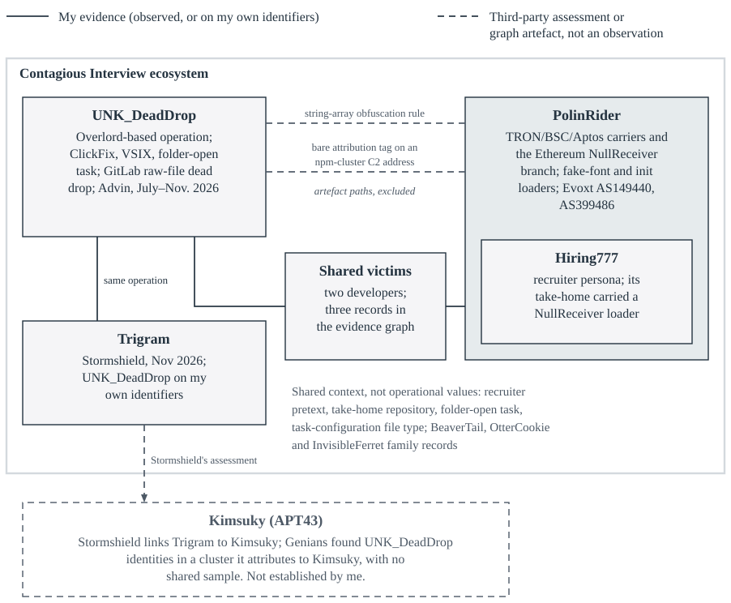

I found zero observational paths between PolinRider's records and UNK_DeadDrop's in my evidence graph. The only two paths that connect them run through a generic obfuscator.io string-array rule and a bare attribution tag, so I describe UNK_DeadDrop and PolinRider as two separate operations in the same ecosystem.

## Key takeaways

- Two paths connect the PolinRider block to UNK_DeadDrop, and neither is an observation; removing them leaves zero observational paths.
- The two operations differ at every layer an operator has to build: first contact, delivery, C2 resolution, implant and hosting.
- Shared victims, the folder-open launcher, shared address space and a shared swap service are reasons to compare the clusters, not links between them.
- OpenSourceMalware attributes PolinRider to the DPRK and Stormshield links Trigram to Kimsuky; I attribute neither operation to a state or a named group.
- MITRE's G1052 page lacks five techniques I observed directly, among them T1102.001 Dead Drop Resolver, so suspensions of this operator's infrastructure have to be simultaneous rather than staged.

## Method: link only on shared operational values

For weeks the two operations sat in the same case folder, under the same case label. They also approached some of the same people through recruiters. The question of whether they are one operation matters because almost everything visible about these crews is shared by the wider Contagious Interview ecosystem:

- a recruiter persona;
- a take-home repository;
- an editor task that runs when a folder is opened;
- a payload that reads its command-and-control (C2) address from a value the operator has published somewhere public.

Clustering on that kind of resemblance merges operations that share nothing operational, so I adopted a narrow rule early on. Two clusters are linked only when they hold an operational value in common: a wallet, a contract, a carrier transaction, a key, a certificate, a credential, a build identifier or a host used in the same role at the same time. A shared technique, target population or victim is a reason to compare two clusters and never the result of the comparison. The `unk-deaddrop` label that my records carry marks the case, not an attribution.

## Comparison: every layer an operator builds is different

Set side by side, the two operations differ at each layer an operator must build. The earlier parts of this series describe the UNK_DeadDrop side in detail, from the [ClickFix pages](../01-clickfix-clipboard-manipulation/) and the [VSIX route](../02-vsix-editor-execution/) to the [GitLab dead drop](../06-gitlab-dead-drop-infrastructure/) that its implant reads.

| Layer | UNK_DeadDrop | PolinRider |
|---|---|---|
| First contact | Recruiter mail to harvested developer addresses, careers sites, take-home repositories | Recruiter personas such as Hiring777, take-home repositories, worm spread through infected developers' own pushes |
| Delivery | ClickFix clipboard substitution, VSIX extension, folder-open task to an installer | Obfuscated `init` or fake-font loader started by an npm script or a hidden folder-open task |
| C2 resolution | GitLab raw configuration file | TRON, BSC and Aptos pointers to a BSC payload carrier; Ethereum zero-value transfers encoding an IPv4 address in the recipient |
| Implant | Private fork of the Overlord Go client, Node and Python Windows pipeline | Socket.io JavaScript RAT stages, Python stealer modules |
| Hosting | Advin Services (AS22295, AS206216), July to November 2026, certificate-heavy `.ink` and `.xyz` lure fleet | Evoxt (AS149440) and AS399486, bare IPs on raw ports, almost no certificates |

I keep the clock out of the table because it is the weakest comparison I have. UNK_DeadDrop's git hosts run at UTC while its build hosts are set to United States offsets. The handful of genuine commits on the PolinRider-linked npm cluster declare +03:00. A commit's timezone is a setting, however, and nine commits in three sessions on the resolver side stand against forty-one lure-side sessions built on certificate issuance, registrations and on-chain events. The honest statement is only that the working windows differ on the evidence available.

When I compared the Hiring777 material with the UNK_DeadDrop estate in November, I found no shared address, subnet, autonomous system, certificate or panel fingerprint between them.

*Figure 1. Solid lines are my own evidence. Dashed lines mark the two excluded artifact paths and Stormshield's Kimsuky link, which I have not established. The ecosystem frame groups shared context and is not a link.*

## Measurement: two artifact paths, zero observations

I built the path count on a graph from my evidence snapshot of 14 November 2026. In that graph, records are joined only by recorded relationships between observables. Campaign and actor labels are not vertices, so an attribution edge cannot carry a path on its own.

Counted as vertex-disjoint paths, the NullReceiver, PolinRider and Hiring777 block reaches the rest of the case through exactly two artifacts, and those two form its minimum separator:

- a generic obfuscator.io string-array rule that I had tagged as indicating the operator;
- a PolinRider-side C2 address that carried nothing more than a bare attribution tag, a conclusion written down as if it were a relationship.

Removing those two leaves zero observational paths between the two blocks. That number, more than any single indicator, is why I treat the operations as separate. For comparison, the same measure gives the TronzitVeca and ECHOES persona block twelve independent paths across 210 source files.

As a second and unrelated method, I ran Leiden community detection over 2,218 observables. Every one of the 177 connected resolver-side records landed in a community containing no UNK_DeadDrop record. Of those, 176 sit in six communities of five or more records and one sits in a community of four.

### The boundary runs both ways

The same test moves records in the other direction. The `pretie_x1` and `pretie_x2` npm typosquats had been tagged to the PolinRider npm cluster. They delivered an `install_guard` stage detected as Overlord from an UNK_DeadDrop host, so they belong to UNK_DeadDrop. The repair deleted twelve wrong edges and replaced them with four weaker ones that describe the actual relationship: a shared ecosystem and overlapping victims, with no infrastructure overlap.

### Placing the payload carrier

Reporting on money and infrastructure in this ecosystem often says "the operator" without saying which one, so I placed PolinRider's BNB Smart Chain payload carrier explicitly. Its 350 data-carrying writes, its TRON and Aptos pointer front end and the Ethereum signal wallet that funds its October pointer channel all sit on the PolinRider side:

- its earliest builds embed hosts that are all on the known PolinRider sink list;
- its loader writes match the PolinRider-era loader template twenty-one times over;
- a second carrier of the same family belongs to the May and June 2025 PolinRider generation;
- nothing in my findings ties it to the Overlord chain, the ClickFix kit or the GitLab dead drop.

Inside PolinRider, the relationship between the TRON and BNB Smart Chain branch and the Ethereum branch is less settled, and [Part 19](../19-polinrider-ethereum-address-book/) takes it up. For the separation it is enough that both branches lie on the PolinRider side of the line.

## Overlaps: shared victims, launchers and address space

### Shared victims

The two operations do share victims. My records hold two developers who answered both operations' recruiters. One of them holds the weaponized Hiring777 take-home, with PolinRider loader artifacts in 19 of the account's 26 public repositories, which I read as propagation from that developer's workstation.

One detail shows how easily a shared victim manufactures a link. A developer's account carrying the loader holds forks whose fork-only commits carry the kit under the upstream maintainers' names. One of those forks is of a repository owned by pridnet, the GitHub persona behind the UNK_DeadDrop take-home lure on `dscufo[.]xyz`. Read naively, an UNK_DeadDrop identity appears to have authored a PolinRider commit. The worm, however, amends commits in every working copy it reaches under whoever wrote them, so the authorship field records the worm's path rather than its operator.

### Shared keys, launchers and gas

Other tempting links fail for similar reasons:

- In September 2026 a second sweeper drained a developer whose key the PolinRider side already held, without touching that operator's funder or hub. That is what happens once a key store has been stolen and then resold or leaked again.
- On GitGuardian's [working hypothesis](https://blog.gitguardian.com/ghostaction-x-polinrider/), the GhostAction credential campaign copied a public PolinRider launcher and shares nothing else with it.
- Two wallet clusters that both took gas from FixedFloat share a preference rather than an operator.

### Shared address space

Address space was the hardest case. PolinRider's signal-wallet C2 `95.135.181[.]25` sits in the same leased /24 as the NullReceiver resolver's eleventh host, `95.135.181[.]84`. Six separate tests point away from a common hand, among them rotation history, setup order, service shape and the range's churn between unrelated customers. I record shared space without shared control at medium-high confidence.

### Hosting resemblance

Resemblance in hosting is the most tempting kind of link and the least reliable:

- Evoxt's registry handles are one per data center rather than one per tenant, so on their own they can neither separate nor join anything.
- A shared leading prefix, such as two addresses that begin with the same two octets, carries no weight once the registry shows three unrelated holders in three countries.
- A registration fingerprint of commodity registrar, commodity host and privacy WHOIS describes a large share of ordinary small-company domains. A domain that matches it does not belong under certificate monitoring as an operator front on that basis alone.

The clearest case in my records is a family of September 2025 domains on the same budget host as the UNK_DeadDrop lure fleet. Characterized in full, it is an unrelated Brazilian affiliate-marketing spam operation, with Portuguese-named beauty and cosmetics domains, forty consumer-name persona subdomains and bulk-mail senders. Eight months separate its activity on the shared address from the arrival of the lure fleet. A referral built on co-residence, batch registration and similar-looking persona subdomains would have put an uninvolved party's infrastructure, with forty named personas attached, in front of law enforcement.

## Parallel clusters: the same technique, different values

### The March and April cluster is PolinRider

Public reporting in March and April 2026 described a parallel cluster using the same fake-recruiting lures and the same `.vscode/tasks.json` technique as UNK_DeadDrop. [OpenSourceMalware's April update](https://opensourcemalware.com/blog/polinrider-rides-again-north-korean-attack-expands-across-github) counted it at 1,951 compromised repositories across 1,047 owners.

I ran the comparison in both directions: sixteen of my identifiers against that dossier, and nine of its markers against ninety-five of my sample and report files. I found zero overlap either way within those sets. The differences were concrete: dedicated `.ink` and `.xyz` hosting against platform-as-a-service, a `tasks.json` that deletes itself against one that propagates when victims commit it, and a bespoke Go and Node toolchain against npm-delivered families. That parallel cluster is the one public reporting calls PolinRider, so the July indicator test and my November infrastructure comparison reach the same line from opposite ends.

Two further tests set the boundary from the code side:

- Every reference in an independent researcher's bibliography of prior reporting gave zero indicator overlap in both directions. Those reports describe the npm, fake-application and BeaverTail branch of the ecosystem, while I hold the weaponized-repository, VSIX and ClickFix branch.
- My July list of fifteen G1052- and G1049-associated families, among them BeaverTail, InvisibleFerret, OtterCookie and AppleJeus, returned zero hits across the UNK_DeadDrop sample set. InvisibleFerret samples I acquired later, from a fake-exchange lure and from a separate Animate.css campaign, are bound to neither operation; their shared port 1244 is a resemblance of method, not a match.

### The folder-open launcher

The folder-open launcher is the artifact most often over-read in this ecosystem:

- UNK_DeadDrop uses it to reach its VSIX installer.
- PolinRider uses it to start its fake-font loader.
- [SafeDep's Miasma write-up](https://safedep.io/blog/miasma-worm-ai-coding-agent-config-injection) lists it among five auto-run triggers.
- Unit 42's [ChainDrop analysis](https://unit42.paloaltonetworks.com/chaindrop-npm-worm-analysis/) shows that worm writing persistence into the same file.

Its presence therefore identifies a family convention and nothing narrower. A search of all 104 mirrored UNK_DeadDrop operator repositories found neither PolinRider's disguised-font script nor its loader marker.

Miasma, which also forges commits under maintainers' names, shares the launcher idea with PolinRider and nothing else:

| | Miasma | PolinRider |
|---|---|---|
| Loader | Multi-megabyte Bun setup script | Fake-font Node loader of about 38 KB |
| C2 resolution | Commit-search channels | On-chain resolver |
| History rewriting | New backdated commits | Amended existing commits |

Of the 186 Miasma repositories a code search found, the only three that intersect the 566 PolinRider repositories in my records are defender repositories quoting both worms' strings, not co-infections.

### The npm stealer cluster

The npm stealer cluster published from nine single-use accounts in October and November 2026 is the hardest parallel case. It carries PolinRider's genuine resolver design, both TRON wallets, both Aptos fallback accounts, the exact TronGrid query string and the worm's forced-push propagation.

Every value it shares with the real loader, however, was already printed in [JFrog's June report](https://research.jfrog.com/post/hijacked-npm-vscode-tasks-blockchain/) or in OpenSourceMalware's posts of March, April and July. The Aptos accounts and the first XOR key are in JFrog's and OpenSourceMalware's 31 July write-ups, and the exact TronGrid query string in OpenSourceMalware's post of 8 March. Both XOR carrier keys are public too, in the posts of 8 March and 12 April, so the absence of the second key from the npm build does not by itself separate copying from shared source. Its code names itself after the analysts' label for the actor rather than anything the operator uses, and it carries local test endpoints. I assess it as probable reuse or emulation of PolinRider at moderate confidence. A non-public constant or a shared build marker would settle the question in either direction. The lesson I took from it is to check every constant against the public write-ups before calling it unpublished, because a cluster that copies from reporting matches on exactly the values reporting has made known.

## Hiring777: a reported campaign, not UNK_DeadDrop

Hiring777 was my entry point to PolinRider. It is a recruiter persona whose copy-trading take-home carried a dropper that I fully deobfuscated as an EtherHiding and NullReceiver loader. I recovered all 538 of its call sites and 372 strings, and read its C2 from the recipient address of an Ethereum transaction.

The evidence on a link to UNK_DeadDrop points both ways:

- For a link: the overlapping victims and the shared fake-recruiter pretext.
- Against a link: a different persona, a different malware vector, different hosting, a different resolver, and no shared C2, certificate or panel.

Same-crew is therefore not established. What the dropper does yield is a placement in published reporting. My resolver wallet shares two C2 hosts, the `helloipbot!!` marker, the staging paths and the RPC list with the wallet named in [OpenSourceMalware's NullReceiver write-up](https://opensourcemalware.com/blog/nullreceiver-dprk-c2-technique). That makes Hiring777 a live node of a known campaign rather than an unknown actor.

Public reporting on that branch grew while I worked. OpenSourceMalware published resolver wallet B in August. JFrog's and StepSecurity's November reports on the AccuraSoftHire campaign name it again, and StepSecurity lists the eight hosts it decoded from it, all already in my records. Sonatype's report on hijacked npm packages names wallet C and one of its hosts. Wallet A was in no public reporting I found up to 18 November 2026; [Part 20](../20-polinrider-wallets-and-hosts/) gives all three.

The Ethereum branch is also self-contained in the sense that matters for separation. OpenSourceMalware's developer guide lists eleven addresses as known malicious IPs to block. Every one of their Ethereum resolver recipients is empty, so none of them was ever served through the Ethereum branch, and I read them as hosts of the TRON and BNB Smart Chain branch. A host used only as the second endpoint beside a different first one would escape that test.

The attribution for that campaign belongs to OpenSourceMalware. It attributes PolinRider to the Democratic People's Republic of Korea (DPRK) and describes it as a known Lazarus group contributor connected to the Contagious Interview and TasksJacker campaigns. I adopt that wording from their reporting rather than establish it myself.

Naming a specific cluster such as UNC5342 would go one step further than the evidence. Google Threat Intelligence Group's [EtherHiding report](https://cloud.google.com/blog/topics/threat-intelligence/dprk-adopts-etherhiding) attributes EtherHiding and JADESNOW to UNC5342 and never mentions PolinRider or NullReceiver. A sentence that joins the two quietly borrows GTIG's authority for a claim GTIG did not make.

## Trigram: UNK_DeadDrop, with Stormshield's Kimsuky link

Stormshield's Customer Security Lab published its [Trigram report](https://www.stormshield.com/news/cti-trigram-campaign/) on 11 November 2026. It describes a ClickFix campaign behind a GitLab relay and a Django back office. Three lure scenarios run on one platform:

- fake recruitment across about fifty impersonated Web3 and AI brands;
- a fake conference on AI, large language models and blockchain;
- package-tracking pages impersonating DHL, DPD and Aramex.

All three end in the same ClickFix flow. A harmless first "verification" command and a deliberate fake timeout are followed by clipboard substitution, so that the pasted command fetches `verify_w` or `verify_m`, then a portable Node.js 20.18.1 and `install_guard.js`. Stormshield calls the kit DeepfakeGuard and finds, on several indicators, that its final payload relies on the OverLord framework. I agree that Trigram is UNK_DeadDrop and can say so on my own identifiers:

- The relay is the GitLab dead drop I track in its later projects.
- The back office's database user `silviattech1129` and the author address of one relay commit carry the same handle that binds the "Silvio Silva" persona to the 2025 launchpad.
- The FullStory organization Stormshield found in current builds also sits on the July `dscufo` lure and on two June lure domains.
- The funnel endpoints and stage-two commands are identical across every pretext I have seen.

The version Stormshield republished on 17 November softened its wording. A high-confidence attribution to North Korea became shared indicators and strong similarities with North Korea-linked intrusion sets, among them UNK_DeadDrop and Kimsuky. The report still keeps Trigram as a continuation of UNK_DeadDrop, and it still says the shared `silviattech1129` identifier ties the `antd-img-crop` infection chain that SafeDep described to the Trigram control platform. It no longer restates its earlier high-confidence assessment that the two are run by the same operators. I cite the report in its archived form because it changed after I read it.

The Kimsuky link is Stormshield's assessment and not mine. The one outside piece of evidence I hold that bears on it is [Genians' Operation GitPower report](https://www.genians.co.kr/en/blog/threat_intelligence/kimsuky_ai_llm) of 10 August 2026. That report lists identities I already held, among them `eros1030109@gmail[.]com` and `apollo1030109@gmail[.]com`, linked to the operator's configuration. It adds `hera1030109@gmail[.]com`, which was new to me. It also gives two C2 addresses that I place on Advin's network, all reached through a Kimsuky cluster built on LNK files, PowerShell, GitHub and AsyncRAT.

That corroborates the identity set and is consistent with Stormshield's link. None of Genians' forty-six file hashes, however, matches any of the roughly 2.76 million files I hold. The two bodies of evidence overlap in people and hosting and not in a single sample. My wording therefore stays as follows:

- Stormshield links Trigram to Kimsuky.
- Genians found UNK_DeadDrop identities inside a cluster it attributes to Kimsuky.
- I have not established a Kimsuky attribution.

The `antd-img-crop` link, which an independent researcher also described as overlapping with a Contagious Interview subgroup deploying Overlord, is likewise Stormshield's and that researcher's.

### Narrower than the report

Several parts of the Trigram picture support narrower statements than the report makes:

- The launcher host `193.160.32[.]10` runs thirteen parcel-tracking and document-themed services on ports 3260 to 3272, first seen between 9 and 27 October 2026 beside confirmed recruitment pages. Their association with the October recruitment infrastructure is well supported. What the pages did after loading their JavaScript, and who controlled each service, is not.
- Stormshield's indicator set surfaced 142 lure domains I had not collected. It also carries a sinkhole and a reassigned host, discussed under exclusions below, so I re-derived the set entry by entry before using it.
- Shodan, RIPEstat and RDAP place the launcher host on Advin's AS206216. The historical label AS54600 that AlienVault OTX gives the address remains unexplained.

I also hold material the report does not mention: the Cortex console, a newer build that puts the operator console on an open `/admin` path and instruments every step of the victim funnel, and a further lure scenario presented as a Bittensor subnet.

## ATT&CK: what MITRE's G1052 page fits and what it misses

I use MITRE's [Contagious Interview group, G1052](https://attack.mitre.org/groups/G1052/), as my primary ATT&CK mapping because it fits UNK_DeadDrop in target and pretext. MITRE describes the group as North Korea-aligned, which again is MITRE's description and not a conclusion I draw.

MITRE's own impersonation entry for the group records that it impersonated hiring personnel and ran interviews to get victims to download malware disguised as legitimate code. Mapped technique by technique against MITRE's table, the campaign has three distinguishing techniques:

- malicious copy and paste, of which the copy-event clipboard overwrite is a textbook instance;
- the web-service dead-drop resolver, a public repository that holds no malicious code and is read at runtime only to find the current C2;
- financial theft, which rests on the recovered console built to drain imported victim mnemonics and Bittensor cold keys.

The mapping keeps a gap table so that only observed techniques are claimed; I tested for keylogging and did not find it in the held samples.

The fit is one of behavior rather than tooling. The C2 and encryption MITRE documents for the group differ from this operator's. The fifteen malware families on my July list of G1052- and G1049-associated software, BeaverTail and InvisibleFerret among them, returned zero hits across the UNK_DeadDrop sample set.

Against the page as read on 24 July, which listed 105 techniques, my mapping marks five directly observed techniques that the page does not carry. They were still absent after its 31 July revision:

- [T1102.001 Dead Drop Resolver](https://attack.mitre.org/techniques/T1102/001/)
- T1566.002 Spearphishing Link
- T1552.001 Credentials In Files
- T1552.004 Private Keys
- T1113 Screen Capture

The dead-drop resolver is the most consequential gap. Over four months it was the most durable part of the operation, retained while the lure layer was rebuilt twice. Seizing or blocking a C2 domain interrupts nothing when the operators can edit one file, so suspensions have to be simultaneous rather than staged. The group is mapped to acquiring web services but not to using one as a resolver, so the published mapping misses the part defenders can most usefully watch. I marked the dead-drop resolver, the spearphishing link and credentials in files for submission to ATT&CK.

Two adjacent labels need care. UNC4736 is a genuine alias of AppleJeus (G1049), but its documented operation is a supply-chain compromise rather than developer recruitment, so I label it adjacent without implying similarity. A PolinRider build of 27 February 2025 queried `api.hirog[.]io`, a geolocation-check endpoint that returns only the caller's address and country. An AlienVault OTX pulse titled "Lazarus IOC" listed `hirog[.]io` in October 2024 beside other location-check services, and it is shared across the wider fake-interview family. The query ties the build to that family on behavior and dates but gives no operator pivot, and I hold only at moderate confidence that the endpoint was shared rather than operator-run.

## Contradictions: four published statements that do not hold

Set against my data, four published statements about the two operations do not hold, two about each:

| Statement | Publisher | What my data shows |
|---|---|---|
| UNK_DeadDrop has no Windows persistence | Proofpoint | A scheduled task, later documented by SafeDep |
| The operators named their toolkit OverLord, inferred from the `overlord-client` Go module | SafeDep | That is the Overlord framework's own module name, declared in its public module file |
| NullReceiver never reuses a recipient | OpenSourceMalware | 194 beacons to one fixed recipient in my decode of 14 November |
| The actor reads chains through centralized API providers rather than RPC endpoints | Google Threat Intelligence Group | The loader I hold falls back to four public Ethereum RPC endpoints |

Each contradiction carries a qualification a quick reading would drop:

- Proofpoint's statement described the May repository and extension route it examined. The later scheduled task contradicts it for the operation as a whole, not Proofpoint's reading of its sample.
- The `overlord-client` point cuts both ways. The same framework comparison shows that the `/api/company-wallet/` endpoint, its client-id header and its environment variable are operator additions that follow the upstream naming convention. My working rule is that anything naming remote control, capture, transport or the module path is framework, and anything touching credentials, wallets, seed phrases or the Google masquerade is this actor's.
- The Google contradiction holds only if the Ethereum branch's operator is UNC5342, which I have not established. The precise statement is that the loader I hold behaves differently from Google's description.
- OpenSourceMalware's own account of PolinRider's vector developed over time, from configuration files in compromised npm packages in March to the workspace-task launcher in a later guide, so a comparison with its reporting has to name the publication.

Two further statements are outdated rather than wrong: Hopkins' resolver path was replaced on 23 October, and Proofpoint's Overlord repository link points to an account the repository has since left.

## Corroboration: what outside reporting confirms

On UNK_DeadDrop, Proofpoint, Hopkins and SafeDep each examined their own samples, and together they confirm the core chain, each for part of it. The extension I recovered bundles exactly the three Go agents in Proofpoint's published indicator list, which shows how those samples were delivered. Hopkins and SafeDep build on Proofpoint's cluster definition, however, so three partial confirmations amount to one judgment about who runs it.

| Claim | Outside confirmation | Status as of 17 November 2026 |
|---|---|---|
| UNK_DeadDrop core chain (VSIX, Overlord agent, GitLab dead drop, AES-GCM stage three, ClickFix) | Proofpoint, Hopkins, SafeDep, each on own samples | Confirmed jointly; attribution rests on Proofpoint |
| Trigram as UNK_DeadDrop continuation | Stormshield | Agreed on my own identifiers |
| Operator identity set | Genians, through a different malware family | Corroborated in people and hosting, not samples |
| Post-July panel, Cortex, lure families, brand catalogue, target list | None found | Mine alone |
| NullReceiver recipient encoding | OpenSourceMalware | Confirmed |
| Wallets B and C | OpenSourceMalware (B, August); victims' incident reports (from 22 October); JFrog, StepSecurity (B); Sonatype (C) | Public |
| Hand-over from wallet B to wallet C | One victim's report of 27 October | Stated by one victim report |
| Wallet A, three-wallet enumeration, money trail, most loader generations | None found | Mine alone |
| North Korean attribution of UNK_DeadDrop | Proofpoint's judgment | Not established by me |

*Table 1. The corroboration boundary.*

Two pieces of outside telemetry corroborate my decodes rather than my attributions. A third party recorded the same loader path family on one carrier staging host in the same days, and another submitted one decoded carrier plaintext to VirusTotal 101 minutes after it was written on chain.

Public sample services add a narrower layer. Of the fourteen hashes MalwareBazaar holds for my samples, four were cataloged by other parties before my own uploads. Read in full rather than by their tags, the third-party records offer no reasoned independent attribution: one accurate mechanism-level reading that draws no attribution, one bare `lazarus` tag with no stated reasoning, two automated pipelines, and one automatic label whose "payload hashes" include an AES-256-GCM key a vendor had printed. I never count an entry filed from my own account.

At the scale of the whole record the result is the same. Of 2,138 documents I analyzed for source independence, 1,605 could not be placed with a reporting origin, and after a per-link review only two claims count as independently supported. That is expected for a record made mostly of my own analysis, and it is why the separation is my analysis of my own evidence, checked against outside reporting where it exists.

## Consistency: the North Korean fit and where it stops

UNK_DeadDrop fits a North Korean profile on several lines, and I keep each at its own strength:

- **Third-party judgment.** Proofpoint assessed the cluster as likely North Korea-aligned, and my evidence is consistent with that cluster in every particular it can test.
- **Build-host offsets.** The gap between local and UTC timestamps in the operation's ZIP archives places two build hosts at UTC-4 for the ClickFix chain and UTC-7 for the VSIX chain. On the UTC-4 host, hand-authored files fall mostly between 21:00 and 04:00 in the machine's own frame, which reads as an ordinary 10:00 to 17:00 shift at UTC+8 or UTC+9. Eight dead-drop commits from a third, UTC-configured host fall in the same window.
- **Provisioning clock.** The 147 certificate issuance times group into seventy-three sessions with a median hour of 06:00 UTC, and 73% of them start between 00:00 and 10:00. Automatic renewal cannot avoid Fridays and these certificates do, so the clock is a person's rather than a timer's.
- **Purchase clock.** Ninety-nine domain registrations have a median hour of 15:00 UTC, the Korean small hours, so the UTC+9 daytime reading holds for provisioning only and no separation argument can rest on purchase timing.
- **Persona farm and money.** Reconciled on identifier equality against a public DPRK IT-worker dataset, one identity binding verified in every particular. On chain, the money I followed touches wallets that a public community register lists under DPRK-attributed thefts and laundering; most of those chains run through the PolinRider payload carrier, so they bear more on PolinRider's fit than on UNK_DeadDrop's.

The fit stops being evidence at definite points. Offsets and commit timezones are settings the operator chooses, so they corroborate the assessment without being geolocation. One take-home session falls outside the working window altogether. The strongest real-world lever I have, the August 2024 funding of the operators' primary Solana wallet from a centralized exchange's hot wallet, is a single seed-funding link that says nothing about where the operators bank.

## Exclusions: twelve candidates that did not hold

I ruled out twelve candidate campaigns. Eleven were reported by third parties. One, a Brazilian affiliate-marketing spam family, I found through co-residence on the lure fleet's budget host.

- Four ClickFix frameworks reported by [Sekoia](https://www.sekoia.com/blog/unveiling-errtraffic-inside-a-growing-clickfix-malware-distribution-framework) and Huntress share no marker, identifier, domain or IP with UNK_DeadDrop's lure builder. Their one shared idea, assembling the command per visitor at copy time, is implemented differently.
- SleepyDuck, reported by [Socket](https://socket.dev/blog/bee-js-compromise) and Pluto Security, reads a blockchain as a resolver and aims at developers' wallets just as NullReceiver does. It shares no wallet, host, contract or payload with it.
- ChainDrop, Miasma, GhostAction and the rest fell the same way: each matched an idea, and none matched a value.

| Candidate | Reported by | Tested against | Reason ruled out |
|---|---|---|---|
| ErrTraffic, Exvicy, IClickFix, Custom-GPT ClickFix | Sekoia, Huntress | UNK_DeadDrop lure builder | No marker, identifier, contract, domain or IP in any held bundle; commodity payloads |
| WeaselBiscuit; trojanized macOS installers | OpenSourceMalware; Jamf Threat Labs | UNK_DeadDrop stealers | Every IP, domain, package, route and hash negative; different C2 design |
| ChainDrop npm worm | Unit 42 | PolinRider Ethereum branch | Contract read through `eth_call`; only contact a shared swap-service payout address |
| Miasma | SafeDep | PolinRider | Launcher idea only; no co-infected victim |
| GhostAction | GitGuardian | PolinRider | Probably copied a public launcher; own C2 on a plain IP |
| SleepyDuck / EtherDuck | Socket, Pluto Security | NullReceiver | No shared wallet, host, contract or payload |
| Animate.css fake-interview campaign | One researcher, sandbox record | Both operations | Different C2-location design; disjoint hosting; no shared supplier |
| September 2025 beauty-domain family | Co-residence on the lure fleet's host | UNK_DeadDrop | Unrelated Brazilian affiliate spam operation |

*Table 2. Ruled-out candidates.*

The ClickFix comparison tested for a supplier. The UNK_DeadDrop stealers upload in chunks to a company-wallet endpoint with a screenshot module and use no Socket.IO, no JSON dead drop and no IP-geolocation service, which also separates them from two further Contagious Interview branches reported in September 2026.

The Animate.css comparison was ruled on code rather than indicators. Its chain is a conventional BeaverTail to InvisibleFerret delivery on hard-coded HTTP C2, while PolinRider's resolver side is built around blockchain resolvers and XOR under a carrier key. With that campaign's loader recovered, a shared kit vendor is excluded too: a vendor selling both sides a dropper would not give one a blockchain resolver and the other a cloud-drive link. The one data artifact that crosses between them, a list of wallet-extension identifiers, differs on each side and comes from a wider public pool. A second laundering farm that copied repositories out of the TronzitVeca persona farm is likewise separate, with no supplier in common, on my direction-and-date test.

Exclusion also protects people. All of the following stay out of every indicator list I publish:

- a value decoded from the NullReceiver resolver's rehearsal day, which belongs to a content-delivery network's proxy service;
- one address in Stormshield's indicator set that is a DNS-filtering sinkhole;
- another address in that set that is a reassigned host now running game servers;
- an address that appears beside PolinRider victims in public reporting and belongs to GhostAction.

| Address | What it is | Why it stays out |
|---|---|---|
| `45.12.31[.]11` | Cloudflare Spectrum proxy address, decoded from the resolver's rehearsal day | Third-party infrastructure; its resolver recipient is empty |
| `45.54.28[.]15` | DNS-filtering sinkhole returned by four lure domains from Stormshield's set | Blocking or reporting it hits the filter, not the operator |
| `146.19.215[.]187` | Host the operator used from about 8 to 29 June, since reassigned to game servers | Current tenant is unrelated |
| `193.32.204[.]199` | GhostAction infrastructure seen beside PolinRider victims | Belongs to a different campaign |

*Table 3. Values excluded from my indicator lists.*

The persona farm re-pushes genuine projects with their author history. As a result, six real developers' addresses appear inside persona-owned repositories as a matter of course. On my direction-and-date test they are copy victims, not personas, four of them core developers of a real decentralized-finance project. Co-occurrence with a known persona therefore does not identify a farm identity, and none of them may be flagged as one.

## Limitations

- UNK_DeadDrop is consistent with a cluster that [Proofpoint](https://www.proofpoint.com/us/blog/threat-insight/dont-fear-repo-unkdeaddrop-phishing-campaign-targets-developers-steal) assesses as likely North Korea-aligned. The timing I measured points the same way: provisioning sessions cluster early in the UTC day, and hand-authored files form an ordinary daytime shift when read at UTC+8 or UTC+9. Build-host offsets are settings the operator chooses, so this corroborates their assessment without amounting to geolocation.
- I do not myself attribute either operation to a state or a named group.
- I do not know whether the people behind the two operations answer to one organization. Infrastructure cannot answer that question; it would need account records that only providers and exchanges hold.
- A longer write-up of the separation analysis is in preparation.

## Conclusion

What I can say is narrower and, I think, more useful. The two operations share an ecosystem, a pretext and a handful of victims, and nothing else that I can observe. The PolinRider material that follows is therefore a separate investigation with its own resolvers, its own spread and its own money.

For defenders, the practical consequence is to cluster on shared operational values and to treat techniques, victims and address space as prompts for comparison. Indicator lists should leave out sinkholes, proxy services, reassigned hosts and copy victims, and actions against a dead-drop resolver should be simultaneous rather than staged.

That part begins with [one developer whose repositories carried a loader](../18-polinrider-following-a-developer/), and with the take-home that led me from Hiring777 to an Ethereum address book.
