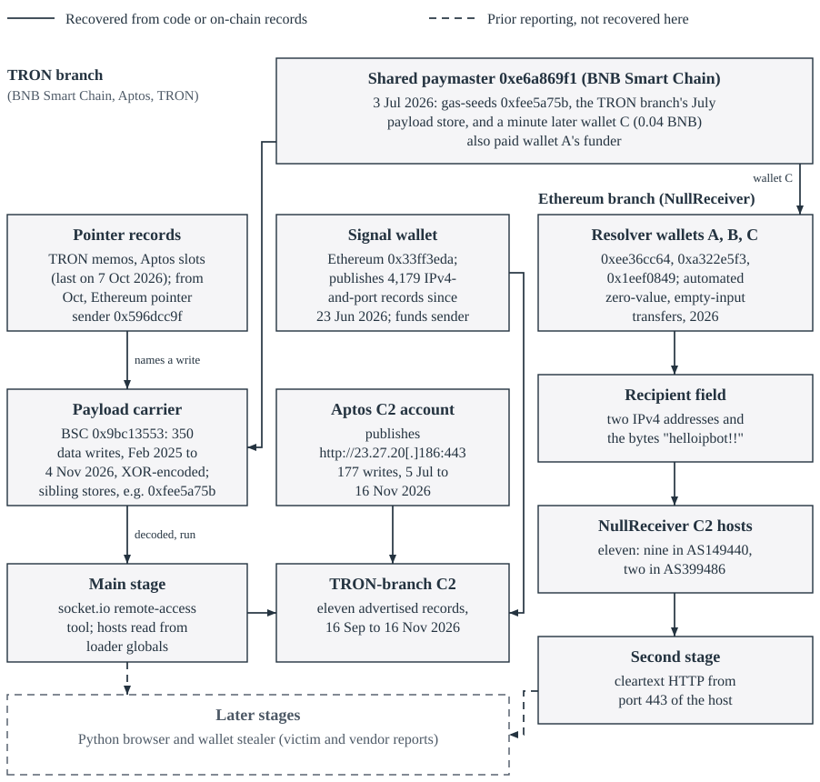
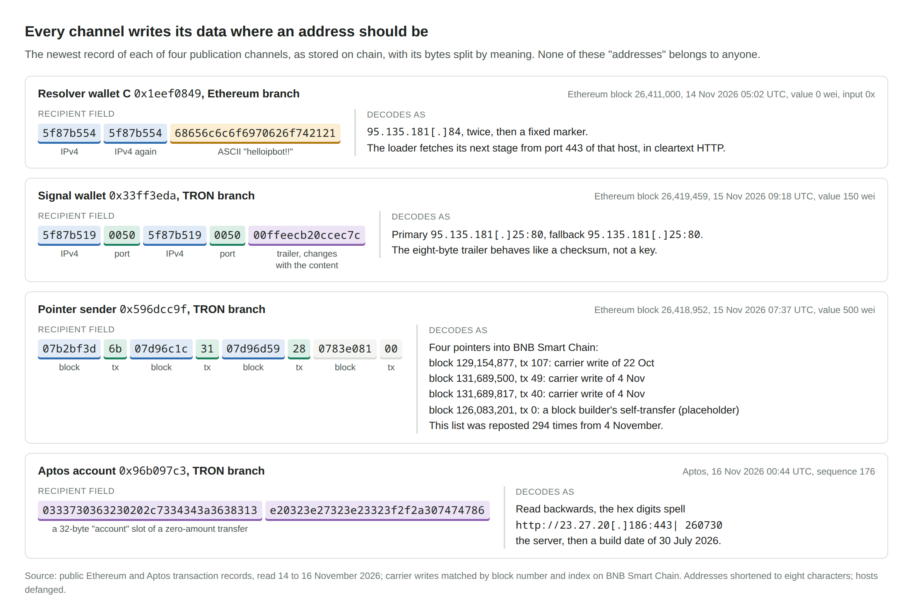
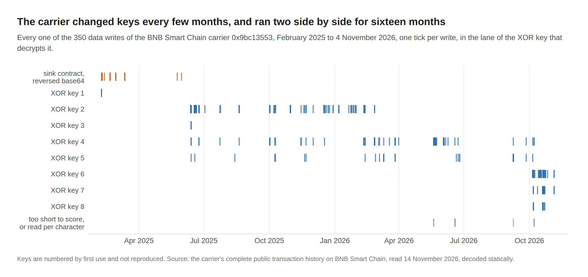
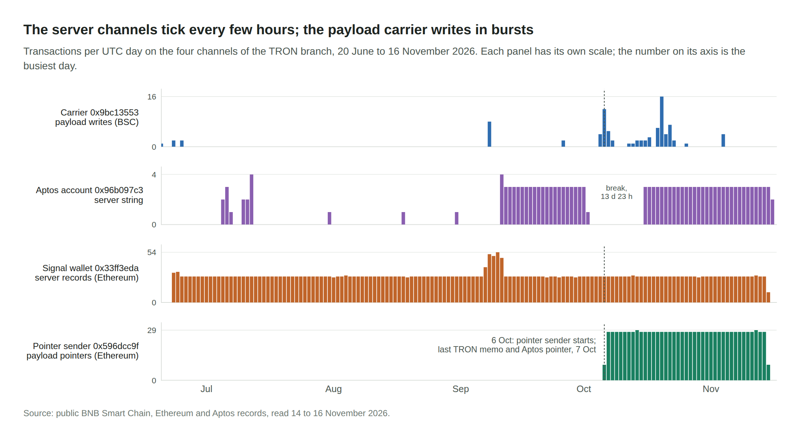

I found that the Hiring777 loader does not contain the address of its next server. It reads that address from the recipient field of the newest transaction sent by one fixed Ethereum wallet, so I could read every address the wallet had ever announced without contacting a single server.

## Key takeaways

- The Ethereum resolver writes each server as twenty bytes in a zero-value transfer: an IPv4 address, the same four bytes again, and `helloipbot!!`.
- The older TRON branch keeps its payloads on one BNB Smart Chain carrier, `0x9bc13553`, whose complete history of 351 transactions I took rather than sampled.
- The memos of the two published TRON wallets name only 28 of the carrier's 350 data writes; three further methods raised coverage to 259 writes, about 74%.
- From October 2026 the carrier's writes are named by block number and transaction index from an Ethereum sender, which defeats memo watching in principle; that sender is funded only by the signal wallet and writes in the same block as it 315 times, so one process runs both.
- One paymaster on BNB Smart Chain funded both the Hiring777 resolver wallet and a TRON-branch payload store one minute apart, which joins the two branches in one money network.

*Figure 1. The two resolver branches. Solid arrows show behavior recovered from code and on-chain records; the dashed later stages rest on prior reporting.*

## Impact: a channel that cannot be blocked and cannot be erased

This design cuts both ways. For the operator, an unchanged copy of the loader, already sitting in a victim's repository, follows each new server as soon as one more transaction is sent. Blocking yesterday's address therefore protects nobody for long.

For a defender, the operator's server history is written into a public ledger that cannot be edited afterwards, with a block time on every entry. This post explains how the Ethereum branch encodes its servers, and then how PolinRider's older and larger branch on TRON and BNB Smart Chain uses the same idea for its payloads.

## Method: reading the loader without running it

The `init` file hides its strings behind a common JavaScript obfuscator:

- a rotated string array;
- decoder calls in place of every readable literal;
- a further layer that splits strings into fragments, so searching the raw bytes for a URL finds nothing.

I recovered the strings in four steps:

1. I parsed the file into a syntax tree.
2. I reimplemented the decoder.
3. I solved the array rotation without evaluating the input.
4. I reassembled the fragments.

That recovered all 372 strings at all 538 call sites.

## Ethereum branch: a server address in the recipient field

What came out was a small, precise program. It performs these steps:

1. It names a fixed sender wallet.
2. It asks public block explorers and indexers for that wallet's transactions, newest first.
3. It falls back to four public Ethereum RPC endpoints if those fail.
4. It reads the recipient of the newest transaction.

That recipient is not a wallet anyone controls. Its twenty bytes are an IPv4 address, the same four bytes again, and the twelve ASCII bytes `helloipbot!!`. The transfer that carries it has zero value and empty input, so the whole transaction exists only to write those twenty bytes into the chain.

*Figure 2. The newest record of each of four channels, as stored on chain. Each writes its data into a field that should hold an account address.*

### The second stage

Having decoded the address, the loader fetches its second stage in cleartext HTTP from port 443 of that host, under a path beginning `/0x/`: `/0x/cls` and `/0x/ls`. It accepts a gzip, deflate or brotli body, or a base64 payload in a response header, and runs the result as a module inside a faked context that wires the process's input, output and `child_process` through to it, so the next stage gets an interactive shell channel. The port and the protocol are separate facts. A host listed in an indicator feed as "HTTPS on 443" would mislead anyone writing a network rule for this traffic.

I retrieved the second-stage responses on 6 November and kept them as inert files, neither decrypted nor run. They are small, 4,746 bytes for `/0x/cls` and 1,845 bytes for `/0x/ls`, against the public 71 KB, 161 KB and 1.5 MB stages of this family, which suggests a first-hop boot or list script. Neither was on VirusTotal. What those files do is known only from other researchers' reporting, and they establish nothing about what any particular developer received.

### A correction to one published description

Google's [EtherHiding report](https://cloud.google.com/blog/topics/threat-intelligence/dprk-adopts-etherhiding) describes the cluster it calls UNC5342 as querying chains through centralized API providers rather than RPC endpoints. This loader falls back to public RPC endpoints. That contradicts Google's description only if this branch's operator is UNC5342, which I have not established. The precise statement is that the loader I hold behaves differently from that description.

## TRON branch: payloads on BNB Smart Chain

### The carrier

The Ethereum resolver turned out to be the newer and smaller of two branches. PolinRider's primary resolver is described in OpenSourceMalware's reporting, and I recovered it first-hand from Go modules that [JFrog had listed](https://research.jfrog.com/post/hijacked-npm-vscode-tasks-blockchain/). It works as follows:

1. It reads the newest outbound transaction of a fixed TRON wallet.
2. It takes from its memo a reference to a BNB Smart Chain transaction.
3. It fetches that transaction's input over a public RPC.
4. It decodes the input with a byte-wise XOR key and evaluates the result.

The resolver runs two such chains, each with its own TRON wallet, its own Aptos fallback account and its own key, behind a thirty-second anti-replay guard.

The resolver hard-codes no carrier transaction hash at all. Two 32-byte values in it that look like hashes are the Aptos fallback accounts, which sent 10 and 22 transfers from June 2025; the carrier reference is read at runtime from the TRON wallet's newest payload or the Aptos account's newest transfer.

I followed the two TRON wallets that public reporting gives for this branch to the BNB Smart Chain account that holds the payloads, `0x9bc13553`. A carrier's history is finite, so I could take all of it rather than a sample: exactly 351 transactions, one deploying a contract and 350 carrying data, between February 2025 and 4 November 2026, with no unexplained nonce.

The inventory has a structure worth knowing for anyone counting another carrier:

- Nonce 0 deployed a small sink contract on 7 February 2025, and nonces 3 to 25 are the 23 calls to it, between February and May 2025. No other sender ever wrote to it.
- The remaining 327 writes go to the public burn address. The same operator also uses that address for token burns and empty transactions, so writes have to be counted by input length, not by destination.
- 323 of the burn-address writes are framed by a literal `?.?` at both ends.
- Nine short calls to the sink contract are not XOR at all but reversed base64. They publish C2 addresses written as zero-padded dotted quads, `154.91.000[.]103` and `23.027.020[.]143`, a build quirk that an indicator search on the normalized address would miss. They also date `23.27.20[.]143` to 12 March 2025, earlier than any other record of it.

### Generations and keys

The memo mechanism is itself a second generation. In June 2025 the operator first carried payloads inside TRON memos and hit the memo size limit. It then moved the payload into BNB Smart Chain calldata while keeping the memo, written backwards, as a pointer to the carrier transaction.

I recovered the XOR keys write by write with a frequency method that scores each key byte against a reference plaintext. Of the 309 writes long enough to score, 307 decrypt to fully printable text. Eight sixteen-character keys cover most of them, and the remaining two yield to the ordinary key once the XOR is taken per character.

The scoring method is log-likelihood against the byte distribution of a sibling carrier's plaintext, with the printable share as the acceptance test. Every decoded loader reads the calldata as UTF-8 and XORs character by character, so builds that carry non-ASCII characters, such as the zero-width characters one obfuscator appends to renamed identifiers, cannot be solved byte-wise at all.

Generations change every four to six months under a new key. Two keys ran side by side for sixteen months, which I read as a loader and a main stage shipped together.

*Figure 3. Every data write of the carrier `0x9bc13553`, in the lane of the key that decrypts it. Keys 4 and 5 run side by side from June 2025 to October 2026, and keys 6 to 8 arrive in October 2026.*

The operator also confirmed its own key material twice. On 7 October 2026 at 16:18:37 it wrote the literal second half of one key unencrypted, and eight minutes earlier it wrote the word `error` in clear.

The main stage is a socket.io remote-access tool whose code barely moves while its configuration changes:

- Until February 2026, its builds embedded their server addresses.
- From 25 February, they read them from loader globals.
- From May, the loaders route each victim by the campaign tag its lure carried, so one recovered loader understates the infrastructure by about two thirds.

The routing from 20 May 2026 works like this:

| Campaign tag | Socket host | Uploads |
|---|---|---|
| Begins with `A` | `166.88.54[.]158` in May, `23.27.13[.]43` from 18 June, `166.88.134[.]62` from 23 June | Same host |
| Numeric | `198.105.127[.]210` on 443 | Port 80 |
| Any other | `23.27.202[.]27` on 443 | Port 27017 |

The routing says which host a tag class used, not which victims carried which tag.

Every build also dates itself. The stage's version string is a date plus a build counter, running from `260519` in May 2026 to `2601104` in November, and the same convention appears in the marker comments it stamps on files it infects, from `/*C250617A*/` to `/*RS261003*/`. A sample from this kit therefore carries a build date even where no upload record, push date or certificate exists.

From October the embedded addresses are defaults rather than facts about any victim. The stage answers a `connect_info` event that can overwrite its upload host while it runs, and its command set has always included an `ss_connect:<host>` re-homing command. The October builds move their socket and upload pair in four steps over sixteen days, from `154.91.0[.]20` through `95.135.181[.]15` and `95.135.181[.]25` to `2.56.123[.]203`, still the configuration of the last build on 4 November. Its request paths, `/verify-human/<tag>` for logging, `/u/f` for stolen files and `/0x/patch/` for host profiles, stayed constant across every rotation, which is why [Part 6](../23-polinrider-detection/) builds detection on them rather than on addresses.

### Sibling carriers

The carrier at `0x9bc13553` is not the only one. Reading backwards from loaders and Aptos pointers found five more BNB Smart Chain senders in the same pipeline:

| Carrier | Writes | Period | What it shows |
|---|---|---|---|
| `0x20e3b9f0` | 12 | 31 May to 9 June 2025 | The store of the May and June 2025 generation, framed `..base64..` instead of `?.?`; its hosts are on the known PolinRider sink list |
| `0xadd1b89e` | 6 | 8 January 2026 | Three payloads pushed two, three and one times; only its 80 KB main stage is new |
| `0xe69222e6` | 9 | From 25 February 2026 | A relocation: its first write repeats the known carrier's write of 106 seconds earlier byte for byte |
| `0xfee5a75b` | 34 | 3 to 12 July 2026 | The July 2026 payload store, 972,626 bytes of calldata |
| `0x779bb1bb` | 3 | 4 August 2026 | A new shim, main stage and loader from a successor payer, with gas left for more |

One of the 2025 keys has a dated chain of custody across the sink contract, `0x20e3b9f0` and `0x9bc13553` between February and June 2025. It looked rare in the burn-address index only because that index never covered the sink contract where it mainly lived.

## Coverage: pointers that a watcher can and cannot see

The most useful question this carrier lets me ask is how much of a channel like this a defender can reconstruct from outside. The memos of the two published TRON wallets name only 28 of the carrier's 350 data writes, and they stop in June 2026.

Three further methods raised that coverage to 259 writes, about 74%:

- expanding the funders of known dead drops, which attached memos from ten TRON wallets and slots from seven Aptos accounts;
- querying each payload hash on Aptos as though it were an account;
- reading an Ethereum pointer channel that began in October.

The Aptos query works because a dead-drop slot on Aptos is the recipient of a zero-amount transfer, so a payload hash written there looks like an account and the public indexer answers "which transactions touched this address" for it. Run as a control, it returned the three pointing accounts I already held with the same counts before finding twelve new ones, each writing one to ten seconds after the write it names. TRON offers no equivalent reverse query.

The funder expansion only works with a cut-off. Funders with more than 400 sends or a truncated history are treated as services and not expanded, which is also its blind spot: a front-end wallet funded through a service-sized account stays invisible. The Aptos side turned out to be provisioned in generations of three accounts created within half a minute by one creator account, and at least three creators trace to one root funder, so finding one generation tends to give its siblings. One pair created in June 2026 has never sent a transaction, which is why it names no write.

Most of the remaining 91 writes have an explanation. They predate the pointer mechanism, repeat named writes byte for byte, carry one configuration value or read as superseded builds. Seven have neither a pointer nor an explanation, six of them from the two October days on which the Ethereum pointer channel began.

| Unpointed writes | Count |
|---|---|
| Sink-contract calls, February to May 2025, before the pointer mechanism | 21 |
| Burn-address writes of February 2025 | 2 |
| Byte-identical re-pushes | 23 |
| Configuration writes | 15 |
| Superseded builds | 23 |
| Unexplained | 7 |
| Total | 91 |

*Table 1. The carrier's 91 writes without a recovered pointer.*

### The October change

That October change defeats memo watching in principle. From then on, the carrier's writes are named by BNB Smart Chain block number and transaction index. They are published as a list by an Ethereum sender, `0x596dcc9f`, whose 1,112 writes between 6 October and 15 November resolve to the carrier's history.

That sender uses the same trick as the resolver. Each write is a 500-wei transfer whose recipient is twenty bytes of data: four five-byte pointers, each a four-byte block number and a one-byte transaction index. Its 1,112 writes form 26 distinct lists with 39 distinct pointers, of which 38 resolve to carrier writes. The 39th, a constant fourth slot, names a block builder's tagged self-transfer and reads as an unused placeholder. The list current from 4 November was reposted 294 times, and the 7 October loaders find the sender by searching recent blocks for the first sixteen bytes of its address. Two test builds marked `00-test` hard-code such a list, and their pointers resolve to real carrier writes, which is how I confirmed the reading.

The sender's only funding is two payments of 0.01 ETH from the signal wallet described below, one twenty minutes before its first write. Of the 1,135 blocks in which the sender wrote and the 1,696 in which the signal wallet wrote, 315 are the same block. One process submitting both transactions into the same block hundreds of times is not explained by shared infrastructure, so I hold at high confidence that the C2 feed and the payload pointer channel are one operator's.

### A mechanical signature across chains

Provisioning also has a mechanical signature across chains. In three separate sessions the order is the same, each step measured in the block time of its own chain:

1. The BNB Smart Chain write comes first.
2. The Aptos pointer follows two to five seconds later.
3. The TRON memo follows six to fourteen seconds later.

The same order held for the 2025 generation and on 25 February and 8 January 2026. Because "the same block" cannot apply across chains, this lag signature is the cross-chain counterpart of the same-block test above.

Read across its whole life, the branch's control layer is a sequence of addressing schemes laid over one payload pipeline. It runs from the carrier's own contract calls in February 2025, through memos and Aptos slots, to block-and-index lists in October 2026. Each scheme defeats a different kind of watch.

## Server channels: a signal wallet and an Aptos account

From mid-2026 the TRON branch publishes its servers on channels of their own. The Ethereum signal wallet `0x33ff3eda` has made 4,179 address-and-port writes since 23 June 2026. Each recipient holds a primary and a fallback address followed by an eight-byte trailer: four bytes of IPv4, two of port, four of IPv4, two of port and the trailer. The trailer changes with the content and therefore behaves like a checksum rather than a key. The records carried zero value until 16 September 2026 and dust after it, mostly 150 wei. Over 4,181 sends between 23 June and 15 November, none failed, the channel's whole on-chain running cost was 0.0211 ETH, about 0.00015 ETH a day.

Between 16 September and 16 November the signal wallet advertised eleven distinct records. They range from 586 writes for `111.90.143[.]39`, which held for three weeks, down to three writes in under two hours for `150.40.98[.]42`.

Until 12 October the primary used port 443 and the fallback port 80; afterwards both used port 80. The two shortest stand-ups sit on either side of that change, a pattern I hold at medium confidence without knowing its cause. The current record, since 2 November, is `95.135.181[.]25` on port 80.

| Record | Period | Writes |
|---|---|---|
| `181.214.149[.]148`:443 | 16 to 25 September | 250 |
| `198.105.127[.]210`:443 | 25 to 28 September | 88 |
| `198.105.127[.]210`:443, fallback `45.137.198[.]133`:80 | 28 September to 2 October | 106 |
| `45.137.198[.]133`:443 | 2 October | 4 |
| `193.32.162[.]52`:443 | 2 to 5 October | 81 |
| `89.19.222[.]25`:443 | 5 to 7 October | 61 |
| `103.213.248[.]45`:443, fallback `136.0.7[.]231`:80 | 7 to 8 October, about 19 hours | 23 |
| `136.0.7[.]231`:443 | 8 to 12 October | 113 |
| `150.40.98[.]42`:80 | 12 October, 1 hour 43 minutes | 3 |
| `111.90.143[.]39`:80 | 12 October to 2 November | 586 |
| `95.135.181[.]25`:80 | From 2 November, current at 16 November | 380 |

*Table 2. Records advertised by the signal wallet, 16 September to 16 November 2026. Before that window it advertised `23.27.20[.]187` on 443 and 80 from 24 June to 3 September.*

The hand-over to `.25` took one cadence, with no period of advertising both. Outside reporting saw the same infrastructure keep working after the chain stopped showing new builds: an independent ThreatFox entry lists `95.135.181[.]25` on port 80 as a botnet C2 from 10 November, six days after the last carrier build I can read.

An Aptos account repeats a second server string, `http://23.27.20[.]186:443`, in 177 writes since July. The operator therefore keeps two publication channels on two chains at once, advertising adjacent addresses in one /24.

That account, `0x96b097c3`, began as a pointer: its first fourteen writes in July match the July store `0xfee5a75b`. From 31 July it writes the same slot every time, which reversed reads as the server string followed by `260730`, a build of 30 July by the stage's own dating convention. Its eight-hourly cadence began on 11 September, broke for 13 days and 23 hours from 2 October, and produced one off-schedule write on 16 November; I can explain neither. No feed or scanning service I checked documents `23.27.20[.]186` at all, which fits a channel no victim ever reaches through a lure. Redundancy is applied to the C2 feed, not to payload addressing: the Aptos pointer channel ended on 7 October and payload addressing stayed on Ethereum.

*Figure 4. Transactions per day on the four channels. The server channels write on a steady cadence, while the payload carrier writes in bursts, and the pointer sender starts on 6 October.*

## Links between branches: one paymaster

The evidence that the two branches belong to one operation is mostly financial:

- On 3 July 2026 the account `0xe6a869f1` sent 0.04 BNB to the address of the Ethereum resolver wallet that the Hiring777 loader hard-codes. That was two months before that wallet sent its first resolver transaction.
- One minute earlier, the same account had seeded `0xfee5a75b`, the TRON branch's payload store for July 2026. Its 34 writes decrypt with the two XOR keys recovered from my own NullReceiver sample, and the decoded loaders name the known host `166.88.134[.]62` with the path `/$/boot` and the header `Sec-V`.
- The same paymaster paid the funder of another resolver wallet, and it pays the same recipients as the wallet that collects the resolvers' fees.

The two branches and their payroll therefore form one money network, and I hold the on-chain facts behind that statement with high confidence.

At host level, a single undetected Python sample, submitted once to a scanning service on 14 November, posts to the newest Ethereum-branch host under the upload path of the TRON branch's main stage. That joins the branches a second time. The link rests on one sample whose body nobody has been able to read.

A second sandbox report on the same file adds what the first lacked. Run on Windows, the script checks the system version and installs a per-OS dependency, mirroring the Linux keyring path of a held stealer module. It never reached its C2 and was judged clean, which is why no engine flags it. Its memory strings nonetheless contain `http://95.135.181[.]84` and no other operator address, so the sample names exactly one operator host. Almost all of its 14,301 bytes are one line, a short prologue and one packed blob.

### Outside corroboration of the decodes

Two outside observations corroborate my decodes rather than my attributions:

- One decoded carrier plaintext, written on chain on 2 June 2025, was submitted to VirusTotal 101 minutes later by someone else, under working-file names. Somebody was decoding this channel in near real time more than a year before I read it.
- ThreatFox holds `/boot` on `181.214.149[.]148`, ports 80 and 443, from 22 September to 6 October 2026. I had recovered that host statically as a staging host of the two 5 October builds, and the outside window closes immediately after them.

## Conclusion

A blockchain dead drop protects an operator against takedown. Seizing one server changes nothing while the operator can announce the next one for the price of a transaction.

The same design leaves a complete public record of the operator's instructions and spending, because nothing written to the chain can be removed. Defenders who watch only memos lose sight of the carrier after October 2026. Expanding the funders of known dead drops, querying payload hashes on Aptos and reading the Ethereum pointer channel raised my coverage from 28 to 259 of 350 writes.

The record also ends earlier than the operation. The chain stops giving evidence when the operator stops writing payloads to it, while the servers carry on, so the last write is not the last day of activity. Request paths that stayed constant across every rotation are the better long-term anchor.

[Part 3](../20-polinrider-wallets-and-hosts/) follows that record for the Ethereum branch: three resolver wallets, eleven hosts, and the shared destinations that show the wallets to be one pool.
