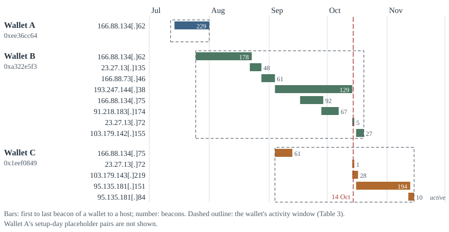

One recovered loader gave me one resolver wallet, and following what that wallet had announced expanded the picture to three wallets and, by 14 November, eleven hosts, handed between the wallets in a way that only one operator would arrange. The step that made this possible follows directly from the encoding described in [Part 2](../19-polinrider-ethereum-address-book/). Because the recipient of a resolver transaction is a fixed function of the host it names, the four address bytes twice followed by `helloipbot!!`, I can compute that recipient for any host and ask the chain which wallets ever sent a transaction to it. Starting from the known hosts, I listed the senders of every host's recipient, decoded every outbound transaction of the wallets I found, added each new host they named, and repeated both steps until neither the wallet set nor the host set grew. Run over the ten hosts known on 6 November, that closed enumeration stopped at three wallets, and decoding both address fields of every transaction they had sent found no host outside those ten apart from one wallet's setup-day placeholders.

The closure has a precise boundary. It is complete only for wallets that named at least one host in the final set, so a wallet that announced only hosts I have never seen cannot be reached by it, and the eleventh host, `95.135.181[.]84`, to which the newest wallet moved on 12 November, entered my set from that wallet's own transactions, without my having listed the other senders of its recipient. Open-source advisories that use the same staging path and header extend beyond the packages that cite these three wallets, which suggests resolver wallets outside the set; that is an inference from shared tooling rather than an observed wallet, and the vendor reports of November that name wallets for those packages name the same ones I hold rather than a fourth.

*Hosts encoded by the three resolver wallets in 2026, by block time. Bars run from a wallet's first to last beacon to a host and do not imply continuous use.*

## One pool handed over in stages

I label the wallets in order of first activity. Wallet A, `0xee36cc64`, sent 247 beacons between 12 and 31 July to a single host, 18 of them placeholder pairs. Wallet B, `0xa322e5f3`, sent 607 beacons to eight hosts between 25 July and 19 October. Wallet C, `0x1eef0849`, the one the Hiring777 loader hard-codes, sent 294 beacons to five hosts from 4 September and was still active at my decode of 14 November. The wallets behave as one pool. Wallets A and B both announced `166.88.134[.]62` over the summer. Wallet C last used `166.88.134[.]75` on 12 September and wallet B first used it on 17 September, and independent operators would be unlikely to pick the same rented address five days apart. On 14 October wallets B and C both announced `23.27.13[.]72` within about five hours of each other. Wallet B then spent its last three days on `103.179.142[.]155`, and from 19 October wallet C was the only active resolver, which matches one victim's public incident report of 27 October stating that the current build used wallet C and the previous one wallet B.

Wallet A's start shows the setup. It began with sixteen self-transfers from 08:58 UTC on 12 July, and its unusable placeholder pairs, one in reserved address space and one pairing a carrier-grade NAT address with a content-delivery address, kept recurring after real use began, so they were not only a pre-deployment test. Wallet C's history after the hand-over is the longest on a single host: 194 beacons to `95.135.181[.]151` between 16 October and 12 November, followed by the move to `95.135.181[.]84` in the same /24 at 23:44 UTC on 12 November. Those 194 beacons to one fixed recipient also contradict a statement in OpenSourceMalware's [NullReceiver write-up](https://opensourcemalware.com/blog/nullreceiver-dprk-c2-technique) that the technique never reuses a destination; the recipient is a fixed function of the host's address, so it repeats for as long as the host does.

## A scheduler, not a person

Everything about the beacons indicates a machine. All 1,177 resolver-wallet transactions form unbroken nonce ladders, and apart from five of wallet A's sends and 68 of wallet B's, each wallet uses one fixed gas limit. Of the 1,176 transactions in the current fee format, 1,169 pay a priority fee of exactly 1.5, 2.25, 3.0 or 4.5 gwei, the exceptions being setup sends and two retried writes. The median gap between consecutive sends is 1,200 seconds for wallet A and about 12,036 seconds, roughly three hours and twenty minutes, for wallets B and C. When I grouped the 1,148 decoded beacons into 743 sessions, opening a new session after any gap longer than 90 minutes, the sessions spread almost evenly across the twenty-four hours of the UTC day: the densest ten consecutive hours hold 43% of them against about 42% for a uniform clock. Rotation, on the other hand, follows no clock. Nine rotation events give intervals from 1.85 to 38.78 days, with a median of 11.27, and I could not distinguish any reaction to my own disclosures from chance, since the forty I sent in November set a baseline lag of about two and a half days against the two days observed.

One timing result survives these doubts because block times cannot be spoofed: nine of the eleven hosts were first named between 00:00 and 07:00 UTC. That tells me when someone chose to rotate, not where that person sits, and the money side of the operation, whose hand-started batches concentrate in a similar early-UTC window, is the subject of [Part 7](../24-polinrider-money/).

## Hosts that only the chain can name

The eleven hosts sit on two networks, the first nine in Evoxt's AS149440 and the last two in AS399486, and they defeat the usual pivots by construction. The resolver side runs its servers as bare addresses on raw ports, so across all 26 resolver-side hosts I hold only two certificates exist, both for a domain of the separate npm cluster discussed in [Part 6](../23-polinrider-detection/), and there is no certificate clock to read. Fingerprint scanning across the shared hosting networks, with roughly 1,300 hosts answering on port 443 in AS399486 alone, never produced a host that the on-chain dead drop had not already named, so the chain rather than the internet is the authoritative host list. Five of the hosts were already in public abuse feeds when I found them, and none is in the public maltrail Lazarus list. Across the resolvers, carriers and publication channels, 21 of 26 Evoxt-routed hosts sit in London, against London's share of about 13%, a provisioning habit that no single address would show; the two newest hosts are off Evoxt, so no newer address has tested it. These are dated hosting associations, and none of them should be carried forward to whoever rents an address next.

Shared address space is also not shared control. The TRON branch's signal wallet currently advertises `95.135.181[.]25`, in the same leased /24 as wallet C's last two hosts, which looks like a link between the branches until the sequence is read. In eleven rotations the signal wallet never advertised any other address in that range, it stood up `.25` ten days before wallet C moved to `.84`, both addresses sit in one leased registry object with no sub-assignment, their service shapes differ, and addresses in that range churn between unrelated customers. I record that as shared space without evidence of shared control.

## What a wallet's balance says

Each beacon costs gas, which turns a wallet's balance into a forecast. Dividing wallet C's balance on 7 November by its mean fee per beacon and multiplying by its period gave about 32 more days of beacons; the operator refunded it with 0.06 ETH on 11 November, about a month early, and at the measured rate the runway after the refund is about 150 days. Where the gas comes from is more informative than how much it costs. Wallets B and C were partly funded from a FixedFloat payout address, a no-registration swap service, so the shared payout reflects a habit rather than common control. The wallet that pays the resolver fees, `0xf97062cb`, is a drain collection address into which about twenty-two established personal wallets sent what for most of them was their last transaction, and wallet B returned its remaining 0.0293 ETH to it on 14 October, the same day both wallets announced `23.27.13[.]72`. That the transfers into it were thefts by this operation is an inference I hold open, and Part 7 sets it out with the rest of the money.

Two of these three wallets are now public. Wallet B appeared in OpenSourceMalware's reporting in August, [SafeDep](https://safedep.io/polinrider-ethereum-c2-github-repositories/) published six of its eight hosts on 30 September, JFrog a seventh on 9 November and [StepSecurity](https://www.stepsecurity.io/blog/accurasofthire-fake-interview-developer-machines) all eight on 13 November, while [Sonatype](https://www.sonatype.com/blog/polinrider-loader-reappears-in-hijacked-npm-packages) named wallet C and one of its hosts on 4 November. Wallet A and the enumeration that ties all three together appeared in no publication I found. The chain told me which servers the loaders were told to use and when; [Part 4](../21-polinrider-repository-spread/) returns to the repositories to show how the same loader reached thousands of projects whose owners never spoke to a recruiter.
