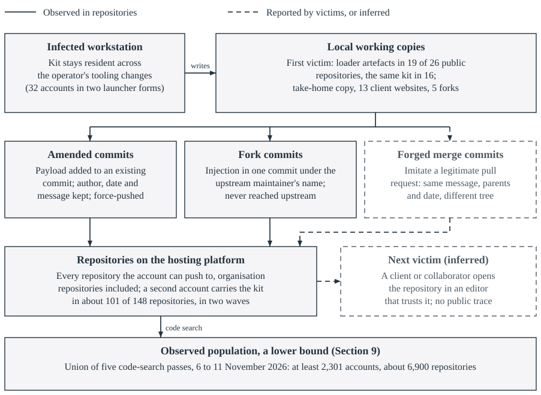

I found loader artifacts in nineteen of the 26 public repositories of the developer who took the Hiring777 take-home assessment. Eighteen of them had nothing to do with any recruiter, so changes written through one developer's access exposed clients and collaborators who never spoke to the recruiter.

## Key takeaways

- Nineteen of 26 repositories on one account carried the PolinRider kit; thirteen of the eighteen non-lure repositories are small business websites built for clients.
- The kit is written by amending existing commits under their real authors' names and force-pushing them, so author dates and author fields mislead.
- The platform's push time is the reliable clock: an author date can read as 2022 to 2024 for an infection in 2026.
- A second account carries the kit in about 101 of its 148 repositories, pushed in two waves on 14 August and 29 October 2026.
- Defenders should remove persistence before rotating credentials, disable automatic editor tasks globally and check every repository the account can push to without opening it in the editor.

## Scope: one assessment, nineteen repositories

The take-home assessment was one repository. The rest of the same developer's public account showed loader artifacts in nineteen of its 26 repositories: the Hiring777 copy and eighteen others.

- Thirteen of the eighteen are small business websites the developer had built for clients.
- Five are forks: four of open-source projects and one of an UNK_DeadDrop take-home lure.

Sixteen of the nineteen, the thirteen client websites and three of the forks, carry the same kit. Seven of its files are byte-identical across all sixteen, while its fake-font payload differs between the client websites and the forks. An identical root `api.js` sits only in the client websites. It is probably a further loader, but I have not analyzed it.

This pattern changed the scope of the investigation. A recruitment lure exposes one developer, but changes written through that developer's access can expose clients and collaborators. I leave the developer, the clients and the upstream projects unnamed here; their repositories are evidence of exposure, not of anything they did.

*Figure 1. Spread of the kit from one workstation into repositories. Solid boxes are observed in repositories; dashed ones are reported by victims or inferred.*

## Mechanism: commits that keep someone else's name

The way the kit is written into repositories is what makes it hard to see. In every victim I examined, the injecting commits carry real contributors' names, messages and timestamps. The payload is added to an existing commit, which is amended in place with its author, date and message unchanged and then force-pushed.

Victims' own public reports describe two further forms:

- forged merge commits that imitate a legitimate pull request, with the same message, parents and declared date but a different tree;
- merges that reintroduce the payload through several contributors.

In the forks the injection arrives in a single commit under the upstream maintainer's name. I compared each fork with its upstream and found that the commit never reached the upstream project. Reading the author field alone would blame a maintainer who never touched the change. I found nothing to suggest that any upstream project received it.

### Dating: push time, not author date

A compromise cannot be dated by a commit's author date. The kit inherits that date from the commit it amends, and it can read as 2022 to 2024 for an infection in 2026. The platform's push time records when the hosting service received the commits and is the reliable clock. A recent push can carry an apparently ancient malicious change.

### The fork of the UNK_DeadDrop lure

One fork looks at first like an UNK_DeadDrop identity authoring a PolinRider commit. Its folder-open task is the lure's original weaponization inherited from upstream, not part of this kit. The PolinRider commit carries the upstream name only because the worm amends whatever it finds. The repository joins the two operations through the victim's disk and nowhere else, so I keep them apart, as [Part 1](../18-polinrider-following-a-developer/) and [Part 17](../17-two-operations-one-ecosystem/) explain.

## Launchers: where the kit hides and what starts it

The take-home route with its `node init` script is one of several. The kit also hides loaders in two other places:

- a whitespace-padded `api.js` at the repository root;
- far more often, fake Font Awesome files under `public/fonts/`, which an editor task reaches when the folder is opened rather than through a package script.

### Fake fonts and their triggers

The executed files carry names such as `fa-solid-*`, `fa-brand-400.*` and `fa-brands-400.ttf`, or invented extensions such as `.lkf`, `.lfk`, `.llf`, `.fml` and `.orc`. From one build onward the folder-open task calls `.vscode/eslint-check.sh` or `.vscode/eslint-check.cmd`, which then run the fake font with Node. Two further forms exist:

- a nested inline form whose file sits deep in the tree under paths containing spaces, route-group parentheses and ampersands;
- an argument form that passes the path separately to a `node` command.

The trait common to every form is an automatically triggered task, directly or through a `dependsOn` chain, that runs a file under `public/fonts/` with Node. A rule keyed to one font name or to the root path therefore ages out. For the same reason [Part 5](../22-polinrider-counting-repositories/) counts by that trait rather than by a filename.

### Configuration launchers

The configuration route that OpenSourceMalware reported first has not gone away. A public scanning service links seven files to one of the branch's older sink addresses. Three of them are `craco.config.js`, `tailwind.config.js` and `appconfig.js` launchers from October 2025 and February 2026.

A reviewer who checks only dependencies would miss both routes. A reviewer who opens an unfamiliar workspace in an editor that trusts it would run the editor task before reading it, which is the whole point of the design. Jamf's [account of workspace-task abuse](https://www.jamf.com/blog/threat-actors-expand-abuse-of-visual-studio-code/) describes the same mechanism in other campaigns, and [Part 6](../23-polinrider-detection/) turns the shared trait into a review rule.

## Persistence: a machine that stays infected

A second account shows the same mechanism at a larger scale and over a longer time. It carries the kit in about 101 of its 148 repositories, written in two waves of pushes two and a half months apart:

- The 81 repositories pushed on 14 August 2026 carry an older launcher and no fake font.
- The 29 repositories of a bulk re-push on 29 October carry the launcher identical to the one in my analyzed loader, this time together with a fake font.

Those are push-day counts. They do not divide the roughly 101 infected repositories neatly between the waves, but they show a machine that stayed infected across a change in the operator's tooling. The 32 accounts that appear in both my inline-launcher and my helper-script searches show the same across the wider population.

For cleanup this is direct. A remediation dated to one wave will miss the other, and deleting one visible fake font establishes nothing about the rest of the account.

## Attribution check: victims, not operators

An aged, quiet account that took assignments from more than one fake recruiter resembles the accounts operators sometimes repurpose. I tested rather than assumed that these accounts are victims. Two observations decided it:

- The kit rides inside the developer's own feature commits and inside forks under third parties' names, which gains an operator nothing.
- Six independent incident reports by other developers describe the same pattern on their own machines and read as genuine victim reports.

A comparison with Miasma, the other repository worm of 2026, makes the commit method diagnostic. Miasma, as [SafeDep](https://safedep.io/inside-the-miasma-supply-chain-attack-toolkit) describes it, forges new backdated commits and hijacks tags. PolinRider amends existing commits in place, and the two share only the idea of a folder-open launcher. A code search for Miasma's signatures found 186 repositories in 104 accounts. The only three that intersect my PolinRider lists are defender repositories quoting both worms.

## Exposure: write access, not audience

These repositories are not lures aimed at the public, and their audience shows it. Across the 177 public repositories of the three victims I studied in detail, the combined audience is two stars, four forks and two watchers. All four forks predate the injections and are clean, because a fork does not receive later commits from its source.

The exposure therefore runs through write access. Several affected accounts belong to organizations, where one member's infected machine can reach every repository the organization owns. The next victim is a client or colleague who opens an infected repository in an editor that trusts it, which leaves no public trace for anyone to count.

I did not have endpoint telemetry from any affected machine. I cannot describe the local process that wrote each file, only the repository changes it left. Those changes are consistent with a resident process writing the kit into every working copy it could reach.

## Conclusion

One take-home assessment led to nineteen infected repositories on one account and about 101 on another. The kit spreads through amended commits under real names, so write access, not audience, defines who is exposed, and push time, not author date, defines when.

Response has an order that follows from this:

1. Remove persistence before rotating credentials, because a resident process collects the new ones.
2. Disable automatic editor tasks globally before any affected repository is opened again.
3. Check every repository the account can push to, forks and organization repositories included, without opening it in the editor.
4. Treat any wallet key or seed phrase that was on the machine as stolen.

Takedown requests need the same care, because most infected repositories belong to victims. The owner should hear about it first, and a report to the platform should describe the repository as victim-owned rather than as attacker infrastructure.

How many such repositories exist is the question of Part 5, and the answer depends more on the shape of the search than I expected.
