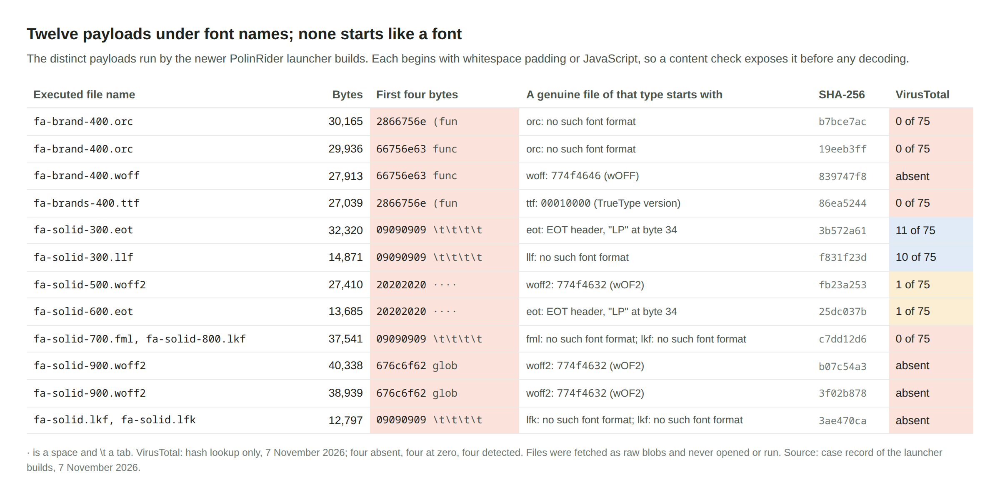
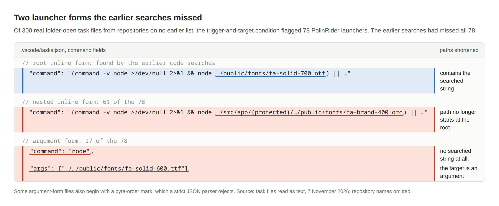

I found that multi-engine scanners and my own JavaScript-only scanner saw almost none of PolinRider. A check on what a repository runs automatically, combined with a test for asset files that parse as JavaScript, flagged 78 launchers in 300 real task files with no false positive and no PolinRider launcher missed.

## Key takeaways

- Of twelve victim-published payloads, eight were absent from VirusTotal and two more had zero detections; of twelve payloads I recovered, four were absent and four more had zero detections.
- The launcher names the file it hands to Node, and that trigger-to-target relationship held up better than any filename, extension, payload hash or server address.
- On 7 November the condition flagged 78 launchers in 300 real folder-open task files, all PolinRider, and nothing in the 82 lifecycle scripts among the top 1,000 npm packages.
- Real launchers exposed nine parser gaps that no fixture had found, each a silent miss rather than an error.
- Before opening a repository from a recruiter, client or stranger, read its `.vscode/tasks.json`, agent settings and `package.json` scripts as text, and keep automatic tasks off.

## The problem: the first plausible match was a real font

In one infected repository the first `fa-solid` file in the fonts directory was a genuine 202,902-byte font that a public scanning service had known since 2020. The editor task ran the `.woff2` file sitting beside it, which was JavaScript under a font's name. Anyone who collected the first plausible match in that directory would have analyzed a real font and declared the repository clean.

The launcher supplied the right answer, because it names the file it hands to Node. As the investigation widened from one assessment to thousands of repositories, that relationship between a trigger and its target held up far better than any filename, extension, payload hash or server address. This part describes what the existing tools saw of the campaign, the condition that did reach it with its measured results, and the questions the evidence still leaves open.

## Scanners: what existing tools saw

Multi-engine scanning services detect almost none of this:

- Of twelve payloads that victims published in their own incident reports, eight were absent from VirusTotal and two more had zero detections.
- Of the twelve payloads I recovered from the newer launcher builds, four were absent and four more had zero detections.
- The builds in active use at the time of writing were both absent.

| Sample set | Absent | Zero detections | Detected |
|---|---:|---:|---|
| 12 payloads published by victims | 8 | 2 (of 61 engines) | 2, by 8 and 9 of 61 |
| 4 payload variants I held first | 3 | 0 | 1, by 1 of 60 |
| 12 payloads from 17 newer builds | 4 | 4 (of 75 engines) | 2 by 1 of 75, 2 by 10 to 11 of 75 |
| 2 builds live at the time of writing | 2 | 0 | 0 |

*Table 1. VirusTotal coverage of PolinRider's loader payloads.*

None of the victim-published payloads matches any of my own variants, so the family is not one file that a single hash would cover.

The one detection name a victim reported, Microsoft Defender's `Trojan:Script/MalTask.A`, fires on the `tasks.json` launcher rather than on the payload. In practice it is the launcher pattern that catches this family.

My own [public scanner](https://github.com/KrasForge/unk-scanner) fared worse for a structural reason. It reads only JavaScript and TypeScript files (`.js`, `.mjs`, `.cjs`, `.jsx`, `.ts`, `.mts`, `.cts` and `.tsx`), so it never opens an editor task, a package manifest or a font file, nor agent rule files, `binding.gyp`, Makefiles, `tox.ini` or Dockerfiles. Its documented limitations did not say so at first, which let a reader assume coverage that did not exist, and I have since added a plain scope statement to the repository. For PolinRider it saw neither the launcher nor the payload. That is a stated limit of its scope, which covers UNK_DeadDrop, rather than a rule defect. The habit behind it, selecting files by extension and assuming that configuration is not code, is common enough that an attacker needs only one automatic trigger and one disguised file to pass through both.

## Method: a condition on what runs automatically

The method I evaluated reports a launcher only when two conditions hold together: an automatic trigger and a suspicious target. Its rationale is a base rate rather than a signature.

Automatic triggers are common in legitimate projects, which start development servers on folder open and build native code on install. Files in asset directories are common too. What is rare is an automatic trigger that does one of the following:

- hands a repository file to a JavaScript runtime from a place where legitimate triggers have no reason to point, such as a fonts, asset or hidden tooling directory;
- hands it a file under a non-code name;
- downloads content and pipes it into an interpreter.

The triggers it reads are:

- folder-open editor tasks, including those reached through `dependsOn`;
- the hooks and always-applied rules of coding agents, session-start hooks with a wildcard matcher above all;
- install-time and test package scripts;
- build files that expand commands, such as `binding.gyp`;
- helper scripts that a trigger calls, and inline `node -e` loads.

The target side is a command that runs a repository file with Node or Bun where that file sits in an unusual place or carries a non-code extension. Running Node on a font or an image is a strong signal by itself. A plain `node` call is not, which is why the conjunction matters.

Applied, the method has four steps:

1. Collect every automatic trigger the project declares.
2. Extract and classify what each trigger runs.
3. Check the content of that target.
4. Report only the conjunction.

Each report carries its trigger, the launcher file, the target, any helper in between and a severity, so a reviewer knows which file to read first. Legitimate triggers point overwhelmingly at tools and at ordinary scripts in ordinary directories, which keeps the conjunction quiet, and it depends on no name, hash or string that the attacker rotates.

### Content test: JavaScript under a non-code name

Beside the trigger check sits a content test that I would recommend to anyone. A file is reported as JavaScript under a non-code name when its first bytes carry no font, image or document signature and its text parses as JavaScript. The file is parsed only, never evaluated, and the report records how it parsed, for example as a script with a given number of top-level statements after a long run of leading whitespace.

The two conditions protect each other. The signature check keeps genuine fonts and images out even when some of their bytes happen to form text, and the parse check keeps ordinary text files with odd extensions out.

*Figure 1. The twelve payloads I recovered from the newer launcher builds. Each begins with whitespace or JavaScript, never with a font signature.*

How the test is applied matters as much as the test:

- It runs over every file with a font, image, media or document extension wherever it sits, and over files with invented extensions in asset-like directories (fonts, assets, images, icons, media, static, public), skipping dependency, version-control and build directories.
- It runs over those files whether or not a launcher names them, because a kit can be present before its launcher arrives or after the launcher was removed.
- It is never reached through an extension filter, because the name is the disguise. A runtime executes such a file as JavaScript whatever it is called, and a reviewer who sees it beside genuine fonts has no reason to open it.

## Results: every launcher in the test set

The results are the reusable part:

- On 7 November I ran the condition over 300 real folder-open task files from public repositories that appeared on no earlier PolinRider, Miasma or defender list. It flagged 78 launchers, all PolinRider, with no false positive and no PolinRider launcher missed. The ground truth was task files that name a target in the kit's fonts directory.
- On the 82 lifecycle scripts among the top 1,000 npm packages it flagged nothing.
- The content test recognized all thirteen held loader payloads, twelve plus a control.
- On five live repositories of the separate Miasma worm it found every launcher. The folder-open task, both agent session-start hooks and the always-applied agent rule were reported at high confidence and the npm test script at medium.

*Figure 2. Of the 78 launchers the condition flagged, 61 used the nested inline form and 17 the argument form. My earlier string searches matched neither.*

The Miasma check was an out-of-sample test. [SafeDep](https://safedep.io/inside-the-miasma-supply-chain-attack-toolkit) describes that kit as wired to run automatically through five developer tools, four of them agent or editor configurations and the fifth the npm test script. The five repositories were those still serving the kit on 7 November among the first eighteen I checked from the published list, with payloads of 4.6 MB under three hashes, and only two of the five carried a `package.json` with the test script.

The evaluation also found its own gap. Eight further repositories, whose paths contain both spaces and parentheses, were missed on the first run, and the reader was fixed to handle them the same day.

Those figures are bounded by their samples, and they say nothing about endpoint behavior. They show that a check whose selection step does not trust the filename reached payloads that string recovery could not decode and that multi-engine scanning did not flag. Both of those act only after a file has been chosen, and the disguise defeats the choosing.

## Parsing: real files broke the reader nine times

The method's other main lesson concerns reading configuration. Real launchers exposed nine gaps that no fixture written from published descriptions had found, and every one was a silent miss rather than an error:

- shell redirections such as `>/dev/null 2>&1` read as the file being run;
- a leading byte-order mark that made a strict parser reject a file the editor runs happily;
- framework route-group parentheses that cut a path at the wrong bracket;
- payloads deep in the source tree instead of in a root assets directory;
- path arguments with spaces split on reassembly;
- unquoted paths with spaces and ampersands cut at the first space;
- inline code read as though it were a filename;
- tasks reachable only through `dependsOn` that were not treated as automatic, although the task carrying the trigger may do nothing itself;
- folder names combining spaces with parentheses, which defeated two earlier fixes at once.

The last gap hid eight repositories until a much simpler text search found them. A text search and a parser fail on disjoint sets of real files, so neither validates the other.

A reader of task files has to read them as the editor reads them, tolerating comments, trailing commas and a byte-order mark. It has to be checked against real files and a second, independent search before its silence means anything, never only against fixtures written from published descriptions.

## Hunting: structure, not names

The same conjunction works as a hunt in an organization's own code search, because names and hashes rotate independently of each other while the launcher structure does not:

- a folder-open task, or a task it depends on, whose command or arguments run a file in a fonts or other asset directory, in a hidden tooling directory, or with a font, image or invented extension;
- an agent hook, especially one on session start with a wildcard matcher, or an always-applied agent rule that does the same;
- an install, test or pre-script, or a `binding.gyp` command, that runs such a file;
- any of these that downloads code and pipes it into an interpreter;
- on the content side, a font or image file whose first bytes carry no font or image signature and whose text is JavaScript.

A hit is a candidate rather than a finding until someone reads the launcher, and defensive material quoting the strings has to be excluded. Hashes still link copies of one kit, but only for files with distinctive content. One of the kit's shared files is a three-byte `.vscode/settings.json` holding an empty JSON object and a newline, and every empty settings file has those bytes, so its hash links nothing.

## Defense: review before opening

For a developer the practical rule is to treat configuration that a tool acts on without asking as code. Before a repository from a recruiter, a client or a stranger is opened in an editor or handed to a coding agent, read these as text:

- its `.vscode/tasks.json` and every task its folder-open tasks depend on;
- its agent settings and rules;
- every script in `package.json`.

A trigger that runs a file from a fonts or asset directory, or under a font, image or invented extension, should stop the opening.

Visual Studio Code already provides most of the protection through [Workspace Trust and Restricted Mode](https://code.visualstudio.com/docs/editing/workspaces/workspace-trust), which runs no task and trusts no workspace settings until a folder is trusted. The `task.allowAutomaticTasks` setting can keep automatic tasks off by default. Any commit that adds or changes `.vscode/`, `.claude/`, `.gemini/`, `.cursor/`, the `scripts` of `package.json` or `binding.gyp` deserves review, especially when it appears under another person's name or inside a force-push. That is exactly how [Part 4](../21-polinrider-repository-spread/) showed the kit arriving.

Three further habits close most of the remaining gap:

- Do not start an AI coding agent in a repository whose agent configuration has not been reviewed.
- Install dependencies with lifecycle scripts disabled where the build allows it, and permit scripts only for the packages that need them.
- Never exclude files from scanning by extension alone, and check that files in asset directories are what their names say.

## Network: the lookups and the fetch

On the network the stable steps are the lookups and the fetch. A Node process started from a workspace that queries a blockchain transaction list or a TronGrid account endpoint, followed by cleartext HTTP to port 443 on a bare address under a path beginning `/0x/`, is far more telling than any host the chain names today. I hold no endpoint telemetry from an affected machine, so I offer that pairing as a hypothesis derived from the recovered chain rather than as a validated rule.

- **Ethereum branch:** the closed wallet set of [Part 3](../20-polinrider-wallets-and-hosts/) lets a defender compute the current server directly from the chain. A poll of the three wallets every two hours is adequate for the rotation behavior observed so far. Nine rotations came at intervals of 1.85 to 38.78 days, with a median of 11.27, which is no schedule, and none followed a disclosure closely enough to read as a response.
- **TRON branch:** a watch on known pointers sees them stop but cannot see a replacement created under a new name, so it needs a discovery channel beside it.

## Emulation: copies that match on public values

The hardest detection case in this ecosystem is a cluster that reuses an operation's genuine values. From 12 October nine single-use npm accounts published twelve malicious packages carrying one stealer. They were delivered through fake take-home exercises on an AI-agent theme authored by the GitHub persona Noel-Codess, which register a package as a PostCSS plugin so that it runs whenever the application is started, built or tested. Its server domain was `node-js[.]dev` and its server address `2.58.56[.]216`.

The stealer carries PolinRider's resolver design, both published TRON wallets with their Aptos fallback accounts, the exact TronGrid query string and the worm's force-push propagation. Three observations point the other way:

- every one of those constants had already been printed by OpenSourceMalware or [JFrog](https://research.jfrog.com/post/hijacked-npm-vscode-tasks-blockchain/);
- the code names itself after the analysts' label rather than the operator's;
- it fetches no next stage.

Five further observations favor the same reading:

- the code names itself after the analysts' label rather than the operator's, with a lab marker, a generator name and a staging log path all built on the researchers' name for the actor;
- it carries local test endpoints, a loopback relay and a private address;
- the genuine dead drops it reads were last updated in June, and nothing was updated for this cluster's October and November activity;
- its commits run on a clock three hours ahead of UTC, where every git host of the real operation runs at UTC;
- its nine publisher addresses are fresh and never breached.

The cluster's own server is distinctive in a different way. `node-js[.]dev` was registered on 13 October 2026 (an older registration date in one scanning service belongs to a lapsed earlier registration), runs on the name servers of one privacy provider and resolves to an address at that same provider's hosting company. Only two certificates were ever issued for it, for `cdn.` on 14 October and `npm.` on 15 October. Captures from 2 to 4 November show its root serving a fake "Chrome Update Required" page of 2,465 bytes that was unique in urlscan's index, which makes the page body a usable fingerprint.

I assess the cluster as probable reuse or emulation of PolinRider at moderate confidence; a non-public constant or a shared build marker would settle it. I briefly held a stronger view. On 13 November, when I recovered and decoded a genuine TRON-branch loader, its shared constants proved byte-identical, and I read three of them as unpublished and upgraded the assessment to high confidence. Every one of those premises failed: two values I had taken for carrier transaction hashes were the Aptos fallback accounts, already in the vendor write-ups, and the query string and both carrier keys had been printed by OpenSourceMalware on 8 March 2026. I withdrew the upgrade.

The same logic applies to GhostAction. On [GitGuardian's](https://blog.gitguardian.com/ghostaction-x-polinrider/) working hypothesis, its operator copied a public PolinRider launcher while running its own infrastructure, so its server does not belong in PolinRider's indicator set. A cluster that copies from reporting will match on precisely the values reporting has made known. I now check every constant against the public write-ups before calling it unpublished.

## Limitations

- The condition does not interpret shell control flow or judge what a payload does. Its output is a triage signal naming the file to read, not a verdict on a project.
- It produces nothing for a package that runs on import without any launcher.
- Passing `--ignore-scripts` to an install does not stop a `prebuild` script when the project is later built, as [npm's documentation](https://docs.npmjs.com/cli/v10/using-npm/config#ignore-scripts) makes clear. The trigger list shares that gap, because it reads install-time and test scripts but not pre-scripts of other names such as `prebuild` or `pretest`, so a forged `prebuild` dropper of the kind SafeDep has reported would pass unreported until review catches it.
- I hold no endpoint event records, so I have not submitted endpoint or network rules from this work to public rule repositories; a rule without event-backed validation is withheld rather than shipped with caveats.

## Open questions

Several questions remain open, each with a specific test:

- The second stage I retrieved on 6 November is still undecrypted and unexecuted, so the later browser and wallet stealer stages rest on other researchers' reporting. Decrypting it or obtaining the stealer would show whether the keys drained from wallets came from this operation.
- The Hiring777 chronology of [Part 1](../18-polinrider-following-a-developer/) needs the developer's own account to decide between a dormant implant and a misleading commit date.
- The body of the Python sample tied to the newest Ethereum-branch host would test the host-level link between the two branches.
- Loaders from advisory packages that cite none of the three known wallets would show whether resolver wallets exist outside the closed set.
- The 19,156-byte root `api.js` of the infected client websites in [Part 4](../21-polinrider-repository-spread/) is a probable second loader that I have not analyzed, and the 18,563-byte fake font beside it may reference the resolver wallet; both need analysis before either claim is more than probable.

## Conclusion

PolinRider passes through tools that choose files by name, because the name is the disguise. A check that starts from what a repository runs automatically, and tests asset files by content, reached every launcher in a real-world test where scanners saw almost nothing.

For a developer who suspects exposure, the repository is where scoping begins rather than proof of its extent. Preserve the files and history, follow each execution path to the file it actually runs, and check every repository and credential the machine could reach, because a cleaned task file establishes nothing about the rest.

[Part 7](../24-polinrider-money/) follows the money that pays for the resolvers, from gas funding through laundering to a small observed cash-out.
